# [Web逆向] wasm转c调用实战

- 原帖: https://www.52pojie.cn/forum.php?mod=viewthread&tid=1581887
- 抓取时间: 2026-11-01T23:38:05

本篇文章共介绍两个案例。在本篇文章中，之前文章讲过的内容会进行跳过，主要讲新的内容和知识，所以建议先看前置阅读

## 案例一：猿人学2022新春题

样品地址：https://match.yuanrenxue.com/match/20

新学习的知识：

- 导入函数环境检测处理
- 二级指针取值
- 编译为命令行方式调用

打开网址用`f12`抓包

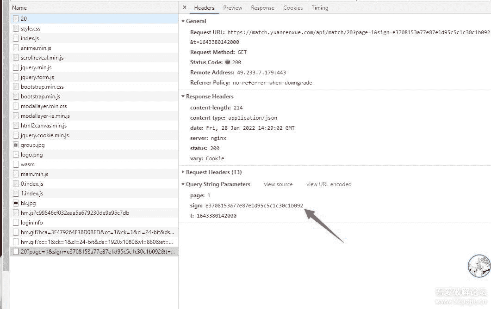

看到参数中有一个`sign`，通过调用堆栈，很容易找到其是调用`sign`函数计算的结果

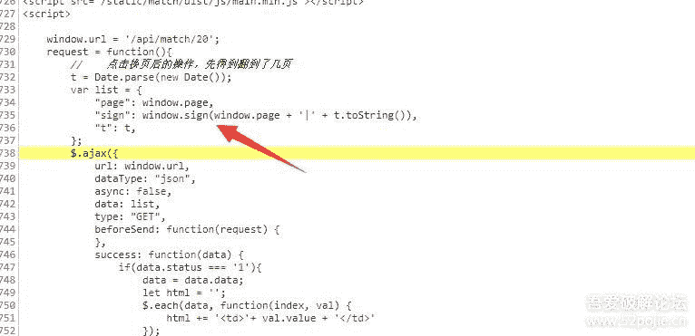

打断点后跟入，发现是调用`wasm`的导出函数

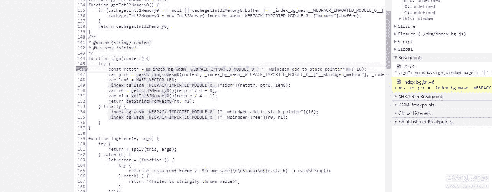

搜索`wasm`下载，转成`c`文件

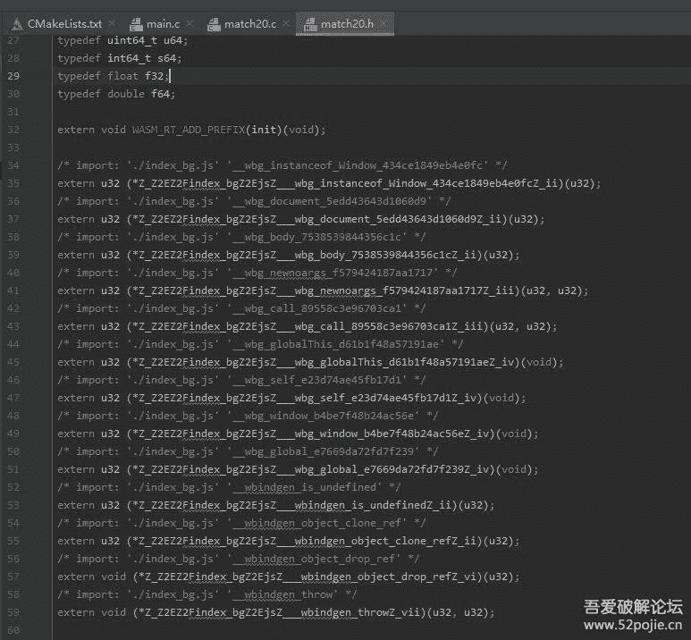

在头文件中，可以看到有很多的导入函数，这里需要实现用到的函数的逻辑，最粗暴的方法是在所有的导入函数下断点，哪个运行到了就补哪一个

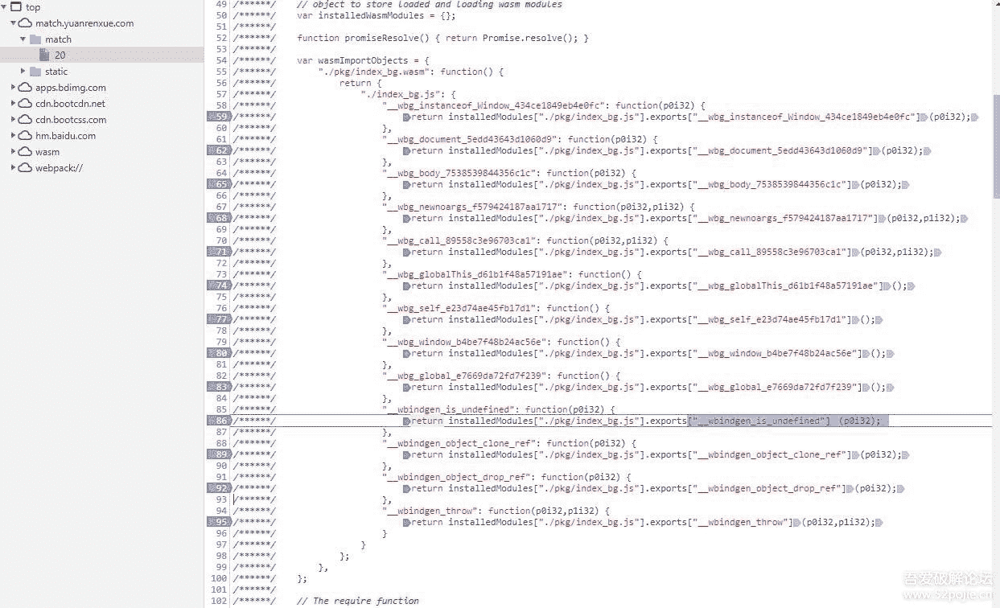

例如这里调用了导入函数`__wbindgen_is_undefined`，根据`js`逻辑，就可以直接改为

```c
u32 wbindgen_is_undefined(u32 p0i32){
    return 0;
}
```

其他的如此类推，一直没有执行过的就直接赋值`NULL`即可，完整代码如下

```c
u32 wbg_self_e23d74ae45fb17d1(void){
    return 36;
}
u32 wbindgen_object_clone_ref(u32 p0i32){
    return p0i32 + 1;
};
u32 wbindgen_is_undefined(u32 p0i32){
    return 0;
}
u32 wbg_instanceof_Window_434ce1849eb4e0fc(u32 p0i32){
    return 1;
}
u32 wbg_document_5edd43643d1060d9(u32 p0i32){
    return p0i32 + 1;
};
u32 wbg_body_7538539844356c1c(u32 p0i32){
    return p0i32 + 1;
};
void wbindgen_object_drop_ref(u32 p0i32){
}
u32 (*Z_Z2EZ2Findex_bgZ2EjsZ___wbg_instanceof_Window_434ce1849eb4e0fcZ_ii)(u32) = wbg_instanceof_Window_434ce1849eb4e0fc;
u32 (*Z_Z2EZ2Findex_bgZ2EjsZ___wbg_document_5edd43643d1060d9Z_ii)(u32) = wbg_document_5edd43643d1060d9;
u32 (*Z_Z2EZ2Findex_bgZ2EjsZ___wbg_body_7538539844356c1cZ_ii)(u32) = wbg_body_7538539844356c1c;
u32 (*Z_Z2EZ2Findex_bgZ2EjsZ___wbg_newnoargs_f579424187aa1717Z_iii)(u32, u32) = NULL;
u32 (*Z_Z2EZ2Findex_bgZ2EjsZ___wbg_call_89558c3e96703ca1Z_iii)(u32, u32) = NULL;
u32 (*Z_Z2EZ2Findex_bgZ2EjsZ___wbg_globalThis_d61b1f48a57191aeZ_iv)(void) = NULL;
u32 (*Z_Z2EZ2Findex_bgZ2EjsZ___wbg_self_e23d74ae45fb17d1Z_iv)(void) = wbg_self_e23d74ae45fb17d1;
u32 (*Z_Z2EZ2Findex_bgZ2EjsZ___wbg_window_b4be7f48b24ac56eZ_iv)(void) = NULL;
u32 (*Z_Z2EZ2Findex_bgZ2EjsZ___wbg_global_e7669da72fd7f239Z_iv)(void) = NULL;
u32 (*Z_Z2EZ2Findex_bgZ2EjsZ___wbindgen_is_undefinedZ_ii)(u32) = wbindgen_is_undefined;
u32 (*Z_Z2EZ2Findex_bgZ2EjsZ___wbindgen_object_clone_refZ_ii)(u32) = wbindgen_object_clone_ref;
void (*Z_Z2EZ2Findex_bgZ2EjsZ___wbindgen_object_drop_refZ_vi)(u32) = wbindgen_object_drop_ref;
void (*Z_Z2EZ2Findex_bgZ2EjsZ___wbindgen_throwZ_vii)(u32, u32) = NULL;
```

这样就完成了所有的导入函数，接下来就是写自己的导出函数

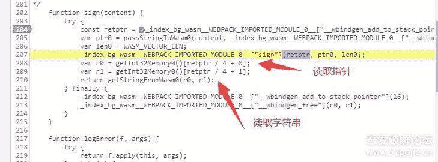

这里函数调用后，得到的是一个二级指针，要得到最终的字符串，需要先读取一次指针，再读取字符串，完整代码入下

```c
#include 
#include 
#include "match20.c"

extern void init_wasm(void);
extern char* get_sign(char*);

void init_wasm(){
    init_func_types();
    init_globals();
    init_memory();
    init_table();
    init_exports();
}

char* get_sign(char* content){
    u32 retptr = w2c___wbindgen_add_to_stack_pointer(-16);
    int content_len = (int)strlen(content);
    u32 content_ptr = w2c___wbindgen_malloc( content_len + 1);
    memcpy(w2c_memory.data + content_ptr, content, content_len + 1);
    w2c_sign(retptr, content_ptr, content_len);
    int out_ptr = 0;
    out_ptr += (w2c_memory.data + retptr)[0];
    out_ptr += (w2c_memory.data + retptr)[1];
```

然后编译为`dll`进行调用

```
"D:/MinGW64/bin/gcc" -shared -Os -s -o match20.dll main.c wasm-rt-impl.c
```

然后尝试在`python`中进行调用

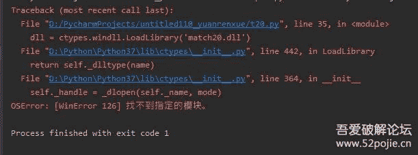

非常诡异的错误，目录下明明有这个文件，却显示找不到模块，如果有大佬知道是为什么，麻烦在评论区回复一下我，先谢谢了。

既然`dll`没法调用，`exe`总归能调用，那么也可以通过命令行来传参，调用`exe`获取结果。`main`函数中提供了两个参数来接受命令行参数。`argc`和`argv`，一个是命令行参数的长度，一个是命令行参数列表，完整代码如下

```c
int main(int argc,char *argv[]) {
    init_wasm();
    char* content = argv[1];

    u32 retptr = w2c___wbindgen_add_to_stack_pointer(-16);
    int content_len = (int)strlen(content);
    u32 content_ptr = w2c___wbindgen_malloc( content_len + 1);
    memcpy(w2c_memory.data + content_ptr, content, content_len + 1);
    w2c_sign(retptr, content_ptr, content_len);
    int out_ptr = 0;
    out_ptr += (w2c_memory.data + retptr)[0];
    out_ptr += (w2c_memory.data + retptr)[1];
```

这次编译的是为`exe`

```
"D:/MinGW64/bin/gcc" -o match20 main.c wasm-rt-impl.c
```

把生成的`exe`放到`py`文件同目录下

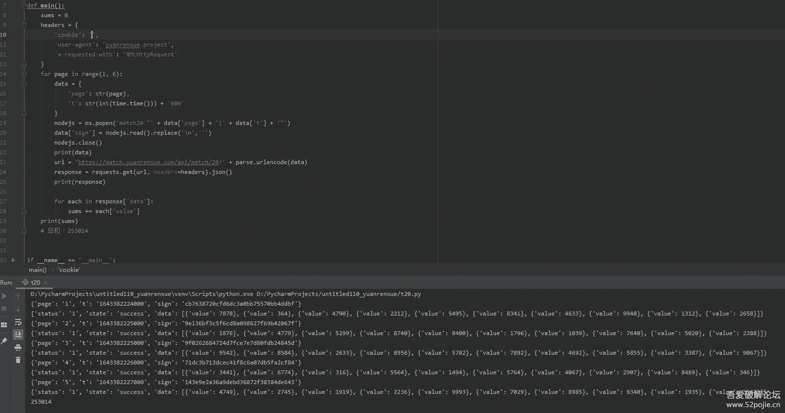

完美得到结果


## 案例一：`match20` 数据获取

```python
import requests
import time
import os
from urllib import parse

def main():
    sums = 0
    headers = {
        'cookie': '',
        'user-agent': 'yuanrenxue.project',
        'x-requested-with': 'XMLHttpRequest'
    }
    for page in range(1, 6):
        data = {
            'page': str(page),
            't': str(int(time.time())) + '000'
        }
        nodejs = os.popen('match20 "' + data['page'] + '|' + data['t'] + '"')
        data['sign'] = nodejs.read().replace('\n', '')
        nodejs.close()
        print(data)
        url = 'https://match.yuanrenxue.com/api/match/20?' + parse.urlencode(data)
        response = requests.get(url, headers=headers).json()
        print(response)

        for each in response['data']:
            sums += each['value']
    print(sums)
    # 总和：253014

if __name__ == '__main__':
    main()
```


`9.png`（99.08 KB，下载次数：269），2024-10-11 17:18 上传；[附件下载](https://www.52pojie.cn/forum.php?mod=attachment&aid=MjcyNzg4M3xhY2YwZTMyZnwxNzkzNTc2MjgyfDE2ODA4NnwxNTgxODg3&nothumb=yes)

### `dll` 调用修复

在 6 楼 Frhvjhhv 大佬提到的，是因为缺少引用的 `dll` 文件，使用 `Depends` 查看编译出来的 `dll`。

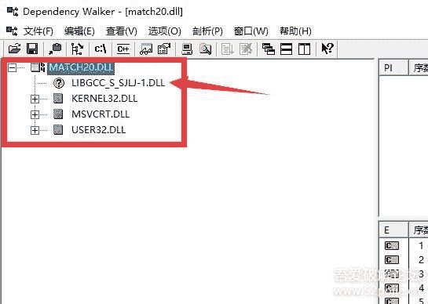

`10.png`（31.39 KB，下载次数：272），2024-10-11 17:18 上传；[附件下载](https://www.52pojie.cn/forum.php?mod=attachment&aid=MjcyNzg4NHwzMDA0NTc0YXwxNzkzNTc2MjgyfDE2ODA4NnwxNTgxODg3&nothumb=yes)

可以看到，确实缺少了一个 `libgcc_s_sjlj-1.dll`。这个 `dll` 可以在 `gcc` 目录下找到【`D:\MinGW64\x86_64-w64-mingw32\lib`】，把缺少的 `dll` 复制到编译出来的 `dll` 同目录下。再次尝试调用 `dll`。

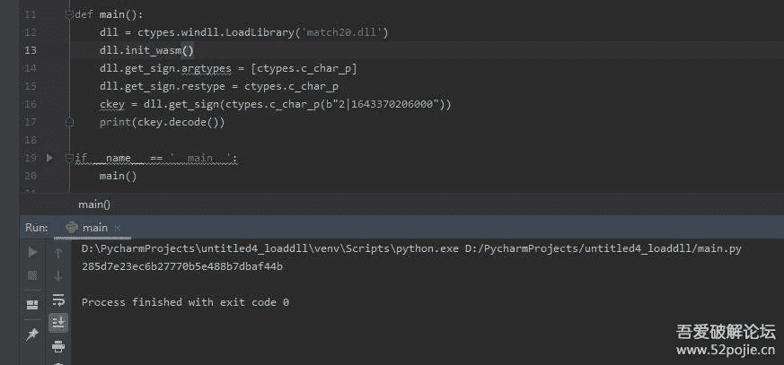

`11.png`（37.31 KB，下载次数：277），2024-10-11 17:19 上传；[附件下载](https://www.52pojie.cn/forum.php?mod=attachment&aid=MjcyNzg4NXwwNzE1YjFhMHwxNzkzNTc2MjgyfDE2ODA4NnwxNTgxODg3&nothumb=yes)

调用成功，测试也可以成功获取数据。

```python
import ctypes

def main():

    dll = ctypes.windll.LoadLibrary('match20.dll')

    dll.init_wasm()

    dll.get_sign.argtypes = [ctypes.c_char_p]

    dll.get_sign.restype = ctypes.c_char_p

    ckey = dll.get_sign(ctypes.c_char_p(b"2|1643370206000"))

    print(ckey.decode())

if __name__ == '__main__':

    main()
```

## 案例二：某讯视频 `ckey` 参数获取

样品地址：`aHR0cHM6Ly92LnFxLmNvbS94L2NvdmVyL216YzAwMjAwbXA4dm85Yi9uMDA0MWFhMDg3ZS5odG1s`

新学习的知识：

- 导入数值处理
- 带有闭包的导入函数环境检测处理

大部分 js 分析的过程在前置阅读的第四篇已经有详细介绍，就不多说了，这里直接进入 wasm 的内容。

创建完项目后，根据文章中的代码，导入函数中除了 `getTotalMemory` 和 `_get_unicode_str`，其他都可以直接给 `NULL`，具体怎么补后面说。

然后是导入内存和导入表，前置阅读的第三篇已经详细介绍过，这里就跳过。

最后是导入数值，导入数值比较暴力，首先设置为 `NULL`。

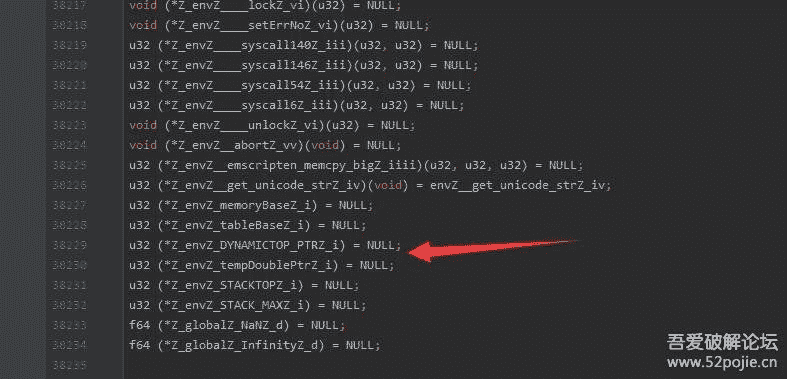

`12.png`（50.73 KB，下载次数：272），2024-10-11 17:19 上传；[附件下载](https://www.52pojie.cn/forum.php?mod=attachment&aid=MjcyNzg4NnwxNzY4YWFjMXwxNzkzNTc2MjgyfDE2ODA4NnwxNTgxODg3&nothumb=yes)

然后在所有引用到的地方修改为导入的数值。

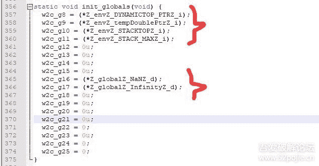

`13.png`（39.84 KB，下载次数：270），2024-10-11 17:19 上传；[附件下载](https://www.52pojie.cn/forum.php?mod=attachment&aid=MjcyNzg4N3wyMDYwMjkyNnwxNzkzNTc2MjgyfDE2ODA4NnwxNTgxODg3&nothumb=yes)

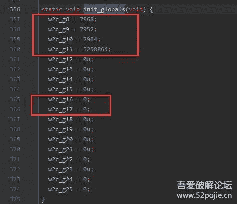

`14.png`（25.47 KB，下载次数：285），2024-10-11 17:19 上传；[附件下载](https://www.52pojie.cn/forum.php?mod=attachment&aid=MjcyNzg4OHw0ZWRlOTE3M3wxNzkzNTc2MjgyfDE2ODA4NnwxNTgxODg3&nothumb=yes)

这样导入数值就处理完了，最后就是上面留下的两个导入函数。

`getTotalMemory` 比较简单，在 js 中可以看到返回的是一个定值：

```c
u32 envZ_getTotalMemoryZ_iv(void){
  return 16777216;
}
```

`_get_unicode_str` 比较麻烦，它的 js 函数如下：

```javascript
function P() {

    function a(a) {

        return a ? a.length > 48 ? a.substr(0, 48) : a : ""

    }

    function b() {

        var b = document.URL

          , c = window.navigator.userAgent.toLowerCase()

          , d = "";

        document.referrer.length > 0 && (d = document.referrer);

        try {

            0 == d.length && opener.location.href.length > 0 && (d = opener.location.href)

        } catch (e) {}

        var f = window.navigator.appCodeName

          , g = window.navigator.appName

          , h = window.navigator.platform;

        return b = a(b),

        d = a(d),

        c = a(c),

        b + "|" + c + "|" + d + "|" + f + "|" + g + "|" + h

    }

    var c = b()

      , d = p(c) + 1

      , e = Pb(d);

    return o(c, e, d + 1),

    e

}
```

可以看到其通过闭包获取了 `document.URL` 和 `window.navigator` 等等的值。那么这里尽量把可以写死的值写死，`document.URL` 只能够传进去，那么怎么解决？

那么可以在函数外面定义一个变量，然后再调用之前给这个变量赋值，代码如下：

```c
char *url;

void set_url(char *url_str){
    url = url_str;
}

u32 envZ__get_unicode_strZ_iv(void){
  int c_len = (int)strlen(url);
  u32 e = w2c__malloc(c_len + 75);
  memcpy(w2c_memory.data + e, url, c_len);
  memcpy(w2c_memory.data + e + c_len, "|mozilla/5.0 (windows nt 10.0; wow64) applewebkit||Mozilla|Netscape|Win32", 73);
  return e;
}
```

这样就可以曲线处理闭包的参数，完整的导入函数处理如下：

```c
static wasm_rt_memory_t w2c_memory;
static wasm_rt_table_t w2c___indirect_function_table;

char *url;

void set_url(char *url_str){
    url = url_str;
}

u32 envZ__get_unicode_strZ_iv(void){
  int c_len = (int)strlen(url);
  u32 e = w2c__malloc(c_len + 75);
  memcpy(w2c_memory.data + e, url, c_len);
  memcpy(w2c_memory.data + e + c_len, "|mozilla/5.0 (windows nt 10.0; wow64) applewebkit||Mozilla|Netscape|Win32", 73);
  return e;
}

u32 envZ_getTotalMemoryZ_iv(void){
return 16777216;
}

wasm_rt_memory_t (*Z_envZ_memory) = &w2c_memory;
wasm_rt_table_t (*Z_envZ_table) = &w2c___indirect_function_table;
u32 (*Z_envZ_enlargeMemoryZ_iv)(void) = NULL;
u32 (*Z_envZ_getTotalMemoryZ_iv)(void) = envZ_getTotalMemoryZ_iv;
u32 (*Z_envZ_abortOnCannotGrowMemoryZ_iv)(void) = NULL;
void (*Z_envZ_abortStackOverflowZ_vi)(u32) = NULL;
void (*Z_envZ_nullFunc_iiZ_vi)(u32) = NULL;
void (*Z_envZ_nullFunc_iiiiZ_vi)(u32) = NULL;
void (*Z_envZ_nullFunc_vZ_vi)(u32) = NULL;
void (*Z_envZ_nullFunc_viZ_vi)(u32) = NULL;
void (*Z_envZ_nullFunc_viiiiZ_vi)(u32) = NULL;
void (*Z_envZ_nullFunc_viiiiiZ_vi)(u32) = NULL;
void (*Z_envZ_nullFunc_viiiiiiZ_vi)(u32) = NULL;
void (*Z_envZ____lockZ_vi)(u32) = NULL;
void (*Z_envZ____setErrNoZ_vi)(u32) = NULL;
u32 (*Z_envZ____syscall140Z_iii)(u32, u32) = NULL;
u32 (*Z_envZ____syscall146Z_iii)(u32, u32) = NULL;
u32 (*Z_envZ____syscall54Z_iii)(u32, u32) = NULL;
u32 (*Z_envZ____syscall6Z_iii)(u32, u32) = NULL;
void (*Z_envZ____unlockZ_vi)(u32) = NULL;
void (*Z_envZ__abortZ_vv)(void) = NULL;
u32 (*Z_envZ__emscripten_memcpy_bigZ_iiii)(u32, u32, u32) = NULL;
u32 (*Z_envZ__get_unicode_strZ_iv)(void) = envZ__get_unicode_strZ_iv;
u32 (*Z_envZ_memoryBaseZ_i) = NULL;
u32 (*Z_envZ_tableBaseZ_i) = NULL;
u32 (*Z_envZ_DYNAMICTOP_PTRZ_i) = NULL;
u32 (*Z_envZ_tempDoublePtrZ_i) = NULL;
u32 (*Z_envZ_STACKTOPZ_i) = NULL;
u32 (*Z_envZ_STACK_MAXZ_i) = NULL;
f64 (*Z_globalZ_NaNZ_d) = NULL;
f64 (*Z_globalZ_InfinityZ_d) = NULL;
```

接着可以写自己的导出函数，这时就没有什么难度了，都前面说过的。


## C 实现代码

```
#include 
#include 
#include "txckey91.c"

extern void init_wasm(void);
extern char* get_ckey(int, char*, char*, char*, char*, char*, int);

void init_wasm(){
    init_func_types();
    init_globals();
    init_memory();
    init_table();
    init_exports();
}

char* get_ckey(int platform, char* url_str, char* appVer, char* vid, char* empty_str, char* guid, int tm){
    set_url(url_str);
    int appVer_len = (int)strlen(appVer);
    u32 appVer_ptr = w2c__malloc( appVer_len + 1);
    memcpy(w2c_memory.data + appVer_ptr, appVer, appVer_len + 1);
    int vid_len = (int)strlen(vid);
    u32 vid_ptr = w2c__malloc( vid_len + 1);
    memcpy(w2c_memory.data + vid_ptr, vid, vid_len + 1);
    int empty_str_len = (int)strlen(empty_str);
    u32 empty_str_ptr = w2c__malloc( empty_str_len + 1);
    memcpy(w2c_memory.data + empty_str_ptr, empty_str, empty_str_len + 1);
    int guid_len = (int)strlen(guid);
    u32 guid_ptr = w2c__malloc( guid_len + 1);
    memcpy(w2c_memory.data + guid_ptr, guid, guid_len + 1);
    u32 out_ptr = w2c__getckey(platform, appVer_ptr, vid_ptr, empty_str_ptr, guid_ptr, tm);
    char* out_str = (char *)malloc(512);
    memcpy(out_str, w2c_memory.data + out_ptr, 512);

    w2c__free(appVer_ptr);
    w2c__free(vid_ptr);
    w2c__free(empty_str_ptr);
    w2c__free(guid_ptr);

    return out_str;
}

int main(int argc,char *argv[]) {
    return 0;
}
```

## 编译文件为 dll

```
"D:/MinGW64/bin/gcc" -shared -Os -s -o txckey91.dll main.c wasm-rt-impl.c
```

## 尝试在 python 中调用

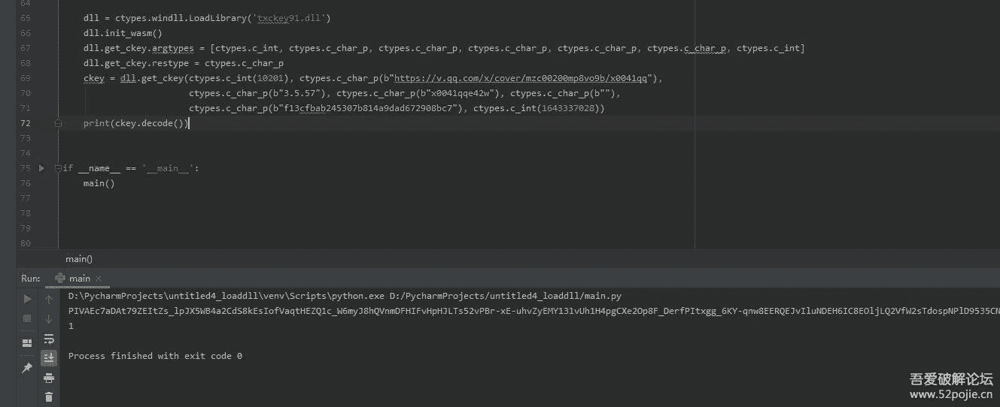

15.png (68.08 KB, 下载次数: 277)

[href="forum.php?mod=attachment&aid=MjcyNzg4OXw0YWIzZTM5NHwxNzkzNTc2MjgyfDE2ODA4NnwxNTgxODg3&nothumb=yes" target="_blank"](https://www.52pojie.cn/forum.php?mod=attachment&aid=MjcyNzg4OXw0YWIzZTM5NHwxNzkzNTc2MjgyfDE2ODA4NnwxNTgxODg3&nothumb=yes)

2024-10-11 17:19 上传

运行正常，得出的结果与浏览器结果对比完全一致。完结

## Python 调用示例

```
import ctypes

def main():
    dll = ctypes.windll.LoadLibrary('txckey91.dll')
    dll.init_wasm()
    dll.get_ckey.argtypes = [ctypes.c_int, ctypes.c_char_p, ctypes.c_char_p, ctypes.c_char_p, ctypes.c_char_p, ctypes.c_char_p, ctypes.c_int]
    dll.get_ckey.restype = ctypes.c_char_p
    ckey = dll.get_ckey(ctypes.c_int(10201), ctypes.c_char_p(b"https://v.qq.com/x/cover/mzc00200mp8vo9b/x0041qq"),
                        ctypes.c_char_p(b"3.5.57"), ctypes.c_char_p(b"x0041qqe42w"), ctypes.c_char_p(b""),
                        ctypes.c_char_p(b"f13cfbab245307b814a9dad672908bc7"), ctypes.c_int(1643337028))
    print(ckey.decode())

if __name__ == '__main__':
    main()
```
