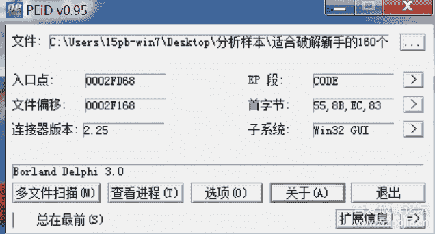
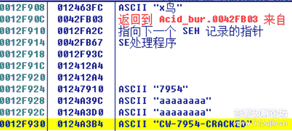
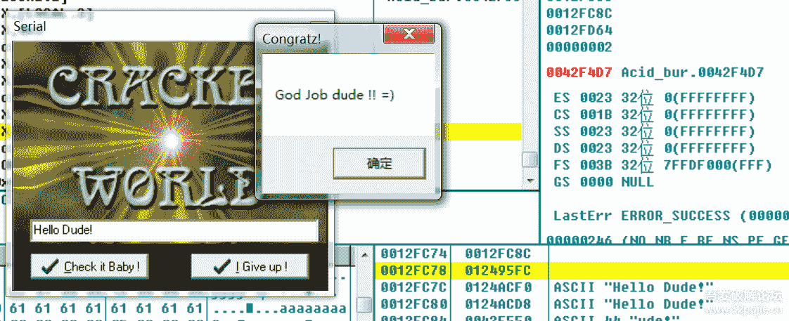
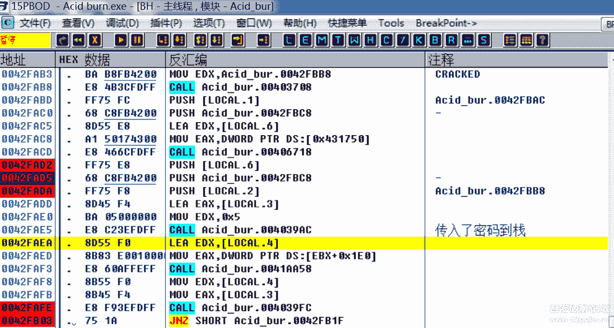
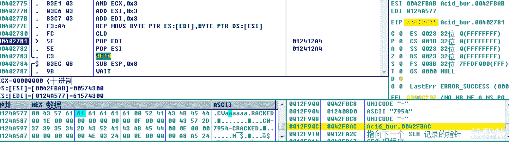

# [CTF] 适合新手的 160 道 Crackme 001

- 原帖：https://www.52pojie.cn/forum.php?mod=viewthread&tid=1585666
- 抓取时间：2026-11-01T23:38:02

## [反汇编练习] 160 个 CrackMe 之 001

本系列文章的目的是从一个没有任何经验的新手的角度（其实就是我自己），一步步尝试将 160 个 CrackMe 全部[//www.52pojie.cn/](https://www.52pojie.cn/)，如果可以，通过任何方式写出一个类似于注册机的东西。

其中，文章中按照如下逻辑编排（解决如下问题）：（这部分直接引用的）

## 我的[//www.52pojie.cn](https://www.52pojie.cn)方法

### 1. 用 `PEid` 查看 `PE` 文件的类型

`1.png`（63.54 KB，下载次数：0）

[查看附件](https://www.52pojie.cn/forum.php?mod=attachment&aid=MjQ4ODU4OXwwN2ZiM2U4ZnwxNzkzNTc2MjgwfDE2ODA4NnwxNTg1NjY2&nothumb=yes)

2022-2-10 19:21 上传

很明显这个文件是 `delphi`、`win32` 的 `GUI` 程序。现在我还不太清楚这个程序主函数入口在哪，应该是有特征的。所以我先输入尝试一下。

### 2. 输入 `aaaaaaa`、`aaaaaa` 尝试一下

这个图我不贴了，主要就是到栈里看一下它是怎么调用输入的。当然在这在它输出结果之前设置个断点。结果我发现，正确的密码直接明文在栈里。

`2.png`（38.07 KB，下载次数：0）

[查看附件](https://www.52pojie.cn/forum.php?mod=attachment&aid=MjQ4ODU5MHxlMzUwMGQwOXwxNzkzNTc2MjgwfDE2ODA4NnwxNTg1NjY2&nothumb=yes)

2022-2-10 19:21 上传

于是我又用相同的办法测试了里面的另一题，套路完全相同。

`5.png`（246.21 KB，下载次数：0）

[查看附件](https://www.52pojie.cn/forum.php?mod=attachment&aid=MjQ4ODU5M3w5M2QwZTVmOHwxNzkzNTc2MjgwfDE2ODA4NnwxNTg1NjY2&nothumb=yes)

2022-2-10 19:21 上传

## 3. 注意的地方

第一个要输入用户名的地方，其实汇编代码应该被修改过，里面有一处跳转很奇怪，就是说任意用户名都可以通过。大家可以自己找找。下面是 `OD` 分析的图。

`6.png`（163.4 KB，下载次数：0）

[查看附件](https://www.52pojie.cn/forum.php?mod=attachment&aid=MjQ4ODU5NHw2N2ZmZjJjM3wxNzkzNTc2MjgwfDE2ODA4NnwxNTg1NjY2&nothumb=yes)

2022-2-10 19:37 上传

`4.png`（95.24 KB，下载次数：0）

[查看附件](https://www.52pojie.cn/forum.php?mod=attachment&aid=MjQ4ODU5MnwwZjUzYTBlZHwxNzkzNTc2MjgwfDE2ODA4NnwxNTg1NjY2&nothumb=yes)

2022-2-10 19:21 上传

写的比较随意，请各位不要介意。这道题主要的技巧我觉得就是学会看栈区信息。
