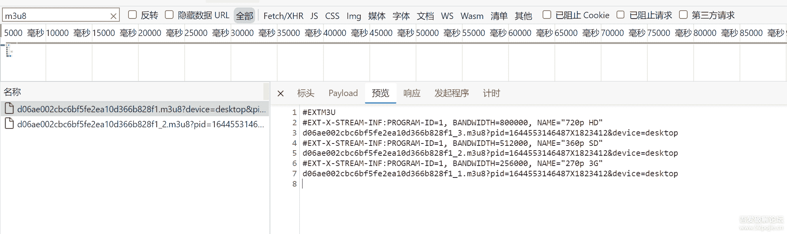
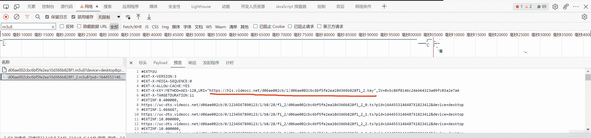
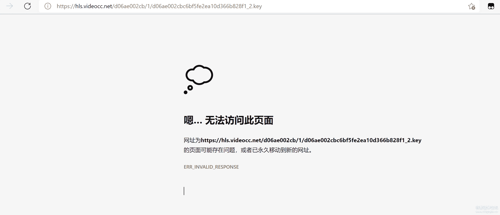
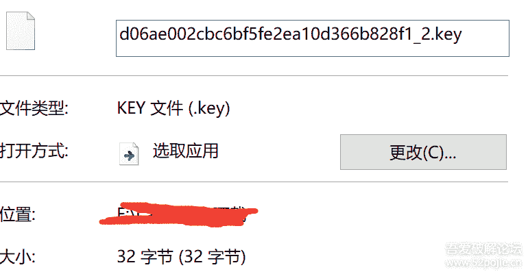
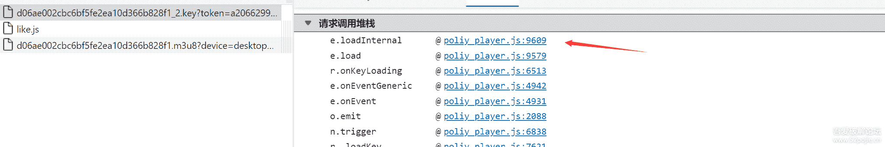
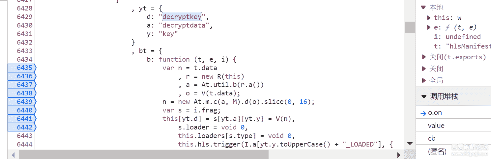
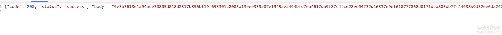

# [Web逆向] 破解某网课的m3u8文件的key加密

- 原帖: https://www.52pojie.cn/forum.php?mod=viewthread&tid=1585958
- 抓取时间: 2026-11-01T23:38:01

## 1. 首先，找到 `m3u8` 文件
首先，找到`m3u8`文件打开开发者工具，在搜索栏中搜索`m3u8`，可以看到两个链接



一个链接其中有三个清晰度不同多的`m3u8`的文件，下面的一个链接就是我们加载的`m3u8`的文件



这里可以看到，他是使用的`AES-128`加密，秘钥链接和`iv`值都给出了。但是事情真的那么简单吗？

## 2. 进入 `key` 的链接


发现无法访问这个链接。看来`key`的链接是加密了。搜索`key`，可以看到，`key`的链接确实是加密了，后面加了个`token`。我们请求一下这个链接看看



得到了一个32字节的文件，但是按照道理来说，这个文件应该是16字节的才对。看来这个`key`是加密过的。没办法，只能去看`js`了。

## 3. 在 `js` 里寻找解密
可以看到这个请求都是从`poliy player`里面发出来的，那我们进入`js`里面看看。因为是`aes`加密，所以搜索一下`decrypt`，找到了这个函数。



这个`bt`函数就是`key`的解密了。这个函数看起来很熟悉，这不正是某利威加密吗？那既然这样，就好解决了。



## 4. 按照某利威的方式来解密
按照某利威的方式来解密某利威加密就是会有个`json`文件，取其中的`seed_const`进行`MD5`加密，取前16位作为`key`，`iv`是固定的`AQIDBQcLDRETFx0HBQMCAQ==`（`base64`编码后的，自己去解码）。现在`key`有了，`iv`也有了，对加密的`key`文件进行解密，获取真的`key`。但是，前面还有一个问题就是这个`json`也是加密了的。



## 5. 先解密 `json`
`json`解密的话就是一利用`vid`就行`md5`加密，取前16位为`key`，后16位为`iv`进行解密。`vid`就是


就是视频链接后面的参数。解密后的结果转为字符串再通过`base64`解码, 最后将字符串通过`json`转换为对象。其中的`seed_const`就是我们要的参数了。

## 6. 进行解密
```python
import os
from Crypto.Cipher import AES
import base64

filename = '1.key.txt'

# 把文件内容以byte字节形式读写到缓冲区中。
def read_into_buffer(filename):
    buf = bytearray(os.path.getsize(filename))
    with open(filename, 'rb') as f:
        f.readinto(buf)
        f.close()
    return buf

print(list(read_into_buffer(filename)))

password = 'b1d10e7bafa44212'.encode() #秘钥，b就是表示为bytes类型
iv = base64.b64decode('AQIDBQcLDRETFx0HBQMCAQ==') # iv偏移量，bytes类型
text = read_into_buffer(filename) #需要加密的内容，bytes类型

# AES.MODE_CBC 表示模式是CBC模式
aes = AES.new(password,AES.MODE_CBC,iv) #CBC模式下解密需要重新创建一个aes对象
den_text = aes.decrypt(text)

print("明文：",list(den_text))

keys = list(den_text)

hex16 = []
for i in keys[:16]:
    hex16.append(i)

def print_bytes_hex(data):
    lin = ['%02X' % i for i in data]
    print(" ".join(lin))

print_bytes_hex(hex16)
```
获取到`key`，就拿着`key`和`m3u8`里面的`iv`偏移量进行解密下载。ok，就这样了。
