# [CTF] 【2022春节】解题领红包之三 Windows 中级题

- 原帖: https://www.52pojie.cn/forum.php?mod=viewthread&tid=1588444
- 抓取时间: 2026-11-01T23:36:24

第一次完成Windows 中级题的逆向，用了数天，IDA的伪代码着实看得头大。

本文适合于小白，文章思路及观点仅供参考。多图预警！！！

首先查壳，拖入查壳工具

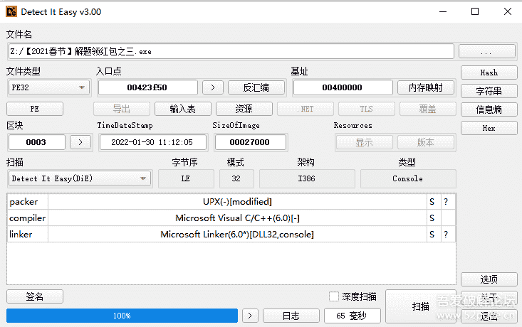

图片1.png (31.44 KB, 下载次数: 2) [附件](https://www.52pojie.cn/forum.php?mod=attachment&aid=MjQ5NTA1NnxmNTdjYTlkZHwxNzkzNTc2MTgyfDE2ODA4NnwxNTg4NDQ0&nothumb=yes)

die查壳

2022-2-16 07:39 上传

很显然是UPX压缩壳，尝试`upx -d`命令，失败

手动脱壳。`ESP`定律载入OD，可以很明显地看到一个`PUSHAD`

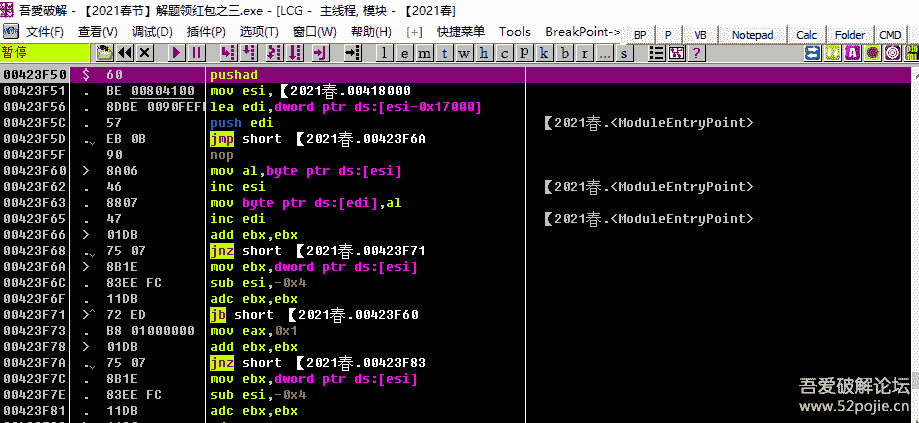

图片2.png (39.56 KB, 下载次数: 2) [附件](https://www.52pojie.cn/forum.php?mod=attachment&aid=MjQ5NTA1N3xiYmQxYWEyZXwxNzkzNTc2MTgyfDE2ODA4NnwxNTg4NDQ0&nothumb=yes)

2022-2-16 07:40 上传

F8单步，`ESP`变红，直接使用插件下硬件断点

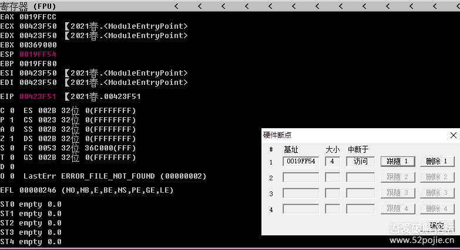

图片3.png (22.49 KB, 下载次数: 1) [附件](https://www.52pojie.cn/forum.php?mod=attachment&aid=MjQ5NTA1OXwwYjAyMGY0YnwxNzkzNTc2MTgyfDE2ODA4NnwxNTg4NDQ0&nothumb=yes)

2022-2-16 07:41 上传

F9运行

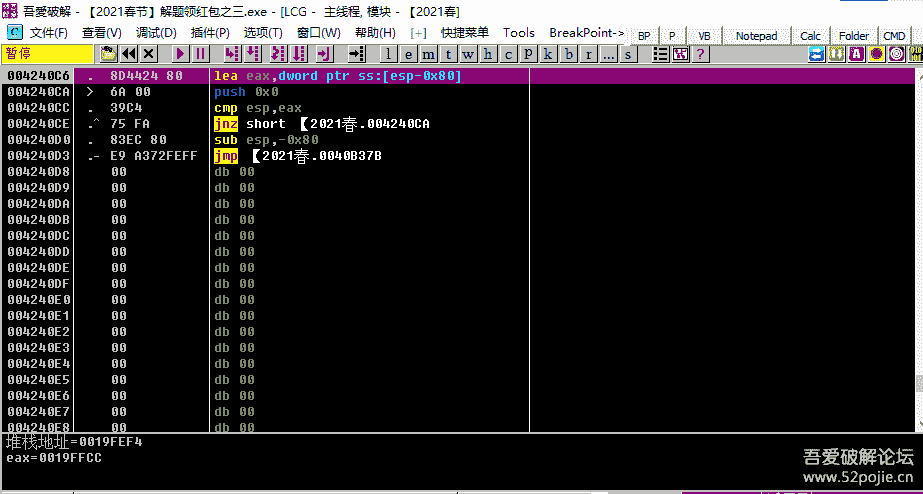

图片4.png (35.91 KB, 下载次数: 2) [附件](https://www.52pojie.cn/forum.php?mod=attachment&aid=MjQ5NTA2MHxlZWJhZTZkZXwxNzkzNTc2MTgyfDE2ODA4NnwxNTg4NDQ0&nothumb=yes)

2022-2-16 07:41 上传

删除前面下的硬件断点，F8单步跳过一个循环，或选中`sub esp,-0x80`，按F4运行到选中位置，再一直单步到OEP

用OllyDump脱壳

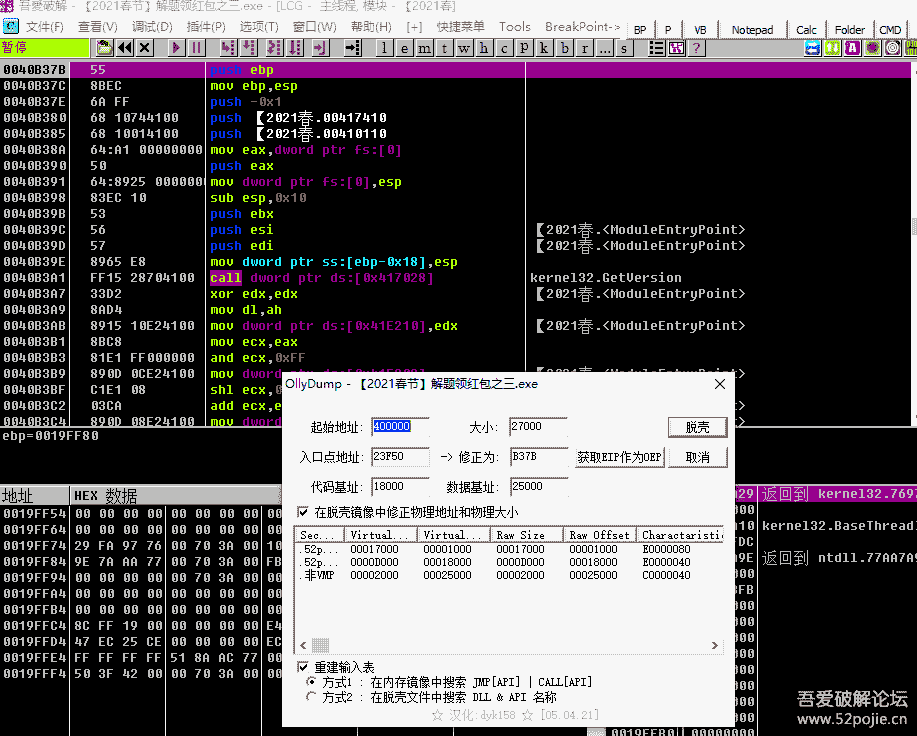

图片5.png (65.51 KB, 下载次数: 1) [附件](https://www.52pojie.cn/forum.php?mod=attachment&aid=MjQ5NTA2MXw0ZGQ4MTAwOXwxNzkzNTc2MTgyfDE2ODA4NnwxNTg4NDQ0&nothumb=yes)

2022-2-16 07:42 上传

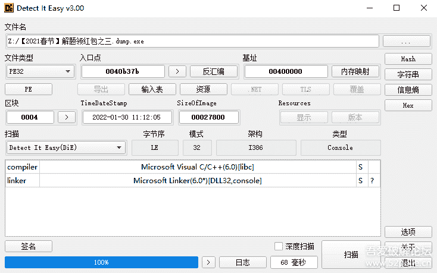

图片6.png (30.06 KB, 下载次数: 1) [附件](https://www.52pojie.cn/forum.php?mod=attachment&aid=MjQ5NTA2MnxiODVkYzBiZHwxNzkzNTc2MTgyfDE2ODA4NnwxNTg4NDQ0&nothumb=yes)

2022-2-16 07:42 上传

能直接打开，脱壳完成

IDA打开，F5查看伪代码

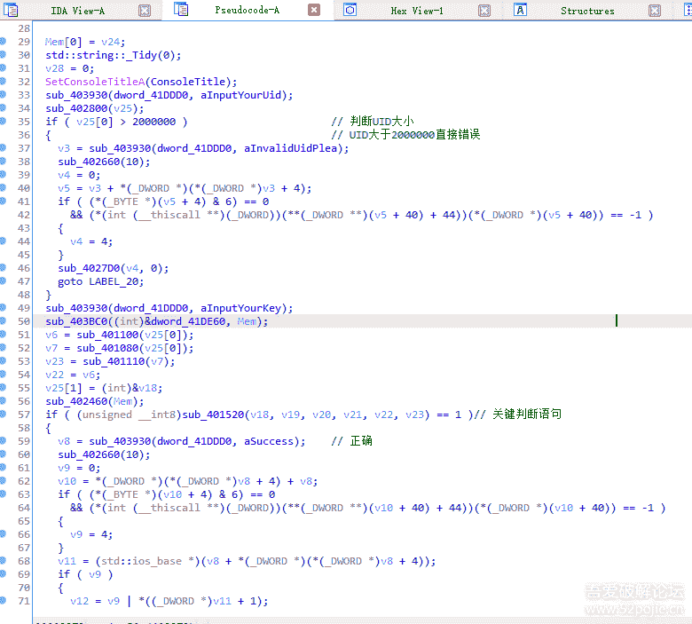

图片7.png (73.43 KB, 下载次数: 1) [附件](https://www.52pojie.cn/forum.php?mod=attachment&aid=MjQ5NTA2M3xjOTdjOTNmZHwxNzkzNTc2MTgyfDE2ODA4NnwxNTg4NDQ0&nothumb=yes)

2022-2-16 07:43 上传

静态分析，由于伪代码看得极其头疼，只能大致找找，算法分析甚至还原就放弃了。

找到关键判断语句

进入`sub_401520`函数

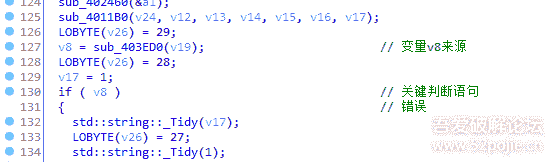

图片8.png (21.62 KB, 下载次数: 0) [附件](https://www.52pojie.cn/forum.php?mod=attachment&aid=MjQ5NTA2NHxmYzgzOTg5YXwxNzkzNTc2MTgyfDE2ODA4NnwxNTg4NDQ0&nothumb=yes)

2022-2-16 07:44 上传

一些字符串处理，找到关键判断语句

进入`sub_403ED0`函数

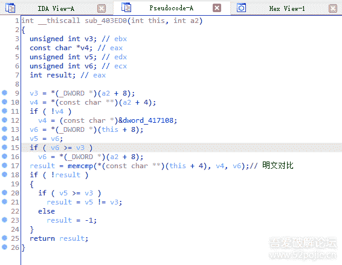

图片9.png (38.73 KB, 下载次数: 2) [附件](https://www.52pojie.cn/forum.php?mod=attachment&aid=MjQ5NTA2NXwxMWUwNjJiNnwxNzkzNTc2MTgyfDE2ODA4NnwxNTg4NDQ0&nothumb=yes)

2022-2-16 07:44 上传

很明显是明文比较。回到IDA View-A，通过`Synchronize with`找到`memcmp`指令位置

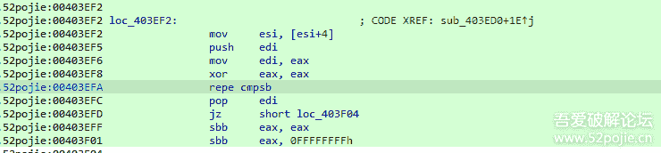

图片10.png (25.67 KB, 下载次数: 1) [附件](https://www.52pojie.cn/forum.php?mod=attachment&aid=MjQ5NTA2Nnw2ZjQzNDkwY3wxNzkzNTc2MTgyfDE2ODA4NnwxNTg4NDQ0&nothumb=yes)

2022-2-16 07:45 上传

很明显的`repe cmpsb`指令，地址`0x403EFA`。OD载入，翻到`0x403EFA`，或者Ctrl+F查找`repe cmpsb`

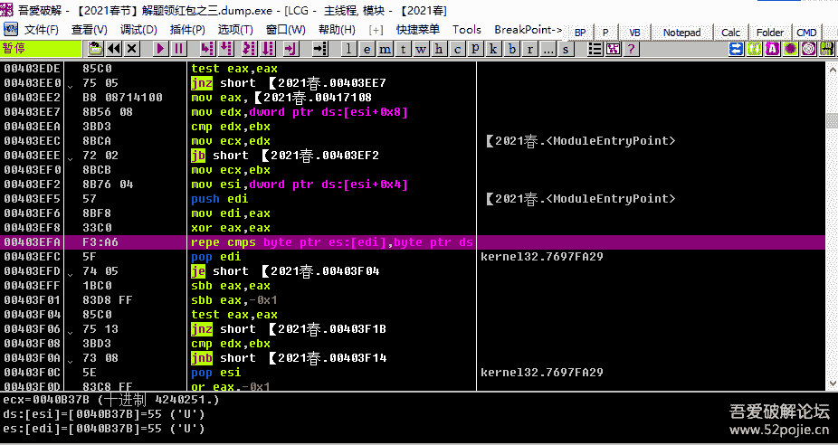

图片11.png (42.29 KB, 下载次数: 1) [附件](https://www.52pojie.cn/forum.php?mod=attachment&aid=MjQ5NTA2N3xkZjlhNjM1ZHwxNzkzNTc2MTgyfDE2ODA4NnwxNTg4NDQ0&nothumb=yes)

2022-2-16 07:45 上传

在该指令处F2下断，F9执行

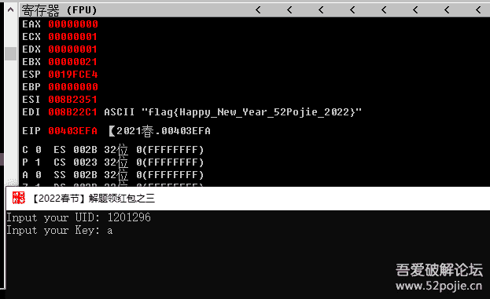

图片12.png (16.02 KB, 下载次数: 1) [附件](https://www.52pojie.cn/forum.php?mod=attachment&aid=MjQ5NTA2OHwwMDQyMmM2MHwxNzkzNTc2MTgyfDE2ODA4NnwxNTg4NDQ0&nothumb=yes)

2022-2-16 07:46 上传

很明显的`flag{Happy_New_Year_52Pojie_2022}`。把`flag{Happy_New_Year_52Pojie_2022}`作为Key再试

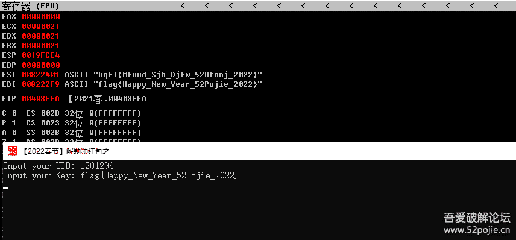

图片13.png (17.68 KB, 下载次数: 1) [附件](https://www.52pojie.cn/forum.php?mod=attachment&aid=MjQ5NTA2OXwyNzQ2OTA0NnwxNzkzNTc2MTgyfDE2ODA4NnwxNTg4NDQ0&nothumb=yes)

2022-2-16 07:46 上传

处理过后的字符串，符号位、数字位不变。把`aaaa{aaaaa_aaa_aaaa_52aaaaa_2022}`作为Key再试

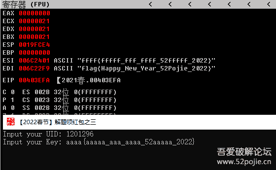

图片14.png (15.86 KB, 下载次数: 2) [附件](https://www.52pojie.cn/forum.php?mod=attachment&aid=MjQ5NTA3MXxiZTA1YmM0MHwxNzkzNTc2MTgyfDE2ODA4NnwxNTg4NDQ0&nothumb=yes)

2022-2-16 07:47 上传

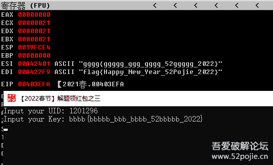

图片15.png (14.8 KB, 下载次数: 1) [附件](https://www.52pojie.cn/forum.php?mod=attachment&aid=MjQ5NTA3Mnw1YThmYWIxN3wxNzkzNTc2MTgyfDE2ODA4NnwxNTg4NDQ0&nothumb=yes)

2022-2-16 07:47 上传

多次尝试，可以看出是字符偏移变换，并且偏移量与大小写和位置无关，根据偏移量还原字符串(UID不同，偏移量不相同)

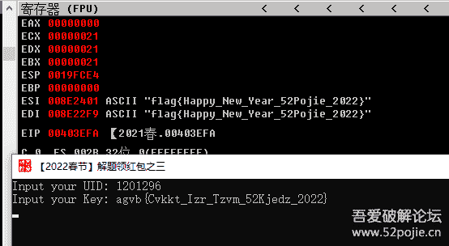

图片16.png (15.82 KB, 下载次数: 0) [附件](https://www.52pojie.cn/forum.php?mod=attachment&aid=MjQ5NTA3M3wzNjU4NzBhMnwxNzkzNTc2MTgyfDE2ODA4NnwxNTg4NDQ0&nothumb=yes)

2022-2-16 07:48 上传

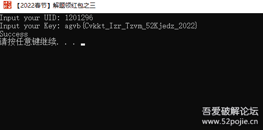

图片17.png (11.08 KB, 下载次数: 0) [附件](https://www.52pojie.cn/forum.php?mod=attachment&aid=MjQ5NTA3NHwxNDE5ZTY2NXwxNzkzNTc2MTgyfDE2ODA4NnwxNTg4NDQ0&nothumb=yes)

2022-2-16 07:48 上传

结果正确

更改UID后，Key发生变化，很显然是根据UID计算一个偏移量，对Key的字母位进行偏移变换后明文对比。
