# [CTF] 【2022春节】解题领红包windows（二、三）和web解题过程

- 原帖: https://www.52pojie.cn/forum.php?mod=viewthread&tid=1588476
- 抓取时间: 2026-11-01T23:36:22

## 解题领红包之二 {Windows 初级题}

查壳，无壳

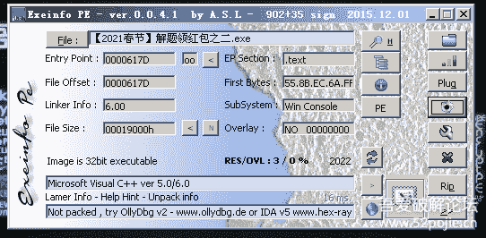

`0.PNG` (120.08 KB, 下载次数: 5)

[href="forum.php?mod=attachment&aid=MjQ5NTA3OXwwMWM5YTRkYXwxNzkzNTc2MTgwfDE2ODA4NnwxNTg4NDc2&nothumb=yes" target="_blank"](https://www.52pojie.cn/forum.php?mod=attachment&aid=MjQ5NTA3OXwwMWM5YTRkYXwxNzkzNTc2MTgwfDE2ODA4NnwxNTg4NDc2&nothumb=yes)

2022-2-16 08:59 上传

运行程序看一下


`1.png` (8.52 KB, 下载次数: 2)

[href="forum.php?mod=attachment&aid=MjQ5NTA4MHw3YzZiZWJlNHwxNzkzNTc2MTgwfDE2ODA4NnwxNTg4NDc2&nothumb=yes" target="_blank"](https://www.52pojie.cn/forum.php?mod=attachment&aid=MjQ5NTA4MHw3YzZiZWJlNHwxNzkzNTc2MTgwfDE2ODA4NnwxNTg4NDc2&nothumb=yes)

2022-2-16 08:59 上传

拖进od，搜字符串，找到please input password，以及附近的tip: flag长度为23

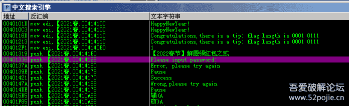

`2.png` (17.74 KB, 下载次数: 1)

[href="forum.php?mod=attachment&aid=MjQ5NTA4MXxjYWE5NGNiZnwxNzkzNTc2MTgwfDE2ODA4NnwxNTg4NDc2&nothumb=yes" target="_blank"](https://www.52pojie.cn/forum.php?mod=attachment&aid=MjQ5NTA4MXxjYWE5NGNiZnwxNzkzNTc2MTgwfDE2ODA4NnwxNTg4NDc2&nothumb=yes)

2022-2-16 08:59 上传

双击please input password，在该处硬件断点，运行

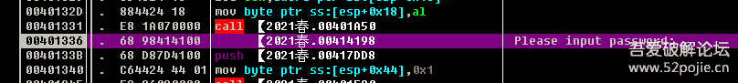

`3.PNG` (11.05 KB, 下载次数: 3)

[href="forum.php?mod=attachment&aid=MjQ5NTA4MnxlMTYzMzUwM3wxNzkzNTc2MTgwfDE2ODA4NnwxNTg4NDc2&nothumb=yes" target="_blank"](https://www.52pojie.cn/forum.php?mod=attachment&aid=MjQ5NTA4MnxlMTYzMzUwM3wxNzkzNTc2MTgwfDE2ODA4NnwxNTg4NDc2&nothumb=yes)

2022-2-16 08:59 上传

堆栈窗口看到字符串，长度也为23，可能就是flag


`4.PNG` (8.86 KB, 下载次数: 3)

[href="forum.php?mod=attachment&aid=MjQ5NTA4M3wwMzI4YTBmNnwxNzkzNTc2MTgwfDE2ODA4NnwxNTg4NDc2&nothumb=yes" target="_blank"](https://www.52pojie.cn/forum.php?mod=attachment&aid=MjQ5NTA4M3wwMzI4YTBmNnwxNzkzNTc2MTgwfDE2ODA4NnwxNTg4NDc2&nothumb=yes)

2022-2-16 08:59 上传

试输入，正确，得到flag为2022HappyNewYear52PoJie

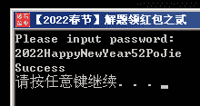

`5.PNG` (4.92 KB, 下载次数: 2)

[href="forum.php?mod=attachment&aid=MjQ5NTA4NHwxZjRjYTAxNXwxNzkzNTc2MTgwfDE2ODA4NnwxNTg4NDc2&nothumb=yes" target="_blank"](https://www.52pojie.cn/forum.php?mod=attachment&aid=MjQ5NTA4NHwxZjRjYTAxNXwxNzkzNTc2MTgwfDE2ODA4NnwxNTg4NDc2&nothumb=yes)

2022-2-16 08:59 上传

## 解题领红包之三 {Windows 中级题}

查壳，可能是有修改的upx，要先[//www.52pojie.cn/forum-5-1.html" target="_blank" class="relatedlink"](https://www.52pojie.cn/forum-5-1.html:href="https)

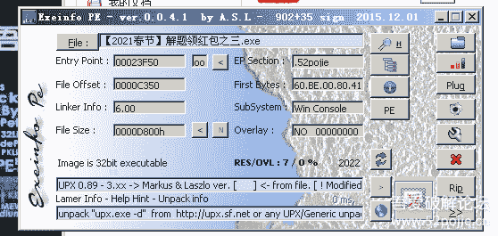

`6.PNG` (117.23 KB, 下载次数: 2)

[href="forum.php?mod=attachment&aid=MjQ5NTA4NXwwMjAzZTQzYnwxNzkzNTc2MTgwfDE2ODA4NnwxNTg4NDc2&nothumb=yes" target="_blank"](https://www.52pojie.cn/forum.php?mod=attachment&aid=MjQ5NTA4NXwwMjAzZTQzYnwxNzkzNTc2MTgwfDE2ODA4NnwxNTg4NDc2&nothumb=yes)

2022-2-16 08:59 上传

先用52[//www.52pojie.cn/thread-661779-1-1.html" target="_blank" class="relatedlink"](https://www.52pojie.cn/thread-661779-1-1.html:href="https)脱壳，拖进od，走一步，ESP定律，在ESP寄存器上右键，数据窗口中跟随

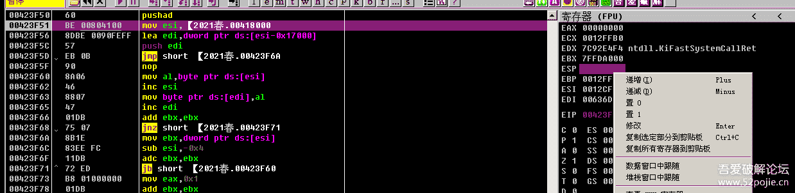

`7.PNG` (33.73 KB, 下载次数: 0)

[href="forum.php?mod=attachment&aid=MjQ5NTA4NnxiYTc0MGUzZHwxNzkzNTc2MTgwfDE2ODA4NnwxNTg4NDc2&nothumb=yes" target="_blank"](https://www.52pojie.cn/forum.php?mod=attachment&aid=MjQ5NTA4NnxiYTc0MGUzZHwxNzkzNTc2MTgwfDE2ODA4NnwxNTg4NDc2&nothumb=yes)

2022-2-16 08:59 上传

然后右键，断点-硬件访问-byte

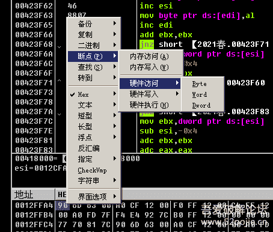

`8.PNG` (20.56 KB, 下载次数: 2)

[href="forum.php?mod=attachment&aid=MjQ5NTA4N3w0ZTZmYzA1M3wxNzkzNTc2MTgwfDE2ODA4NnwxNTg4NDc2&nothumb=yes" target="_blank"](https://www.52pojie.cn/forum.php?mod=attachment&aid=MjQ5NTA4N3w0ZTZmYzA1M3wxNzkzNTc2MTgwfDE2ODA4NnwxNTg4NDc2&nothumb=yes)

2022-2-16 08:59 上传

然后运行程序，停在4240C6，上面是popad，下面不远处一个大jmp，推测接近OEP

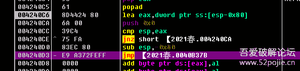

`9.PNG` (11.91 KB, 下载次数: 1)

[href="forum.php?mod=attachment&aid=MjQ5NTA4OHxiNTZmNDI3ZXwxNzkzNTc2MTgwfDE2ODA4NnwxNTg4NDc2&nothumb=yes" target="_blank"](https://www.52pojie.cn/forum.php?mod=attachment&aid=MjQ5NTA4OHxiNTZmNDI3ZXwxNzkzNTc2MTgwfDE2ODA4NnwxNTg4NDc2&nothumb=yes)

2022-2-16 08:59 上传

运行到4240D3该jmp处，然后单步一次，到40B37B的push处，应为OEP

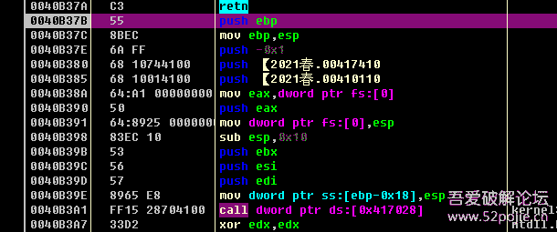

`10.PNG` (14.86 KB, 下载次数: 1)

[href="forum.php?mod=attachment&aid=MjQ5NTA4OXxiZTk4MmYxNXwxNzkzNTc2MTgwfDE2ODA4NnwxNTg4NDc2&nothumb=yes" target="_blank"](https://www.52pojie.cn/forum.php?mod=attachment&aid=MjQ5NTA4OXxiZTk4MmYxNXwxNzkzNTc2MTgwfDE2ODA4NnwxNTg4NDc2&nothumb=yes)

2022-2-16 09:00 上传

Ollydump脱壳

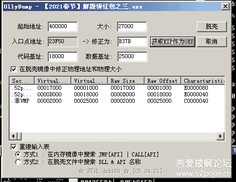

`11.PNG` (21.29 KB, 下载次数: 1)

[href="forum.php?mod=attachment&aid=MjQ5NTA5MHxkNGY2NTFhYnwxNzkzNTc2MTgwfDE2ODA4NnwxNTg4NDc2&nothumb=yes" target="_blank"](https://www.52pojie.cn/forum.php?mod=attachment&aid=MjQ5NTA5MHxkNGY2NTFhYnwxNzkzNTc2MTgwfDE2ODA4NnwxNTg4NDc2&nothumb=yes)

2022-2-16 09:00 上传

脱壳结果ExeinfoPE看不出，用PEID看应该是脱了

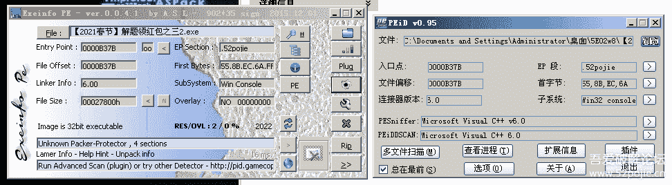

`12.PNG` (127.27 KB, 下载次数: 2)

[href="forum.php?mod=attachment&aid=MjQ5NTA5MXw4ZmUzZmUwZHwxNzkzNTc2MTgwfDE2ODA4NnwxNTg4NDc2&nothumb=yes" target="_blank"](https://www.52pojie.cn/forum.php?mod=attachment&aid=MjQ5NTA5MXw4ZmUzZmUwZHwxNzkzNTc2MTgwfDE2ODA4NnwxNTg4NDc2&nothumb=yes)

2022-2-16 09:00 上传

运行程序看一下

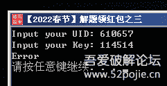

`13.PNG` (11.23 KB, 下载次数: 0)

[href="forum.php?mod=attachment&aid=MjQ5NTA5MnxhMmYyZDBiN3wxNzkzNTc2MTgwfDE2ODA4NnwxNTg4NDc2&nothumb=yes" target="_blank"](https://www.52pojie.cn/forum.php?mod=attachment&aid=MjQ5NTA5MnxhMmYyZDBiN3wxNzkzNTc2MTgwfDE2ODA4NnwxNTg4NDc2&nothumb=yes)

2022-2-16 09:00 上传

拖回实机上的IDA，看流程，首先是Input your UID:，然后到Input your Key:，最后根据某种判断条件跳到Success或Error。

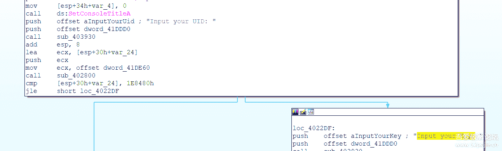

`14.PNG` (41.01 KB, 下载次数: 0)

[href="forum.php?mod=attachment&aid=MjQ5NTA5M3xiMDI1OGQyNXwxNzkzNTc2MTgwfDE2ODA4NnwxNTg4NDc2&nothumb=yes" target="_blank"](https://www.52pojie.cn/forum.php?mod=attachment&aid=MjQ5NTA5M3xiMDI1OGQyNXwxNzkzNTc2MTgwfDE2ODA4NnwxNTg4NDc2&nothumb=yes)

2022-2-16 09:00 上传

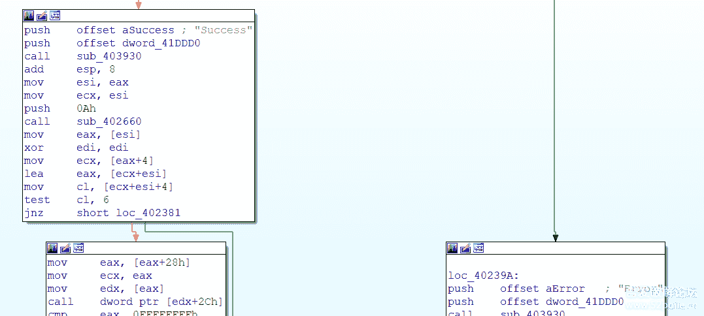

`15.PNG` (46.59 KB, 下载次数: 2)

[href="forum.php?mod=attachment&aid=MjQ5NTA5NHw5ODg5OTE5NnwxNzkzNTc2MTgwfDE2ODA4NnwxNTg4NDc2&nothumb=yes" target="_blank"](https://www.52pojie.cn/forum.php?mod=attachment&aid=MjQ5NTA5NHw5ODg5OTE5NnwxNzkzNTc2MTgwfDE2ODA4NnwxNTg4NDc2&nothumb=yes)

2022-2-16 09:01 上传

在Success处F5得到伪代码，显然地，`sub_401520`内有判定flag是否正确的条件

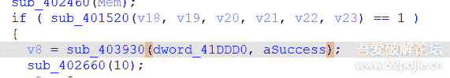

`16.PNG` (14.9 KB, 下载次数: 1)

[href="forum.php?mod=attachment&aid=MjQ5NTA5NnwzNmY4NmY1OXwxNzkzNTc2MTgwfDE2ODA4NnwxNTg4NDc2&nothumb=yes" target="_blank"](https://www.52pojie.cn/forum.php?mod=attachment&aid=MjQ5NTA5NnwzNmY4NmY1OXwxNzkzNTc2MTgwfDE2ODA4NnwxNTg4NDc2&nothumb=yes)

2022-2-16 09:02 上传

双击点进`sub_401520`，它的返回值以`v8`变量为判断条件决定返回值为0或1

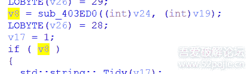

`17.PNG` (13.03 KB, 下载次数: 2)

[href="forum.php?mod=attachment&aid=MjQ5NTA5N3w2MmQxN2YxMnwxNzkzNTc2MTgwfDE2ODA4NnwxNTg4NDc2&nothumb=yes" target="_blank"](https://www.52pojie.cn/forum.php?mod=attachment&aid=MjQ5NTA5N3w2MmQxN2YxMnwxNzkzNTc2MTgwfDE2ODA4NnwxNTg4NDc2&nothumb=yes)

2022-2-16 09:03 上传

[C++] 纯文本查看 复制代码


# 逆向分析记录

## 分析 `sub_401520` 返回值逻辑

```
 if ( v8 )
{
//省略其他代码
return 0;
}
else
{
//省略其他代码
return 1;
}
```

上面代码省略处为与分析返回值逻辑关系不大的代码，太长截不了图，用文字表示。

根据以上条件可知需要 `sub_401520` 返回 1，就需要 `v8 = sub_403ED0` 的返回值为 0。

双击点进 `sub_403ED0`，看到以下和返回值有关的代码。

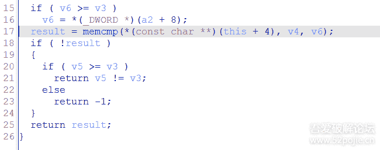

因为需要返回值为 0，根据该逻辑就需要 `memcmp` 返回 0，且 `v5==v3`。

接下来在 IDA 中进行动态调试，先在伪代码 17、18、20 行下断点，输入我的 `UID`，在 `key` 处我随便输了个 `114514`，停在 17 行。鼠标放在 `v4` 变量上能看到疑似 `flag`：`flag{Happy_New_Year_52Pojie_2022}`。


停止调试重新运行程序，但测试发现 `flag` 不对。

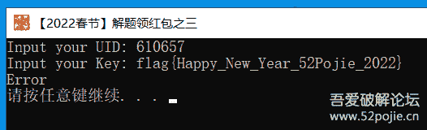

继续看 IDA，在第 17 行的第一个参数处拆分内存访问。

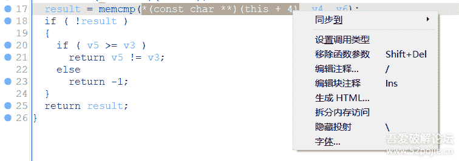

得到新的伪代码如下图所示。

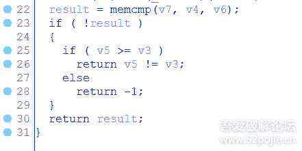

## 动态调试与变换规则

在新伪代码的 22 行下断点，在 IDA 中运行，输入 `UID` 和 `key`：`flag{Happy_New_Year_52Pojie_2022}`，停在伪代码 22 行后查看变量 `v7` 为 `ikpr{Apuux_Czf_Xzpm_52Ulsjz_2022}`，`v4` 仍为 `flag{Happy_New_Year_52Pojie_2022}`。

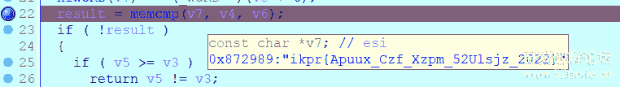

推测 `v7` 的值是对输入的 `flag{Happy_New_Year_52Pojie_2022}` 的字母部分做了某种变换，遂输入与 `flag` 等长的连续 33 个 `a`，得到 `v7` 为连续 33 个 `p`，故推测该变换与其为何种字母有关，与其在字符串中的位置无关。

为了获得该变换的规则，输入 `abcdefghijklnmopqrstuvwxyzABCDEFGHIJKLNMOPQRSTUVWXYZ`，得到 `v7` 为 `pyhqzirajsbkctludmvenwfoxgPYHQZIRAJSBKCTLUDMVENWFOXG`。


从而得到了变换规则，将之前找到的 `flag{Happy_New_Year_52Pojie_2022}` 进行逆变换，得到 `wohz{Chaab_Utv_Bthg_52Axift_2022}`，测试显示 `success`，为正确 `flag`。

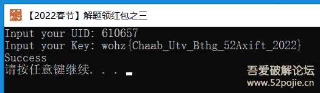

## 解题领红包之番外篇 {Web 中级题}

用 fiddler 打开 `52tube.saz`，把文件保存出来。

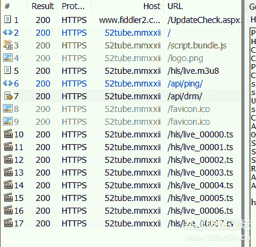

`/api/drm/` 包含疑似密钥为 32byte，但 `m3u8` 里是 AES-128 加密，应是 16byte 的密钥，此处不对，先看 js，查找 `/api/drm/` 字符串，相关代码如下所示。

```javascript
let e = "/api/ping/", i = "/api/drm/";

function n(t)

{

return [...new Uint8Array(t)].map((t => t.toString(16).padStart(2, "0"))).join("")

}

function s(t, e)

{

let r = new Uint8Array(t.length);

for (let i = 0; i  {

l({

data : t.buffer

}, e, a)

}))

}

}

r(t, a, o)

}

}

}
```

显然，`s(t,e)` 是一个按位异或，`return s(s(u, e), c);` 可能为解密密钥。

`let u = new Uint8Array(l.slice(0, 16)), c = new Uint8Array(l.slice(16, 32));` 处可看出 32byte 密钥的前半部分为 `u`，后半部分为 `c`。

`var r = new URLSearchParams;  r.append("h", n(e.buffer)), r.append("id", t);` 处可看出 `e` 为 URL 参数 `h`，在 fiddler 的 `/api/drm/` 处可找到。

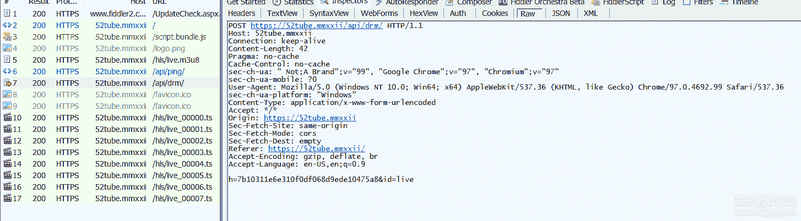

`u=08a5e6c2c261a8acb4d79c49af160a3a`  
`c=da4e5ceae16fed46eb6f498c9b63d53b`  
`e=7b10311e6e310f0df068d9ede10475a8`

解密密钥为 `u异或e异或c = a9fb8b364d3f4ae7afd00c28d571aaa9`。

然后找了个现成的 ts 解密工具（ts助手）解密得到 mp4，播放 mp4 视频得到 `flag{like_sub_52tube}`。

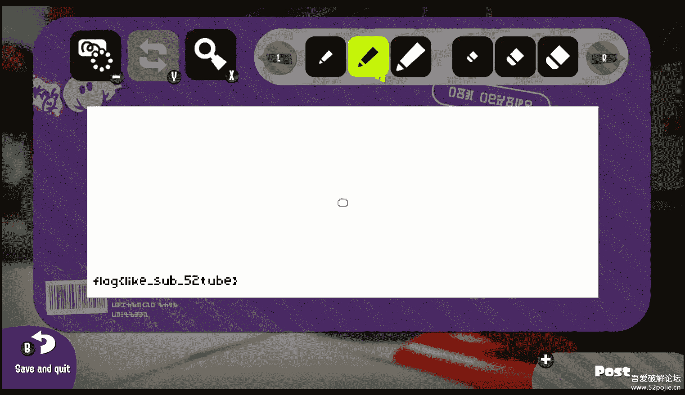

我太菜，安卓题没做出来，今后需要继续学习。
