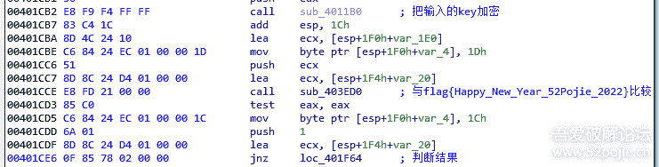
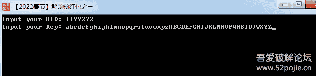

# [CTF] 2022春节红包之三 writeup

- 原帖: https://www.52pojie.cn/forum.php?mod=viewthread&tid=1588492
- 抓取时间: 2026-11-01T23:36:20

`exeinfope`查壳显示`UPX`，用`UPX /d` [//www.52pojie.cn/forum-5-1.html" target="_blank" class="relatedlink"](https://www.52pojie.cn/forum-5-1.html:href="https)失败。。。那就用esp大法直接`jump`到`OEP`保存文件。输入`UID`和`KEY`后，`UID`一个进行了一个简单的计算，不知道要干啥。。接着往下调试定位关键判断


图片2.png (36.98 KB, 下载次数: 0)
[href="forum.php?mod=attachment&aid=MjQ5NTEzMnwxZDU0YzgxZXwxNzkzNTc2MTc4fDE2ODA4NnwxNTg4NDky&nothumb=yes" target="_blank"](https://www.52pojie.cn/forum.php?mod=attachment&aid=MjQ5NTEzMnwxZDU0YzgxZXwxNzkzNTc2MTc4fDE2ODA4NnwxNTg4NDky&nothumb=yes)
2022-2-16 09:50 上传

经过数次调试后，发现同一个`UID`的在`sub_4011B0`中算法是固定的大概如下：

```
void sub_4011B0(char* p)
{
    while (1)
    {
        char& i = *p++;
        if (i == 0)
            break;
        if (i >= 'a' && i = 'a' && i 
```


图片1.png (16.68 KB, 下载次数: 0)
[href="forum.php?mod=attachment&aid=MjQ5NTEzMXwxMDliNjE3ZnwxNzkzNTc2MTc4fDE2ODA4NnwxNTg4NDky&nothumb=yes" target="_blank"](https://www.52pojie.cn/forum.php?mod=attachment&aid=MjQ5NTEzMXwxMDliNjE3ZnwxNzkzNTc2MTc4fDE2ODA4NnwxNTg4NDky&nothumb=yes)
2022-2-16 09:49 上传

求得映射为 mpsvybehknqtwzcfiloruxadgjMPSVYBEHKNQTWZCFILORUXADGJ
最后写个程序:
```
int main()
{
    char arr1[] = "abcdefghijklmnopqrstuvwxyzABCDEFGHIJKLMNOPQRSTUVWXYZ";
    char arr2[] = "mpsvybehknqtwzcfiloruxadgjMPSVYBEHKNQTWZCFILORUXADGJ";
    char key[] = "flag{Happy_New_Year_52Pojie_2022}";
    for (auto it : key)
    {
        if (!isChar(it))
        {
            printf("%c", it);
            continue;
        }
        for (int i = 0; i < 52; ++i)
        {
            if (arr2[i] == it)
            {
                printf("%c", arr1[i]);
                break;
            }
        }
    }
}
```
程序打印结果 prwy{Hwbbe_Jgm_Egwt_52Bszqg_2022}输入源程序验证正确取了个巧，有点菜，算法没逆出来，写不出注册机
