# [.NET逆向] 一次Unity引擎gal游戏TextMesh Pro字库汉化记录

- 原帖: https://www.52pojie.cn/forum.php?mod=viewthread&tid=1588559
- 抓取时间: 2026-11-01T23:36:13

## 一、原由

受别人邀请接手了一个Gal的汉化，发现是Unity引擎的，并不是原版厂商常用的引擎。因为之前也没有接触过Unity，好一番折腾，总算是成了，记录一下曲折过程，顺便分享一下经验。

个人水平有限，写得不好还请多多谅解。

## 二、初步分析

从群友那里拿到游戏文件，双击直接可运行，不用[//www.52pojie.cn" target="_blank" class="relatedlink"](https://www.52pojie.cn:href="https)，lucky~

进步一观察游戏资源，发现为Unity引擎：

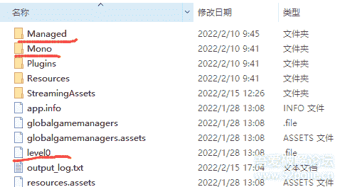

QQ图片20220216085550.png (32.52 KB, 下载次数: 226)

[href="forum.php?mod=attachment&aid=MjQ5NTA3N3xlYjRlYTc5OXwxNzkzNTc2MTcwfDE2ODA4NnwxNTg4NTU5&nothumb=yes" target="_blank"](https://www.52pojie.cn/forum.php?mod=attachment&aid=MjQ5NTA3N3xlYjRlYTc5OXwxNzkzNTc2MTcwfDE2ODA4NnwxNTg4NTU5&nothumb=yes)

2022-2-16 08:56 上传

进入`Managed`目录，发现是原版Mono打包的，没有用`IL2CPP`加密，lucky~，对我这种新手来说太好了。

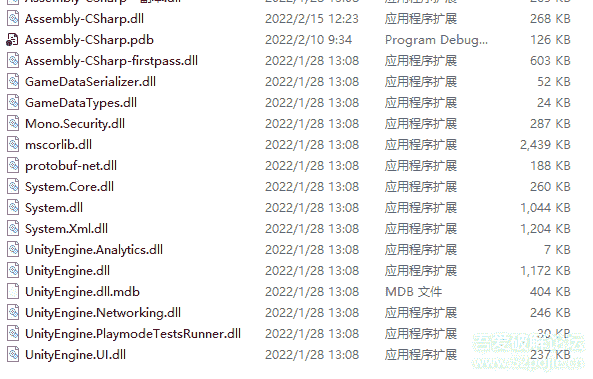

QQ图片20220216085751.png (62.79 KB, 下载次数: 223)

[href="forum.php?mod=attachment&aid=MjQ5NTA3OHwyNzQzZmNlMHwxNzkzNTc2MTcwfDE2ODA4NnwxNTg4NTU5&nothumb=yes" target="_blank"](https://www.52pojie.cn/forum.php?mod=attachment&aid=MjQ5NTA3OHwyNzQzZmNlMHwxNzkzNTc2MTcwfDE2ODA4NnwxNTg4NTU5&nothumb=yes)

2022-2-16 08:58 上传

网上搜索了一下，Unity引擎的脚步存放在`Assembly-CSharp.dll`中，没加密就是C#的，`ILSpy`安排上。

完美反编译，美滋滋~，代码保存成C#工程，计划通~

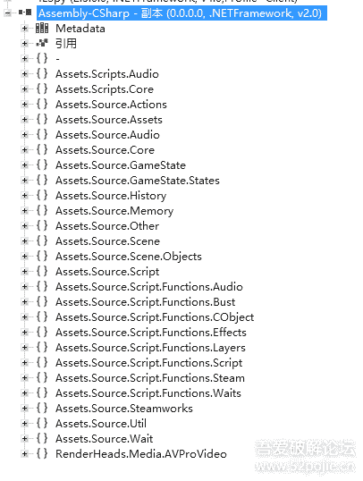

QQ图片003.png (21.98 KB, 下载次数: 219)

[href="forum.php?mod=attachment&aid=MjQ5NTA5NXw2MzQ5ZTUyNHwxNzkzNTc2MTcwfDE2ODA4NnwxNTg4NTU5&nothumb=yes" target="_blank"](https://www.52pojie.cn/forum.php?mod=attachment&aid=MjQ5NTA5NXw2MzQ5ZTUyNHwxNzkzNTc2MTcwfDE2ODA4NnwxNTg4NTU5&nothumb=yes)

2022-2-16 09:02 上传

进一步分析游戏的资源的构成，发现`StreamingAssets`目录下有我们感兴趣的脚本封包

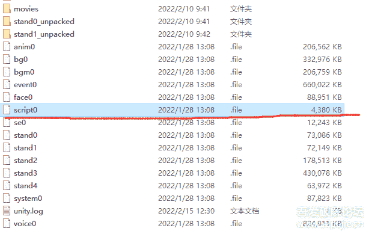

QQ图片004.png (46.83 KB, 下载次数: 221)

[href="forum.php?mod=attachment&aid=MjQ5NTA5OXxiMjQ4Njk1OHwxNzkzNTc2MTcwfDE2ODA4NnwxNTg4NTU5&nothumb=yes" target="_blank"](https://www.52pojie.cn/forum.php?mod=attachment&aid=MjQ5NTA5OXxiMjQ4Njk1OHwxNzkzNTc2MTcwfDE2ODA4NnwxNTg4NTU5&nothumb=yes)

2022-2-16 09:05 上传

在保存的C#反编译项目中搜索 "script 找到如下代码：

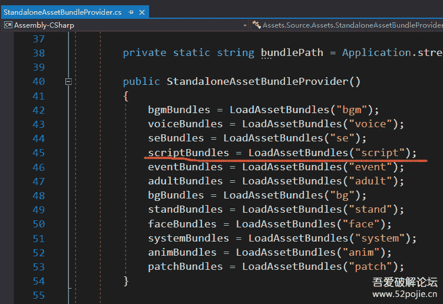

QQ图片005.png (85.11 KB, 下载次数: 228)

[href="forum.php?mod=attachment&aid=MjQ5NTEwNXw3NTEyZmY3OHwxNzkzNTc2MTcwfDE2ODA4NnwxNTg4NTU5&nothumb=yes" target="_blank"](https://www.52pojie.cn/forum.php?mod=attachment&aid=MjQ5NTEwNXw3NTEyZmY3OHwxNzkzNTc2MTcwfDE2ODA4NnwxNTg4NTU5&nothumb=yes)

2022-2-16 09:08 上传

在这个类里继续往下翻，发现获取脚本的函数：

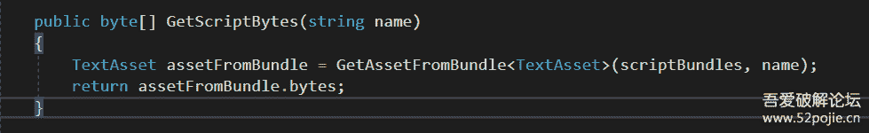

QQ图片006.png (24.35 KB, 下载次数: 225)

[href="forum.php?mod=attachment&aid=MjQ5NTExM3w3Y2JkNjk3NXwxNzkzNTc2MTcwfDE2ODA4NnwxNTg4NTU5&nothumb=yes" target="_blank"](https://www.52pojie.cn/forum.php?mod=attachment&aid=MjQ5NTExM3w3Y2JkNjk3NXwxNzkzNTc2MTcwfDE2ODA4NnwxNTg4NTU5&nothumb=yes)

2022-2-16 09:12 上传

顺腾摸瓜，看看哪里调用了这个函数，发现是`AssetManager.cs`中的`GetScriptData()`函数调用了它，继续回溯：

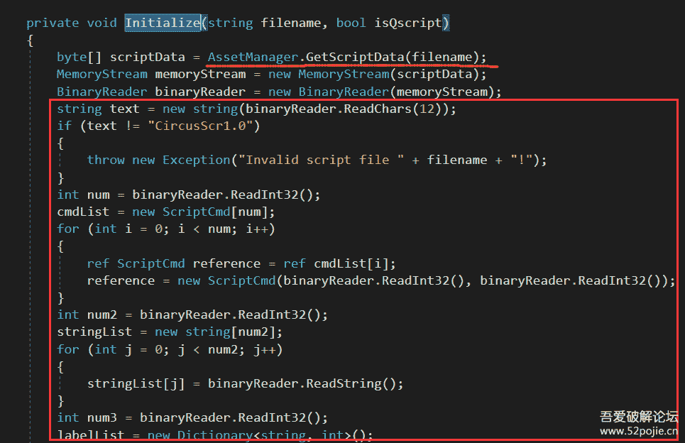

QQ图片007.png (96.94 KB, 下载次数: 220)

[href="forum.php?mod=attachment&aid=MjQ5NTExNHwzOTZiZTNjZXwxNzkzNTc2MTcwfDE2ODA4NnwxNTg4NTU5&nothumb=yes" target="_blank"](https://www.52pojie.cn/forum.php?mod=attachment&aid=MjQ5NTExNHwzOTZiZTNjZXwxNzkzNTc2MTcwfDE2ODA4NnwxNTg4NTU5&nothumb=yes)

2022-2-16 09:16 上传

方框里就是脚本的读取了，包括`string`列表，这样脚本就解密完了，感觉很顺利呢，一天可以搞掂的样子~

## 三、曲折

写解包工具，提取了日文版的文本（这个版本是英文版的），测试顶一下，修改源代码，编译，一气呵成~


QQ图片008.png (15.93 KB, 下载次数: 230)

[href="forum.php?mod=attachment&aid=MjQ5NTExNnwxMDlmYzIzZXwxNzkzNTc2MTcwfDE2ODA4NnwxNTg4NTU5&nothumb=yes" target="_blank"](https://www.52pojie.cn/forum.php?mod=attachment&aid=MjQ5NTExNnwxMDlmYzIzZXwxNzkzNTc2MTcwfDE2ODA4NnwxNTg4NTU5&nothumb=yes)

2022-2-16 09:21 上传

发现有很多框框，马上意识到是字库有问题，找找文字输出的函数吧，找了一会找到一个`DisplayText()`函数，看起来像是 （人名，对话）

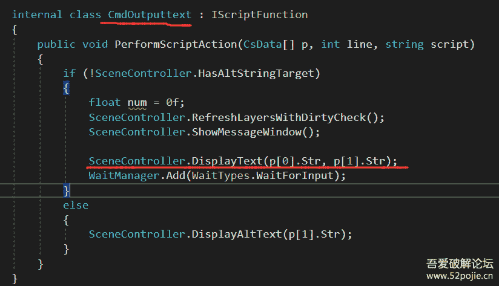

QQ图片009.png (54.15 KB, 下载次数: 224)

[href="forum.php?mod=attachment&aid=MjQ5NTExN3w2NGY0NGVmMHwxNzkzNTc2MTcwfDE2ODA4NnwxNTg4NTU5&nothumb=yes" target="_blank"](https://www.52pojie.cn/forum.php?mod=attachment&aid=MjQ5NTExN3w2NGY0NGVmMHwxNzkzNTc2MTcwfDE2ODA4NnwxNTg4NTU5&nothumb=yes)

2022-2-16 09:25 上传

转到函数，发现`NameArea`和`TextArea`

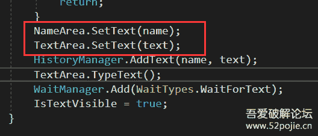

QQ图片010.png (27.04 KB, 下载次数: 228)

[href="forum.php?mod=attachment&aid=MjQ5NTExOHw0ZTgwODVlYXwxNzkzNTc2MTcwfDE2ODA4NnwxNTg4NTU5&nothumb=yes" target="_blank"](https://www.52pojie.cn/forum.php?mod=attachment&aid=MjQ5NTExOHw0ZTgwODVlYXwxNzkzNTc2MTcwfDE2ODA4NnwxNTg4NTU5&nothumb=yes)

2022-2-16 09:27 上传

转到定义，来到了class `CStringEntity` : `MonoBehaviour`，发现`TextMeshPro` `TextObject`，

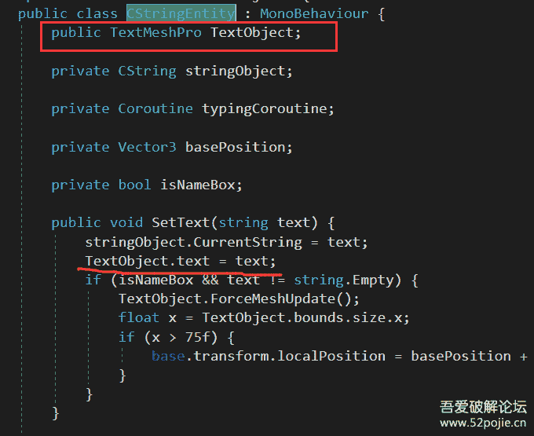

QQ图片011.png (59.58 KB, 下载次数: 227)

[href="forum.php?mod=attachment&aid=MjQ5NTExOXwwNmIzYWRiM3wxNzkzNTc2MTcwfDE2ODA4NnwxNTg4NTU5&nothumb=yes" target="_blank"](https://www.52pojie.cn/forum.php?mod=attachment&aid=MjQ5NTExOXwwNmIzYWRiM3wxNzkzNTc2MTcwfDE2ODA4NnwxNTg4NTU5&nothumb=yes)

2022-2-16 09:30 上传

进一步分析发现此时代码已经转到`Assembly-CSharp-firstpass.dll`中了，我意识到这可能是系统组件，网上搜索一番

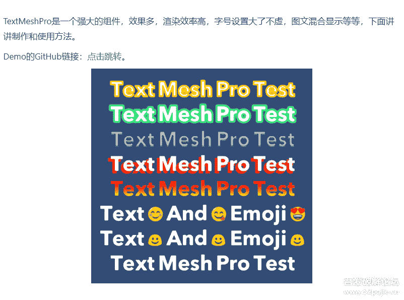

QQ图片012.png (128.05 KB, 下载次数: 223)

[href="forum.php?mod=attachment&aid=MjQ5NTEyMHwyZTIwMjhmMHwxNzkzNTc2MTcwfDE2ODA4NnwxNTg4NTU5&nothumb=yes" target="_blank"](https://www.52pojie.cn/forum.php?mod=attachment&aid=MjQ5NTEyMHwyZTIwMjhmMHwxNzkzNTc2MTcwfDE2ODA4NnwxNTg4NTU5&nothumb=yes)

2022-2-16 09:32 上传

果然，下面就是汉化字库就完成了，看起来还挺简单的，网上搜搜，看看有解决方案没有，还真找到了：

https://www.bilibili.com/video/BV1D5411V7MK

嗯，对着操作一番，首先下载unity，看起来要对应的版本才行，OK，主程序上属性一下，发现是`Unity5.5`版本的：

一般正规的软件厂商都会带版本信息，还是比较可靠的，下载，安装，一气呵成~，我，今天，就！要！搞！掂！它！

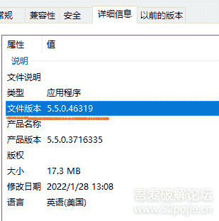

QQ图片013.png (18.24 KB, 下载次数: 226)

[href="forum.php?mod=attachment&aid=MjQ5NTEyM3w0M2IyZTg0NXwxNzkzNTc2MTcwfDE2ODA4NnwxNTg4NTU5&nothumb=yes" target="_blank"](https://www.52pojie.cn/forum.php?mod=attachment&aid=MjQ5NTEyM3w0M2IyZTg0NXwxNzkzNTc2MTcwfDE2ODA4NnwxNTg4NTU5&nothumb=yes)

2022-2-16 09:36 上传

好的，安装`TextMeshPro` 插件，嗯，按网上说的进AssetStore搜索，嗯？怎么会没有？网友留了地址，点进去，嗯？？？怎么是404？？？

what fuck？？

上管网搜索，好嘛，该软件已下架，我陷入了深深的思考。

没关系，面向百度编程嘛，找到一个 `Text Mesh Pro U5.unitypackage`的包，导入，安装，然后报错，修改，然后报错，看来是版本不对，再搜。

CSDN CSDN CSDN，好嘛，全是CSDN，没分，没钱。

偶然间找到一篇文章介绍 `TextMeshPro`的，了解到该字库最开始是由个人开发的收费软件，后来Unity官方觉得不错，收购了，从unity2018版起集成到了Unity引擎中，但是官方app依然提供下载。

俗话说得好，凡事都怕但是，看来2022年官方觉得这么多年过去了，是时候淘汰老版本了。

好嘛，没关系，梯--子打开，面向google编程，翻了两天英文网页，我终于找到了1.0.56 b2 1.0.56 b3 1.2.2版本for unity5.5 unity5.6 unity2017.1 unity2017.2 unity2017.3。

查了一下游戏发行时间2017年，1.0.56 b2安排上。

字库制作中，略过不表，网上教程很多，大同小异。

这里有一个选择，按照bilibili的教程，应该生成字库后提取，然后替换原来的字库，但是我看评论区有为朋友提到：

`Font Asset Creator`生成好字体（类型为`TMP_FontAsset`）后，做一个包含`TMP_FontAsset`的`AssetBundle`。

之后在代码中加载`AssetBundle`，获取你做好的`TMP_FontAsset`，直接替换掉游戏原本的字体。

我心动了，这种才是完美解决之道，才是程序应该做的，直接替换破坏了原来的数据，不好不好。

面向Unity编程，打包打包。

[C#] 纯文本查看 复制代码


```
        public static TMP_FontAsset chsFont;
        public static void LoadChsFont() {

            string chsfont = Path.Combine(Application.streamingAssetsPath, "CHS/jissdf");
            LogPrint(chsfont);
            AssetBundle assetBundle = AssetBundle.LoadFromFile(chsfont);
            if (assetBundle != null) {
                foreach (string tt in assetBundle.GetAllAssetNames()) {
                    LogPrint(tt);
                }

                chsFont = assetBundle.LoadAsset("jisSDF");
                if (chsFont != null) LogPrint("asset sucess! " + chsFont.GetType().ToString());
                else LogPrint("faild,faild");
                assetBundle.Unload(false);
            }
            else LogPrint("load AssetBundle faild");
        }
```
运行，faild，修改，运行，faild faild faild faild，情况不对啊，在自己的Unity中运行，成功，嗯？？？

我悟了，看来是Text Mesh Pro的版本不对，我顿时有了一个大胆的想法，干嘛不引用新的Text Mesh Pro版本，把原来的Text Mesh Pro忽略掉，说干就干。

修改反编译的C#工程代码，引用 `TextMeshPro-5.5-1.0.56-Runtime.dll`，命名空间引用别名，解决命名冲突，编译，一气呵成~

load，成功！！！，yes~，进游戏测试，嗯？怎么文字全不显示了？继续改改，改改，还是不显示。好嘛，看来要多学一点Unity的知识，面向bilibili学习中。。。

## 四、解决

经过一番学习之后，我终于发现：Unity的场景工作模式是这样的，你要先再场景中放置一个对象，然后给对象绑定一个脚本，在脚本里编写你需要的代码。

回到游戏中，使用 `AssetStudio` 查看场景文件，发现场景中的对象是绑定了具体哪个 `dll` 程序集的，而且很多相关对象都是绑定了同一个程序集，像之前那种移到另一个程序集，行不通，或者要改太多地方。

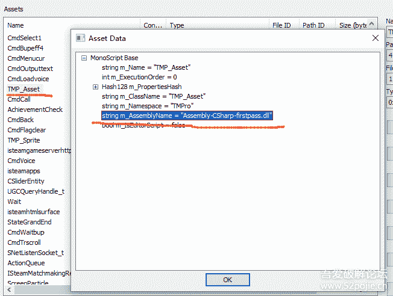

QQ图片014.png (43.04 KB, 下载次数: 233)

[href="forum.php?mod=attachment&aid=MjQ5NTE0NHxiNzY0ODdhY3wxNzkzNTc2MTcwfDE2ODA4NnwxNTg4NTU5&nothumb=yes" target="_blank"](https://www.52pojie.cn/forum.php?mod=attachment&aid=MjQ5NTE0NHxiNzY0ODdhY3wxNzkzNTc2MTcwfDE2ODA4NnwxNTg4NTU5&nothumb=yes)

2022-2-16 10:12 上传

好嘛，还是得替换文件，而且我还发现，游戏里的 `TMP` 版本，跟我手头上有的还不一样！因为在VS中有提示某些函数已经废弃，看来游戏里的 `TMP` 版本，比我的要旧，

网上继续搜索，没找到。。。CSDN找到一个1.0.52的，淘宝六毛八下载下来。。。

安装，引用，嗯？这次发现VS中没有提示错误了，看来是这个版本了，顿时放心下来，看来是时候了！

这里说一下 `TMP` 字库的构成，使用 `AssetBundleExtractor` 查看生成的字库文件 `*SDF.asset`，有三个文件

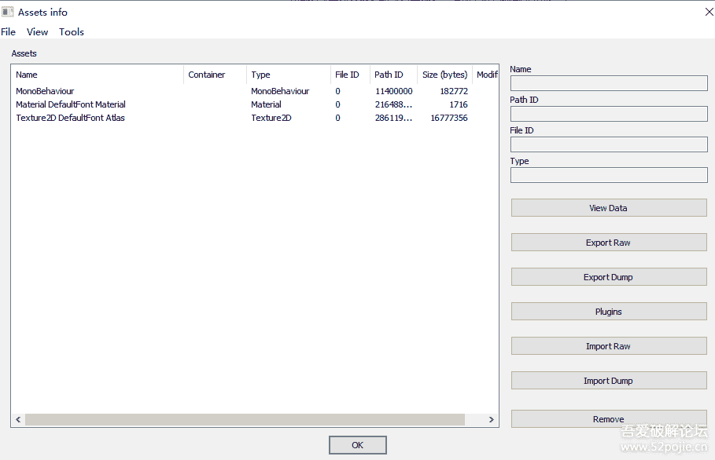

QQ图片015.png (25.76 KB, 下载次数: 212)

[href="forum.php?mod=attachment&aid=MjQ5NTE0NXw0ZmI2NTQxM3wxNzkzNTc2MTcwfDE2ODA4NnwxNTg4NTU5&nothumb=yes" target="_blank"](https://www.52pojie.cn/forum.php?mod=attachment&aid=MjQ5NTE0NXw0ZmI2NTQxM3wxNzkzNTc2MTcwfDE2ODA4NnwxNTg4NTU5&nothumb=yes)

2022-2-16 10:20 上传

`MonoBehaviour` 保存了字库的基本信息，包括文字索引

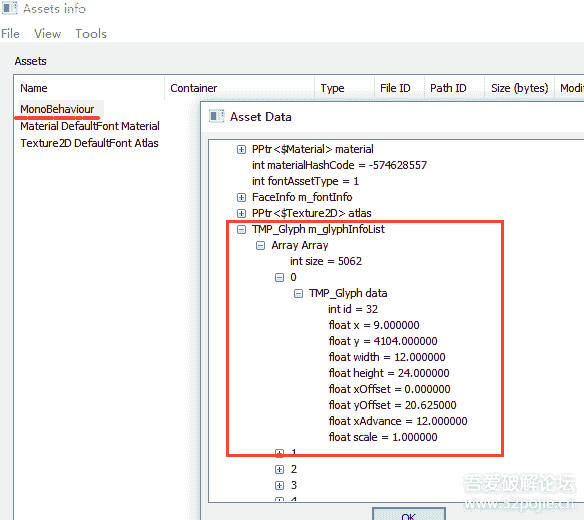

QQ图片016.png (33.74 KB, 下载次数: 209)

[href="forum.php?mod=attachment&aid=MjQ5NTE0N3xlYjcxMDI0M3wxNzkzNTc2MTcwfDE2ODA4NnwxNTg4NTU5&nothumb=yes" target="_blank"](https://www.52pojie.cn/forum.php?mod=attachment&aid=MjQ5NTE0N3xlYjcxMDI0M3wxNzkzNTc2MTcwfDE2ODA4NnwxNTg4NTU5&nothumb=yes)

2022-2-16 10:21 上传

`Material` 保存了文字的效果，比如描边啊，阴影啊，`Texture2D` 保存的是字库的图片，就是一张大大的图上写满了文字

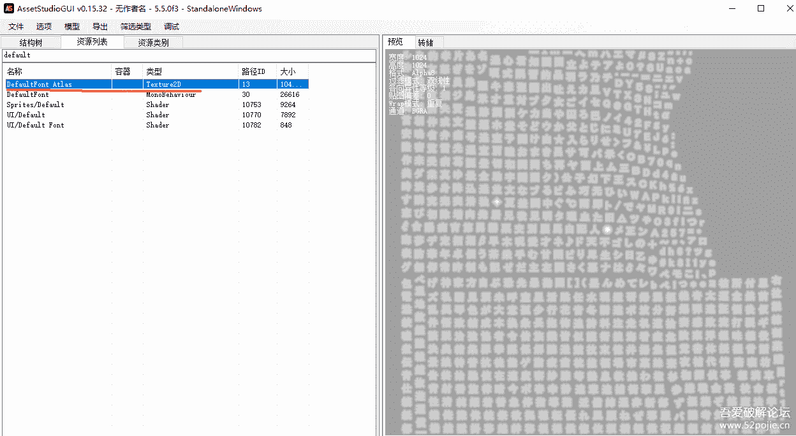

QQ图片017.png (249.43 KB, 下载次数: 224)

[href="forum.php?mod=attachment&aid=MjQ5NTE0OHw2NjM0YTRlYnwxNzkzNTc2MTcwfDE2ODA4NnwxNTg4NTU5&nothumb=yes" target="_blank"](https://www.52pojie.cn/forum.php?mod=attachment&aid=MjQ5NTE0OHw2NjM0YTRlYnwxNzkzNTc2MTcwfDE2ODA4NnwxNTg4NTU5&nothumb=yes)

2022-2-16 10:28 上传

OK，了解清楚我们照着视频操作，使用 `AssetBundleExtractor` 替换，保存，这里有个小细节，替换 `MonoBehaviour` 时必须首先点击 `ViewData`，查看数据，并且弹射的第一个对话框选 “是”，后面的对话框根据有没有具体的 `dll` 选否，原理我们后面介绍。

替换完成，保存，运行，当然是成.....

崩溃了，崩溃了。

思考.jpg


why？

检查生成的封包，发现替换的 `MonoBehaviour` 变成无法读取了，读取不出数据了。花了一段时间毫无营养的百度机器互相抄袭的答案后，我悟了。

我突然想起在反编译时看到的字段特性：

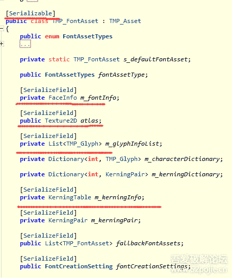

QQ图片018.png (40.24 KB, 下载次数: 229)

[href="forum.php?mod=attachment&aid=MjQ5NTE0OXxlNWM1NTEwMXwxNzkzNTc2MTcwfDE2ODA4NnwxNTg4NTU5&nothumb=yes" target="_blank"](https://www.52pojie.cn/forum.php?mod=attachment&aid=MjQ5NTE0OXxlNWM1NTEwMXwxNzkzNTc2MTcwfDE2ODA4NnwxNTg4NTU5&nothumb=yes)

2022-2-16 10:34 上传

注意这个 `[Serializable]` 标识，C# 拥有自动序列化的特性，只需要一个 `[Serializable]` 即可轻松序列化反序列化实例，再对照看看我们 `AssetBundleExtractor` 看到的信息，破案了兄弟们，

以及为什么 `AssetBundleExtractor` 查看信息之前要寻找 `dll`，就是通过反编译 `dll` 文件查找类属性，执行反序列化操作。自动序列化是一个好东西，但是这玩意是双刃剑，序列化是轻松了，

但是如果有任何字段的调整，比如添加新的序列化字段，之前序列化的东西就是无法再次在新的类上执行反序列化，表现出来的就是版本问题，版本不一样，你无法实现替换。

验证我的想法，`AssetBundleExtractor` 导出老的 `TMP` 信息，和我生成的 `TMP` 版本信息，一比较，果然：

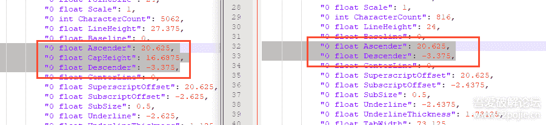

QQ图片019.png (38.17 KB, 下载次数: 223)

[href="forum.php?mod=attachment&aid=MjQ5NTE1Nnw4MWNmYWM0Y3wxNzkzNTc2MTcwfDE2ODA4NnwxNTg4NTU5&nothumb=yes" target="_blank"](https://www.52pojie.cn/forum.php?mod=attachment&aid=MjQ5NTE1Nnw4MWNmYWM0Y3wxNzkzNTc2MTcwfDE2ODA4NnwxNTg4NTU5&nothumb=yes)

2022-2-16 10:50 上传

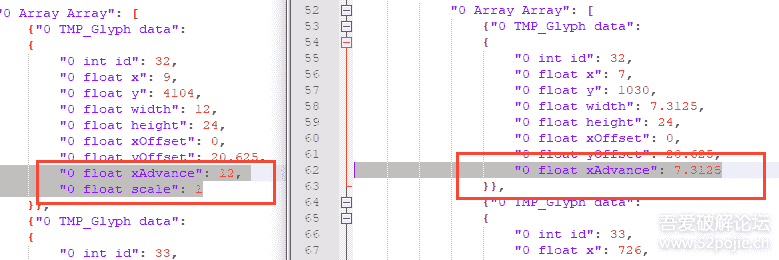

QQ图片020.png (33.12 KB, 下载次数: 220)

[href="forum.php?mod=attachment&aid=MjQ5NTE1N3xkNWZkZmE0Y3wxNzkzNTc2MTcwfDE2ODA4NnwxNTg4NTU5&nothumb=yes" target="_blank"](https://www.52pojie.cn/forum.php?mod=attachment&aid=MjQ5NTE1N3xkNWZkZmE0Y3wxNzkzNTc2MTcwfDE2ODA4NnwxNTg4NTU5&nothumb=yes)

2022-2-16 10:51 上传

新生成的字库比旧的字库信息多出来几项，删掉它。

字库信息还比较接近，`Material` 几乎就是面目全非了，完全没有修改的价值，好在游戏里的文字特效比较简单，就一个描边和阴影

了解了一下 `TMP` 的文字特效设置，找到阴影设置项

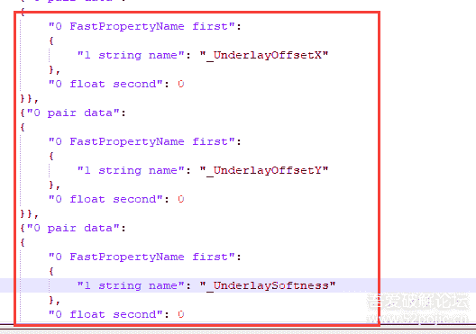

QQ图片021.png (23.24 KB, 下载次数: 203)

[href="forum.php?mod=attachment&aid=MjQ5NTE1OXwzNjc0NjEwNXwxNzkzNTc2MTcwfDE2ODA4NnwxNTg4NTU5&nothumb=yes" target="_blank"](https://www.52pojie.cn/forum.php?mod=attachment&aid=MjQ5NTE1OXwzNjc0NjEwNXwxNzkzNTc2MTcwfDE2ODA4NnwxNTg4NTU5&nothumb=yes)

2022-2-16 10:55 上传

`_UnderlayOffsetX` 是阴影的X轴偏移，同理Y是Y轴偏移，`_UnderlaySoftness` 是阴影的虚化程度，这里我都改为0，因为已经有描边了，阴影效果不好，主要是我换了字体，原来的设置不适用。

修改完成后，导入，再测试，完美，收工收工，前前后后折腾了快一个礼拜了。


QQ图片022.png (27.33 KB, 下载次数: 218)

[href="forum.php?mod=attachment&aid=MjQ5NTE2MnxkNWI0ZjYyOHwxNzkzNTc2MTcwfDE2ODA4NnwxNTg4NTU5&nothumb=yes" target="_blank"](https://www.52pojie.cn/forum.php?mod=attachment&aid=MjQ5NTE2MnxkNWI0ZjYyOHwxNzkzNTc2MTcwfDE2ODA4NnwxNTg4NTU5&nothumb=yes)

2022-2-16 10:59 上传

## 五、总结：

unity引擎汉化要特别注意版本问题，实在找不到原版本，找个差不多的版本来改吧。

文中并没有介绍各种工具的操作方法，具体使用百度上有很多了。

最后给大家分享一个我收集的各版本的Text Mesh Pro，不妨收藏一下，万一哪天用上了呢。


[href="forum.php?mod=attachment&aid=MjQ5NTE2N3wwYjlkMWE2MHwxNzkzNTc2MTcwfDE2ODA4NnwxNTg4NTU5" target="_blank"](https://www.52pojie.cn/forum.php?mod=attachment&aid=MjQ5NTE2N3wwYjlkMWE2MHwxNzkzNTc2MTcwfDE2ODA4NnwxNTg4NTU5)

(194 Bytes, 下载次数: 118)

2022-2-16 11:09 上传

点击文件名下载附件

下载积分: 吾爱币 -1 CB
