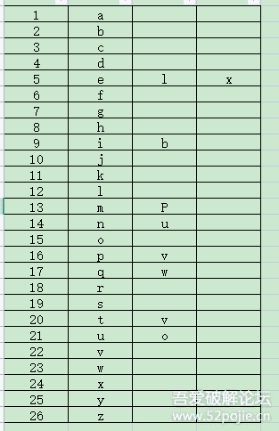
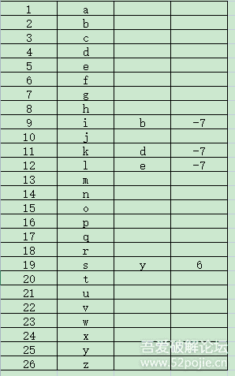
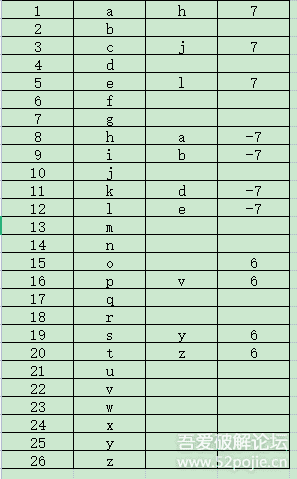
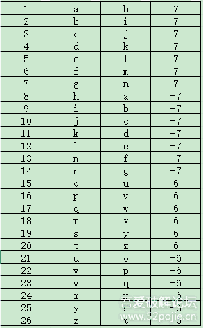
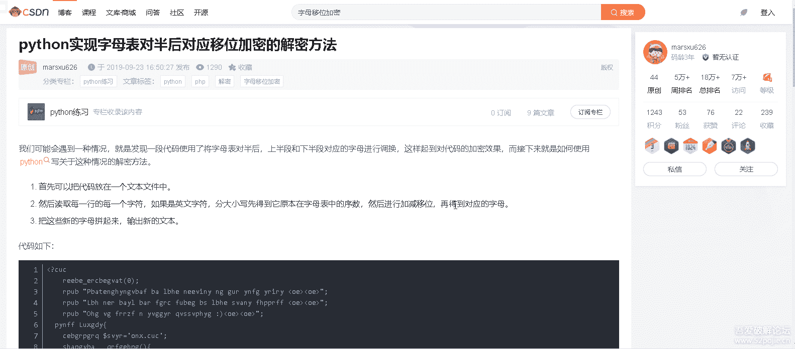

# \[原创\] 破解某游戏存档字母移位加密

- 原帖：https://www.52pojie.cn/forum.php?mod=viewthread&tid=1588592
- 抓取时间：2026-11-01T23:36:11

## 前言

首先声明一下，本人小白一枚，能在百度的帮助下大概看懂一些简单的代码，写这篇文章的目的是提供一些思路以供像我一样的小白学习，文中如果有误欢迎大佬指正。


话不多说，直接上存档：

```text
103
209
01048016120090330090450090450200340100320080330060
211319
305
```

存档内容较多，这里选取了一部分贴出来，可以看到这个存档仅仅对`name`做了加密，加密过后看起来是混乱的字母组合，我们假设这就是字母移位的加密，按照这个思路分析一下试试：

## 推测加密规律

为了方便分析，我们尽量控制变量，先把游戏存档删除，开个初始存档保存一下，然后再进去玩一下，获得第一件装备后再保存一个存档，通过比对这两个存档，我发现获得装备后的存档多了一行：

```text
01048016120090330090450090450200340100320080330060
```

再对比游戏里装备的属性，发现后面的数值能完美对应，OK，我们可以确定这一行存档就代表装备了，想改装备的话改后面的数字就行了，但是到这一步我们肯定不能满足啊，毕竟还有好多存档不知道对应着什么，所以我们尝试一下破解。

装备用英语怎么说？幸好我的英语还没丢


，果断上百度搜了一下：`equipment`，反手掏出我的Excel开始尝试：

先把`a~z`输入进去，加上编上号，取上面`string name`的前9个字母`lwobvPxuv`对应`equipment`：



1.png (12.79 KB, 下载次数: 1)

[附件](https://www.52pojie.cn/forum.php?mod=attachment&aid=MjQ5NTE1MHw4YjUxMzQ5N3wxNzkzNTc2MTY4fDE2ODA4NnwxNTg4NTky&nothumb=yes)

2022-2-16 10:44 上传

填好之后我陷入了沉思


，这明显不对啊！`equipment`有俩`e`，一个对应`l`一个对应`x`。。。。

莫非我之前的推测有误？这并不是字母移位加密？不死心的我决定再试试：

这时候我想到一个大概率会存在的单词：`skill`-技能，而且这个单词比较有特色，有两个连续的L，如果移位加密的话得出的结果肯定有连续两个相同的字母，通过一番查找，我发现存档里多次出现的“`ydbee`”嫌疑很大，再放入我的字母表试一下：



2.png (12.62 KB, 下载次数: 1)

[附件](https://www.52pojie.cn/forum.php?mod=attachment&aid=MjQ5NTE2NXw0ZTc4YjU1Y3wxNzkzNTc2MTY4fDE2ODA4NnwxNTg4NTky&nothumb=yes)

2022-2-16 11:01 上传

我们发现有三个字母都是向上偏移了7位，感觉这个思路是正确的，但是还有个不是偏移7位的怎么说！


然后。。。。破解又陷入了僵局。。。。


上面说过，我已经确定了装备怎么改，已经能修改出变态装备各种秒了，本来是准备放弃的，但是我不甘心啊。。。

于是我祭出了一件大杀器 ——`Il2CppDumper`


感谢大佬编写这么好用的工具，让我拿到了`dump.cs`这个文件！

在 dump 出的文件里搜索`skill`：

```csharp
private int[] skillCheatLevelCheck; // 0x524
```

这个`skillCheatLevelCheck`跟下面的`ydbeeCalhzLlpleCaljd`明显就呼应上了啊！而且我发现貌似大写字母是不做移位处理的！Excel继续工作：



3.png (12.54 KB, 下载次数: 0)

[附件](https://www.52pojie.cn/forum.php?mod=attachment&aid=MjQ5NTE4MnxmMGVhYjYyN3wxNzkzNTc2MTY4fDE2ODA4NnwxNTg4NTky&nothumb=yes)

2022-2-16 11:34 上传

填上去之后就很明显了啊，前7个字母下移7位，7到14个字母上移7位，也就是前7个字母和它们下面的7个互换，26个字母除去这14个还剩12个，大胆推测下这12个也是6个一组互换：



4.png (13.77 KB, 下载次数: 1)

[附件](https://www.52pojie.cn/forum.php?mod=attachment&aid=MjQ5NTE4OXwyZDYxYjc5MXwxNzkzNTc2MTY4fDE2ODA4NnwxNTg4NTky&nothumb=yes)

2022-2-16 11:39 上传

按照这个规律带入刚才的推测的`equipment`试一下：`lwobvPxuvlxzsImBf = equipPropertyIfBm`


我没错！错的是百度和游戏作者！百度翻译的装备英文是`equipment`，结果这里是`equip`！


到这儿，解密工作已经完成了，如果是大佬肯定随手贴出几行代码，运行一下就解密完了，但是我不会啊。。。。难道几百行的游戏存档你让我手工翻译？

不存在的，虽然我不会敲代码，但是我会借（抄）鉴（袭）啊


5.png (14.82 KB, 下载次数: 2)

[附件](https://www.52pojie.cn/forum.php?mod=attachment&aid=MjQ5NTE5MHwxZjFiMGE3MXwxNzkzNTc2MTY4fDE2ODA4NnwxNTg4NTky&nothumb=yes)

2022-2-16 11:54 上传



6.png (97.43 KB, 下载次数: 1)

[附件](https://www.52pojie.cn/forum.php?mod=attachment&aid=MjQ5NTE5MXw5MTRjNWNhN3wxNzkzNTc2MTY4fDE2ODA4NnwxNTg4NTky&nothumb=yes)

2022-2-16 11:56 上传

## 大佬的解密代码

直接贴上大佬的代码：

```python
def main():        
    s=open("1.txt",'r')
    for line in s.readlines():
        line=line.strip(' ')
        result=shu(line)
        print(result)
def shu(line):
    temp=''        
    z="abcdefghijklmnopqrstuvwxyz"
    zz="ABCDEFGHIJKLMNOPQRSTUVWXYZ"
    for i in range(0,len(line)):
        if line[i] in z:
            m=ord(line[i])-96
            if m
```

经过一番认真阅（百）读（度），我大致懂了大佬的思路：通过返回字母对应的十进制整数进行移位操作，再对应到创建的`a~z`的字符串，不得不感叹大佬思路的精妙啊，开始修改：

```python
def main():     
    s=open("1.txt",'r')
    for line in s.readlines():
        line=line.strip(' ')
        result=shu(line)
        print(result)
def shu(line):
    temp='' 
    z="abcdefghijklmnopqrstuvwxyz"
    # zz="ABCDEFGHIJKLMNOPQRSTUVWXYZ"大写字母不用处理都注释掉
    for i in range(0,len(line)):
        if line[i] in z:
            m=ord(line[i])-96
            if m
```

`F5`跑一下看看结果：

```text
================ RESTART: C:\Users\Administrator\Desktop\zimu.py ===============
Traceback (most recent call last):
  File "C:\Users\Administrator\Desktop\zimu.py", line 35, in 
    main()
  File "C:\Users\Administrator\Desktop\zimu.py", line 5, in main
    result=shu(line)
  File "C:\Users\Administrator\Desktop\zimu.py", line 19, in shu
    temp+=z[m+6]
IndexError: string index out of range
```

额。。。报错了`IndexError: string index out of range`为什么会超出啊？


经过一番研（百）究（度），发现是因为字符串的第一位下标是0，所以`z[0]=a`，正确的移位应该是再减去1：`7-1=6`，`-7-1=-8`，`6-1=5`，`-6-1=-7`，修改好再跑一次：

```text
================ RESTART: C:\Users\Administrator\Desktop\zimu.py ===============
3289843741
1644816420
2
210905
```

额。。。成功了，但又没有完全成功，名字是对上了，本来对的又全错了，理论上也能凑合看，但我忍不了啊。。。


经过观察存档结构，大致的思路是这样的：首先查找`name=`，开头到`name=`后面这段不做处理直接输出，从`name=`后面开始查找第一个引号，这一段内容移位处理，引号后面也不处理：

定义好`start`和`end`

```python
start=str(line).find("name=",0,len(line))+6 #name=“占了6个字符，所以加6
end=str(line).find("\"",start,len(line))#引号要用“\”转义
```

完整代码如下，思路都在注释里了：

```python
def main(): 
    s=open("1.xml",'r') #存档是xml格式的
    for line in s.readlines():
        #line=line.strip(' ')不需要删空格，注释掉
        result=shu(line)
        print(result)
        with open('D:\\1.xml','a',encoding='utf-8') as f: #加个写入直接生成文件
            f.write(result)

def shu(line):
    temp=''
    start=str(line).find("name=",0,len(line))+6 #name=“占了6个字符，所以加6
    end=str(line).find("\"",start,len(line)) #引号要用“\”转义
    z="abcdefghijklmnopqrstuvwxyz"
    # zz="ABCDEFGHIJKLMNOPQRSTUVWXYZ"大写字母不用处理都注释掉
    if start
```

运行结果如下：

```text
```


```
=============== RESTART: C:\Users\Administrator\Desktop\zimu2.py ===============
103
209
01048016120090330090450090450200340100320080330060
211319
305
```
D盘下也生成了解密后的文件，至此存档字母移位加密破解完成！


### 后记：
写的很详（啰）细（嗦），因为我想把思考的过程也写出来，给跟我一样的小白一些思路，其实中间走了很多弯路，特别是最后的代码，一直在不停的试错，最后全靠百度一点点搞定的，因为我真的是小白，真的不会编程啊！

能够耐心看到这儿儿的靓仔，确定不给个评分再走吗？

