# [CTF] 【2022】春节解题领红包之三——新手向

- 原帖: https://www.52pojie.cn/forum.php?mod=viewthread&tid=1588987
- 抓取时间: 2026-11-01T23:36:00

## 那年我找到了一个`String`，却以为抓住了整个`Key`。

### 如果说上一篇是动静分离，那么这一篇就是动静结合了，对于大佬而言可能只需要`OD`工具就调出最终的结果了，但对我来这种菜鸡来讲需要多个工具一起分析，再加上一个不太灵光的脑袋，也是可以勉强一战的，推荐先阅读上一篇文章【2022】春节解题领红包之二——新手向 ( [//www.52pojie.cn/thread-1588722-1-1.html" target="_blank" rel="noopener noreferrer nofollow"](https://www.52pojie.cn/thread-1588722-1-1.html:href="https) ) 其中的一些思路和操作会对这道题的分析有帮助，如果你能动手跟着做一下那最好不过了，Enjoy the Time!

### 工欲善其事，必先利其器

吾爱专用虚拟机2.0 ( [//www.52pojie.cn/thread-661779-1-1.html" target="_blank" rel="noopener noreferrer nofollow"](https://www.52pojie.cn/thread-661779-1-1.html:href="https) )
`IDA`7.5 ( [//www.aliyundrive.com/s/4yE1LbvctT5" target="_blank" rel="noopener noreferrer nofollow"](https://www.aliyundrive.com/s/4yE1LbvctT5:rel="nofollow noopener" href="https) )

### 查壳

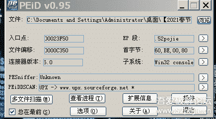
pic-55.png (32.17 KB, 下载次数: 1)
[href="forum.php?mod=attachment&aid=MjQ5NTcwM3w5MTY2ZDU3YnwxNzkzNTc2MTU4fDE2ODA4NnwxNTg4OTg3&nothumb=yes" target="_blank"](https://www.52pojie.cn/forum.php?mod=attachment&aid=MjQ5NTcwM3w5MTY2ZDU3YnwxNzkzNTc2MTU4fDE2ODA4NnwxNTg4OTg3&nothumb=yes)
2022-2-17 21:00 上传

### `UPX`壳,我们的老朋友，使用`ESP`定律即可，关于`ESP`定律脱壳详细操作可参考我之前文章 ( 2020春节红包之二———小白成长的血泪史[//www.52pojie.cn/thread-1101472-1-1.html" target="_blank" rel="noopener noreferrer nofollow"](https://www.52pojie.cn/thread-1101472-1-1.html:href="https) ) 观看脱壳部分学习即可，此处不多赘述。

### 收集信息，需要我们的`UID`和最终的`Key`，随便输入，提示`Error`

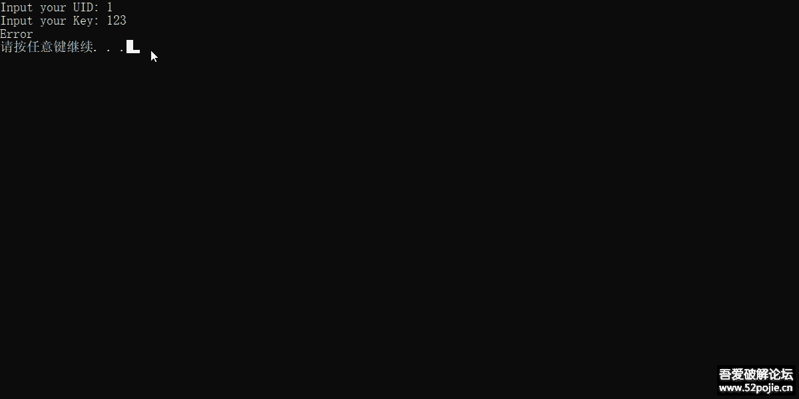
pic-56.png (9.23 KB, 下载次数: 1)
[href="forum.php?mod=attachment&aid=MjQ5NTcwNHwzZTM5MmI0OHwxNzkzNTc2MTU4fDE2ODA4NnwxNTg4OTg3&nothumb=yes" target="_blank"](https://www.52pojie.cn/forum.php?mod=attachment&aid=MjQ5NTcwNHwzZTM5MmI0OHwxNzkzNTc2MTU4fDE2ODA4NnwxNTg4OTg3&nothumb=yes)
2022-2-17 21:00 上传

## 动态追溯

### 将脱壳后的文件拖入`OD`，这里选择否

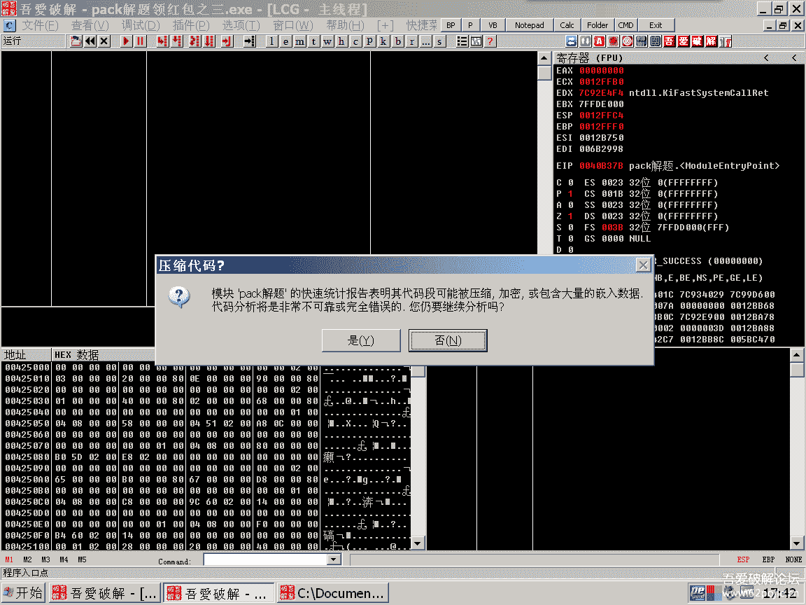
pic-57.png (76.32 KB, 下载次数: 1)
[href="forum.php?mod=attachment&aid=MjQ5NTcwNXw0MWU0YTI2NnwxNzkzNTc2MTU4fDE2ODA4NnwxNTg4OTg3&nothumb=yes" target="_blank"](https://www.52pojie.cn/forum.php?mod=attachment&aid=MjQ5NTcwNXw0MWU0YTI2NnwxNzkzNTc2MTU4fDE2ODA4NnwxNTg4OTg3&nothumb=yes)
2022-2-17 21:00 上传

### 右键依次选择中文搜索引擎—>智能搜索,`Ctrl+F` 找我们的提示信息`Error`(按`N`寻找下一个匹配项),这里除了`Error`,`Success`,还有一串神秘疑似`key`的字符串

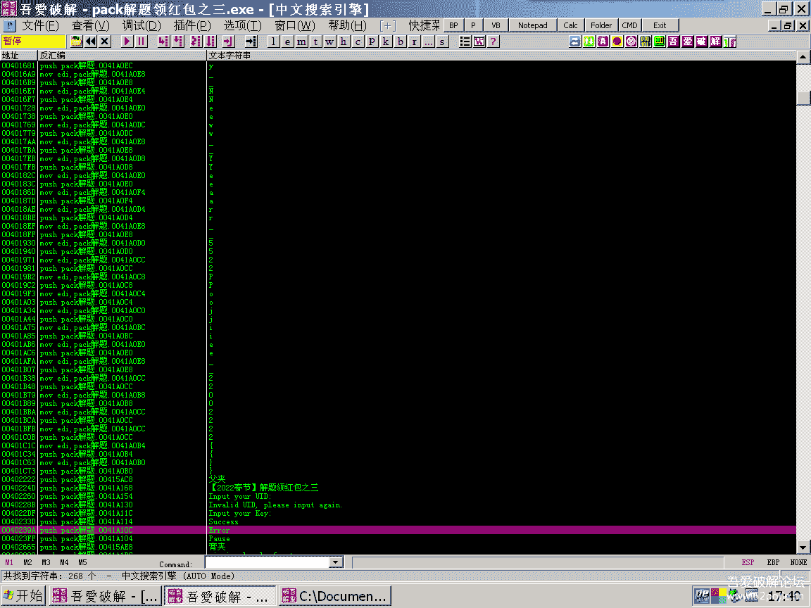
pic-58.png (78.52 KB, 下载次数: 1)
[href="forum.php?mod=attachment&aid=MjQ5NTcwNnw4Y2ZiOTQ5MXwxNzkzNTc2MTU4fDE2ODA4NnwxNTg4OTg3&nothumb=yes" target="_blank"](https://www.52pojie.cn/forum.php?mod=attachment&aid=MjQ5NTcwNnw4Y2ZiOTQ5MXwxNzkzNTc2MTU4fDE2ODA4NnwxNTg4OTg3&nothumb=yes)
2022-2-17 21:00 上传

### 结合前几年的题目，开始我的偷懒猜想，可就是这个字符串，困了我整整一天

pic-59.png (46.12 KB, 下载次数: 0)
[href="forum.php?mod=attachment&aid=MjQ5NTcwN3wzMWRjMDM5MnwxNzkzNTc2MTU4fDE2ODA4NnwxNTg4OTg3&nothumb=yes" target="_blank"](https://www.52pojie.cn/forum.php?mod=attachment&aid=MjQ5NTcwN3wzMWRjMDM5MnwxNzkzNTc2MTU4fDE2ODA4NnwxNTg4OTg3&nothumb=yes)
2022-2-17 21:00 上传

### 既然看到我们的`Success`，那就它对应的汇编代码，双击后回到我们的汇编页面，熟悉的`jnz`，熟悉的`cmp`，还是原来的配方，还是原来的味道

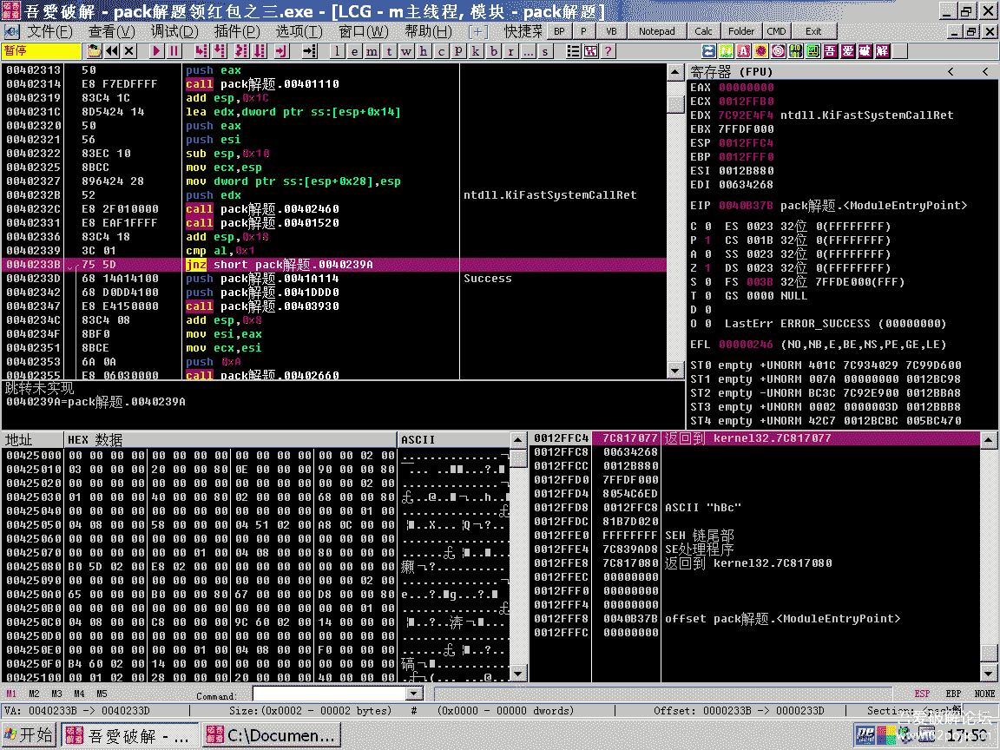
pic-60.png (91.18 KB, 下载次数: 1)
[href="forum.php?mod=attachment&aid=MjQ5NTcwOHw0MGMwZDRkNHwxNzkzNTc2MTU4fDE2ODA4NnwxNTg4OTg3&nothumb=yes" target="_blank"](https://www.52pojie.cn/forum.php?mod=attachment&aid=MjQ5NTcwOHw0MGMwZDRkNHwxNzkzNTc2MTU4fDE2ODA4NnwxNTg4OTg3&nothumb=yes)
2022-2-17 21:00 上传

### 往上我们发现了两个`call`函数，在离的最近的下个断点(按`F2`或者双击汇编代码前区域)，待会看看有没有什么发现，按`F9`运行程序后，输入测试的1和123456（假装自己的`UID`为1哈哈哈哈），`F7`进入断点，一通`F8`过后，手指都快按断了，却什么也没有发现

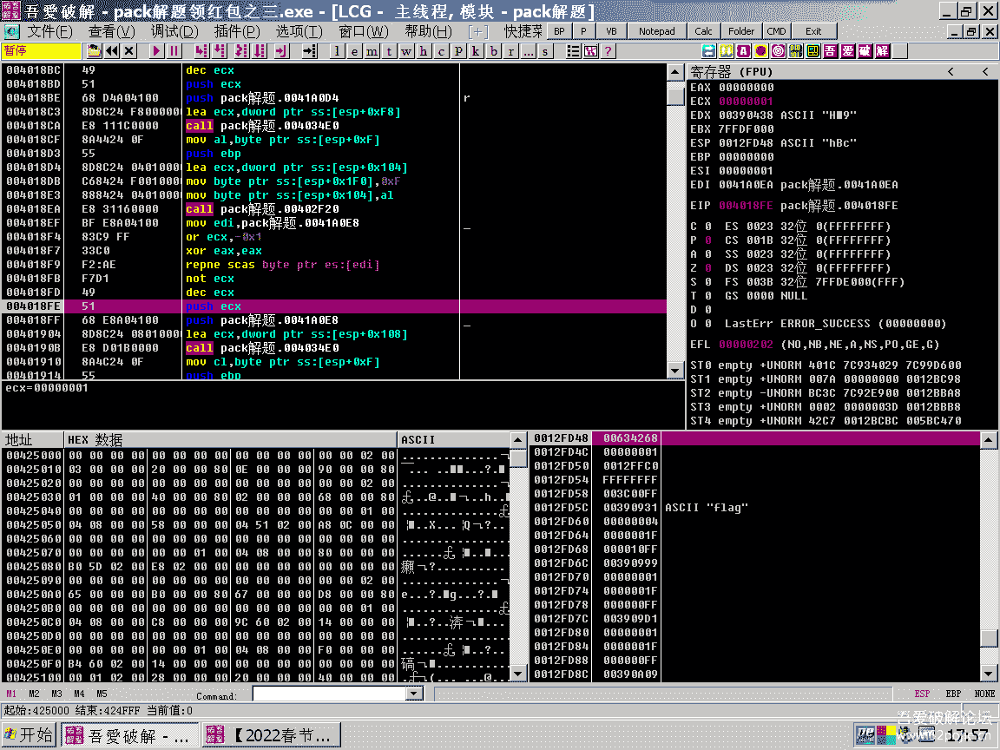
pic-61.png (88.53 KB, 下载次数: 0)
[href="forum.php?mod=attachment&aid=MjQ5NTcwOXw1ZDNmZjc1OXwxNzkzNTc2MTU4fDE2ODA4NnwxNTg4OTg3&nothumb=yes" target="_blank"](https://www.52pojie.cn/forum.php?mod=attachment&aid=MjQ5NTcwOXw1ZDNmZjc1OXwxNzkzNTc2MTU4fDE2ODA4NnwxNTg4OTg3&nothumb=yes)
2022-2-17 21:00 上传

## 静态分析

### 于是决定使用`IDA`分析一波，将文件再拖入`IDA`中看看有什么发现，阿，很快啊，我们就找到`Success`了，然后发现它上方面的判断模块，`F5`将汇编代码转为伪代码，(使用`Shift+F12`调处字符串窗口，再搜索`Success`也是可以的)

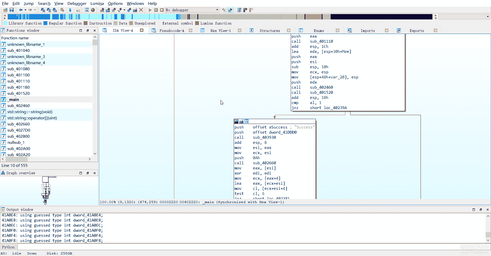
pic-62.png (134.66 KB, 下载次数: 1)
[href="forum.php?mod=attachment&aid=MjQ5NTcxMHxmOGI2YjZkNnwxNzkzNTc2MTU4fDE2ODA4NnwxNTg4OTg3&nothumb=yes" target="_blank"](https://www.52pojie.cn/forum.php?mod=attachment&aid=MjQ5NTcxMHxmOGI2YjZkNnwxNzkzNTc2MTU4fDE2ODA4NnwxNTg4OTg3&nothumb=yes)
2022-2-17 21:00 上传

### 这里的`sub_401520`函数就是决定我们成功或是失败的条件，这里要求它的返回值为1才能进入`Success`，点击`sub_401520`函数，进入它的内部看看

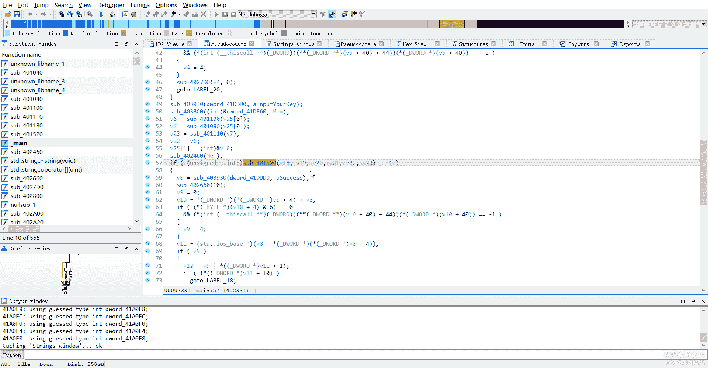
pic-63.png (160.86 KB, 下载次数: 0)
[href="forum.php?mod=attachment&aid=MjQ5NTcxMXxhZDJiMWRhZXwxNzkzNTc2MTU4fDE2ODA4NnwxNTg4OTg3&nothumb=yes" target="_blank"](https://www.52pojie.cn/forum.php?mod=attachment&aid=MjQ5NTcxMXxhZDJiMWRhZXwxNzkzNTc2MTU4fDE2ODA4NnwxNTg4OTg3&nothumb=yes)
2022-2-17 21:00 上传

### 直接滑到底部发现`result`，而`result`的结果又与`v8`的值有关，而`v8`的结果又与另外一个函数`sub_403ED0`有关，这搁这套娃呢这是。我们必须保证`v8`返回值为`false`(为0)，才可以使`result`的值为1，我们在这里打上断点(双击)，调试看看（这里不清楚的同学可以看我开头提到的前一篇文章）这里的`if`语句以及这个函数中很长的代码部分需要注意一下，我们后边会用到

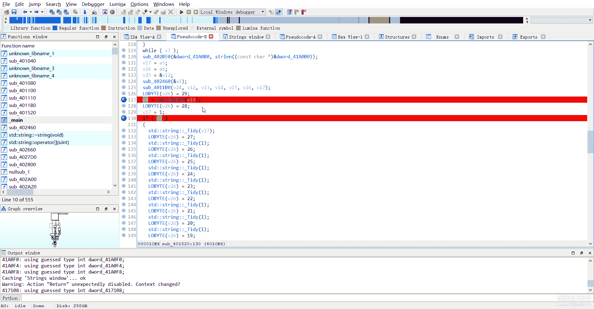
pic-64.png (161.24 KB, 下载次数: 1)
[href="forum.php?mod=attachment&aid=MjQ5NTcxMnw1NmYxYzUzY3wxNzkzNTc2MTU4fDE2ODA4NnwxNTg4OTg3&nothumb=yes" target="_blank"](https://www.52pojie.cn/forum.php?mod=attachment&aid=MjQ5NTcxMnw1NmYxYzUzY3wxNzkzNTc2MTU4fDE2ODA4NnwxNTg4OTg3&nothumb=yes)
2022-2-17 21:00 上传

### 运行后输入我们的测试数据1，123456后回车，在断点的地方停下来，显示这个页面不用担心，按`F5`将代码转为伪`C`代码

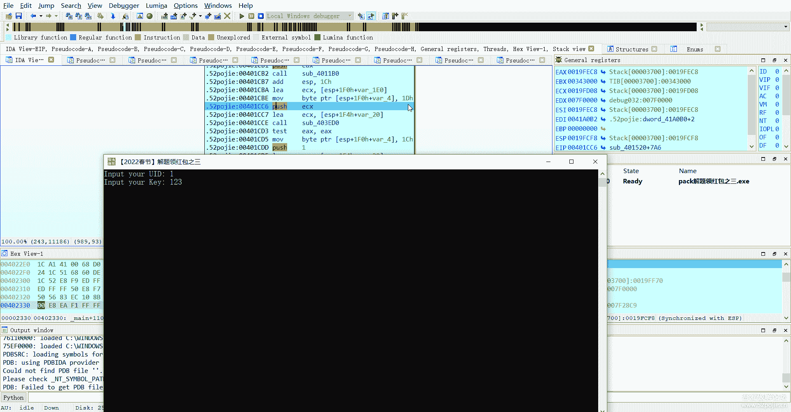
pic-65.png (152.49 KB, 下载次数: 2)
[href="forum.php?mod=attachment&aid=MjQ5NTcxM3w1NThlNTlkN3wxNzkzNTc2MTU4fDE2ODA4NnwxNTg4OTg3&nothumb=yes" target="_blank"](https://www.52pojie.cn/forum.php?mod=attachment&aid=MjQ5NTcxM3w1NThlNTlkN3wxNzkzNTc2MTU4fDE2ODA4NnwxNTg4OTg3&nothumb=yes)
2022-2-17 21:00 上传

### 按`F7`进入函数内部，然后`F8`执行，如果没有思路的时候，可以把鼠标悬停变量上，或许会有意想不到的收获，这里的`v3`为`0x21`，16进制转十进制即 33，这会预示什么呢？

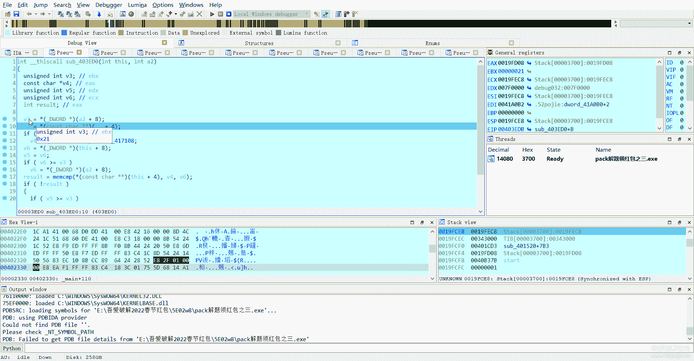
pic-66.png (171.64 KB, 下载次数: 1)
[href="forum.php?mod=attachment&aid=MjQ5NTcxNHwwNmY0ODY0ZnwxNzkzNTc2MTU4fDE2ODA4NnwxNTg4OTg3&nothumb=yes" target="_blank"](https://www.52pojie.cn/forum.php?mod=attachment&aid=MjQ5NTcxNHwwNmY0ODY0ZnwxNzkzNTc2MTU4fDE2ODA4NnwxNTg4OTg3&nothumb=yes)
2022-2-17 21:00 上传

### 继续`F8`，这个`V4`变量显示一个`String`(字符串)

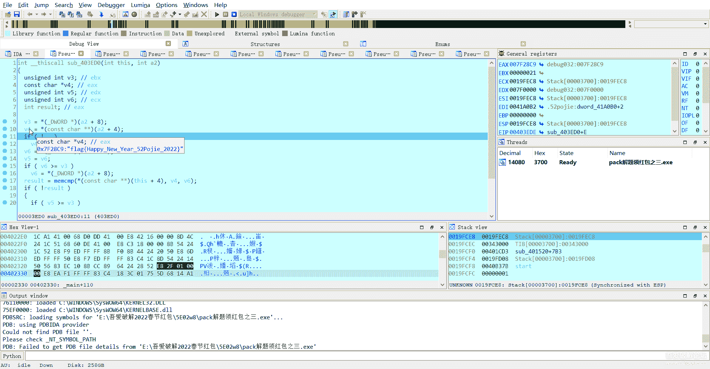
pic-67.png (171.73 KB, 下载次数: 1)
[href="forum.php?mod=attachment&aid=MjQ5NTcxNXw0Y2U1NmFjY3wxNzkzNTc2MTU4fDE2ODA4NnwxNTg4OTg3&nothumb=yes" target="_blank"](https://www.52pojie.cn/forum.php?mod=attachment&aid=MjQ5NTcxNXw0Y2U1NmFjY3wxNzkzNTc2MTU4fDE2ODA4NnwxNTg4OTg3&nothumb=yes)
2022-2-17 21:00 上传

### 双击`V4`，找到它的源地址，并把这个`String`拿到，得到"`flag{Happy_New_Year_52Pojie_2022}`"，字符串长度恰好为33 = (`0x21`)，这就是答案吗？不，才刚刚开始，，，

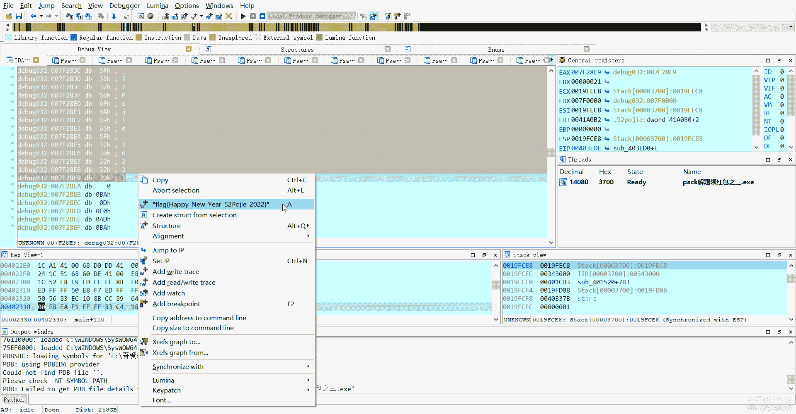
pic-68.png (199.37 KB, 下载次数: 1)
[href="forum.php?mod=attachment&aid=MjQ5NTcxN3w2ZTdkYzUzZnwxNzkzNTc2MTU4fDE2ODA4NnwxNTg4OTg3&nothumb=yes" target="_blank"](https://www.52pojie.cn/forum.php?mod=attachment&aid=MjQ5NTcxN3w2ZTdkYzUzZnwxNzkzNTc2MTU4fDE2ODA4NnwxNTg4OTg3&nothumb=yes)
2022-2-17 21:01 上传

### 继续向下分析，我们发现这个`v6`中存放的值是3，也就是我们输入的字符串"`123`"的长度，而接下来又看见我们熟悉的`result` 和`memcmp`函数了，前面提到需要保证返回值为0，才可以进入`Success`，据此我们可知`Key`的长度为33

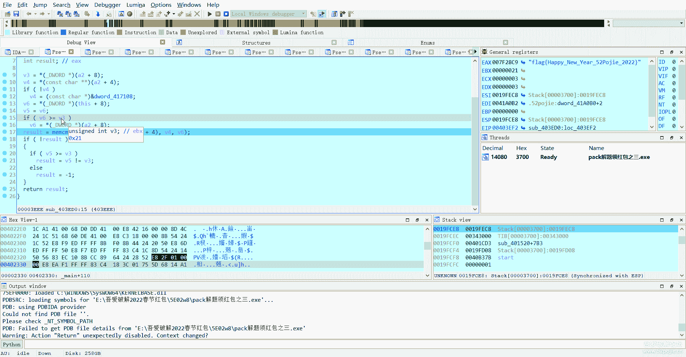
pic-69.png (166.95 KB, 下载次数: 1)
[href="forum.php?mod=attachment&aid=MjQ5NTcxOHw1NTMzOTU0MHwxNzkzNTc2MTU4fDE2ODA4NnwxNTg4OTg3&nothumb=yes" target="_blank"](https://www.52pojie.cn/forum.php?mod=attachment&aid=MjQ5NTcxOHw1NTMzOTU0MHwxNzkzNTc2MTU4fDE2ODA4NnwxNTg4OTg3&nothumb=yes)
2022-2-17 21:01 上传

解题的那天家里正好还来了客人，我顾不得那么那么多，在电脑前不肯放弃（大家千万别学我），因为看多了B站老冯的 鸡汤来喽 的视频，找到这个`String`的时候高兴的不得了，情不自禁的念叨着"这(解题)多是一件美事呀！"

但使用获得的`"flag{Happy_New_Year_52Pojie_2022}"`却显示不正确，场面一度十分尴尬。起初以为是`UID`问题，后来由改了正确的`UID`，然后还是不行，摸摸我的秀发，深深的陷入了沉思

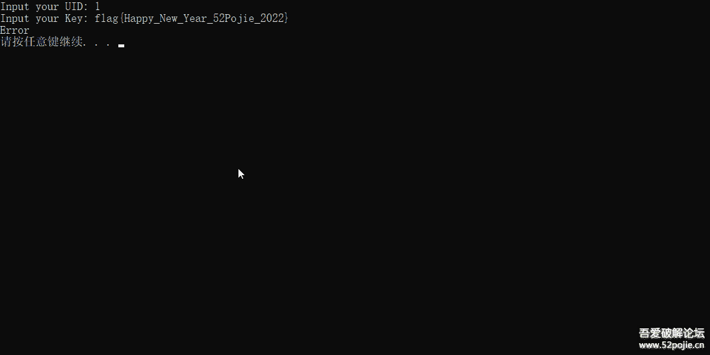

`pic-70.png` (10.29 KB, 下载次数: 1)

[href="forum.php?mod=attachment&aid=MjQ5NTcxOXw5ODFmYmY0ZHwxNzkzNTc2MTU4fDE2ODA4NnwxNTg4OTg3&nothumb=yes" target="_blank"](https://www.52pojie.cn/forum.php?mod=attachment&aid=MjQ5NTcxOXw5ODFmYmY0ZHwxNzkzNTc2MTU4fDE2ODA4NnwxNTg4OTg3&nothumb=yes)

2022-2-17 21:01 上传

## 再回 `OD`

在次将程序拖入`OD`，使用现在已知的条件，一次又一次的`F8`分析尝试，一次又一次`Error`，心里的疑惑越来越大，到底哪里出问题了？后来突然看着自己记录的字符串，忽然想起很久以前了解过一丁点密码学知识，似乎是凯撒加密还是别的什么，用于字符的移位操做，如`ABC—>DEF`，那么这道题是不是也有这样加密的方法

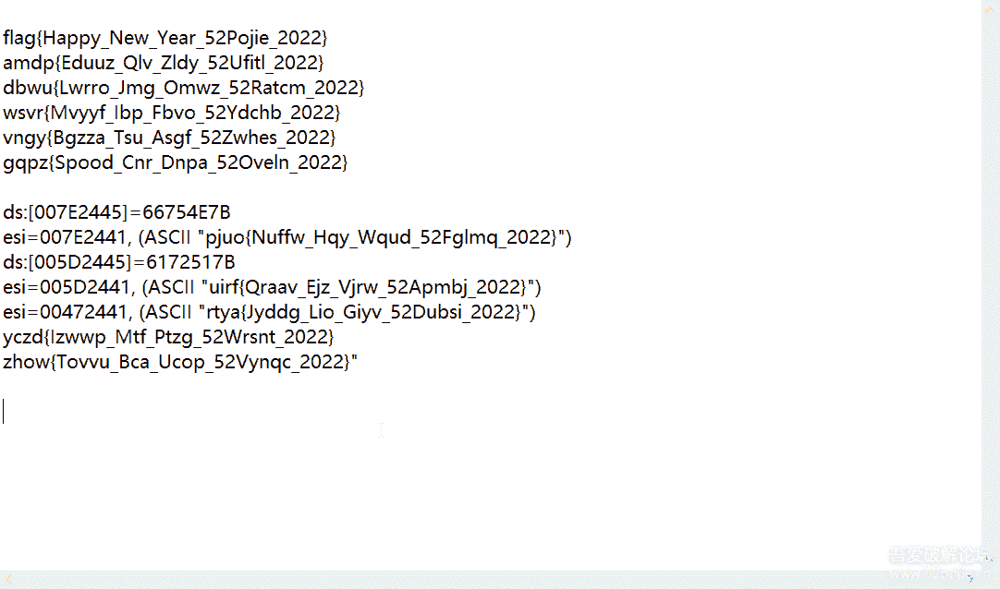

`pic-71.png` (46.11 KB, 下载次数: 1)

[href="forum.php?mod=attachment&aid=MjQ5NTcyMHw5ZmQxMmIwY3wxNzkzNTc2MTU4fDE2ODA4NnwxNTg4OTg3&nothumb=yes" target="_blank"](https://www.52pojie.cn/forum.php?mod=attachment&aid=MjQ5NTcyMHw5ZmQxMmIwY3wxNzkzNTc2MTU4fDE2ODA4NnwxNTg4OTg3&nothumb=yes)

2022-2-17 21:01 上传

结合之前在`IDA`中发现的`memcmp`函数，可知需要比较的字符串为`"flag{Happy_New_Year_52Pojie_2022}"`,也就是说，并不是要输入这个`String`，而是需要我们输入的`Key`经过计算后得到这个`String`，这才是解题的关键，在`OD`中看到的很长的`F8`的过程，其实就是在对字符串进行运算，然后做比较在返回结果。根据`OD`中显示的字符串发现数字没有改变，也就是说这个`Key`的加密运算和我们的输入的字母有关系，那么大小写字母对应的值也不一样(在这里我甚至已经联想到`ASCII`码，但没找到规律)，所以将26个字母大小写输入会得到运算后的关系，进而得到我们要找的答案。

使用`OD`载入程序，这里输入测试`UID = 1`, `Key = "abcdefghijklmnopqrstuvwxyz"`

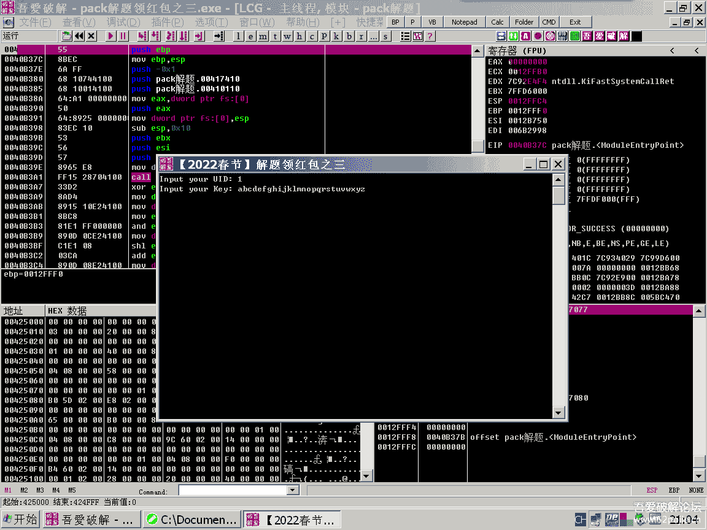

`pic-72.png` (82.75 KB, 下载次数: 1)

[href="forum.php?mod=attachment&aid=MjQ5NTcyMXw3MWNjMjcwZHwxNzkzNTc2MTU4fDE2ODA4NnwxNTg4OTg3&nothumb=yes" target="_blank"](https://www.52pojie.cn/forum.php?mod=attachment&aid=MjQ5NTcyMXw3MWNjMjcwZHwxNzkzNTc2MTU4fDE2ODA4NnwxNTg4OTg3&nothumb=yes)

2022-2-17 21:01 上传

在之前我们下过的断点处停下，然后`F7`再进入函数内部，距离`Success`很近的`call`函数

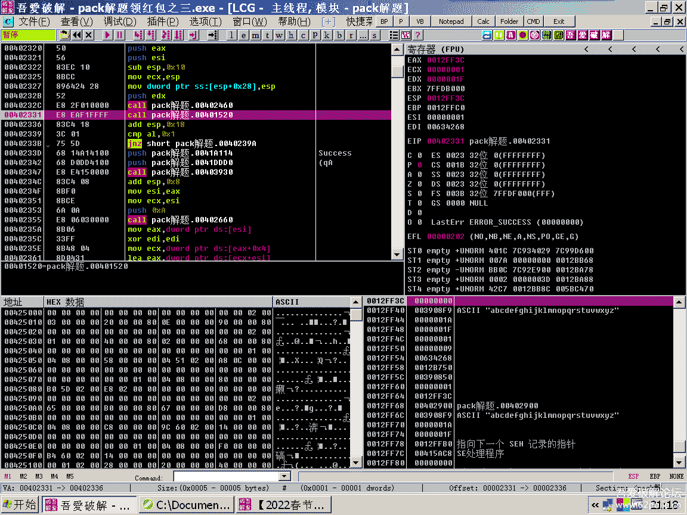

`pic-73.png` (91.9 KB, 下载次数: 2)

[href="forum.php?mod=attachment&aid=MjQ5NTcyMnw2MGUwYzU2MHwxNzkzNTc2MTU4fDE2ODA4NnwxNTg4OTg3&nothumb=yes" target="_blank"](https://www.52pojie.cn/forum.php?mod=attachment&aid=MjQ5NTcyMnw2MGUwYzU2MHwxNzkzNTc2MTU4fDE2ODA4NnwxNTg4OTg3&nothumb=yes)

2022-2-17 21:01 上传

这里需要很多次`F8`，结合之前在`IDA`中获得的信息，这个函数内有一个`if`条件，而且这里有许多相似的代码块，滑动鼠标中键，并且观察一下右边的内容，可以看到会重复重复出`"flag{Happy_New_Year_52Pojie_2022}"`,找到最后一个`}`

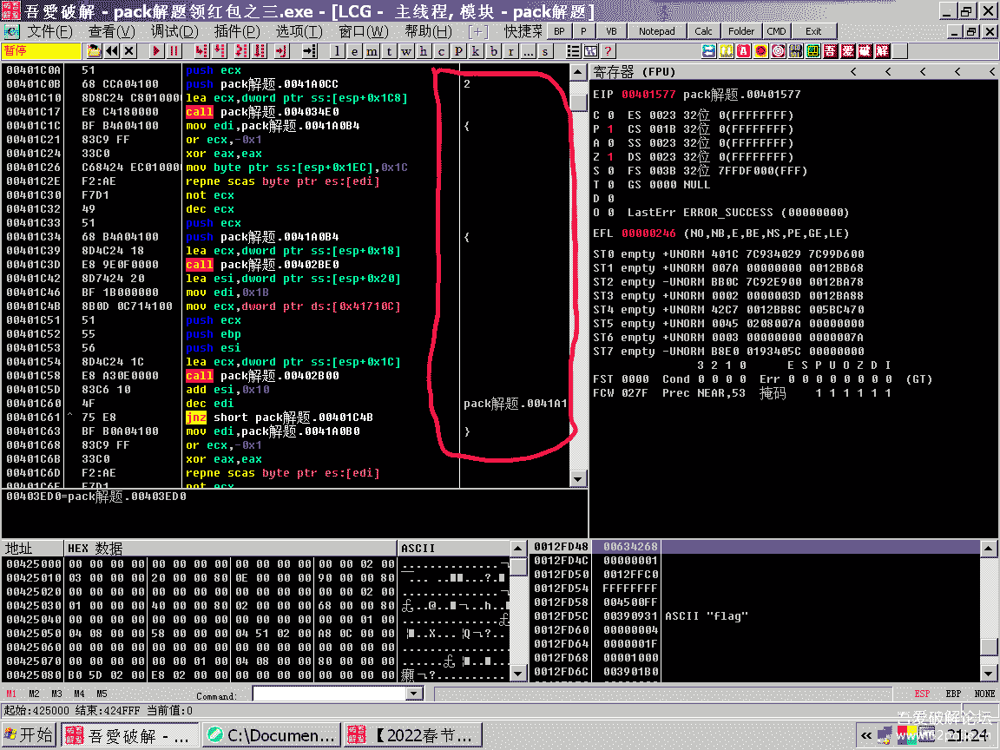

`pic-74.png` (102.19 KB, 下载次数: 1)

[href="forum.php?mod=attachment&aid=MjQ5NTcyM3w1MjQwYmRiN3wxNzkzNTc2MTU4fDE2ODA4NnwxNTg4OTg3&nothumb=yes" target="_blank"](https://www.52pojie.cn/forum.php?mod=attachment&aid=MjQ5NTcyM3w1MjQwYmRiN3wxNzkzNTc2MTU4fDE2ODA4NnwxNTg4OTg3&nothumb=yes)

2022-2-17 21:01 上传

再向下可以发现一些`call`函数，和`jnz`跳转，就近原则，在`00401CCE` 这个地址下断点，按`F9`直接运行到这个断点，再按`F7`进入函数

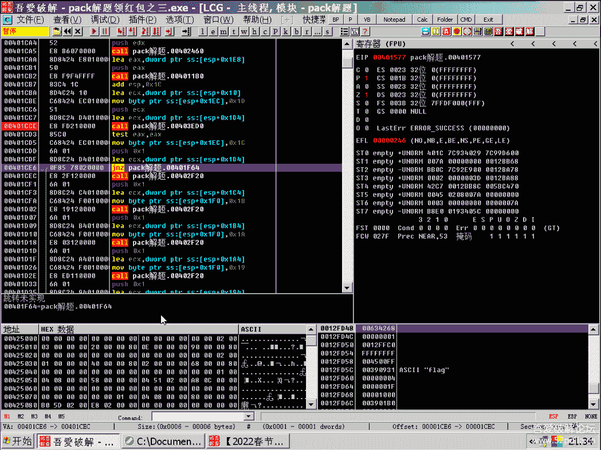

`pic-75.png` (498.7 KB, 下载次数: 0)

[href="forum.php?mod=attachment&aid=MjQ5NTcyNHxmZWE4N2NmYXwxNzkzNTc2MTU4fDE2ODA4NnwxNTg4OTg3&nothumb=yes" target="_blank"](https://www.52pojie.cn/forum.php?mod=attachment&aid=MjQ5NTcyNHxmZWE4N2NmYXwxNzkzNTc2MTU4fDE2ODA4NnwxNTg4OTg3&nothumb=yes)

2022-2-17 21:01 上传

一路`F8`可以发现输入的`"abcdefghijklmnopqrstuvwxyz"` 变成了 `"rajsbktcludmvenwfoxgpyhqzi"`，别忘了，这是`UID = 1`时获得的值

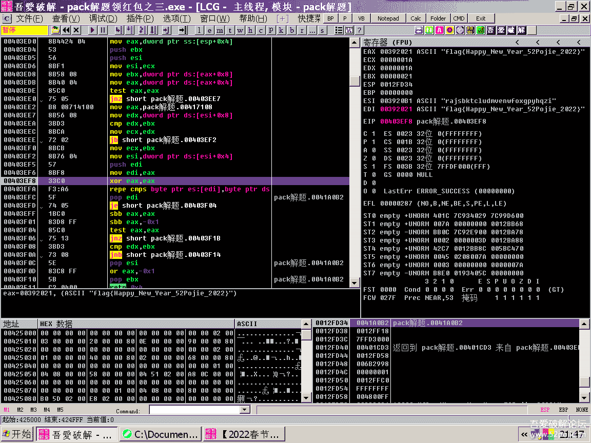

`pic-76.png` (90.89 KB, 下载次数: 1)

[href="forum.php?mod=attachment&aid=MjQ5NTcyNXw5NDM1NjBiNHwxNzkzNTc2MTU4fDE2ODA4NnwxNTg4OTg3&nothumb=yes" target="_blank"](https://www.52pojie.cn/forum.php?mod=attachment&aid=MjQ5NTcyNXw5NDM1NjBiNHwxNzkzNTc2MTU4fDE2ODA4NnwxNTg4OTg3&nothumb=yes)

2022-2-17 21:01 上传

输入我自己的`UID = "990855"`和对应的`key = "abcdefghijklmnopqrstuvwxyz"`,可以得到对应的真实`Key = "dshwlapetixmbqfujyncrgvkzo"`，类比得到大写的字母对应的内容。结合以上可知，这种加密更像是`MD5`的散列函数，即`Y = H(UID)`的关系，我们输入`UID`，可以得到对应的一个`Y`，再通过`Y`对我们输入的`Key`进行移位操作，使得它最终变成 `"flag{Happy_New_Year_52Pojie_2022}"`

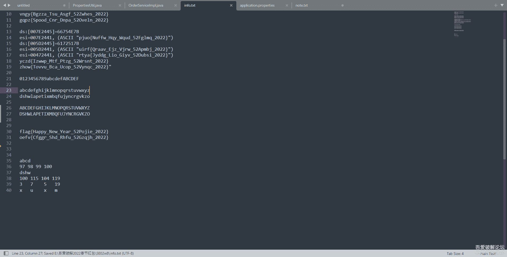

`pic-77.png` (105.95 KB, 下载次数: 1)

[href="forum.php?mod=attachment&aid=MjQ5NTcyNnxkNjM3MTYzMnwxNzkzNTc2MTU4fDE2ODA4NnwxNTg4OTg3&nothumb=yes" target="_blank"](https://www.52pojie.cn/forum.php?mod=attachment&aid=MjQ5NTcyNnxkNjM3MTYzMnwxNzkzNTc2MTU4fDE2ODA4NnwxNTg4OTg3&nothumb=yes)

2022-2-17 21:01 上传

通过上图可以得知我的`UID`计算后的字符对应关系，进而写出我的`Key` `"oefv{Cfggr_Shd_Rhfu_52Gzqjh_2022}"`，完美

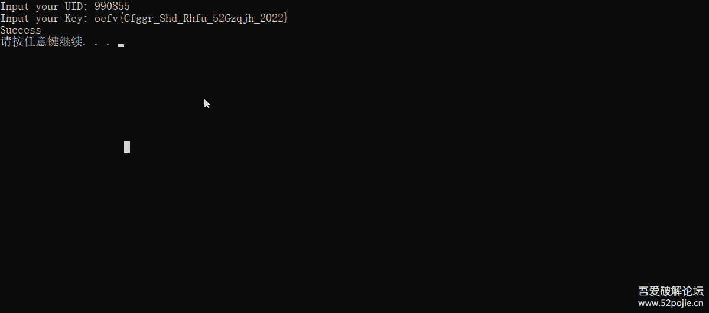

`pic-78.png` (20.63 KB, 下载次数: 1)

[href="forum.php?mod=attachment&aid=MjQ5NTcyN3xjYWJlY2Q1ZnwxNzkzNTc2MTU4fDE2ODA4NnwxNTg4OTg3&nothumb=yes" target="_blank"](https://www.52pojie.cn/forum.php?mod=attachment&aid=MjQ5NTcyN3xjYWJlY2Q1ZnwxNzkzNTc2MTU4fDE2ODA4NnwxNTg4OTg3&nothumb=yes)

2022-2-17 21:01 上传

官方其实对`UID`做了限制，从`IDA`中可以看出 `2000000` 就会提示错误，而这个函数保证了每个人所生成的`Key`是不一样的，避免在活动结束前泄露答案，还有每天只允许提交三次保证了服务不受过多的错误请求而占用资源（没错，就是我因为错误点击的刷新导致卡掉了当天的提交机会，只得到第二天凌晨提交），提交获得的`Key`后，后台就会根据用户的`UID`和`Key`进行计算得到`"flag{Happy_New_Year_52Pojie_2022}"`后，返回成功给前台， 真是妙啊。

还有一点有些疑惑的地方就是在下面的`if-else`条件语句块中，`IDA`中看到的代码似乎相差不大，是否说明这段代码设计之初有冗余，可以取公有的部分封装优化。

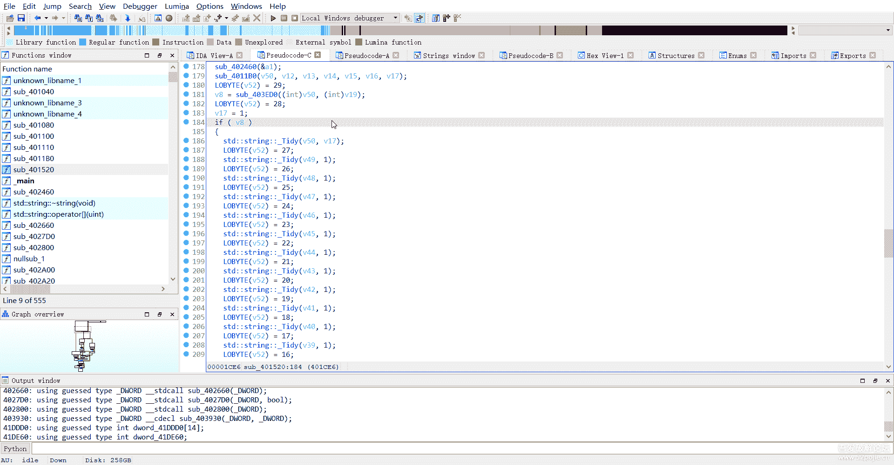

`pic-79.png` (171.57 KB, 下载次数: 1)

[href="forum.php?mod=attachment&aid=MjQ5NTcyOHwwNTk2Mjk4OXwxNzkzNTc2MTU4fDE2ODA4NnwxNTg4OTg3&nothumb=yes" target="_blank"](https://www.52pojie.cn/forum.php?mod=attachment&aid=MjQ5NTcyOHwwNTk2Mjk4OXwxNzkzNTc2MTU4fDE2ODA4NnwxNTg4OTg3&nothumb=yes)

2022-2-17 21:01 上传

此处应该有分析整个代码块的加密算法的，但因为我不仅菜，而且懒，所以没有了。

评论区有位大佬给出了解密的注册机算法源码，大家可以去围观学习一下。

关于第四和第五题，Andriod题目确实触及到我的盲区了，虽然发现了最终的答案就在`so`层，不过被混淆了，即使补了很多功课，也还是没有解出来，第五题说来惭愧，楼主本来是学`Java`的，自诩对`web`题目也应该会当能信手拈来，但是后来分析很久只拿到了`ts`文件，没有找到解密的`key`因此无法得出结果，实属遗憾。

本文是为给那些像楼主一样的小白选手一些学习的参考，能够帮助他们接触到一些相关的知识便足矣，能使他们得以动手实操学习之再好不过，我想论坛的初衷也在于此，这些内容也是源于论坛文章的学习，在解题过程中，我翻看了论坛之前历年的春节红包活动的WP文章，学习了许多大佬们的经验，相信在座聪明的各位也能得以成功。
