# [CTF] 【2022春节】解题领红包之windows中级题WP

- 原帖: https://www.52pojie.cn/forum.php?mod=viewthread&tid=1589209
- 抓取时间: 2026-11-01T23:35:58

## 脱壳

拖进`DIE`，有`UPX`壳

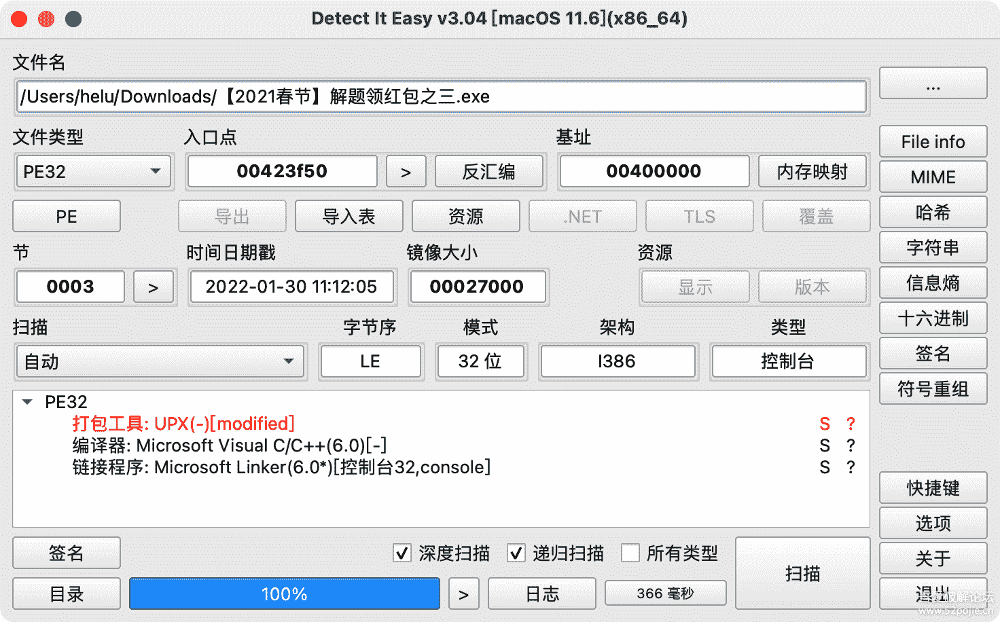

2022-02-03_14-43-28.png (206.23 KB, 下载次数: 3)

[href="forum.php?mod=attachment&aid=MjQ5NTUxN3xhMzIzODg1YnwxNzkzNTc2MTU2fDE2ODA4NnwxNTg5MjA5&nothumb=yes" target="_blank"](https://www.52pojie.cn/forum.php?mod=attachment&aid=MjQ5NTUxN3xhMzIzODg1YnwxNzkzNTc2MTU2fDE2ODA4NnwxNTg5MjA5&nothumb=yes)

2022-2-17 13:46 上传

`OD`脱壳，`ctrl+B`搜索`0000000000000`，找到上面的`jmp`，打断点。

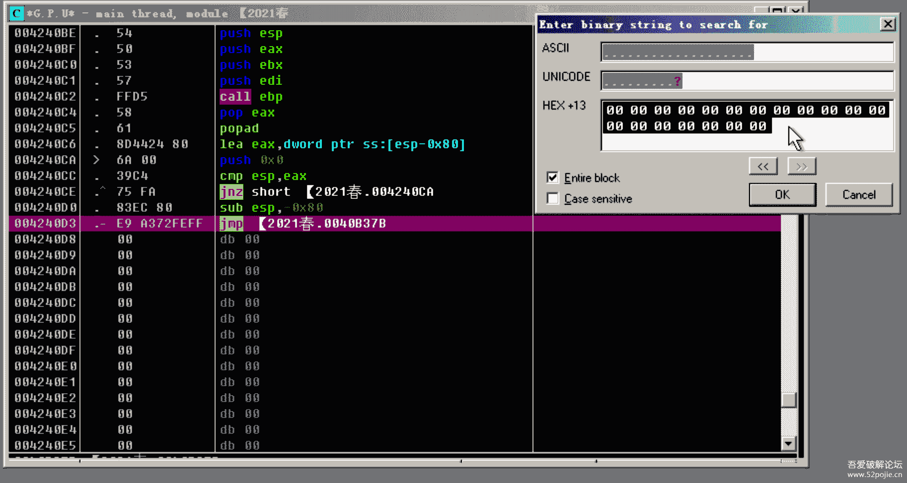

2022-02-03_14-44-30.png (115.07 KB, 下载次数: 3)

[href="forum.php?mod=attachment&aid=MjQ5NTUxOHxhYjUzMzc2NXwxNzkzNTc2MTU2fDE2ODA4NnwxNTg5MjA5&nothumb=yes" target="_blank"](https://www.52pojie.cn/forum.php?mod=attachment&aid=MjQ5NTUxOHxhYjUzMzc2NXwxNzkzNTc2MTU2fDE2ODA4NnwxNTg5MjA5&nothumb=yes)

2022-2-17 13:47 上传

运行，然后走一步，就到入口点了。

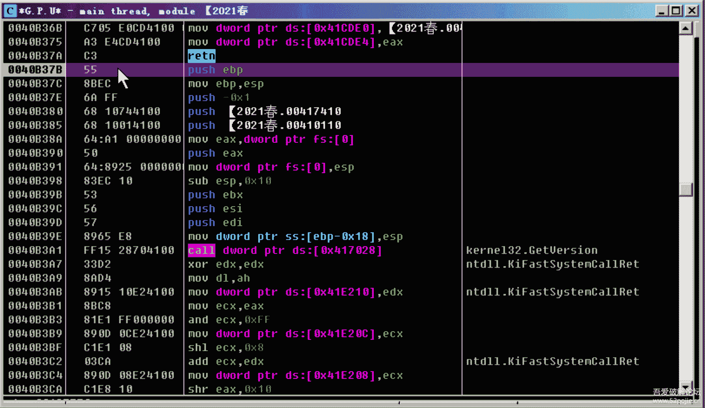

2022-02-03_14-46-58.png (128.58 KB, 下载次数: 2)

[href="forum.php?mod=attachment&aid=MjQ5NTUxOXwwM2ZlNGI5N3wxNzkzNTc2MTU2fDE2ODA4NnwxNTg5MjA5&nothumb=yes" target="_blank"](https://www.52pojie.cn/forum.php?mod=attachment&aid=MjQ5NTUxOXwwM2ZlNGI5N3wxNzkzNTc2MTU2fDE2ODA4NnwxNTg5MjA5&nothumb=yes)

2022-2-17 13:47 上传

## 跟流程

拖入`IDA`，看到`_main`函数，可以发现流线比较清楚，输入`UID`后有两个走向，分别是`UID`合法和不合法

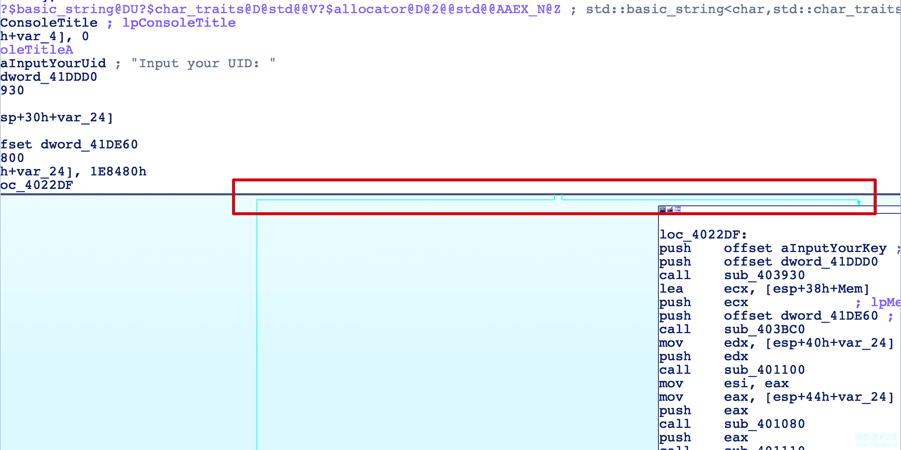

image-20220217141226279.png (419.38 KB, 下载次数: 2)

[href="forum.php?mod=attachment&aid=MjQ5NTU4NXxhMzU0YzBkM3wxNzkzNTc2MTU2fDE2ODA4NnwxNTg5MjA5&nothumb=yes" target="_blank"](https://www.52pojie.cn/forum.php?mod=attachment&aid=MjQ5NTU4NXxhMzU0YzBkM3wxNzkzNTc2MTU2fDE2ODA4NnwxNTg5MjA5&nothumb=yes)

2022-2-17 15:15 上传

在`UID`合法的走向中，又分了两条，分别是`Key`正确和不正确，这个`UID`啊，刚开始压根不知道是账户`UID`，后来看别人回帖才知道的。

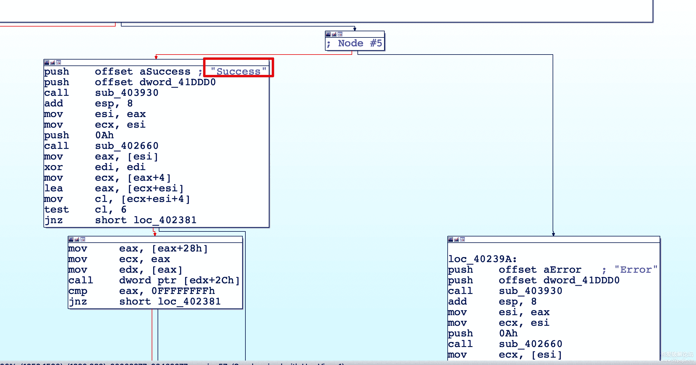

2022-02-03_15-39-04.png (450.68 KB, 下载次数: 3)

[href="forum.php?mod=attachment&aid=MjQ5NTUyMnw2NmRiMTJiZHwxNzkzNTc2MTU2fDE2ODA4NnwxNTg5MjA5&nothumb=yes" target="_blank"](https://www.52pojie.cn/forum.php?mod=attachment&aid=MjQ5NTUyMnw2NmRiMTJiZHwxNzkzNTc2MTU2fDE2ODA4NnwxNTg5MjA5&nothumb=yes)

2022-2-17 13:47 上传

使用`F5`反编译，查看具体算法

## 看算法

可以看到，这个`if-else`就是关键了

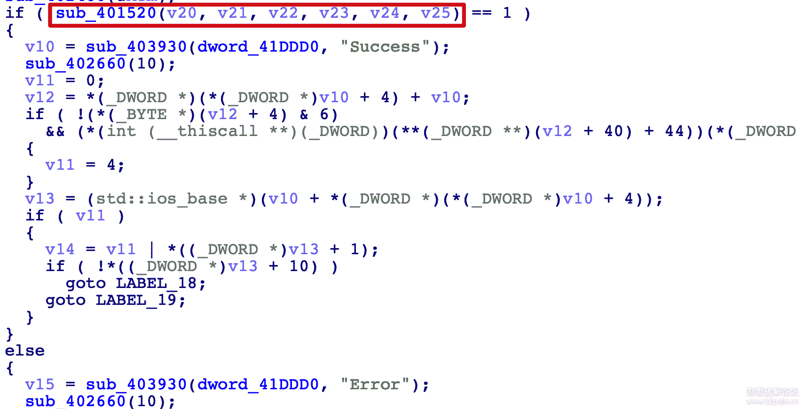

2022-02-03_15-43-23.png (280.4 KB, 下载次数: 3)

[href="forum.php?mod=attachment&aid=MjQ5NTUyM3wzODhmNDIyM3wxNzkzNTc2MTU2fDE2ODA4NnwxNTg5MjA5&nothumb=yes" target="_blank"](https://www.52pojie.cn/forum.php?mod=attachment&aid=MjQ5NTUyM3wzODhmNDIyM3wxNzkzNTc2MTU2fDE2ODA4NnwxNTg5MjA5&nothumb=yes)

2022-2-17 13:47 上传

进这个`sub_401520`函数看看，里面又有一个`if-else`，只有进到`else`才能返回`1`

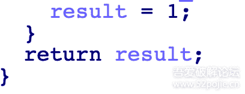

2022-02-03_15-46-02.png (23.78 KB, 下载次数: 3)

[href="forum.php?mod=attachment&aid=MjQ5NTUyNHw2MDBiNTQ4MHwxNzkzNTc2MTU2fDE2ODA4NnwxNTg5MjA5&nothumb=yes" target="_blank"](https://www.52pojie.cn/forum.php?mod=attachment&aid=MjQ5NTUyNHw2MDBiNTQ4MHwxNzkzNTc2MTU2fDE2ODA4NnwxNTg5MjA5&nothumb=yes)

2022-2-17 13:47 上传

而控制的关键在于`v8`这个变量

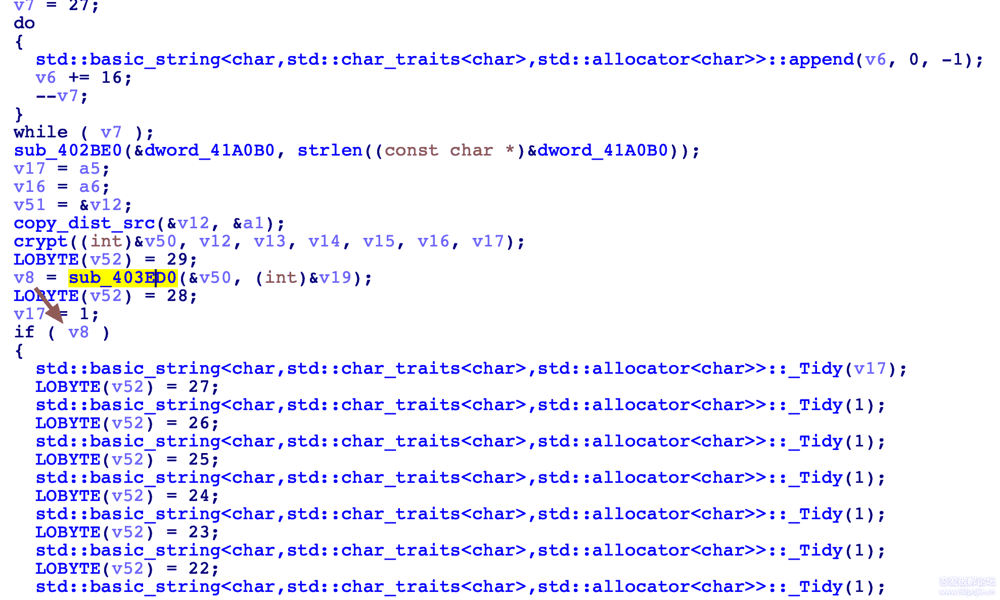

2022-02-04_14-35-32.png (442.47 KB, 下载次数: 3)

[href="forum.php?mod=attachment&aid=MjQ5NTUyOXw0YzEzYjE3N3wxNzkzNTc2MTU2fDE2ODA4NnwxNTg5MjA5&nothumb=yes" target="_blank"](https://www.52pojie.cn/forum.php?mod=attachment&aid=MjQ5NTUyOXw0YzEzYjE3N3wxNzkzNTc2MTU2fDE2ODA4NnwxNTg5MjA5&nothumb=yes)

2022-2-17 13:50 上传

进到`sub_403ED0`，我们需要实现`return`的值为`0`，即`result`为`0`，配合`OD`动态调试对比发现，`memcmp`用于比较输入的内容和真正的`Key`是否相同（观察栈可以发现为`flag{Happy_New_Year_52Pojie_2022}`），相同则返回`0`，至于这个`if`里面的东西，我也没搞懂。

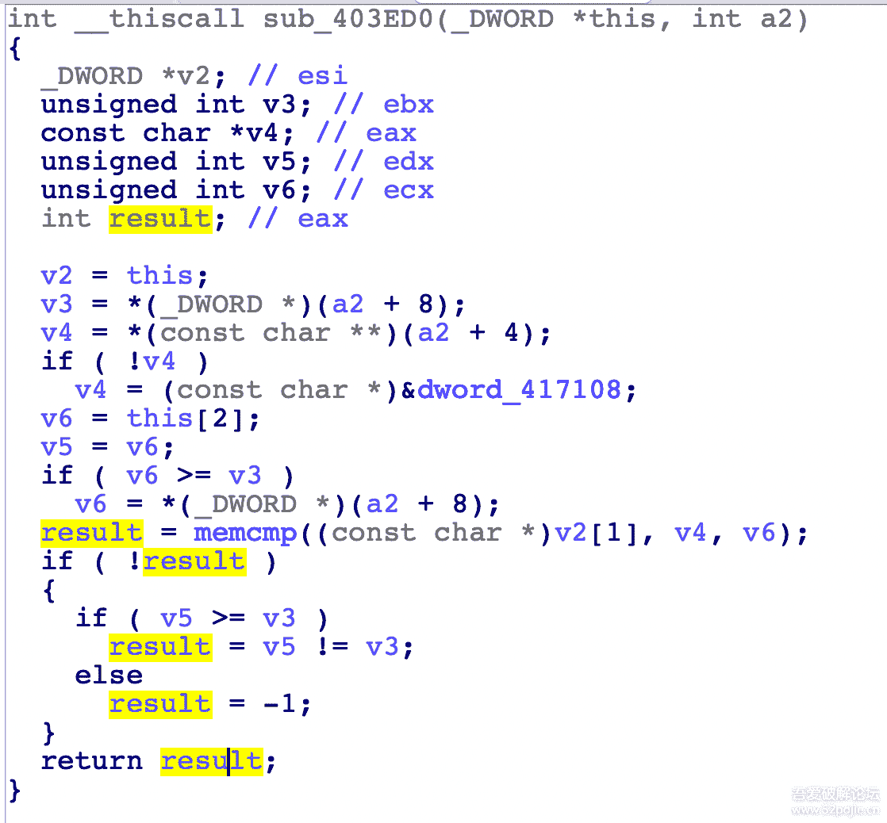

2022-02-04_14-37-13.png (278.11 KB, 下载次数: 3)

[href="forum.php?mod=attachment&aid=MjQ5NTUzMHw3NDc4MzY1OHwxNzkzNTc2MTU2fDE2ODA4NnwxNTg5MjA5&nothumb=yes" target="_blank"](https://www.52pojie.cn/forum.php?mod=attachment&aid=MjQ5NTUzMHw3NDc4MzY1OHwxNzkzNTc2MTU2fDE2ODA4NnwxNTg5MjA5&nothumb=yes)

2022-2-17 13:50 上传

回到上一层，看`v50`是什么，分析后可以知道红框里面的两句分别是将输入的东西（`a1`该函数的参数，传入的是被输入的东西）复制给`v12`，然后将`v12`加密给`v50`

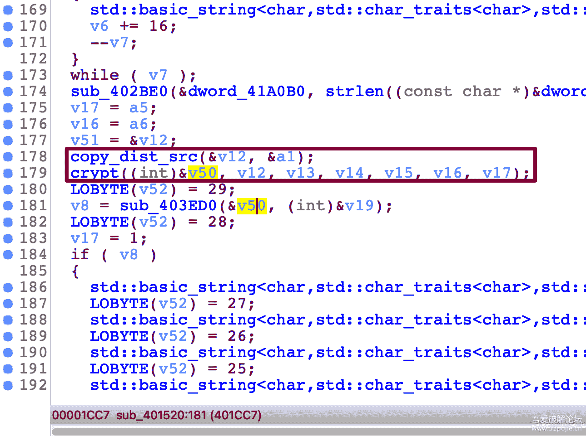

2022-02-04_14-55-50.png (368.35 KB, 下载次数: 3)

[href="forum.php?mod=attachment&aid=MjQ5NTUzMXxlZDQ3MjVjOXwxNzkzNTc2MTU2fDE2ODA4NnwxNTg5MjA5&nothumb=yes" target="_blank"](https://www.52pojie.cn/forum.php?mod=attachment&aid=MjQ5NTUzMXxlZDQ3MjVjOXwxNzkzNTc2MTU2fDE2ODA4NnwxNTg5MjA5&nothumb=yes)

2022-2-17 13:50 上传

至于这个`crypy`函数，核心是这一句，它在`while`循环里面，会加密输入的`Key`的每个大小写字母，通过跟踪函数调用时的相关参数，可以得出如下公式

```
X * (Y - (UID % 25) - 97) % 26 + 97 = 12                # 这个X与UID相关，但我没能力推出公式，可以在OD中运行时找到具体值
                                                                                                                                                                                # Y是Key的每个字符的Ascii码
```

最后用`python`写了个脚本算`Key`，没有转换大写字母，因为我用这个转换出来的是错的，就索性用`OD`去转换每个大写字母，找到那几个关键字母再手动替换就可以了

```
def crypt():
    t = ""
    for y in "flag{Happy_New_Year_52Pojie_2022}":
        if re.match("[a-z]", y):
            for x in range(ord('A'),ord('Z')+1) and range(ord('a'),ord('z')+1):
                if 9 * (x - 10 - 97) % 26 + 97 == ord(y):
                    t += chr(x)
                    break
        else:
            t += y
    return t

print(crypt())
```

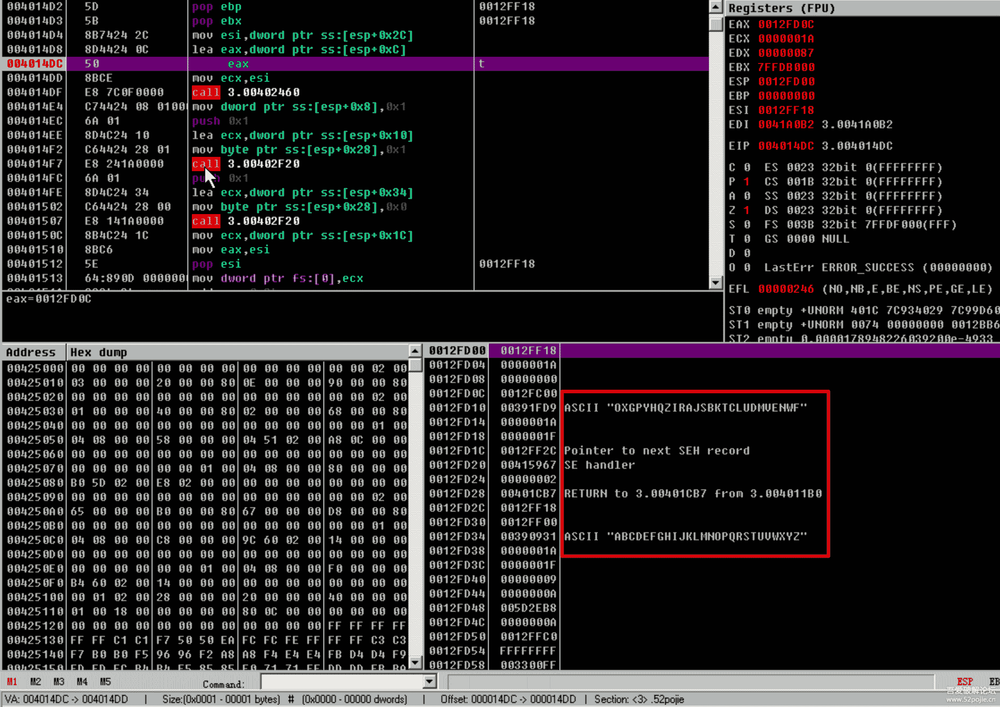

2022-02-04_15-09-00.png (240.63 KB, 下载次数: 3)

[href="forum.php?mod=attachment&aid=MjQ5NTUzM3w3YmQ2N2JjNnwxNzkzNTc2MTU2fDE2ODA4NnwxNTg5MjA5&nothumb=yes" target="_blank"](https://www.52pojie.cn/forum.php?mod=attachment&aid=MjQ5NTUzM3w3YmQ2N2JjNnwxNzkzNTc2MTU2fDE2ODA4NnwxNTg5MjA5&nothumb=yes)

2022-2-17 13:50 上传
