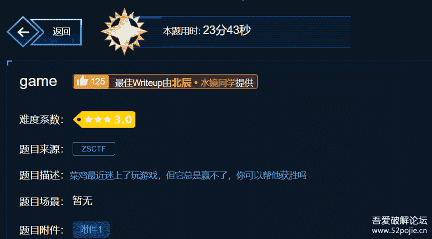
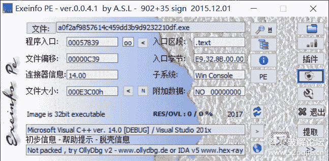
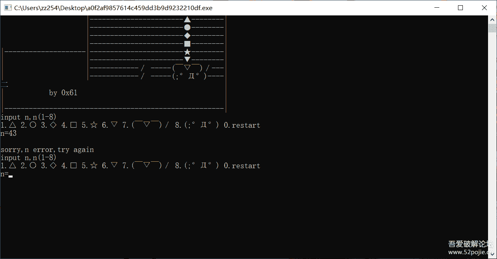
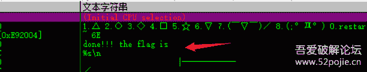
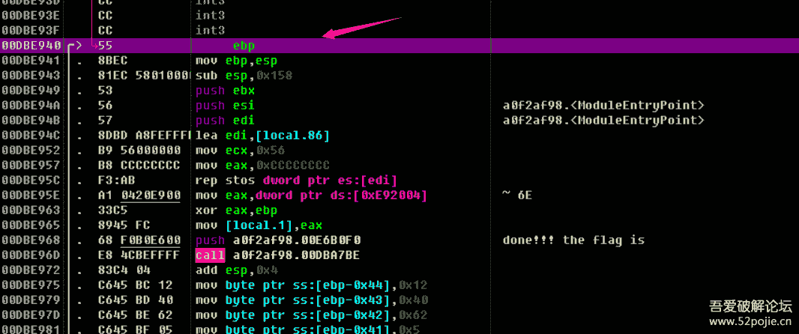
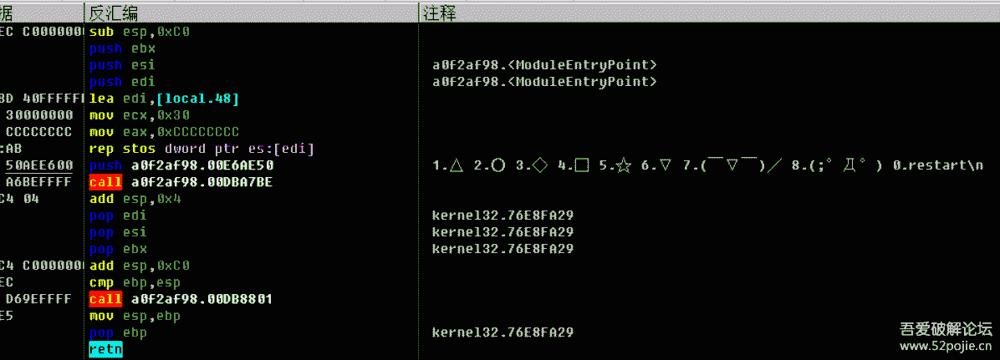
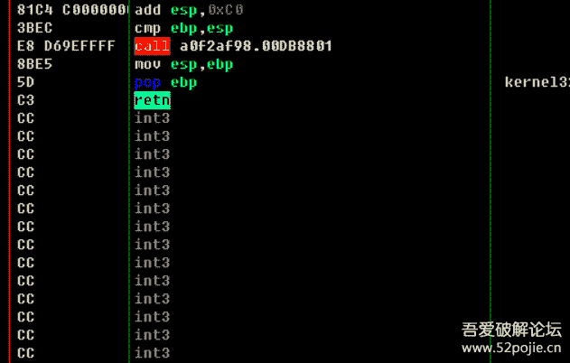
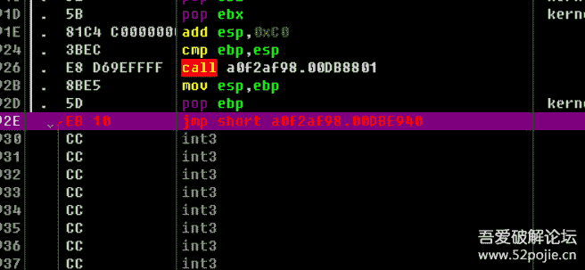
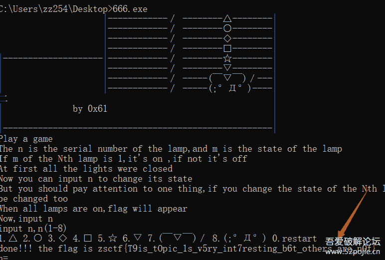

# [CTF] xctf逆向区新手第一题

- 原帖: https://www.52pojie.cn/forum.php?mod=viewthread&tid=1589445
- 抓取时间: 2026-11-01T23:35:57

## 1. 查看题目提供的信息

只要我们玩通过这游戏就可以得到flag，直接下载附件。

`image-20220217193916405.png` (84.65 KB, 下载次数: 0) · [image-20220217193916405.png](https://www.52pojie.cn/forum.php?mod=attachment&aid=MjQ5NTY4OHxkNjY5NzJhOXwxNzkzNTc2MTU1fDE2ODA4NnwxNTg5NDQ1&nothumb=yes) · 2022-2-17 20:13 上传

## 2. 发现是个exe

先查壳，c\c++编译无壳。

`image-20220217194034077.png` (191.61 KB, 下载次数: 0) · [image-20220217194034077.png](https://www.52pojie.cn/forum.php?mod=attachment&aid=MjQ5NTY3OXw0ZGQ0MzUyZnwxNzkzNTc2MTU1fDE2ODA4NnwxNTg5NDQ1&nothumb=yes) · 2022-2-17 20:09 上传

## 3. 打开exe查看运行流程

`image-20220217194156038.png` (40.66 KB, 下载次数: 0) · [image-20220217194156038.png](https://www.52pojie.cn/forum.php?mod=attachment&aid=MjQ5NTY4MHw5NDgxNzJlM3wxNzkzNTc2MTU1fDE2ODA4NnwxNTg5NDQ1&nothumb=yes) · 2022-2-17 20:09 上传

完了一分钟，和作者的要求一样，我们必须玩过才能拿到flag，但是逆向怎么会乖乖听话玩呢？开始整活！

## 4. 拖进od查看是否有关键字符

`image-20220217194342058.png` (15.92 KB, 下载次数: 0) · [image-20220217194342058.png](https://www.52pojie.cn/forum.php?mod=attachment&aid=MjQ5NTY4MXxiZTdmY2JlZHwxNzkzNTc2MTU1fDE2ODA4NnwxNTg5NDQ1&nothumb=yes) · 2022-2-17 20:10 上传

一搜索就发现了一串可疑字符，初步估计这个意思就是成果通过游戏以后的提示，那我们就跟进去

`image-20220217194509797.png` (88.44 KB, 下载次数: 0) · [image-20220217194509797.png](https://www.52pojie.cn/forum.php?mod=attachment&aid=MjQ5NTY4MnxmZjMxYmI0Y3wxNzkzNTc2MTU1fDE2ODA4NnwxNTg5NDQ1&nothumb=yes) · 2022-2-17 20:10 上传

发现这个提示是一个函数过程，又看到有一个跳转是来到这个函数，那我们慢慢跟上去看一下

`image-20220217194759043.png` (58.97 KB, 下载次数: 0) · [image-20220217194759043.png](https://www.52pojie.cn/forum.php?mod=attachment&aid=MjQ5NTY4M3wwMThlZDcwY3wxNzkzNTc2MTU1fDE2ODA4NnwxNTg5NDQ1&nothumb=yes) · 2022-2-17 20:11 上传

往上20多行代码以后发现一串字符，再次打开软件看，这串字符就是菜单，那我们就可以直接推测这几行代码就是显示菜单的，按照流程来看显示完菜单以后就是要求我们进行游戏，游戏用过以后才显示flag，那我们直接可以跳过游戏的环节直接显示flag，那就找个合适的位置直接`jmp`到显示提示信息的函数

`image-20220217195220051.png` (32.2 KB, 下载次数: 0) · [image-20220217195220051.png](https://www.52pojie.cn/forum.php?mod=attachment&aid=MjQ5NTY4NHw2YTE4YmIyZXwxNzkzNTc2MTU1fDE2ODA4NnwxNTg5NDQ1&nothumb=yes) · 2022-2-17 20:11 上传

## 5. 往下一看发现一个`retn`

而且下面一堆`int3` （`int3` 修改基本上不会影响程序），那我们让这个菜单函数执行完以后不进行正常的下一个函数直接跳到我们的成功提示地址，说做就做

`image-20220217195533369.png` (35.79 KB, 下载次数: 0) · [image-20220217195533369.png](https://www.52pojie.cn/forum.php?mod=attachment&aid=MjQ5NTY4NnxkODFmNTgyMHwxNzkzNTc2MTU1fDE2ODA4NnwxNTg5NDQ1&nothumb=yes) · 2022-2-17 20:11 上传

## 6. 地址太近是个短指令

还刚好影响不了`int3`代码，好的，保存运行

`image-20220217195701009.png` (47.64 KB, 下载次数: 0) · [image-20220217195701009.png](https://www.52pojie.cn/forum.php?mod=attachment&aid=MjQ5NTY4N3xhZWVlMzRiYXwxNzkzNTc2MTU1fDE2ODA4NnwxNTg5NDQ1&nothumb=yes) · 2022-2-17 20:12 上传

果不其然，成功了，提交试了一下确实正确了

如有错误，请指正，谢谢！
