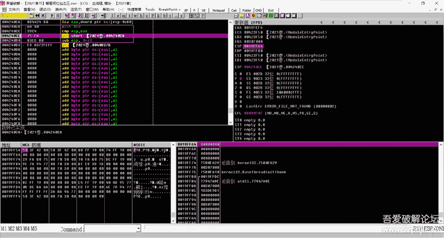
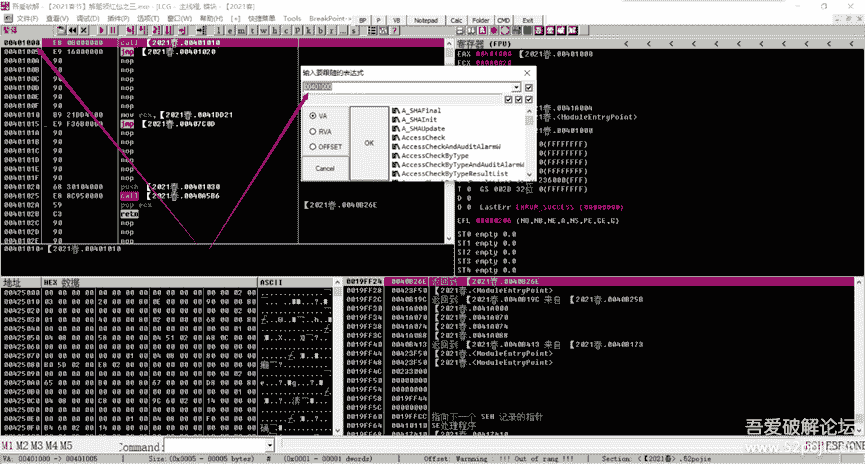
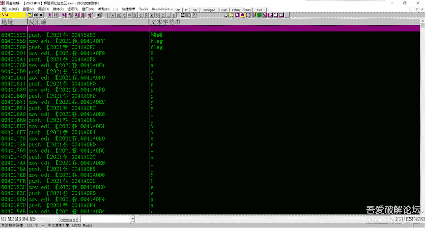
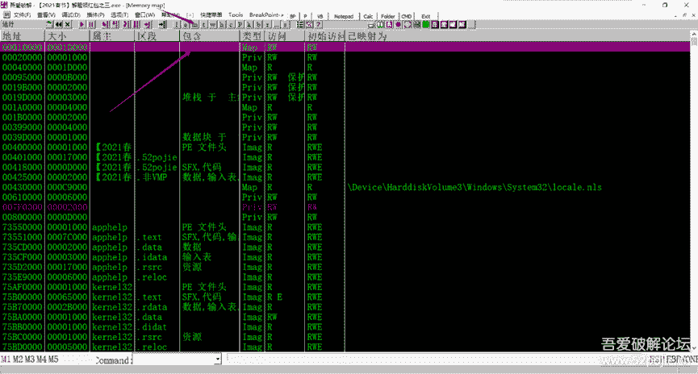
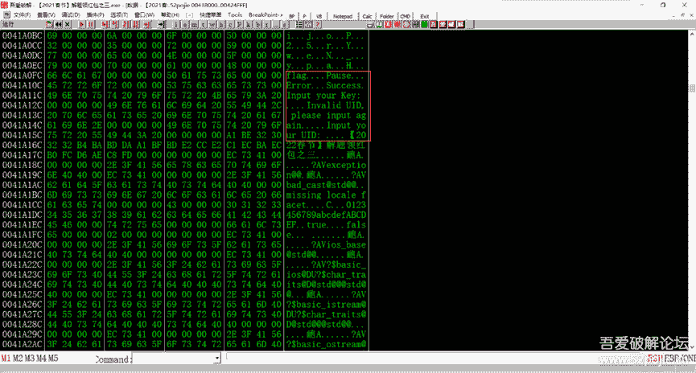

# [CTF] 小白尝试脱壳 【春节红包第三题windwos】

- 原帖: https://www.52pojie.cn/forum.php?mod=viewthread&tid=1589567
- 抓取时间: 2026-11-01T23:35:55

小白尝试 【春节红包第三题windwos】

## 前言

由于这个壳我已经用`PEID`和`DIE`查过了，是`upx`，我这里就不贴图了，直接上操作了

## ESP定律

首先把程序拖入到`od`里，先不要运行`F8`到下一个地址，可以看到右边的寄存器窗口里的`Esp`红了，这个时候可以右键在数据窗口中跟随
跟随之后再左下方的`hex`数据里面的`50`下一个断点，断点-硬件访问-`Word`，下完了后运行一下可以发现软件停在这个位置了，这里需要一直`F8`跟下去，跟个十几次就会跳到软件真正的入口了，目前我发现一个特征是它们都是`55`。然后点那个地址，右键`ollydump`就可以把壳脱掉了（应该）

## 不脱壳直接搜索中文字符串

直接搜是搜不出来的，要先使用`ctrl+F`到达`00401000`处，然后再搜就能够显示出中文字符串了，虽然我也不知道原理是什么

## 不脱壳直接内存里搜索关键字符串

首先软件要先运行起来（按`F9`），然后点击我指的那个`m`，就能进入到这个内存界面了（应该是叫这个名字吧）。滑倒最上面，点击一直右键搜索，或者快捷键`ctrl+B`，输入关键词`input`，点击确定，就能跳到关键词的那个地址里，记下来回到我贴的第一张图里搜索地址然后下一个断点，再后就可以断下来然后慢慢分析了

## 结语

是了大半天把壳脱掉了还是找不到`flag`，虽然有个很明显的字符串写着`flag`。值得一提的是，可以在`success`语句上面的跳转改为`nop`或者无条件跳转就可以爆破，但是这个软件的目的并不是爆破，而是获取`flag`，所以这也没什么用了，后续看一看有没有大佬能够分享一下思路。
