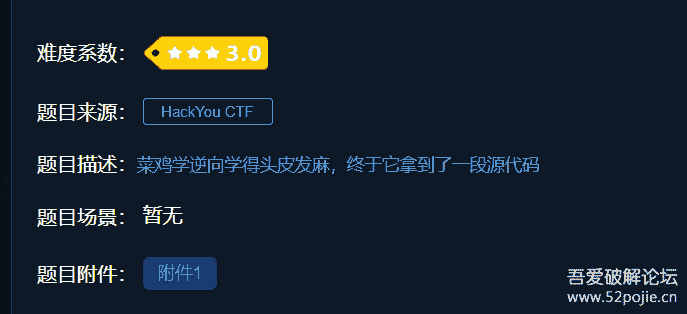

# [CTF] xctf新手逆向区第二题

- 原帖：https://www.52pojie.cn/forum.php?mod=viewthread&tid=1589714
- 抓取时间：2026-11-01T23:35:51

解题方法写在代码注释里了。

## 题目



`image.png` (26.84 KB, 下载次数: 1)

[href="forum.php?mod=attachment&aid=MjQ5NTkwOHwxNDNhZmUyY3wxNzkzNTc2MTQ5fDE2ODA4NnwxNTg5NzE0&nothumb=yes" target="_blank"](https://www.52pojie.cn/forum.php?mod=attachment&aid=MjQ5NTkwOHwxNDNhZmUyY3wxNzkzNTc2MTQ5fDE2ODA4NnwxNTg5NzE0&nothumb=yes)

2022-2-18 13:05 上传

## 解题代码

[C] 纯文本查看 复制代码

```c
#include 
#include 

//大概阅读整体代码，通过最后几行代码我们得知我们需要的flag就是代码中的hash变量
//此时我们逆向推到hash变量的来源
//1.hash值由fist、second和argv[3]三个变量来决定，那我们就跟踪这三个变量
//2.fist变量在第二个if语句中，提示如果first不等于0xcafe的话就退出程序，那我们按照作者意思肯定要让程序执行到显示flag
//那就必须使first=0xcafe
//3.接下来我们再找着second变量，发现second在第三个if语句，提示如果second % 5 == 3 || second % 17 != 8的话就退出，我们目的
//就是执行到最后，那我们就直接用穷举法找到一个数满足second % 5 ！= 3 && second % 17 == 8
//函数：                unsigned int GetNum = 0;
//                                do{
//                                        if(GetNum % 5 ！= 3 && GetNum % 17 == 8)
//                                                        {
//                                                                printf("GetNum:%d",GetNum);
//                                                                break;
//                                                        }
//                                        GetNum++;
//                                        }while(1);
//最后得到GetNum = 25,也就是second是25
//4.最后argv[3]可从最后一个if得知argv[3]=h4cky0u
//5.那我们带进hash中去算
//unsigned int hash =0xcafe * 31337 + (25 % 17) * 11 + strlen("h4cky0u") - 1615810207;
//注意最后一行代码要以十六进制输出才能得到flag
//z最后flag为c0ffee
//6.提交显示正确了
int main(int argc, char *argv[]) {
        if (argc != 4) {
                printf("what?\n");
                exit(1);
        }

        unsigned int first = atoi(argv[1]);
        if (first != 0xcafe) {
                printf("you are wrong, sorry.\n");
                exit(2);
        }

        unsigned int second = atoi(argv[2]);
        if (second % 5 == 3 || second % 17 != 8) {
                printf("ha, you won't get it!\n");
                exit(3);
        }

        if (strcmp("h4cky0u", argv[3])) {
                printf("so close, dude!\n");
                exit(4);
        }

        printf("Brr wrrr grr\n");

        unsigned int hash = first * 31337 + (second % 17) * 11 + strlen(argv[3]) - 1615810207;

        printf("Get your key: ");
        printf("%x\n", hash);
        return 0;
}
```

如有错误，望多多指正！
