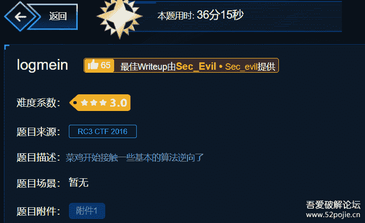
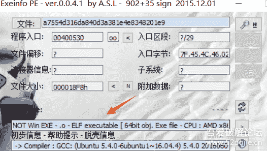
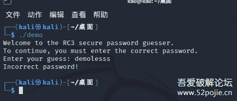
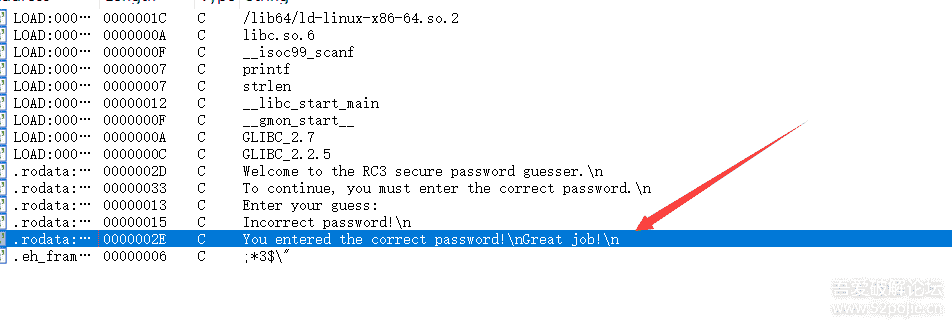
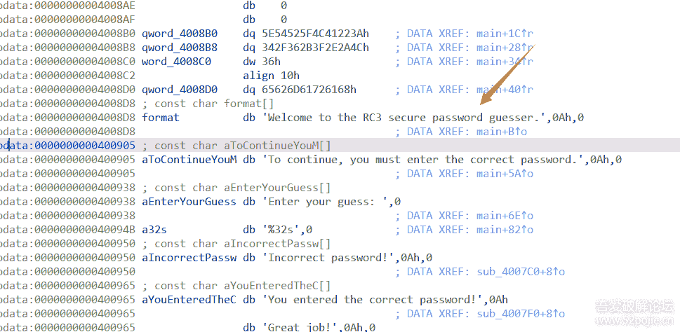
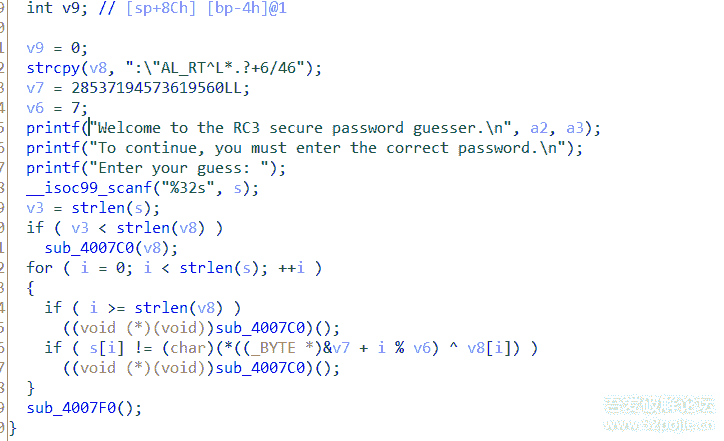
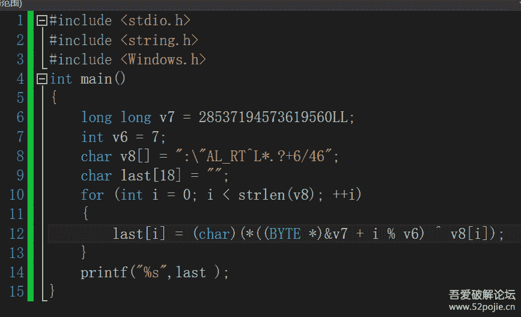
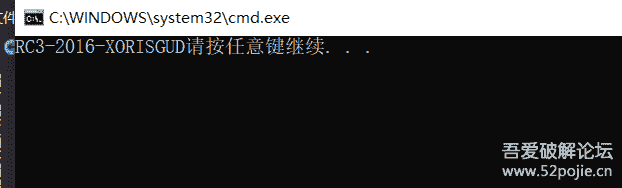

# [CTF] xctf新手区第四题

- 原帖：[https://www.52pojie.cn/forum.php?mod=viewthread&tid=1590237](https://www.52pojie.cn/forum.php?mod=viewthread&tid=1590237)
- 抓取时间：2026-11-01T23:35:40

## 1. 先查看题目

依照作者的话说是需要逆向算法了，先下载下来吧。

[1.png 附件](https://www.52pojie.cn/forum.php?mod=attachment&aid=MjQ5NjIxNHxmOWMzODkwNHwxNzkzNTc2MTM4fDE2ODA4NnwxNTkwMjM3&nothumb=yes)

## 2. 下载下来先查壳

[image-20220219121807559.png 附件](https://www.52pojie.cn/forum.php?mod=attachment&aid=MjQ5NjIxNXxiYjI3NGQwY3wxNzkzNTc2MTM4fDE2ODA4NnwxNTkwMjM3&nothumb=yes)

### 下载下来是个 64 位没加壳的二进制文件

## 3. 老规矩，先丢进 Kali 运行一下看看程序流程

[image-20220219122019494.png 附件](https://www.52pojie.cn/forum.php?mod=attachment&aid=MjQ5NjIxNnwxMDM4NzMwOHwxNzkzNTc2MTM4fDE2ODA4NnwxNTkwMjM3&nothumb=yes)

### 运行了一下，发现程序流程就是让用户输入猜测的内容，再根据猜测的结果进行输出提示

## 4. 把文件丢进 IDA 中分析，先按 `Shift+F12` 查看引用字符

[image-20220219122732327.png 附件](https://www.52pojie.cn/forum.php?mod=attachment&aid=MjQ5NjIxN3wzMjc0NGU3NHwxNzkzNTc2MTM4fDE2ODA4NnwxNTkwMjM3&nothumb=yes)

好家伙，发现关键提示字符，依照字面意思就是说用户输入的 flag 是正确的，那我们直接跟进去。

## 5. 跟进 `welcom` 字符串，查看引用它的函数

这不就是二进制刚运行的时候显示的用户提示吗？那我们直接查看交叉引用。

[image-20220219123610759.png 附件](https://www.52pojie.cn/forum.php?mod=attachment&aid=MjQ5NjIxOXxhMDYyMTJlNXwxNzkzNTc2MTM4fDE2ODA4NnwxNTkwMjM3&nothumb=yes)

## 6. 进入函数按 `F5` 查看伪代码，查看程序逻辑

[image-20220219131854451.png 附件](https://www.52pojie.cn/forum.php?mod=attachment&aid=MjQ5NjIyMHxiNzQ4Y2QxMHwxNzkzNTc2MTM4fDE2ODA4NnwxNTkwMjM3&nothumb=yes)

1. 把一串字符赋值给 `v8`。
2. 把一串十六进制数赋值给 `v7`，`7` 赋值给 `v6`。
3. 将用户输入字符赋值给 `s`，并将其长度赋值给 `v3`。
4. 首先对比输入字符的长度是否小于 `v8` 的长度，如果小于则执行 `sub_4007C0()` 函数，跟进这个函数发现是提示输入错误的。
5. `for` 循环就是关键。循环中第一个 `if` 便是判断用户输入的字符长度是否大于 `v8` 的长度，如果大于，就执行 `sub_4007C0()`，跟进发现就是提示 flag 错误的信息；第二个 `if` 便是对比用户输入的每个字符是否等于 `(char)(((_BYTE *)&v7 + i % v6) ^ v8[i])`，如果不等于则执行 `sub_4007C0()`，跟进发现也是提示 flag 错误。还发现最后一行代码对应的函数也跟进去看过，跟进去看就是提示 flag 正确。那怎么才能执行它呢？肯定是循环成功执行完以后。那我们就可想而知，只要让 `s[i] != (char)(((_BYTE *)&v7 + i % v6) ^ v8[i])` 不成立，也就是 `s[i]` 等于该表达式的值，就可以执行完循环，也就是说我们输入的 flag 是正确的，能得到提示信息。
6. `if (s[i] != (char)(((_BYTE *)&v7 + i % v6) ^ v8[i]))` 是比较加密后的 flag，那我们逆运算加密后的 flag 便可以得到真正的 flag 了。因为源码中的 flag 加密是采用异或，然而异或的逆运算仍然是异或。

逆运算代码如下：

[image-20220219134902705.png 附件](https://www.52pojie.cn/forum.php?mod=attachment&aid=MjQ5NjIyMXxlZGEwYTU5ZHwxNzkzNTc2MTM4fDE2ODA4NnwxNTkwMjM3&nothumb=yes)

## 7. 结果

[image-20220219134956671.png 附件](https://www.52pojie.cn/forum.php?mod=attachment&aid=MjQ5NjIyMnw1MTViZWVmZnwxNzkzNTc2MTM4fDE2ODA4NnwxNTkwMjM3&nothumb=yes)
