# [CTF] 算法分析SUCTF-2016全国赛的一道逆向题

- 原帖: https://www.52pojie.cn/forum.php?mod=viewthread&tid=1591880
- 抓取时间: 2026-11-01T23:35:24

## 算法分析一道SUCTF-2016全国赛的一道逆向题

### 1.下载文件先进行查壳

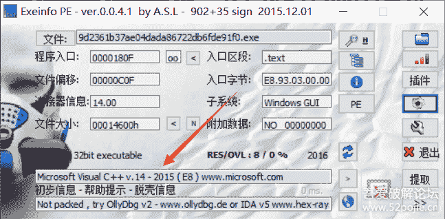
image-20220222161639794.png (167.61 KB, 下载次数: 1)
[href="forum.php?mod=attachment&aid=MjQ5Njg5N3wzMWNiNTE0YXwxNzkzNTc2MTIxfDE2ODA4NnwxNTkxODgw&nothumb=yes" target="_blank"](https://www.52pojie.cn/forum.php?mod=attachment&aid=MjQ5Njg5N3wzMWNiNTE0YXwxNzkzNTc2MTIxfDE2ODA4NnwxNTkxODgw&nothumb=yes)
2022-2-22 20:49 上传

#### 2.vc编译无壳，先跑一边程序，弄清楚程序运行逻辑


image-20220222161748679.png (17.19 KB, 下载次数: 2)
[href="forum.php?mod=attachment&aid=MjQ5Njg5OHxkYTI5ZDVkZHwxNzkzNTc2MTIxfDE2ODA4NnwxNTkxODgw&nothumb=yes" target="_blank"](https://www.52pojie.cn/forum.php?mod=attachment&aid=MjQ5Njg5OHxkYTI5ZDVkZHwxNzkzNTc2MTIxfDE2ODA4NnwxNTkxODgw&nothumb=yes)
2022-2-22 20:50 上传

#### 依照这界面来看，`vc`写的话99%就是利用`mfc`开发的，两个输入框分别提示输 入邮箱地址和一段连续的数字，输入完后按下`ok`按钮得到一个它程序的判断提 示

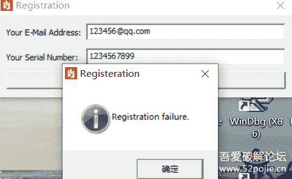
image-20220222162046074.png (64.69 KB, 下载次数: 3)
[href="forum.php?mod=attachment&aid=MjQ5Njg5OXw0NTE5ZmVjMXwxNzkzNTc2MTIxfDE2ODA4NnwxNTkxODgw&nothumb=yes" target="_blank"](https://www.52pojie.cn/forum.php?mod=attachment&aid=MjQ5Njg5OXw0NTE5ZmVjMXwxNzkzNTc2MTIxfDE2ODA4NnwxNTkxODgw&nothumb=yes)
2022-2-22 20:50 上传

### 3.初步了解后我们拖入`od`中进行简单分析其关键逻辑部分（也就是这个按钮事件）

#### 因为我猜测程序99%是利用`mfc`写的，这个提示信息框时来在按钮被按下发生 的，所以肯定在这个按 钮按下后程序对我们输入的内容进行了一系列逻辑运 算让后根据逻辑运算的结果产生不同的提示信息，因此我们可以通过`GetDlgItemTextA`这个`api`来作为关键断点地方。

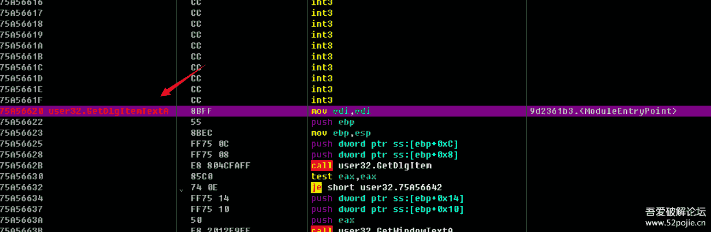
image-20220222162958207.png (71.53 KB, 下载次数: 1)
[href="forum.php?mod=attachment&aid=MjQ5NjkwMHwzYzA3ODczY3wxNzkzNTc2MTIxfDE2ODA4NnwxNTkxODgw&nothumb=yes" target="_blank"](https://www.52pojie.cn/forum.php?mod=attachment&aid=MjQ5NjkwMHwzYzA3ODczY3wxNzkzNTc2MTIxfDE2ODA4NnwxNTkxODgw&nothumb=yes)
2022-2-22 20:50 上传

#### 通过搜索确实存在这个`api`，也成功断下了，那我们先把程序跑起来断点在这个函数上，发现按钮按下后断下来了，接着跑完`GetDlgItemTextA`函数（因为通常这个哈函数执行完我们的输入的数据就被程序拿到了，那也就就该执行数据的操作了）

#### 跑出来发现两个`GetDlgItemTextA`，因为我们有两个输入框组件，所以时两个`GetDlgItemTextA`（这句话好像屁话）

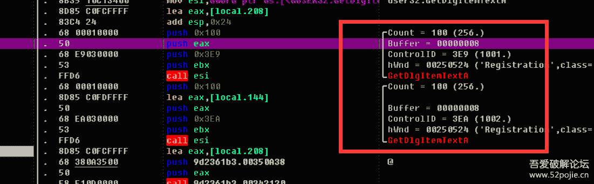
image-20220222163749789.png (61.93 KB, 下载次数: 2)
[href="forum.php?mod=attachment&aid=MjQ5NjkwMXwzZWE1YWVlY3wxNzkzNTc2MTIxfDE2ODA4NnwxNTkxODgw&nothumb=yes" target="_blank"](https://www.52pojie.cn/forum.php?mod=attachment&aid=MjQ5NjkwMXwzZWE1YWVlY3wxNzkzNTc2MTIxfDE2ODA4NnwxNTkxODgw&nothumb=yes)
2022-2-22 20:50 上传

#### 当我们没有只是跑函数没有分析函数内部的时候要着重看函数跑完寄存器的值

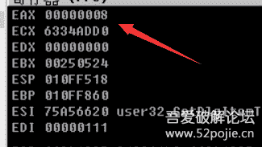
image-20220222164055133.png (19.05 KB, 下载次数: 2)
[href="forum.php?mod=attachment&aid=MjQ5NjkwMnwzZDQ2M2JiNnwxNzkzNTc2MTIxfDE2ODA4NnwxNTkxODgw&nothumb=yes" target="_blank"](https://www.52pojie.cn/forum.php?mod=attachment&aid=MjQ5NjkwMnwzZDQ2M2JiNnwxNzkzNTc2MTIxfDE2ODA4NnwxNTkxODgw&nothumb=yes)
2022-2-22 20:51 上传

#### 查看寄存器发现就`eax`的值比较特殊，8，仔细想想才发现我们输入的有一组数据就是八个

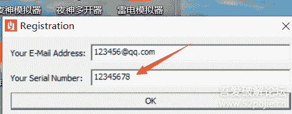
image-20220222164216360.png (44.72 KB, 下载次数: 2)
[href="forum.php?mod=attachment&aid=MjQ5NjkwM3w1NGJhNjAyNXwxNzkzNTc2MTIxfDE2ODA4NnwxNTkxODgw&nothumb=yes" target="_blank"](https://www.52pojie.cn/forum.php?mod=attachment&aid=MjQ5NjkwM3w1NGJhNjAyNXwxNzkzNTc2MTIxfDE2ODA4NnwxNTkxODgw&nothumb=yes)
2022-2-22 20:51 上传

### 4.F8单步走

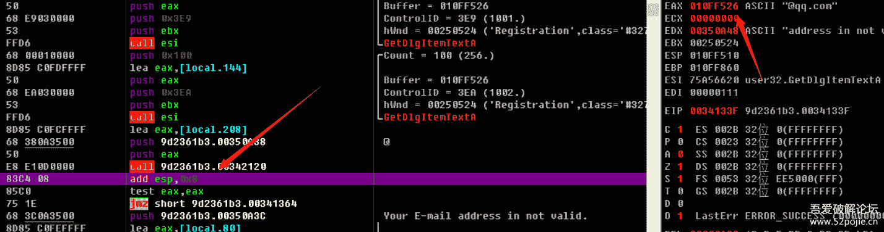
image-20220222164426698.png (104.04 KB, 下载次数: 2)
[href="forum.php?mod=attachment&aid=MjQ5NjkwNHw5NmM2NTY2M3wxNzkzNTc2MTIxfDE2ODA4NnwxNTkxODgw&nothumb=yes" target="_blank"](https://www.52pojie.cn/forum.php?mod=attachment&aid=MjQ5NjkwNHw5NmM2NTY2M3wxNzkzNTc2MTIxfDE2ODA4NnwxNTkxODgw&nothumb=yes)
2022-2-22 20:51 上传

#### 走完`34133a`这个函数以后发现`eax`变为了`@qq.com`所在的地址了，`ecx`变为了0,继续往下走便看到了一个跳转，如果没跳转则会出现一个与`Your E-mail address in not valid.`字符有关的函数，中文也就是提示用户邮箱地址不存在，这里涉及了一个开发中常见的判断用户输入邮箱地址是否存在的知识，就是用正则表达式判断用户输入的字符串中是否存在`@xxx.xxx`的字符，如果存在那么就是存在邮箱地址，为了验证我们的猜想我们在`341344`这个`jnz`处下断点，来试一下这个`jnz`是否是用来判断邮箱存在与否的

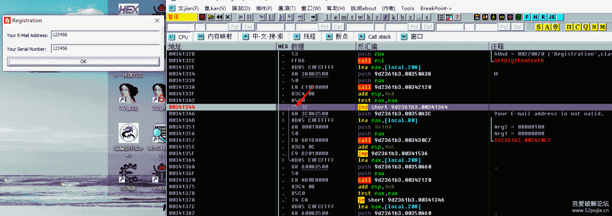
image-20220222170242823.png (500.81 KB, 下载次数: 3)
[href="forum.php?mod=attachment&aid=MjQ5NjkwNXwwY2I1NmEwY3wxNzkzNTc2MTIxfDE2ODA4NnwxNTkxODgw&nothumb=yes" target="_blank"](https://www.52pojie.cn/forum.php?mod=attachment&aid=MjQ5NjkwNXwwY2I1NmEwY3wxNzkzNTc2MTIxfDE2ODA4NnwxNTkxODgw&nothumb=yes)
2022-2-22 20:51 上传

#### 果然，当我们没有按照邮箱格式输入的时候就跳转不实现了，也就是触发了一个与`Your E-mail address in not valid.`字符有关的函数，这是我们往上看`34133a`这个`call`的有一个参数是`@`便更可确认

```
  00341334                          |.  68 380A3500          push 9d2361b3.00350A38                   ;  @
  00341339                          |.  50                   push eax
  0034133A                          |.  E8 E10D0000          call 9d2361b3.00342120
  0034133F                          |.  83C4 08              add esp,0x8
  00341342                          |.  85C0                 test eax,eax
  00341344                          |.  75 1E                jnz short 9d2361b3.00341364
  00341346                          |>  68 3C0A3500          push 9d2361b3.00350A3C                   ;  Your E-mail address in not valid.
  0034134B                          |>  8D85 C0FEFFFF        lea eax,[local.80]                       ; |
  00341351                          |.  68 00010000          push 0x100                               ; |Arg2 = 00000100
  00341356                          |.  50                   push eax                                 ; |Arg1 = 00000000
  00341357                          |.  E8 6B1D0000          call 9d2361b3.003430C7                   ;
```

以上代码是用来判断邮箱是否存在的了，但是由于`34133a`这个函数字符参数只用一个`@`，难道这个作者判断得更简单？只判断是否有`@`字符而且`@`后是否有字符，那我就试了一下，的确在`341344`这个判断点跳转了，但是继续往下的时候遇到一个跳转又跳回了提示邮箱不存在的函数那里了

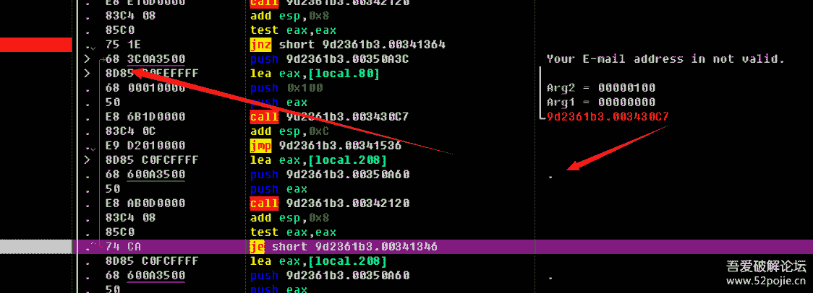
image-20220222171701148.png (71.42 KB, 下载次数: 2)
[href="forum.php?mod=attachment&aid=MjQ5NjkwNnxkYTAwMDM5YXwxNzkzNTc2MTIxfDE2ODA4NnwxNTkxODgw&nothumb=yes" target="_blank"](https://www.52pojie.cn/forum.php?mod=attachment&aid=MjQ5NjkwNnxkYTAwMDM5YXwxNzkzNTc2MTIxfDE2ODA4NnwxNTkxODgw&nothumb=yes)
2022-2-22 20:52 上传

```
0034136A  |.  68 600A3500   push 9d2361b3.00350A60                   ;  .
0034136F  |.  50            push eax
00341370  |.  E8 AB0D0000   call 9d2361b3.00342120
00341375  |.  83C4 08       add esp,0x8
00341378  |.  85C0          test eax,eax
0034137A  |.^ 74 CA         je short 9d2361b3.00341346
```

这段代码再次验证了之前作者对验证邮箱是否存在的验证采用了通常的设计方法

4> 5.那我们继续按照正确的格式继续调试

5> 往下走遇到一下代码


# 序列号校验逻辑分析

## 循环读取与计数

```
[b]003413F0  |> /8A01          /mov al,byte ptr ds:[ecx]
[b]003413F2  |. |41            |inc ecx
[b]003413F3  |. |84C0          |test al,al
[b]003413F5  |.^\75 F9         \jnz short 9d2361b3.003413F0
[b]003413F7  |.  2BCA          sub ecx,edx
[b]003413F9  |.  83F9 10       cmp ecx,0x10
```

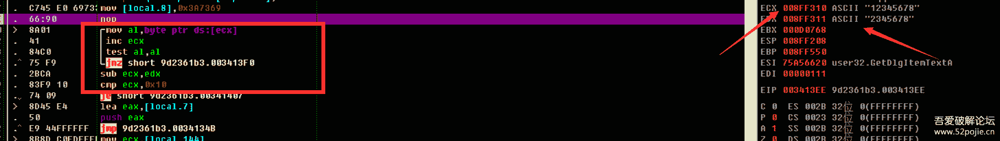

image-20220222193728363.png (70.83 KB, 下载次数: 2)

[href="forum.php?mod=attachment&aid=MjQ5NjkwN3w1ZmNjYjdlOHwxNzkzNTc2MTIxfDE2ODA4NnwxNTkxODgw&nothumb=yes" target="_blank"](https://www.52pojie.cn/forum.php?mod=attachment&aid=MjQ5NjkwN3w1ZmNjYjdlOHwxNzkzNTc2MTIxfDE2ODA4NnwxNTkxODgw&nothumb=yes)

2022-2-22 20:52 上传

> 5> 这段代码的作用便是循环把用户输入的 Serial Number 一个一个的传入 `al` 中（严谨点说应该是每次将 `al` 中的值更新为 `ecx` 指向的字符串），通过判断 `al` 是否为空，如果为部位空 `ecx+1`（其实就是指向 Serial Number 的指针以此向后偏移），如果是空的话那就结束循环，其实这里的 `ecx` 和 `edx` 都是指向 Serial Number 的指针，同时再利用这个位置来计数，计数什么呢？当然是 Serial Number 的个数，怎么实现的呢？`sub ecx,edx`，这里就是利用最后 `ecx` 指向 Serial Number 字符串末尾，`edx` 指向 Serial Number 字符串首，然后 `ecx-edx` 便得到了 Serial Number 的个数，最后 `cmp ecx,0x10`，将得到的 Serial Number 字符数与 `0x10`(16)比较，通常在设计中这种比较就是比如校验用户输入的密码是否小于6个，如果小于6个则提示用户继续输入，那我猜测这里作者也是为了同种要求，此时我们输入的只有8个，那么我们就继续按照8个执行看它会发生什么


image-20220222195149027.png (27.52 KB, 下载次数: 2)

[href="forum.php?mod=attachment&aid=MjQ5NjkwOHwzZTYyMDE5NHwxNzkzNTc2MTIxfDE2ODA4NnwxNTkxODgw&nothumb=yes" target="_blank"](https://www.52pojie.cn/forum.php?mod=attachment&aid=MjQ5NjkwOHwzZTYyMDE5NHwxNzkzNTc2MTIxfDE2ODA4NnwxNTkxODgw&nothumb=yes)

2022-2-22 20:52 上传

> 5> 当用户输入的 Serial Number 不等于16时提示错误，那说明“对于 Serial Number 的第一个要求便是等于16”

## 逐字符校验与爆破

> 4> 6. 那我们在 Serial Number 输入框内输入16个整数，满足 Serial Number 个数等于16跳转以后

```
003413FC  |. /74 09         je short 9d2361b3.00341407
003413FE  |> |8D45 E4       lea eax,[local.7]
00341401  |. |50            push eax
00341402  |.^|E9 44FFFFFF   jmp 9d2361b3.0034134B
00341407  |> \8B8D C0FDFFFF mov ecx,[local.144]
0034140D  |.  80F9 43       cmp cl,0x43
00341410  |.^ 75 EC         jnz short 9d2361b3.003413FE
00341412  |.  0FBE85 CFFDFF>movsx eax,byte ptr ss:[ebp-0x231]
00341419  |.  83C0 43       add eax,0x43
0034141C  |.  3D 9B000000   cmp eax,0x9B
00341421  |.^ 75 DB         jnz short 9d2361b3.003413FE
00341423  |.  0FBECD        movsx ecx,ch
00341426  |.  8D41 FD       lea eax,dword ptr ds:[ecx-0x3]
00341429  |.  83F8 57       cmp eax,0x57
0034142C  |.^ 75 D0         jnz short 9d2361b3.003413FE
0034142E  |.  0FBE85 CEFDFF>movsx eax,byte ptr ss:[ebp-0x232]
00341435  |.  03C1          add eax,ecx
00341437  |.  3D 9B000000   cmp eax,0x9B
0034143C  |.^ 75 C0         jnz short 9d2361b3.003413FE
0034143E  |.  0FBE8D C2FDFF>movsx ecx,byte ptr ss:[ebp-0x23E]
00341445  |.  8D41 01       lea eax,dword ptr ds:[ecx+0x1]
00341448  |.  83F8 3A       cmp eax,0x3A
0034144B  |.^ 75 B1         jnz short 9d2361b3.003413FE
0034144D  |.  0FBE85 CDFDFF>movsx eax,byte ptr ss:[ebp-0x233]
00341454  |.  03C1          add eax,ecx
00341456  |.  3D 9B000000   cmp eax,0x9B
0034145B  |.^ 75 A1         jnz short 9d2361b3.003413FE
0034145D  |.  80BD C3FDFFFF>cmp byte ptr ss:[ebp-0x23D],0x64
00341464  |.^ 75 98         jnz short 9d2361b3.003413FE
00341466  |.  0FBE85 CCFDFF>movsx eax,byte ptr ss:[ebp-0x234]
0034146D  |.  83C0 64       add eax,0x64
00341470  |.  3D 9B000000   cmp eax,0x9B
00341475  |.^ 75 87         jnz short 9d2361b3.003413FE
00341477  |.  80BD C4FDFFFF>cmp byte ptr ss:[ebp-0x23C],0x6D
0034147E  |.^ 0F85 7AFFFFFF jnz 9d2361b3.003413FE
00341484  |.  0FBE85 CBFDFF>movsx eax,byte ptr ss:[ebp-0x235]
0034148B  |.  05 81000000   add eax,0x81
00341490  |.  3D C8000000   cmp eax,0xC8
00341495  |.^ 0F85 63FFFFFF jnz 9d2361b3.003413FE
0034149B  |.  0FBE8D C5FDFF>movsx ecx,byte ptr ss:[ebp-0x23B]
003414A2  |.  8D41 D3       lea eax,dword ptr ds:[ecx-0x2D]
003414A5  |.  83F8 44       cmp eax,0x44
003414A8  |.^ 0F85 50FFFFFF jnz 9d2361b3.003413FE
003414AE  |.  0FBE85 CAFDFF>movsx eax,byte ptr ss:[ebp-0x236]
003414B5  |.  03C1          add eax,ecx
003414B7  |.  3D AA000000   cmp eax,0xAA
003414BC  |.^ 0F85 3CFFFFFF jnz 9d2361b3.003413FE
003414C2  |.  80BD C6FDFFFF>cmp byte ptr ss:[ebp-0x23A],0x34
003414C9  |.^ 0F85 2FFFFFFF jnz 9d2361b3.003413FE
003414CF  |.  0FBE85 C9FDFF>movsx eax,byte ptr ss:[ebp-0x237]
003414D6  |.  83C0 34       add eax,0x34
003414D9  |.  3D 9B000000   cmp eax,0x9B
003414DE  |.^ 0F85 1AFFFFFF jnz 9d2361b3.003413FE
003414E4  |.  80BD C7FDFFFF>cmp byte ptr ss:[ebp-0x239],0x63
003414EB  |.^ 0F85 0DFFFFFF jnz 9d2361b3.003413FE
003414F1  |.  0FBE85 C8FDFF>movsx eax,byte ptr ss:[ebp-0x238]
003414F8  |.  83C0 63       add eax,0x63
003414FB  |.  3D 9B000000   cmp eax,0x9B
00341500  |.^ 0F85 F8FEFFFF jnz 9d2361b3.003413FExxxxxxxxxx 003413FC
```

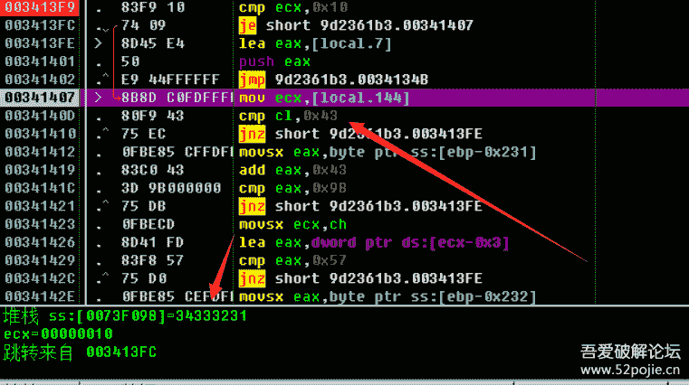

image-20220222200215745.png (79.83 KB, 下载次数: 2)

[href="forum.php?mod=attachment&aid=MjQ5NjkwOXxkNmIyNTM3MHwxNzkzNTc2MTIxfDE2ODA4NnwxNTkxODgw&nothumb=yes" target="_blank"](https://www.52pojie.cn/forum.php?mod=attachment&aid=MjQ5NjkwOXxkNmIyNTM3MHwxNzkzNTc2MTIxfDE2ODA4NnwxNTkxODgw&nothumb=yes)

2022-2-22 20:53 上传

> 5> `34333231`，仔细一看就是我们输入的 `1234` 的倒叙 `4321` 的十六进制，之后又将 `cl` 与 `0x43` 作比较，如果 `cl` 与 `0x43` 不相等则跳转，为了提高贴子的质量，这里我测试过的就不截图了，经测试，这个 `jnz` 跳转是提示注册失败，`003413FC` 到 `00341500` 的 `jnz` 都是跳转到注册失败，那此时我们就知道了 Serial Number 的第二个条件，“所有的 `jnz` 条件不成立”，那我们先通过爆破试试满足所有的第二个条件后程序的执行又是什么。

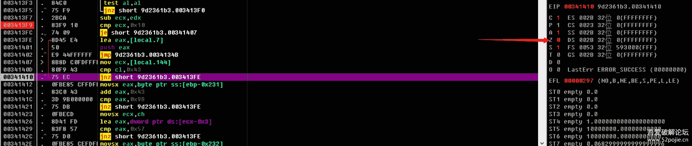

image-20220222201000438.png (121.74 KB, 下载次数: 3)

[href="forum.php?mod=attachment&aid=MjQ5NjkxMHxkYzNiODc5YXwxNzkzNTc2MTIxfDE2ODA4NnwxNTkxODgw&nothumb=yes" target="_blank"](https://www.52pojie.cn/forum.php?mod=attachment&aid=MjQ5NjkxMHxkYzNiODc5YXwxNzkzNTc2MTIxfDE2ODA4NnwxNTkxODgw&nothumb=yes)

2022-2-22 20:53 上传

> 5> 这里我们通过改 `z` 标志位实现 `jnz` 不跳转进行爆破，经过最后一步爆破后如图：

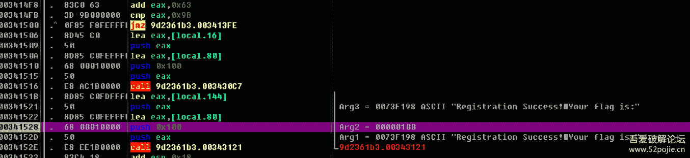

image-20220222201245307.png (59.6 KB, 下载次数: 2)

[href="forum.php?mod=attachment&aid=MjQ5NjkxMXw0OTQ1OGU1MXwxNzkzNTc2MTIxfDE2ODA4NnwxNTkxODgw&nothumb=yes" target="_blank"](https://www.52pojie.cn/forum.php?mod=attachment&aid=MjQ5NjkxMXw0OTQ1OGU1MXwxNzkzNTc2MTIxfDE2ODA4NnwxNTkxODgw&nothumb=yes)

2022-2-22 20:53 上传

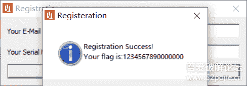

image-20220222201304050.png (32.18 KB, 下载次数: 2)

[href="forum.php?mod=attachment&aid=MjQ5NjkxMnwxYzdiYjAwOXwxNzkzNTc2MTIxfDE2ODA4NnwxNTkxODgw&nothumb=yes" target="_blank"](https://www.52pojie.cn/forum.php?mod=attachment&aid=MjQ5NjkxMnwxYzdiYjAwOXwxNzkzNTc2MTIxfDE2ODA4NnwxNTkxODgw&nothumb=yes)

2022-2-22 20:54 上传

> 5> 原来只要我们输入的数不满足 `jnz` 跳转那就是正确的 `flag`，那么我们就去探寻我们输入的 Serial Number 还需要满足什么？

## 推导最终 Serial Number

> 4> 7. 探寻最后的 Serial Number

> 6> 令我们输入的数字为一个整数数组 `input[16]`

```
00341419  |.  83C0 43       add eax,0x43
0034141C  |.  3D 9B000000   cmp eax,0x9B
```

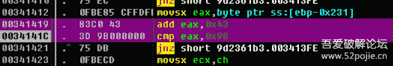

image-20220222203316102.png (26.4 KB, 下载次数: 3)

[href="forum.php?mod=attachment&aid=MjQ5NjkxM3w5YzBmMDBkM3wxNzkzNTc2MTIxfDE2ODA4NnwxNTkxODgw&nothumb=yes" target="_blank"](https://www.52pojie.cn/forum.php?mod=attachment&aid=MjQ5NjkxM3w5YzBmMDBkM3wxNzkzNTc2MTIxfDE2ODA4NnwxNTkxODgw&nothumb=yes)

2022-2-22 20:55 上传

> 5> 这里要注意一个细节，`eax` 除了第一次装入的是我们输入的 Serial Number 中的一个原数外，其他的都加上了一个其他数再对比，如上图，所以我们真正满足要求的 Serial Number 数是需要减去代码中加上的那个数，得到如下结果

今我们输入的整数为一个整数数组 `input[16]`，以上出现的16个 `jnz` 的判断便是有以下16个

> 6> `input[0] ?= 67`

> 6> `input[15] ?= 88`

> 6> `input[1] ?= 90`

> 6> `input[14] ?= 65`

> 6> `input[2] ?= 57`

> 6> `input[13] ?= 98`

> 6> `input[3] ?= 100`

> 6> `input[12] ?= 55`

> 6> `input[4] ?= 109`

> 6> `input[11] ?= 71`

> 6> `input[5] ?= 113`

> 6> `input[10] ?= 57`

> 6> `input[6] ?= 52`

> 6> `input[9] ?= 103`

> 6> `input[7] ?= 99`

> 6> `input[8] ?= 56`

> 6> 因为我们之前通过爆破得知我们输入的 Serial Number 就是正确的 `flag`，所以我们要把这写不满足 `jnz` 的条件按照 `input[0]`-`input[15]` 排序出来就是正确的 `flag`，而且 `flag` 都是字符

## 解密代码

> 4> 8. 解密代码：

```
#include 

int main()

{

       int num[16] = { 67, 57, 100, 109, 88, 52, 99, 56, 103, 57, 71, 55, 98, 65, 88 };

      for (int i = 0; i 
```

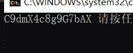


`image-20220222204907969.png` (5.54 KB, 下载次数: 2)

[href="forum.php?mod=attachment&aid=MjQ5NjkxNHw2NmE2ZjFiMHwxNzkzNTc2MTIxfDE2ODA4NnwxNTkxODgw&nothumb=yes" target="_blank"](https://www.52pojie.cn/forum.php?mod=attachment&aid=MjQ5NjkxNHw2NmE2ZjFiMHwxNzkzNTc2MTIxfDE2ODA4NnwxNTkxODgw&nothumb=yes)

2022-2-22 20:55 上传
