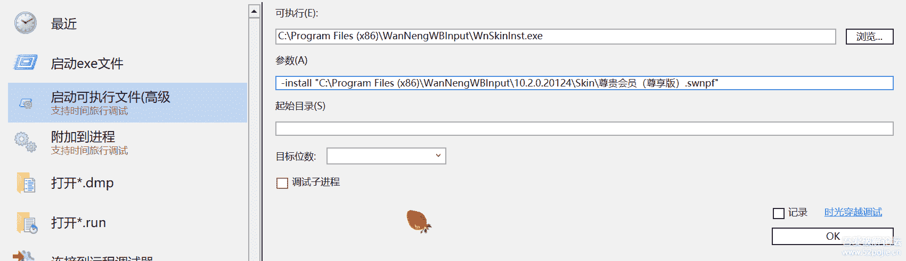
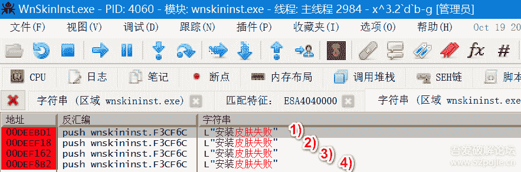
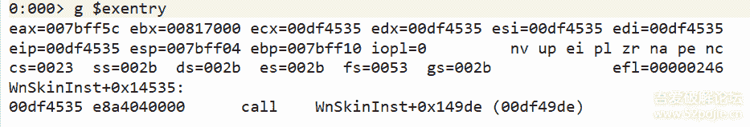
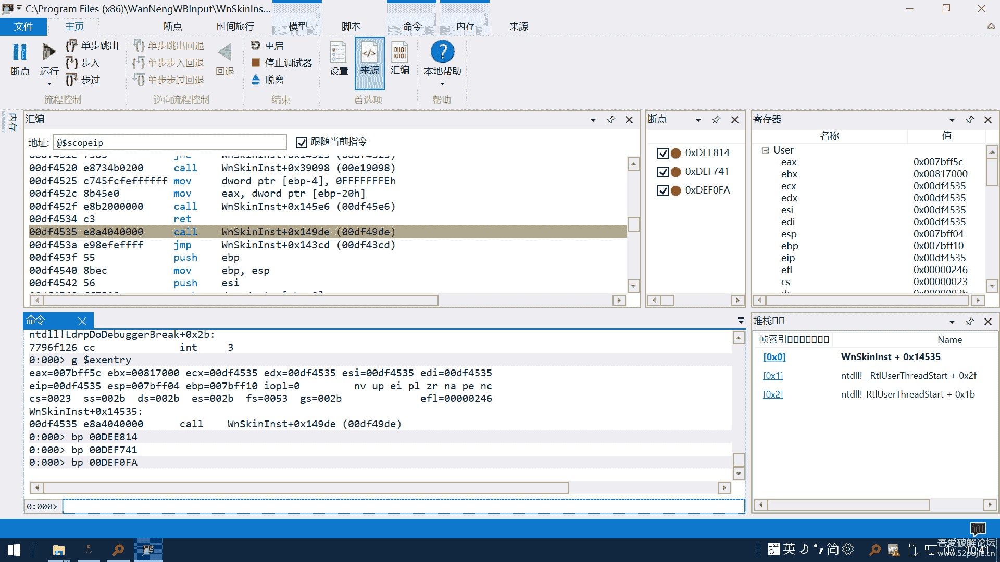
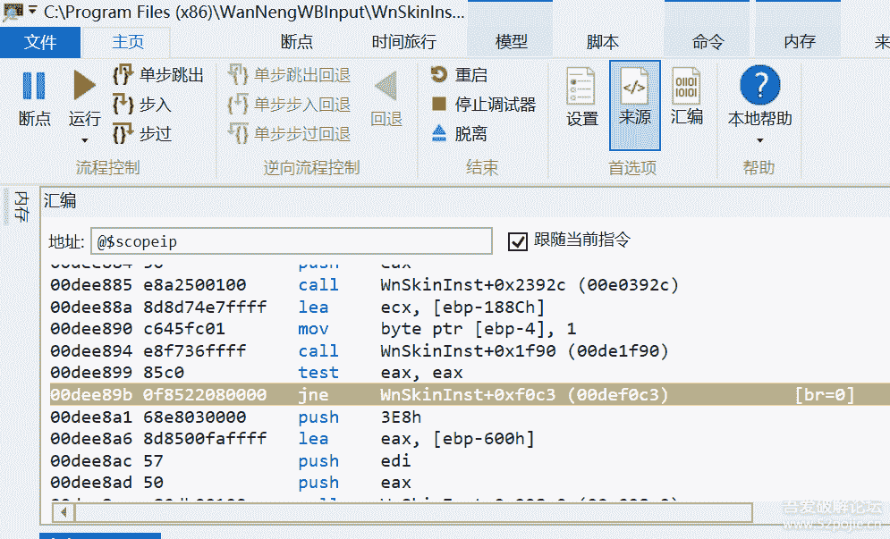
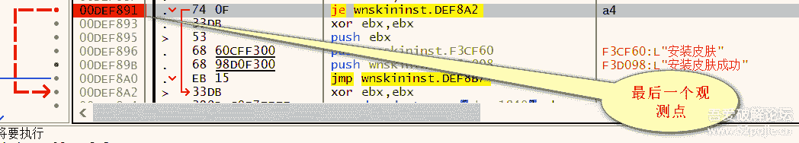
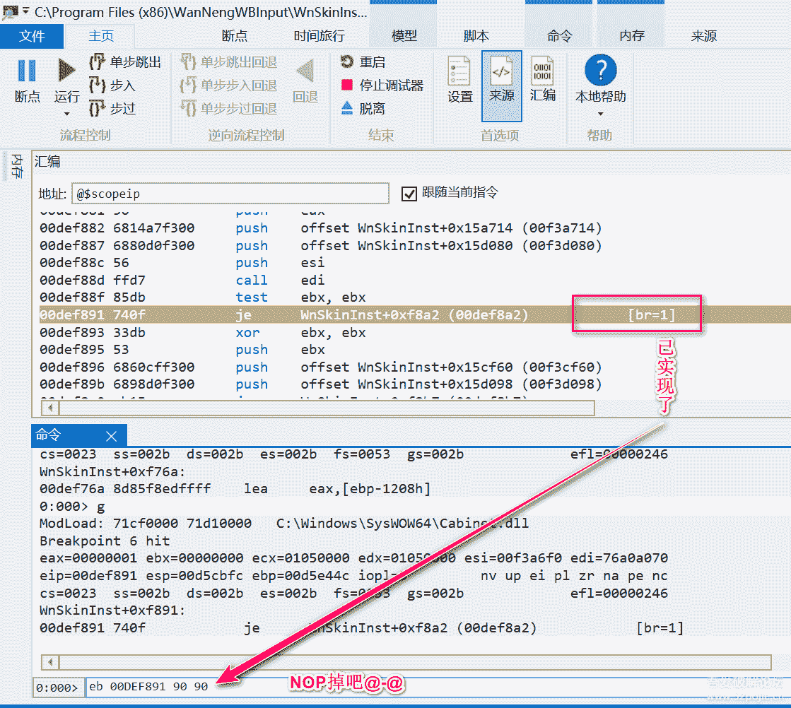

# [原创] Windbg爆破之路之三

- 原帖: <https://www.52pojie.cn/forum.php?mod=viewthread&tid=1593404>
- 抓取时间: 2026-11-01T23:35:18

## 准备

无费话，直接开搞，拉来从微软商店请来的`Windbg`。

如图设置



`image.png` (87.12 KB, 下载次数: 1)

[href="forum.php?mod=attachment&aid=MjQ5NzUwOHwzYTA4ZGNjMHwxNzkzNTc2MTE1fDE2ODA4NnwxNTkzNDA0&nothumb=yes" target="_blank"](https://www.52pojie.cn/forum.php?mod=attachment&aid=MjQ5NzUwOHwzYTA4ZGNjMHwxNzkzNTc2MTE1fDE2ODA4NnwxNTkzNDA0&nothumb=yes)

2022-2-25 10:29 上传

## 观察点与操作

- 观察敌营火力部署
- 布置前沿观察哨
- 记录敌方运作情况
- 发射导弹改变敌方运作流程



`image.png` (65.43 KB, 下载次数: 1)

[href="forum.php?mod=attachment&aid=MjQ5NzUxMXxmOGQzNWUwMnwxNzkzNTc2MTE1fDE2ODA4NnwxNTkzNDA0&nothumb=yes" target="_blank"](https://www.52pojie.cn/forum.php?mod=attachment&aid=MjQ5NzUxMXxmOGQzNWUwMnwxNzkzNTc2MTE1fDE2ODA4NnwxNTkzNDA0&nothumb=yes)

2022-2-25 10:33 上传

设 1)、2)、3)、4) 为四个主要观察点。

## 运行细节分析

接下来运行细节的分析，内容较多，自己上机体会。


[Asm] 纯文本查看 复制代码


# `WnSkinInst` 安装皮肤流程分析

## 关键调用与失败字符串

```
00DEF741 | E8 AA390000        | call       ===>这里也设一个断点
00DEF746 | 84C0               | test al,al                         |
00DEF748 | 75 18              | jne wnskininst.DEF762              | a1
00DEF74A | 3885 C6E7FFFF      | cmp byte ptr ss:[ebp-183A],al      |
00DEF750 | 0F84 56010000      | je wnskininst.DEF8AC               | a2
00DEF756 | 8BCF               | mov ecx,edi                        | ecx:EntryPoint, edi:EntryPoint
00DEF758 | E8 E6EFFFFF        | call        |
00DEF75D | E9 5C010000        | jmp wnskininst.DEF8BE              | a3
00DEF762 | 53                 | push ebx                           |
00DEF763 | 8D85 D0F7FFFF      | lea eax,dword ptr ss:[ebp-830]     |
00DEF769 | 50                 | push eax                           |
00DEF76A | 8D85 F8EDFFFF      | lea eax,dword ptr ss:[ebp-1208]    |
00DEF770 | 50                 | push eax                           |
00DEF771 | FF15 C0A1F300      | call dword ptr ds:[]   |
00DEF777 | FFB5 C0E7FFFF      | push dword ptr ss:[ebp-1840]       |
00DEF77D | 8BD8               | mov ebx,eax                        |
00DEF77F | 56                 | push esi                           | esi:EntryPoint
00DEF780 | E8 9AD90100        | call        |
00DEF785 | 59                 | pop ecx                            | ecx:EntryPoint
00DEF786 | 59                 | pop ecx                            | ecx:EntryPoint
00DEF787 | 33C9               | xor ecx,ecx                        | ecx:EntryPoint
00DEF789 | 85C0               | test eax,eax                       |
00DEF78B | 6A 01              | push 1                             |
00DEF78D | 58                 | pop eax                            |
00DEF78E | 0F44C8             | cmove ecx,eax                      | ecx:EntryPoint
00DEF791 | 8D85 D0F7FFFF      | lea eax,dword ptr ss:[ebp-830]     |
00DEF797 | 6A 00              | push 0                             |
00DEF799 | 898D C0E7FFFF      | mov dword ptr ss:[ebp-1840],ecx    | ecx:EntryPoint
00DEF79F | 8D8D C7E7FFFF      | lea ecx,dword ptr ss:[ebp-1839]    | ecx:EntryPoint
00DEF7A5 | 50                 | push eax                           |
00DEF7A6 | E8 10250000        | call        |
00DEF7AB | E8 C955FFFF        | call        |
00DEF7B0 | 8BC8               | mov ecx,eax                        | ecx:EntryPoint
00DEF7B2 | E8 906F0100        | call        |
00DEF7B7 | 8B3D C0A3F300      | mov edi,dword ptr ds:[       |
00DEF81B | 83C4 0C            | add esp,C                          |
00DEF81E | E8 5655FFFF        | call        |
00DEF823 | 8BC8               | mov ecx,eax                        | ecx:EntryPoint
00DEF825 | E8 D6B20000        | call        |
00DEF82A | 50                 | push eax                           |
00DEF82B | 8D85 E0FBFFFF      | lea eax,dword ptr ss:[ebp-420]     |
00DEF831 | 68 7CCFF300        | push wnskininst.F3CF7C             | F3CF7C:L"%sConfig\\"
00DEF836 | 50                 | push eax                           |
00DEF837 | E8 B256FFFF        | call        |
00DEF83C | 8D85 E0FBFFFF      | lea eax,dword ptr ss:[ebp-420]     |
00DEF842 | 68 90CFF300        | push wnskininst.F3CF90             | F3CF90:L"Config.ini"==&L"搀"
00DEF847 | 50                 | push eax                           |
00DEF848 | E8 4E620200        | call        |
00DEF84D | 83C4 14            | add esp,14                         |
00DEF850 | 8D85 E0FBFFFF      | lea eax,dword ptr ss:[ebp-420]     |
00DEF856 | 50                 | push eax                           |
00DEF857 | 56                 | push esi                           | esi:EntryPoint
00DEF858 | 68 00A7F300        | push wnskininst.F3A700             | F3A700:L"IsUseSkin"
00DEF85D | BE F0A6F300        | mov esi,wnskininst.F3A6F0          | esi:EntryPoint, F3A6F0:L"Setting"
00DEF862 | 56                 | push esi                           | esi:EntryPoint
00DEF863 | FFD7               | call edi                           | edi:EntryPoint
00DEF865 | 8D85 E0FBFFFF      | lea eax,dword ptr ss:[ebp-420]     |
00DEF86B | 50                 | push eax                           |
00DEF86C | 8D85 C8F5FFFF      | lea eax,dword ptr ss:[ebp-A38]     |
00DEF872 | 50                 | push eax                           |
00DEF873 | 68 DCA6F300        | push wnskininst.F3A6DC             | F3A6DC:L"SkinName"
00DEF878 | 56                 | push esi                           | esi:EntryPoint
00DEF879 | FFD7               | call edi                           | edi:EntryPoint
00DEF87B | 8D85 E0FBFFFF      | lea eax,dword ptr ss:[ebp-420]     |
00DEF881 | 50                 | push eax                           |
00DEF882 | 68 14A7F300        | push wnskininst.F3A714             | F3A714:L"1"
00DEF887 | 68 80D0F300        | push wnskininst.F3D080             | F3D080:L"InstallSkin"
00DEF88C | 56                 | push esi                           | esi:EntryPoint
00DEF88D | FFD7               | call edi                           | edi:EntryPoint
00DEF88F | 85DB               | test ebx,ebx                       |
00DEF891 | 74 0F              | je wnskininst.DEF8A2               | a4
00DEF893 | 33DB               | xor ebx,ebx                        |
00DEF895 | 53                 | push ebx                           |
00DEF896 | 68 60CFF300        | push wnskininst.F3CF60             | F3CF60:L"安装皮肤"
00DEF89B | 68 98D0F300        | push wnskininst.F3D098             | F3D098:L"安装皮肤成功"
00DEF8A0 | EB 15              | jmp wnskininst.DEF8B7              |
00DEF8A2 | 33DB               | xor ebx,ebx                        |
00DEF8A4 | 399D C0E7FFFF      | cmp dword ptr ss:[ebp-1840],ebx    |
00DEF8AA | 75 E9              | jne wnskininst.DEF895              |
00DEF8AC | 53                 | push ebx                           |
00DEF8AD | 68 60CFF300        | push wnskininst.F3CF60             | F3CF60:L"安装皮肤"
00DEF8B2 | 68 6CCFF300        | push wnskininst.F3CF6C             | F3CF6C:L"安装皮肤失败"
00DEF8B7 | 53                 | push ebx                           |
00DEF8B8 | FF15 3CA4F300      | call dword ptr ds:[] |
00DEF8BE | 8D8D C7E7FFFF      | lea ecx,dword ptr ss:[ebp-1839]    | ecx:EntryPoint
00DEF8C4 | E8 27420400        | call        |
00DEF8C9 | 33C0               | xor eax,eax                        |
00DEF8CB | 8D8D C8E7FFFF      | lea ecx,dword ptr ss:[ebp-1838]    | ecx:EntryPoint
00DEF8D1 | 53                 | push ebx                           |
00DEF8D2 | 40                 | inc eax                            |
00DEF8D3 | 50                 | push eax                           |
```

```
========================================================
地址       反汇编                    字符串      
00DEEBD1 push wnskininst.F3CF6C L"安装皮肤失败" 1)
00DEEF18 push wnskininst.F3CF6C L"安装皮肤失败"  2)
00DEF162 push wnskininst.F3CF6C L"安装皮肤失败"  3)
00DEF8B2 push wnskininst.F3CF6C L"安装皮肤失败"  4)
==========================================================
```

### 第 1）处前往

```
00DEE814 | 55                 | push ebp                         ====》保险起见，在段首这里设断观察！
00DEE815 | 8BEC               | mov ebp,esp                        |
00DEE817 | 6A FF              | push FFFFFFFF                      |
00DEE819 | 68 7F82F300        | push        |
00DEE81E | 64:A1 00000000     | mov eax,dword ptr fs:[0]           | 00000000:L"︰O"
00DEE824 | 50                 | push eax                           |
00DEE825 | B8 80180000        | mov eax,1880                       |
00DEE82A | E8 11550000        | call        |
00DEE82F | A1 44C0F900        | mov eax,dword ptr ds:[F9C044]      |
00DEE834 | 33C5               | xor eax,ebp                        |
00DEE836 | 8945 F0            | mov dword ptr ss:[ebp-10],eax      |
00DEE839 | 53                 | push ebx                           |
00DEE83A | 56                 | push esi                           | esi:EntryPoint
00DEE83B | 57                 | push edi                           | edi:EntryPoint
00DEE83C | 50                 | push eax                           |
00DEE83D | 8D45 F4            | lea eax,dword ptr ss:[ebp-C]       |
00DEE840 | 64:A3 00000000     | mov dword ptr fs:[0],eax           | 00000000:L"︰O"
00DEE846 | 8BD9               | mov ebx,ecx                        | ecx:EntryPoint
00DEE848 | 8B75 08            | mov esi,dword ptr ss:[ebp+8]       | esi:EntryPoint
00DEE84B | 83EC 18            | sub esp,18                         |
00DEE84E | 8BCC               | mov ecx,esp                        | ecx:EntryPoint
00DEE850 | 56                 | push esi                           | esi:EntryPoint
00DEE851 | E8 AA2FFFFF        | call        |
00DEE856 | 8D85 80E7FFFF      | lea eax,dword ptr ss:[ebp-1880]    |
00DEE85C | 50                 | push eax                           |
00DEE85D | E8 BB180100        | call        |
00DEE862 | 83C4 1C            | add esp,1C                         |
00DEE865 | 33FF               | xor edi,edi                        | edi:EntryPoint
00DEE867 | 8D85 80E7FFFF      | lea eax,dword ptr ss:[ebp-1880]    |
00DEE86D | 83BD 94E7FFFF 08   | cmp dword ptr ss:[ebp-186C],8      |
00DEE874 | 8D8D 74E7FFFF      | lea ecx,dword ptr ss:[ebp-188C]    | ecx:EntryPoint
00DEE87A | 897D FC            | mov dword ptr ss:[ebp-4],edi       | edi:EntryPoint
00DEE87D | 0F4385 80E7FFFF    | cmovae eax,dword ptr ss:[ebp-1880] |
00DEE884 | 50                 | push eax                           |
00DEE885 | E8 A2500100        | call        |
00DEE88A | 8D8D 74E7FFFF      | lea ecx,dword ptr ss:[ebp-188C]    | ecx:EntryPoint
00DEE890 | C645 FC 01         | mov byte ptr ss:[ebp-4],1          |
00DEE894 | E8 F736FFFF        | call        |
00DEE899 | 85C0               | test eax,eax                       |
00DEE89B | 0F85 22080000      | jne wnskininst.DEF0C3              | b8
00DEE8A1 | 68 E8030000        | push 3E8                           |
00DEE8A6 | 8D85 00FAFFFF      | lea eax,dword ptr ss:[ebp-600]     |
00DEE8AC | 57                 | push edi                           | edi:EntryPoint
00DEE8AD | 50                 | push eax                           |
00DEE8AE | E8 0DB00100        | call        |
00DEE8B3 | 83C4 0C            | add esp,C                          |
00DEE8B6 | 8D8D B0E7FFFF      | lea ecx,dword ptr ss:[ebp-1850]    | ecx:EntryPoint
00DEE8BC | 56                 | push esi                           | esi:EntryPoint
00DEE8BD | E8 3E2FFFFF        | call        |
00DEE8C2 | BE 6CB6F300        | mov esi,wnskininst.F3B66C          | esi:EntryPoint, F3B66C:L"-untie"
00DEE8C7 | C645 FC 02         | mov byte ptr ss:[ebp-4],2          |
00DEE8CB | 56                 | push esi                           | esi:EntryPoint
00DEE8CC | E8 B0E70100        | call        |
00DEE8D1 | 59                 | pop ecx                            | ecx:EntryPoint
00DEE8D2 | 50                 | push eax                           |
00DEE8D3 | 57                 | push edi                           | edi:EntryPoint
00DEE8D4 | 56                 | push esi                           | esi:EntryPoint
00DEE8D5 | 8D8D B0E7FFFF      | lea ecx,dword ptr ss:[ebp-1850]    | ecx:EntryPoint
00DEE8DB | E8 2058FFFF        | call        |
00DEE8E0 | 83CE FF            | or esi,FFFFFFFF                    | esi:EntryPoint
00DEE8E3 | 3BC6               | cmp eax,esi                        | esi:EntryPoint
00DEE8E5 | 0F8E 4A010000      | jle wnskininst.DEEA35              | b7
00DEE8EB | 83BD C4E7FFFF 08   | cmp dword ptr ss:[ebp-183C],8      |
00DEE8F2 | 8DB5 B0E7FFFF      | lea esi,dword ptr ss:[ebp-1850]    | esi:EntryPoint
00DEE8F8 | 68 6CB6F300        | push wnskininst.F3B66C             | F3B66C:L"-untie"
00DEE8FD | 0F43B5 B0E7FFFF    | cmovae esi,dword ptr ss:[ebp-1850] | esi:EntryPoint
00DEE904 | E8 78E70100        | call        |
00DEE909 | 83C6 02            | add esi,2                          | esi:EntryPoint
00DEE90C | 8D0446             | lea eax,dword ptr ds:[esi+eax*2]   |
00DEE90F | 50                 | push eax                           |
00DEE910 | 8D85 00FAFFFF      | lea eax,dword ptr ss:[ebp-600]     |
00DEE916 | 50                 | push eax                           |
00DEE917 | E8 7F710200        | call        |
00DEE91C | 83C4 0C            | add esp,C                          |
00DEE91F | 8D8D 7FE7FFFF      | lea ecx,dword ptr ss:[ebp-1881]    | ecx:EntryPoint
00DEE925 | E8 A5F3FFFF        | call        |
00DEE92A | 8D85 7EE7FFFF      | lea eax,dword ptr ss:[ebp-1882]    |
00DEE930 | C645 FC 03         | mov byte ptr ss:[ebp-4],3          |
00DEE934 | 50                 | push eax                           |
00DEE935 | 8D85 00FAFFFF      | lea eax,dword ptr ss:[ebp-600]     |
00DEE93B | 50                 | push eax                           |
00DEE93C | 8D8D 7FE7FFFF      | lea ecx,dword ptr ss:[ebp-1881]    | ecx:EntryPoint
00DEE942 | E8 A9470000        | call        |
00DEE947 | 84C0               | test al,al                         |
00DEE949 | 0F84 6A020000      | je wnskininst.DEEBB9               | b6
00DEE94F | 57                 | push edi                           | edi:EntryPoint
00DEE950 | 8D85 00FAFFFF      | lea eax,dword ptr ss:[ebp-600]     |
00DEE956 | 50                 | push eax                           |
00DEE957 | 8D8D 7FE7FFFF      | lea ecx,dword ptr ss:[ebp-1881]    | ecx:EntryPoint
00DEE95D | E8 59330000        | call        |
00DEE962 | 68 08020000        | push 208                           |
00DEE967 | 8D85 E8FDFFFF      | lea eax,dword ptr ss:[ebp-218]     |
00DEE96D | 57                 | push edi                           | edi:EntryPoint
00DEE96E | 50                 | push eax                           |
00DEE96F | E8 4CAF0100        | call        |
00DEE974 | 83C4 0C            | add esp,C                          |
00DEE977 | E8 FD63FFFF        | call        |
00DEE97C | 8BC8               | mov ecx,eax                        | ecx:EntryPoint
00DEE97E | E8 7DC10000        | call        |
00DEE983 | 50                 | push eax                           |
00DEE984 | 8D85 E8FDFFFF      | lea eax,dword ptr ss:[ebp-218]     |
00DEE98A | 68 7CCFF300        | push wnskininst.F3CF7C             | F3CF7C:L"%sConfig\\"
00DEE98F | 50                 | push eax                           |
00DEE990 | E8 5965FFFF        | call        |
00DEE995 | 8D85 E8FDFFFF      | lea eax,dword ptr ss:[ebp-218]     |
00DEE99B | 68 90CFF300        | push wnskininst.F3CF90             | F3CF90:L"Config.ini"==&L"搀"
00DEE9A0 | 50                 | push eax                           |
00DEE9A1 | E8 F5700200        | call        |
00DEE9A6 | 8D85 00FAFFFF      | lea eax,dword ptr ss:[ebp-600]     |
00DEE9AC | 50                 | push eax                           |
00DEE9AD | 8D85 C8E7FFFF      | lea eax,dword ptr ss:[ebp-1838]    |
00DEE9B3 | 50                 | push eax                           |
00DEE9B4 | E8 01790100        | call        |
00DEE9B9 | 83C4 1C            | add esp,1C                         |
00DEE9BC | 8B35 C0A3F300      | mov esi,dword ptr ds:[       |
00DEEA25 | 59                 | pop ecx                            | ecx:EntryPoint
00DEEA26 | 59                 | pop ecx                            | ecx:EntryPoint
00DEEA27 | 8BCB               | mov ecx,ebx                        | ecx:EntryPoint
00DEEA29 | E8 F1200000        | call        |
00DEEA2E | 33FF               | xor edi,edi                        | edi:EntryPoint
00DEEA30 | E9 01020000        | jmp wnskininst.DEEC36              |
00DEEA35 | 68 A8CFF300        | push wnskininst.F3CFA8             | F3CFA8:L"-temp"
00DEEA3A | E8 42E60100        | call        |
00DEEA3F | 59                 | pop ecx                            | ecx:EntryPoint
00DEEA40 | 50                 | push eax                           |
00DEEA41 | 57                 | push edi                           | edi:EntryPoint
00DEEA42 | 68 A8CFF300        | push wnskininst.F3CFA8             | F3CFA8:L"-temp"
00DEEA47 | 8D8D B0E7FFFF      | lea ecx,dword ptr ss:[ebp-1850]    | ecx:EntryPoint
00DEEA4D | E8 AE56FFFF        | call        |
00DEEA52 | 3BC6               | cmp eax,esi                        | esi:EntryPoint
00DEEA54 | 0F8E DA000000      | jle wnskininst.DEEB34              | b5
00DEEA5A | 83BD C4E7FFFF 08   | cmp dword ptr ss:[ebp-183C],8      |
00DEEA61 | 8DB5 B0E7FFFF      | lea esi,dword ptr ss:[ebp-1850]    | esi:EntryPoint
00DEEA67 | 68 A8CFF300        | push wnskininst.F3CFA8             | F3CFA8:L"-temp"
00DEEA6C | 0F43B5 B0E7FFFF    | cmovae esi,dword ptr ss:[ebp-1850] | esi:EntryPoint
00DEEA73 | E8 09E60100        | call        |
00DEEA78 | 83C6 02            | add esi,2                          | esi:EntryPoint
00DEEA7B | 8D0446             | lea eax,dword ptr ds:[esi+eax*2]   |
00DEEA7E | 50                 | push eax                           |
00DEEA7F | 8D85 00FAFFFF      | lea eax,dword ptr ss:[ebp-600]     |
00DEEA85 | 50                 | push eax                           |
00DEEA86 | E8 10700200        | call        |
00DEEA8B | 83C4 0C            | add esp,C                          |
00DEEA8E | 8D8D 7FE7FFFF      | lea ecx,dword ptr ss:[ebp-1881]    | ecx:EntryPoint
00DEEA94 | E8 36F2FFFF        | call        |
00DEEA99 | 8D85 7EE7FFFF      | lea eax,dword ptr ss:[ebp-1882]    |
00DEEA9F | C645 FC 05         | mov byte ptr ss:[ebp-4],5          |
00DEEAA3 | 50                 | push eax                           |
00DEEAA4 | 8D85 00FAFFFF      | lea eax,dword ptr ss:[ebp-600]     |
00DEEAAA | 50                 | push eax                           |
00DEEAAB | 8D8D 7FE7FFFF      | lea ecx,dword ptr ss:[ebp-1881]    | ecx:EntryPoint
00DEEAB1 | E8 3A460000        | call        |
00DEEAB6 | 84C0               | test al,al                         |
00DEEAB8 | 0F84 FB000000      | je wnskininst.DEEBB9               | b4
00DEEABE | 6A 01              | push 1                             |
00DEEAC0 | 8D85 00FAFFFF      | lea eax,dword ptr ss:[ebp-600]     |
00DEEAC6 | 50                 | push eax                           |
00DEEAC7 | 8D8D 7FE7FFFF      | lea ecx,dword ptr ss:[ebp-1881]    | ecx:EntryPoint
00DEEACD | E8 E9310000        | call        |
00DEEAD2 | E8 A262FFFF        | call        |
00DEEAD7 | 8BC8               | mov ecx,eax                        | ecx:EntryPoint
00DEEAD9 | E8 697C0100        | call        |
00DEEADE | 8B35 C0A3F300      | mov esi,dword ptr ds:[       |
00DEEB3E | 59                 | pop ecx                            | ecx:EntryPoint
00DEEB3F | 50                 | push eax                           |
00DEEB40 | 57                 | push edi                           | edi:EntryPoint
00DEEB41 | 68 88B6F300        | push wnskininst.F3B688             | F3B688:L"-install"
00DEEB46 | 8D8D B0E7FFFF      | lea ecx,dword ptr ss:[ebp-1850]    | ecx:EntryPoint
00DEEB4C | E8 AF55FFFF        | call        |
00DEEB51 | 3BC6               | cmp eax,esi                        | esi:EntryPoint
00DEEB53 | 0F8E 05010000      | jle wnskininst.DEEC5E              | b3
00DEEB59 | 83BD C4E7FFFF 08   | cmp dword ptr ss:[ebp-183C],8      |
00DEEB60 | 8DB5 B0E7FFFF      | lea esi,dword ptr ss:[ebp-1850]    | esi:EntryPoint
00DEEB66 | 68 88B6F300        | push wnskininst.F3B688             | F3B688:L"-install"
00DEEB6B | 0F43B5 B0E7FFFF    | cmovae esi,dword ptr ss:[ebp-1850] | esi:EntryPoint
00DEEB72 | E8 0AE50100        | call        |
00DEEB77 | 83C6 02            | add esi,2                          | esi:EntryPoint
00DEEB7A | 8D0446             | lea eax,dword ptr ds:[esi+eax*2]   |
00DEEB7D | 50                 | push eax                           |
00DEEB7E | 8D85 00FAFFFF      | lea eax,dword ptr ss:[ebp-600]     |
00DEEB84 | 50                 | push eax                           |
00DEEB85 | E8 116F0200        | call        |
00DEEB8A | 83C4 0C            | add esp,C                          |
00DEEB8D | 8D8D 7FE7FFFF      | lea ecx,dword ptr ss:[ebp-1881]    | ecx:EntryPoint
00DEEB93 | E8 37F1FFFF        | call        |
00DEEB98 | 8D85 7EE7FFFF      | lea eax,dword ptr ss:[ebp-1882]    |
00DEEB9E | C645 FC 06         | mov byte ptr ss:[ebp-4],6          |
00DEEBA2 | 50                 | push eax                           |
00DEEBA3 | 8D85 00FAFFFF      | lea eax,dword ptr ss:[ebp-600]     |
00DEEBA9 | 50                 | push eax                           |
00DEEBAA | 8D8D 7FE7FFFF      | lea ecx,dword ptr ss:[ebp-1881]    | ecx:EntryPoint
00DEEBB0 | E8 3B450000        | call        |
00DEEBB5 | 84C0               | test al,al                         |
00DEEBB7 | 75 2C              | jne wnskininst.DEEBE5              | b1
00DEEBB9 | 80BD 7EE7FFFF 00   | cmp byte ptr ss:[ebp-1882],0       |
00DEEBC0 | 74 09              | je wnskininst.DEEBCB               | b2
00DEEBC2 | 8BCB               | mov ecx,ebx                        | ecx:EntryPoint
00DEEBC4 | E8 7AFBFFFF        | call        |
00DEEBC9 | EB 12              | jmp wnskininst.DEEBDD              |
00DEEBCB | 57                 | push edi                           | edi:EntryPoint
00DEEBCC | 68 60CFF300        | push wnskininst.F3CF60             | F3CF60:L"安装皮肤"
00DEEBD1 | 68 6CCFF300        | push wnskininst.F3CF6C             | F3CF6C:L"安装皮肤失败"
00DEEBD6 | 57                 | push edi                           | edi:EntryPoint
00DEEBD7 | FF15 3CA4F300      | call dword ptr ds:[]
```

### 第 2）处向上分析

```
00DEEEFB | 75 32              | jne wnskininst.DEEF2F              | c1
00DEEEFD | 3885 7EE7FFFF      | cmp byte ptr ss:[ebp-1882],al      |
00DEEF03 | 74 0B              | je wnskininst.DEEF10               |
00DEEF05 | 8BCB               | mov ecx,ebx                        | ecx:EntryPoint
00DEEF07 | E8 37F8FFFF        | call        |
00DEEF0C | 33FF               | xor edi,edi                        | edi:EntryPoint
00DEEF0E | EB 14              | jmp wnskininst.DEEF24              |
00DEEF10 | 33FF               | xor edi,edi                        | edi:EntryPoint
00DEEF12 | 57                 | push edi                           | edi:EntryPoint
00DEEF13 | 68 60CFF300        | push wnskininst.F3CF60             | F3CF60:L"安装皮肤"
00DEEF18 | 68 6CCFF300        | push wnskininst.F3CF6C             | F3CF6C:L"安装皮肤失败"
00DEEF1D | 57                 | push edi                           | edi:EntryPoint
00DEEF1E | FF15 3CA4F300      | call dword ptr ds:[] 
```

与 a1）处起点交汇

### 第 3）处向上分析

```
00DEF0FA | 68 40020000        | push 240                          =====>这里的代码很短
00DEF0FF | B8 C882F300        | mov eax,    |
00DEF104 | E8 5E4B0000        | call        |
00DEF109 | 8BF9               | mov edi,ecx                        | edi:EntryPoint, ecx:EntryPoint
00DEF10B | 8B75 08            | mov esi,dword ptr ss:[ebp+8]       | esi:EntryPoint
00DEF10E | 8D8D B8FDFFFF      | lea ecx,dword ptr ss:[ebp-248]     | ecx:EntryPoint
00DEF114 | 56                 | push esi                           | esi:EntryPoint
00DEF115 | E8 E626FFFF        | call        |
00DEF11A | 33DB               | xor ebx,ebx                        |
00DEF11C | 8D8D B6FDFFFF      | lea ecx,dword ptr ss:[ebp-24A]     | ecx:EntryPoint
00DEF122 | 895D FC            | mov dword ptr ss:[ebp-4],ebx       |
00DEF125 | E8 A5EBFFFF        | call        |
00DEF12A | 8D85 B7FDFFFF      | lea eax,dword ptr ss:[ebp-249]     |
00DEF130 | C645 FC 01         | mov byte ptr ss:[ebp-4],1          |
00DEF134 | 50                 | push eax                           |
00DEF135 | 56                 | push esi                           | esi:EntryPoint
00DEF136 | 8D8D B6FDFFFF      | lea ecx,dword ptr ss:[ebp-24A]     | ecx:EntryPoint
00DEF13C | 889D B7FDFFFF      | mov byte ptr ss:[ebp-249],bl       |
00DEF142 | E8 A93F0000        | call        |
00DEF147 | 84C0               | test al,al                         |
00DEF149 | 75 2E              | jne wnskininst.DEF179              | d2
00DEF14B | 3885 B7FDFFFF      | cmp byte ptr ss:[ebp-249],al       |
00DEF151 | 74 09              | je wnskininst.DEF15C               | d1
00DEF153 | 8BCF               | mov ecx,edi                        | ecx:EntryPoint, edi:EntryPoint
00DEF155 | E8 E9F5FFFF        | call        |
00DEF15A | EB 12              | jmp wnskininst.DEF16E              |
00DEF15C | 53                 | push ebx                           |
00DEF15D | 68 60CFF300        | push wnskininst.F3CF60             | F3CF60:L"安装皮肤"
00DEF162 | 68 6CCFF300        | push wnskininst.F3CF6C             | F3CF6C:L"安装皮肤失败"
```

### a4）处

```
00DEF891 | 74 0F              | je wnskininst.DEF8A2               | a4
00DEF893 | 33DB               | xor ebx,ebx                        |
00DEF895 | 53                 | push ebx                           |
00DEF896 | 68 60CFF300        | push wnskininst.F3CF60             | F3CF60:L"安装皮肤"
00DEF89B | 68 98D0F300        | push wnskininst.F3D098             | F3D098:L"安装皮肤成功"
00DEF8A0 | EB 15              | jmp wnskininst.DEF8B7              |
00DEF8A2 | 33DB               | xor ebx,ebx                        |
00DEF8A4 | 399D C0E7FFFF      | cmp dword ptr ss:[ebp-1840],ebx    |
00DEF8AA | 75 E9              | jne wnskininst.DEF895              |
00DEF8AC | 53                 | push ebx                           |
00DEF8AD | 68 60CFF300        | push wnskininst.F3CF60             | F3CF60:L"安装皮肤"
00DEF8B2 | 68 6CCFF300        | push wnskininst.F3CF6C             | F3CF6C:L"安装皮肤失败"
```

又发现 a4）处向上与上面 a1）处交汇

## 转到 `OEP` 与地址定位

`g $exentry` 我们先转到 `OEP`



image.png (45.32 KB, 下载次数: 1)

[href="forum.php?mod=attachment&aid=MjQ5NzUxMnxhM2Y3NmI5OHwxNzkzNTc2MTE1fDE2ODA4NnwxNTkzNDA0&nothumb=yes" target="_blank"](https://www.52pojie.cn/forum.php?mod=attachment&aid=MjQ5NzUxMnxhM2Y3NmI5OHwxNzkzNTc2MTE1fDE2ODA4NnwxNTkzNDA0&nothumb=yes)

2022-2-25 10:39 上传

```
00df4535 e8a4040000     call    WnSkinInst+0x149de (00df49de)
```

用法王三A地址定位法，到 `x32dbg` 中看一眼，是否能对上？

```
00DF4535 | E8 A4040000            | call    
```

nice，此时正好完全吻合！ `00DF4535` 正好是一样的哟~~，也就是说 `VA` 可以直接使用！

对不上，就自己加基址转换呗。。。

## 下断点

`bp 00DEE814`

`bp 00DEF741`

`bp 00DEF0FA`



image.png (301 KB, 下载次数: 0)

[href="forum.php?mod=attachment&aid=MjQ5NzUxNXxiNDE4ZGZiOHwxNzkzNTc2MTE1fDE2ODA4NnwxNTkzNDA0&nothumb=yes" target="_blank"](https://www.52pojie.cn/forum.php?mod=attachment&aid=MjQ5NzUxNXxiNDE4ZGZiOHwxNzkzNTc2MTE1fDE2ODA4NnwxNTkzNDA0&nothumb=yes)

2022-2-25 10:41 上传

## 修改 `is_vip` 返回值

别忘了把 `is_vip` 返回 `1`

所以 `eb 00DE5258 b0 01 c3`



image.png (145.4 KB, 下载次数: 1)

[href="forum.php?mod=attachment&aid=MjQ5NzUxOXwwZmIxZjhmNHwxNzkzNTc2MTE1fDE2ODA4NnwxNTkzNDA0&nothumb=yes" target="_blank"](https://www.52pojie.cn/forum.php?mod=attachment&aid=MjQ5NzUxOXwwZmIxZjhmNHwxNzkzNTc2MTE1fDE2ODA4NnwxNTkzNDA0&nothumb=yes)

2022-2-25 10:55 上传

## 单步向下运行与修改点

一路单步向下运行

```
00DEE89B | 0F85 22080000      | jne wnskininst.DEF0C3              | b8 发现没有跳走！

00e098d1  没跳

00e098e0 0f8edf000000     jle     WnSkinInst+0x299c5 (00e099c5)           [br=0]  依然没有跳

00e098ec 0f8c8b000000     jl      WnSkinInst+0x2997d (00e0997d)           [br=0]依然没有跳

00e098fa 7309             jae     WnSkinInst+0x29905 (00e09905)           [br=0]依然没有跳

00dee8e5 0f8e4a010000   jle     WnSkinInst+0xea35 (00deea35)            [br=1] 这里跳走了

00deea54 0f8eda000000   jle     WnSkinInst+0xeb34 (00deeb34)            [br=1]这里跳走了

00deeb53 0f8e05010000         jle     WnSkinInst+0xec5e (00deec5e)            [br=0]没有跳

00deebb0 e83b450000     call    WnSkinInst+0x130f0 (00df30f0)  ====>====>所以修改这里

00deebb5 84c0                 test    al, al

00deebb7 752c                 jne     WnSkinInst+0xebe5 (00deebe5)            [br=0]直到这里！也就是咱们的a1）处  或修改这里

00DEF741 | E8 AA390000            | call        | 接下来我们来到了这里  ====>====>所以修改这里

00DEF746 | 84C0                   | test al,al                         |

00DEF748 | 75 18                  | jne wnskininst.DEF762              | a1必须实现=====>或修改这里

00DEF74A | 3885 C6E7FFFF          | cmp byte ptr ss:[ebp-183A],al      |

00DEF750 | 0F84 56010000          | je wnskininst.DEF8AC               | a2实现以完蛋

00DEF756 | 8BCF                   | mov ecx,edi                        | ecx:EntryPoint, edi:EntryPoint

00DEF758 | E8 E6EFFFFF            | call        |

00DEF75D | E9 5C010000            | jmp wnskininst.DEF8BE              | a3跳走也完蛋
```

`eb DEF748 eb 18`

```
00def763 8d85d0f7ffff lea     eax, [ebp-830h]改完来到这里

00DEF88D | FFD7                   | call edi                           | edi:EntryPoint

00DEF88F | 85DB                   | test ebx,ebx                       |

00DEF891 | 74 0F                  | je wnskininst.DEF8A2               | a4=======>看这句

00DEF893 | 33DB                   | xor ebx,ebx                        |

00DEF895 | 53                     | push ebx                           |

00DEF896 | 68 60CFF300            | push wnskininst.F3CF60             | F3CF60:L"安装皮肤"

00DEF89B | 68 98D0F300            | push wnskininst.F3D098             | F3D098:L"安装皮肤成功"

00DEF8A0 | EB 15                  | jmp wnskininst.DEF8B7              |

00DEF8A2 | 33DB                   | xor ebx,ebx                        |

00DEF8A4 | 399D C0E7FFFF          | cmp dword ptr ss:[ebp-1840],ebx    |

00DEF8AA | 75 E9                  | jne wnskininst.DEF895              |========》还有这句！

00DEF8AC | 53                     | push ebx                           |

00DEF8AD | 68 60CFF300            | push wnskininst.F3CF60             | F3CF60:L"安装皮肤"

00DEF8B2 | 68 6CCFF300            | push wnskininst.F3CF6C             | F3CF6C:L"安装皮肤失败"

00DEF8B7 | 53                     | push ebx                           |

00DEF8B8 | FF15 3CA4F300          | call dword ptr ds:[] |
```



image.png (57.19 KB, 下载次数: 1)

[href="forum.php?mod=attachment&aid=MjQ5NzUyNnw0ZmE3ZTNkZXwxNzkzNTc2MTE1fDE2ODA4NnwxNTkzNDA0&nothumb=yes" target="_blank"](https://www.52pojie.cn/forum.php?mod=attachment&aid=MjQ5NzUyNnw0ZmE3ZTNkZXwxNzkzNTc2MTE1fDE2ODA4NnwxNTkzNDA0&nothumb=yes)

2022-2-25 11:04 上传



image.png (270.77 KB, 下载次数: 1)

[href="forum.php?mod=attachment&aid=MjQ5NzUyN3xkNTBmMzI0MnwxNzkzNTc2MTE1fDE2ODA4NnwxNTkzNDA0&nothumb=yes" target="_blank"](https://www.52pojie.cn/forum.php?mod=attachment&aid=MjQ5NzUyN3xkNTBmMzI0MnwxNzkzNTc2MTE1fDE2ODA4NnwxNTkzNDA0&nothumb=yes)

2022-2-25 11:04 上传
