# [原创] [2022]HASP SRM加密狗脱狗操作记录

- 原帖：<https://www.52pojie.cn/forum.php?mod=viewthread&tid=1593761>
- 抓取时间：2026-11-01T23:35:16

本次也不算是一个教程吧，最近在工作上遇到了一家供应商提供的非常不错的软件，这个软件给到我们这里的时候是附带了HASP SRM一个月的授权的软件狗，授权到期之后，也打算好好弄一弄这个大名鼎鼎的HASP加密狗。

本文章里的主要思路是受《以色列Aladdin HASP SRM(AES-128)加密狗经验分享》这篇文章的启发，里面所使用的方法与思路即使到了2022年的今天也仍然适用，那些也有心想脱HASP SRM狗的朋友们可以好好再钻研一下这篇文章。

## 确认加密狗行为

1、首选，通过软件的行为，已经基本可以确认为圣天诺，而且是软件狗。在本地建立了一个端口为1947的名为`haspml`的服务，是一个Server。被加密软件运行时会作为Client，向Server发送加密的网络数据，相互握手、校验、数据解密。

针对以上行为，可以获得如下重要信息：

在没有原狗的情况下，想脱狗几乎不可能，没有原狗的程序，本身全部都是加密的，只有原狗才可以传回解密的数据。（这条存疑，在论坛里有大佬发过脱狗获取AES128密钥的教程，但是那个我实践失败了。。）

所以，想要看我这篇文章参考脱狗的人请确保手里要有原狗，即使是过授权期期的原狗都可以。

## 查壳

2、先用PE工具查壳，可能是加密狗的壳本身已经更新了，现在的程序查壳查不到，报告未识别的保护壳，如下图：

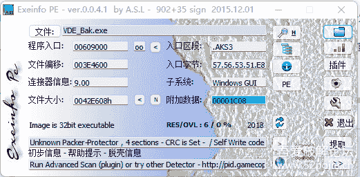

`1.png` (133.29 KB, 下载次数: 259)

[附件链接](https://www.52pojie.cn/forum.php?mod=attachment&aid=MjQ5NzY2N3xhZjdmZmYzN3wxNzkzNTc2MTEzfDE2ODA4NnwxNTkzNzYx&nothumb=yes)

2022-2-25 17:35 上传

## 使用 x64dbg 载入

3、使用x64dbg载入程序，发现数据段、代码段等都被加密了，无法用那篇帖子提到的二次内存断点法定位OEP。

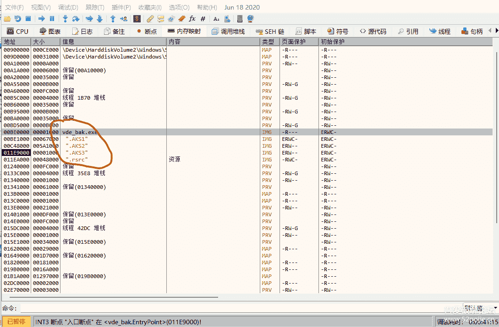

`2.png` (106.35 KB, 下载次数: 256)

[附件链接](https://www.52pojie.cn/forum.php?mod=attachment&aid=MjQ5NzY2OXwxZDQ1MTc4OXwxNzkzNTc2MTEzfDE2ODA4NnwxNTkzNzYx&nothumb=yes)

2022-2-25 17:38 上传

## 理清逆向思路

4、理清逆向思路：

1、核心思路使用API Hook技术，钩住四个关键的函数：`hasp_login`、`hasp_login_scope`、`hasp_encrypt`、`hasp_decrypt`。

2、变更函数的行为：`hasp_login`、`hasp_login_scope`、`hasp_encrypt`直接设置为返回"成功"。

3、变更函数的行为：`hasp_decrypt`，需要根据被加密数据返回加密数据，因此需要使用狗来模拟反馈。

为了实现上面这些步骤，我们需要做如下事情：

1、安装HASP的开发环境，这个在官网上有，就不在文章里贴链接了，我下载的最新的8.x版本的，为什么需要下载开发环境？

答：a、需要他们的`.h`头文件，了解这四个函数的参数与可能的反馈值； b、我们可以使用开发环境，制作一个调用这些函数的简单程序，比如Demo的Lic生成器，我们可以利用这个程序，去寻找这四个函数的特征码。

2、写好API Hook的函数框架，具体的函数内容先不用实现，先确保能正确执行钩子。我个人建议使用微软提供的Detours钩子库，非常稳定易用，面多多线程等各种复杂操作没有漏钩、崩溃等翻车行为，我自己使用Detours又简单封装了一下，主要封装了Add Hook、Remove Hook、log打印、BIN文件读写等功能（非必须，看自己）

3、捕获这四个函数在目标程序中的具体位置

4、使用API Hook钩住这四个函数

5、变更函数行为。

接下来，我会按照上面的思路继续写下面的操作步骤。

## 操作步骤

### 安装 HASP 环境

1、安装HASP环境，跳过，自行操作。（可选）

如果不想下载，我附件里会附带一个官方的`.h`头文件，这个是无论如何必须的，API钩子`dll`里要用。

另外提供四个函数的特征码，是我这边总结出来的，理论上来说应该适用所有HASP SRM类型的狗：

`hasp_login` 函数：
```
B9 03 00 00 00 31 D2 8B 9C 24 D0 01 00 00 8B AC 24 CC 01 00 00
```

`hasp_login_scope` 函数：
```
31 C0 8B AC 24 9C 00 00 00 83 CA 02 83 F1 02
```

`hasp_encrypt` 函数：
```
C7 04 24 00 00 00 00 0F AF C0 89 D6 83 E0 03 39 C8
```

`hasp_decrypt` 函数：
```
83 F9 FF 0F 94 C3 83 C8 02 83 F5 02 81 CB E6 15 00 00
```

### 封装 Detours

2、下载Detours，然后简单封装，Detours的原库我也会在附件里直接提供。我简单封装了一下后，新的函数接口（不一定要和我一致，关键是能方便自己分析东西，至于内容自行实现，网上有太多例子了，本文章只讲方法思路）：

```
int logOutput(const string& text)； //打印Log，在当前目录里生成WKYDebug.log文件，并写入指定字符串内容

void WriteBIN(string sPath, BYTE* pbyte, int iLength)； //将pByte指向的内存数据以二进制写入指定的文件里

void ReadBIN(string sPath, BYTE* pByte, int iLength)； //从指定的文件里以二进制方式读取数据并存入pByte指向的内存

LONG AddHook(void** pOldAddress, void* pNewAddress); //新增一个Hook，参数与Detours一致，只是把一些多余步骤封装进去了

void RemoveHook(void* pNewAddress); //识别地址移除一个Hook
```

### 捕获函数位置

3、捕获这四个函数在内存中的位置。

这四个函数不会在一开始就被发现，只有在某一个时刻解密后才会在内存中短暂的出现，这一块需要耐心的调试，我是以网络传输函数作为中断，每执行`send`或者`recv`时搜索特征码，或者用`VirtualProtect`也行，解密可执行代码段，有些函数是必然会用到的。

一旦特征码搜索到了东西，就不要再点继续了，统计如下几个信息：

1、`Hookdll`在Attach时使用`GetModuleHandle(NULL)`返回的地址信息，这个可以使用上面封装的打印功能，把地址打出来

2、记录函数OEP Address

3、记录四个函数与OEP之间的偏移信息，以我下图描述为例：

此时，我已经特征码搜索到了相关信息：

OEP地址：`013A9000`（就是`exe`的入口点）

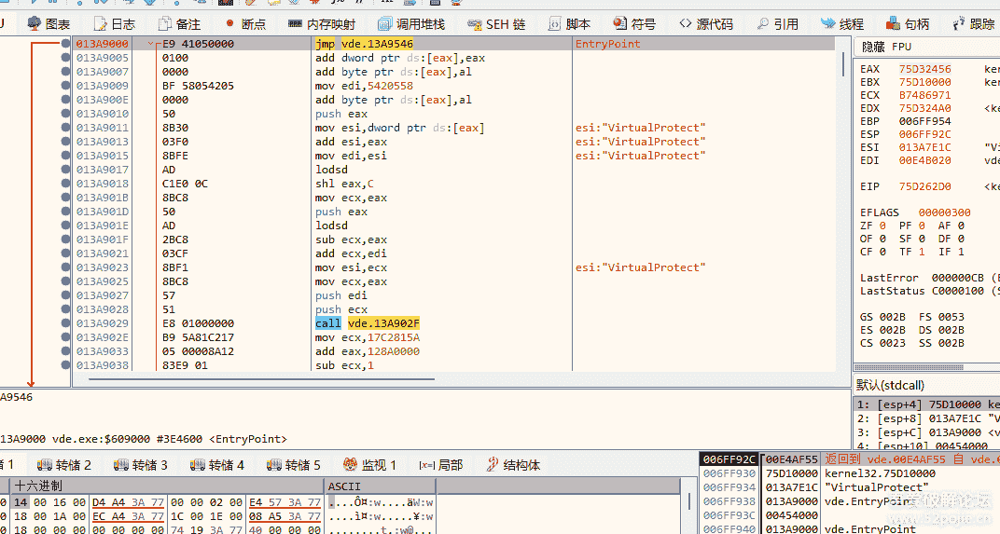

`4.png` (122.65 KB, 下载次数: 262)

[附件链接](https://www.52pojie.cn/forum.php?mod=attachment&aid=MjQ5NzczMnxlNDgzODFmMnwxNzkzNTc2MTEzfDE2ODA4NnwxNTkzNzYx&nothumb=yes)

2022-2-25 21:45 上传

`hasp_login`特征码搜索到以后，起始地址在前面的`00F08C74`，如下：

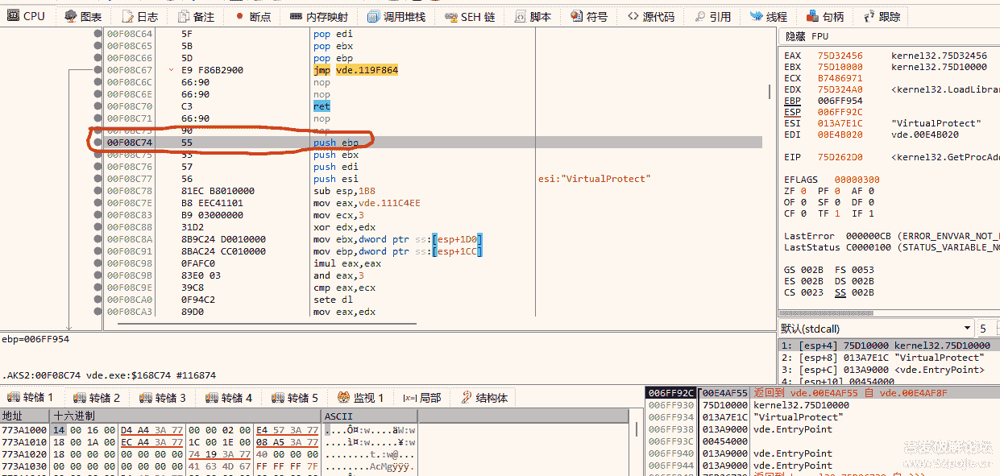

`2.png` (130.63 KB, 下载次数: 254)

[附件链接](https://www.52pojie.cn/forum.php?mod=attachment&aid=MjQ5NzczM3w4NDQ0YTM0MnwxNzkzNTc2MTEzfDE2ODA4NnwxNTkzNzYx&nothumb=yes)

2022-2-25 21:45 上传

`hasp_login_scope`搜索到以后，起始地址是前面的`00F1170E`，如下：

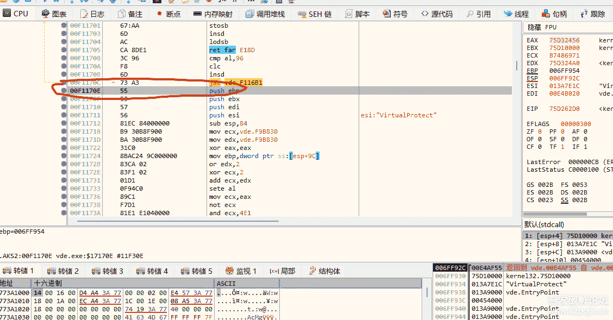

`3.png` (124.37 KB, 下载次数: 261)

[附件链接](https://www.52pojie.cn/forum.php?mod=attachment&aid=MjQ5NzczNHxkZTdhNjRmNXwxNzkzNTc2MTEzfDE2ODA4NnwxNTkzNzYx&nothumb=yes)

2022-2-25 21:46 上传

`hasp_encrypt`搜索到以后，起始地址是前面的`00F09A21`，如下：

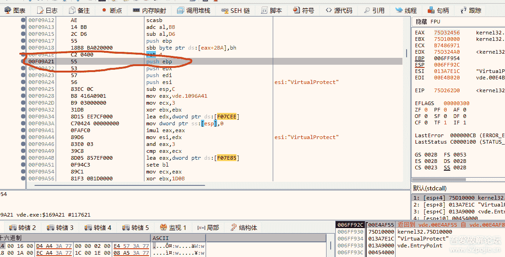

`5.png` (121.92 KB, 下载次数: 256)

[附件链接](https://www.52pojie.cn/forum.php?mod=attachment&aid=MjQ5NzczNXxlM2E1MjhiNXwxNzkzNTc2MTEzfDE2ODA4NnwxNTkzNzYx&nothumb=yes)

2022-2-25 21:47 上传

`hasp_decrypt`搜索到以后，起始地址是前面的`00F09C7C`(千万要注意，是在`push ebx`前面一个字节，这里是做了障眼法，写错了地址后面的Hook是没用的)

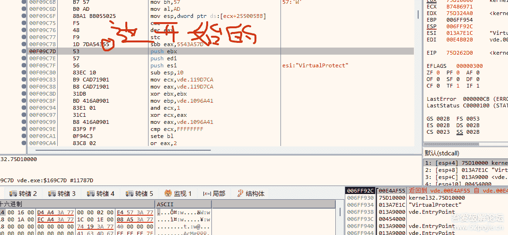

`6.png` (109.3 KB, 下载次数: 265)

[附件链接](https://www.52pojie.cn/forum.php?mod=attachment&aid=MjQ5NzczNnwyZWRjNTE0NHwxNzkzNTc2MTEzfDE2ODA4NnwxNTkzNzYx&nothumb=yes)

2022-2-25 21:50 上传

### 加载 HookDLL 并计算地址

4、加载`Hookdll`，根据上面的信息，统计公式如下（不要照搬，根据自己程序的实际情况来统计）：

```
hasp_login_Address = OEPAddress - 0x4A038C; //Offset：-4A038C
hasp_login_scope_Address = OEPAddress - 0x4978F2; //Offset：-4978F2
hasp_encrypt_Address = OEPAddress - 0x49F5DF; //Offset: -49F5DF
hasp_decrypt_Address = OEPAddress - 0x49F384; //Offset: -49F384
```

另外，我的`GetModuleHandle`打印下来后，根据`log`统计，公式如下：

```
OEPAddress = (DWORD)GetModuleHandle(NULL) + 0x609000; //Offset：609000
```

以下是我的`log`打印记录与Hook初始化代码：

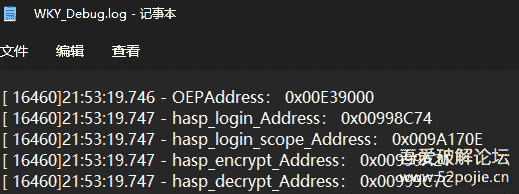

`7.png` (24.12 KB, 下载次数: 269)

[附件链接](https://www.52pojie.cn/forum.php?mod=attachment&aid=MjQ5NzczOHxkOThhOGI4NXwxNzkzNTc2MTEzfDE2ODA4NnwxNTkzNzYx&nothumb=yes)

2022-2-25 21:54 上传

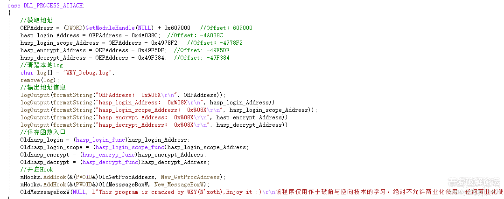

`8.png` (30.82 KB, 下载次数: 275)

[附件链接](https://www.52pojie.cn/forum.php?mod=attachment&aid=MjQ5NzczOXwzZDk5ZjY2N3wxNzkzNTc2MTEzfDE2ODA4NnwxNTkzNzYx&nothumb=yes)

2022-2-25 21:57 上传

这里地址与上面不同，是因为每一次运行的时候OEP都不一样，所以我们才要统计上面的公式，在`HookDLL`加载的时候动态计算各个函数的实际地址，这样得到的地址才是真实的。

初始化里只是先计算出地址，不要Hook `hasp`那四个函数，这个时候Hook是没有用的，程序本身是有做一些反Hook工作的，这四个函数会不停的`Free`和`Load`。

我们需要在`Load`的时候及时钩住，在`Free`的时候即使释放，这里需要掌握时机。否则如果没有及时钩住得到话，在重新载入后Hook是失效的。

建议我们在初始化时，只Hook住`GetProcAddress`，然后在新的`GetProcAddress`里读取四个函数地址的前十个字节匹配一下，来判定当前是否代码已经解密，如果解密，施加钩子，如果没有，释放钩子。

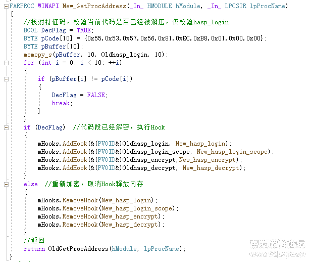

`9.png` (23.56 KB, 下载次数: 263)

[附件链接](https://www.52pojie.cn/forum.php?mod=attachment&aid=MjQ5Nzc0MHwyNDU1YmUyN3wxNzkzNTc2MTEzfDE2ODA4NnwxNTkzNzYx&nothumb=yes)

2022-2-25 22:02 上传

### 验证钩子

5、钩子施加完以后，自己多试试，看看打印出来的Log与预期是否相符合。

其中`hasp_login`、`hasp_login_scope`和`hasp_encrypt`没有好讲的，无脑返回`HASP_STATUS_OK`就可以了，注意`handle`要赋值，我是定义了一个全局变量，然后回传了这个变量的地址。

以下以`haso_login`为例，其他两个依葫芦画瓢：

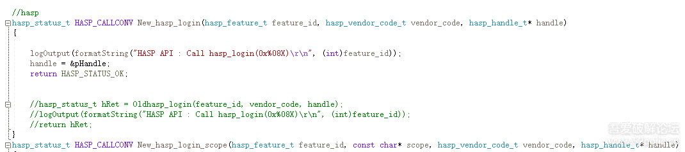

`10.png` (16.78 KB, 下载次数: 270)

[附件链接](https://www.52pojie.cn/forum.php?mod=attachment&aid=MjQ5Nzc0MnwyZDkyNGEyY3wxNzkzNTc2MTEzfDE2ODA4NnwxNTkzNzYx&nothumb=yes)


# Hook 后的 `hasp_decrypt` 编写说明

2022-2-25 22:08 上传

着重讲一下 Hook 后的 `hasp_decrypt` 要怎么写，首先第一步，我们要统计他究竟执行了多少次 `Decrypt`，目前除了 C# 用的狗之外，其他语言的 HASP 狗在程序运行初期就会解密所有代码，只有 C# 是按照函数为原子来解密，比较麻烦。

统计的方法：在新的 `hasp_decrypt` 函数里，每执行一次，打印一次 `log`，显示解密的数据长度，同时把解密的前的数据和解密后的数据都输出为 `BIN` 文件，然后再调用真实的 `hasp_decrypt` 函数并返回，让程序先正常运行下去，就像我这样。

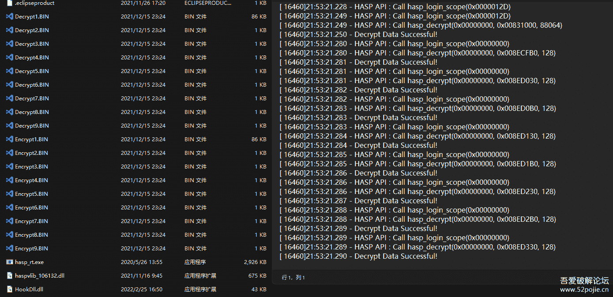

11.png (156.22 KB, 下载次数: 255)

[href="forum.php?mod=attachment&aid=MjQ5Nzc0M3wzN2VhYjY4ZHwxNzkzNTc2MTEzfDE2ODA4NnwxNTkzNzYx&nothumb=yes" target="_blank"](https://www.52pojie.cn/forum.php?mod=attachment&aid=MjQ5Nzc0M3wzN2VhYjY4ZHwxNzkzNTc2MTEzfDE2ODA4NnwxNTkzNzYx&nothumb=yes)

## 数据对比

2022-2-25 22:12 上传

多统计几组数据以后对比一下，看看哪些数据都是固定，我这个程序很幸运，比我参考的那篇文章里的程序要简单，我这几组数据都是固定的，中间没有随机值校验，所以对于我来说其实这里就已经破解完成了。

### 最后一步

修改 Hook 后的 `hasp_decrypt` 函数，执行时识别输入数据，读取对应的解密 `BIN` 文件并返回 `HASP_STATUS_OK` 即可。以下仅为部分示例，举一反三：

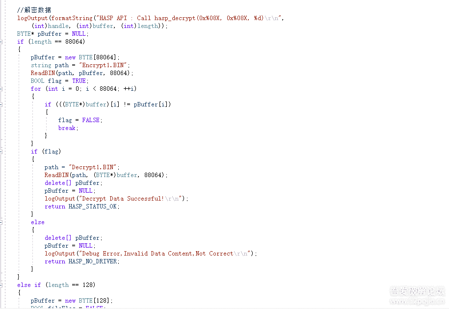

12.png (24.32 KB, 下载次数: 250)

[href="forum.php?mod=attachment&aid=MjQ5Nzc0NHw1ZTA3OWMzMHwxNzkzNTc2MTEzfDE2ODA4NnwxNTkzNzYx&nothumb=yes" target="_blank"](https://www.52pojie.cn/forum.php?mod=attachment&aid=MjQ5Nzc0NHw1ZTA3OWMzMHwxNzkzNTc2MTEzfDE2ODA4NnwxNTkzNzYx&nothumb=yes)

2022-2-25 22:16 上传

## 破解前后对比

### 破解前

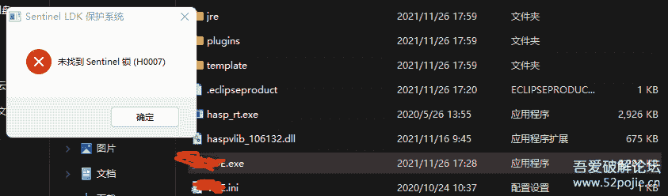

12.png (40.64 KB, 下载次数: 255)

[href="forum.php?mod=attachment&aid=MjQ5Nzc0OHw3ZGE5OTg0YXwxNzkzNTc2MTEzfDE2ODA4NnwxNTkzNzYx&nothumb=yes" target="_blank"](https://www.52pojie.cn/forum.php?mod=attachment&aid=MjQ5Nzc0OHw3ZGE5OTg0YXwxNzkzNTc2MTEzfDE2ODA4NnwxNTkzNzYx&nothumb=yes)

2022-2-25 22:19 上传

### 破解后

破解后，先弹出免责申明，然后脱狗完美运行：

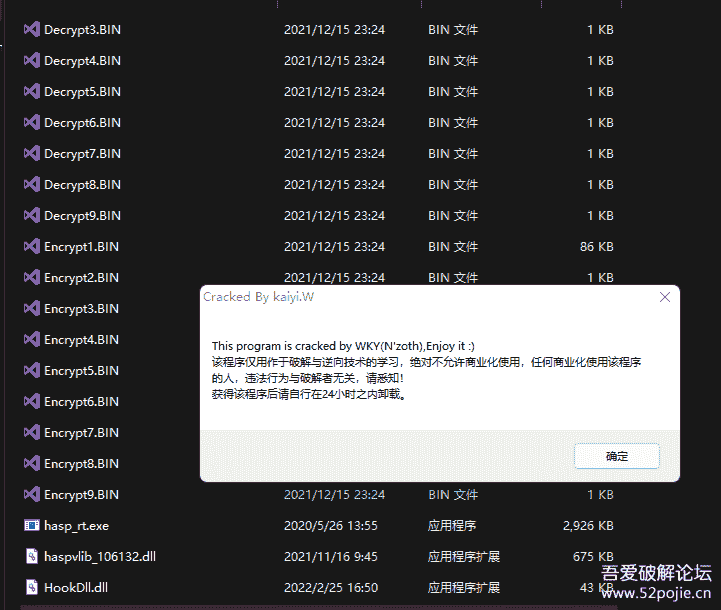

1.png (65.47 KB, 下载次数: 255)

[href="forum.php?mod=attachment&aid=MjQ5Nzc1MHw5MWZlOGE1NXwxNzkzNTc2MTEzfDE2ODA4NnwxNTkzNzYx&nothumb=yes" target="_blank"](https://www.52pojie.cn/forum.php?mod=attachment&aid=MjQ5Nzc1MHw5MWZlOGE1NXwxNzkzNTc2MTEzfDE2ODA4NnwxNTkzNzYx&nothumb=yes)

2022-2-25 22:26 上传


2.png (52.05 KB, 下载次数: 261)

[href="forum.php?mod=attachment&aid=MjQ5Nzc0OXxiNjI1OTJmNXwxNzkzNTc2MTEzfDE2ODA4NnwxNTkzNzYx&nothumb=yes" target="_blank"](https://www.52pojie.cn/forum.php?mod=attachment&aid=MjQ5Nzc0OXxiNjI1OTJmNXwxNzkzNTc2MTEzfDE2ODA4NnwxNTkzNzYx&nothumb=yes)

2022-2-25 22:25 上传

## 附件


[href="forum.php?mod=attachment&aid=MjQ5ODAxMnw3NTkzZjI1NnwxNzkzNTc2MTEzfDE2ODA4NnwxNTkzNzYx" target="_blank"](https://www.52pojie.cn/forum.php?mod=attachment&aid=MjQ5ODAxMnw3NTkzZjI1NnwxNzkzNTc2MTEzfDE2ODA4NnwxNTkzNzYx)

(581.43 KB, 下载次数: 745)

2022-2-26 17:56 上传

点击文件名下载附件

`hasp` 头文件与 Hook

下载积分: 吾爱币 -1 CB
