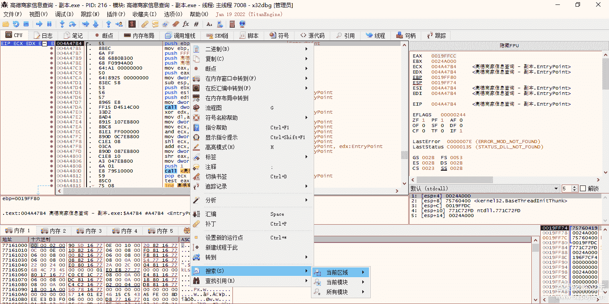
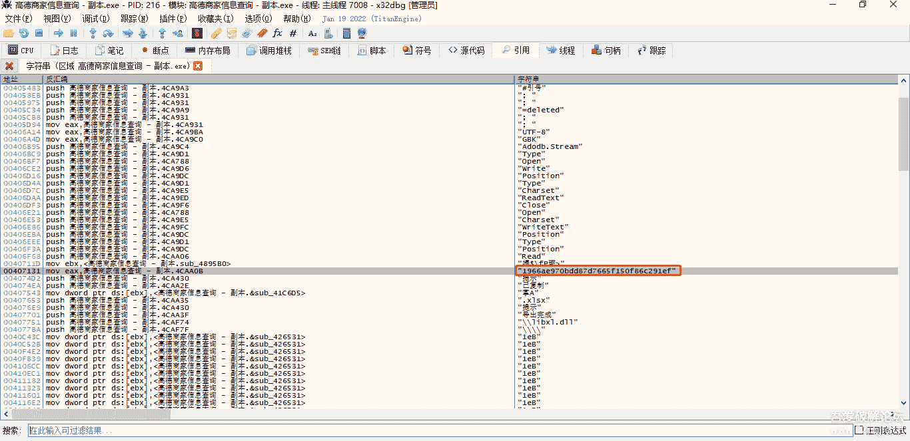
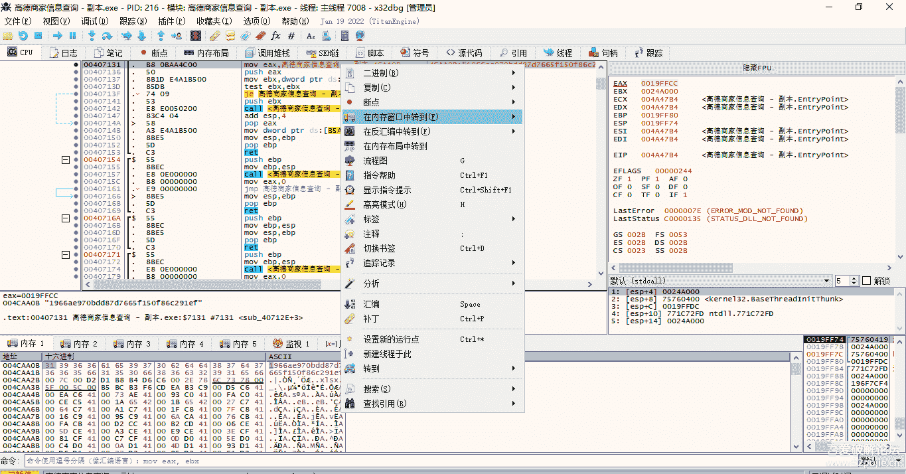
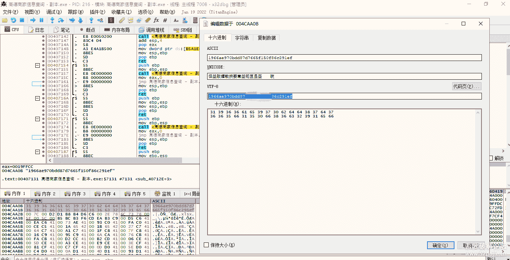
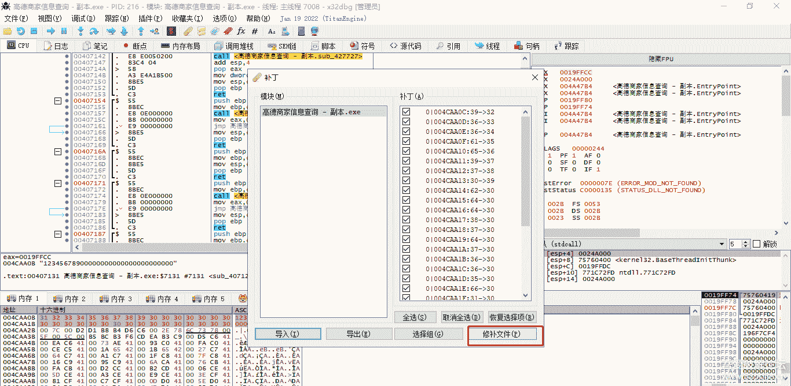

# [分享] 高德商家信息查询工具用【x64dbg调试】修改KEY

- 原帖: <https://www.52pojie.cn/forum.php?mod=viewthread&tid=1593870>
- 抓取时间: 2026-11-01T23:35:13

今天逛论坛的时候发现老师制作的高德商家信息查询工具，在使用过程中发现一直使用老师申请的高德地图`API`的`KEY`会有调用次数限制，就想着能不能把调用的`KEY`换成自己申请的。

1. 高德`API KEY`申请可以去高德官方开放平台申请

## 1、导入x64dbg进行调试

image.png (186.53 KB, 下载次数: 0)

[下载附件](https://www.52pojie.cn/forum.php?mod=attachment&aid=MjQ5NzgyMnwxNTMzOThhNHwxNzkzNTc2MTExfDE2ODA4NnwxNTkzODcw&nothumb=yes)

2022-2-26 10:27 上传

右键搜索-当前区域-字符串-向下翻，找到与申请`key`位数相等的字符，双击转到反汇编界面。

image.png (173.88 KB, 下载次数: 2)

[下载附件](https://www.52pojie.cn/forum.php?mod=attachment&aid=MjQ5NzgyN3wwYjFhNTk2ZnwxNzkzNTc2MTExfDE2ODA4NnwxNTkzODcw&nothumb=yes)

2022-2-26 10:31 上传

右键在内存窗口中转到该地址

image.png (188.54 KB, 下载次数: 0)

[下载附件](https://www.52pojie.cn/forum.php?mod=attachment&aid=MjQ5NzgzOXw4ZTMwMTBhZXwxNzkzNTc2MTExfDE2ODA4NnwxNTkzODcw&nothumb=yes)

2022-2-26 10:42 上传

全部选中，右键二进制编辑

image.png (138.37 KB, 下载次数: 2)

[下载附件](https://www.52pojie.cn/forum.php?mod=attachment&aid=MjQ5Nzg2MnxkOTk2ZDQ1OHwxNzkzNTc2MTExfDE2ODA4NnwxNTkzODcw&nothumb=yes)

2022-2-26 10:47 上传

在`UTF-8`里面填写上自己申请的`KEY`，点击确定。

文件-补丁-修补文件

image.png (178.54 KB, 下载次数: 0)

[下载附件](https://www.52pojie.cn/forum.php?mod=attachment&aid=MjQ5Nzg3MHw2ZjU0OGFmZnwxNzkzNTc2MTExfDE2ODA4NnwxNTkzODcw&nothumb=yes)

2022-2-26 10:50 上传

本人小白，调试只是为了学习，请勿干违法的事情

(第一次发技术贴，如有违规请版主帮删除，谢谢)
