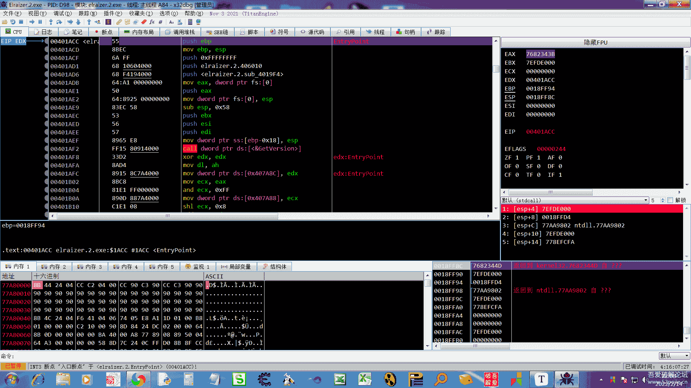
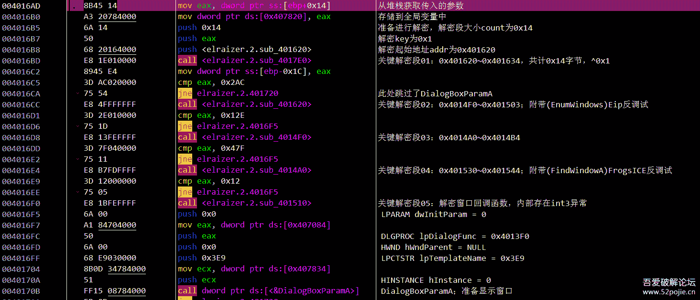
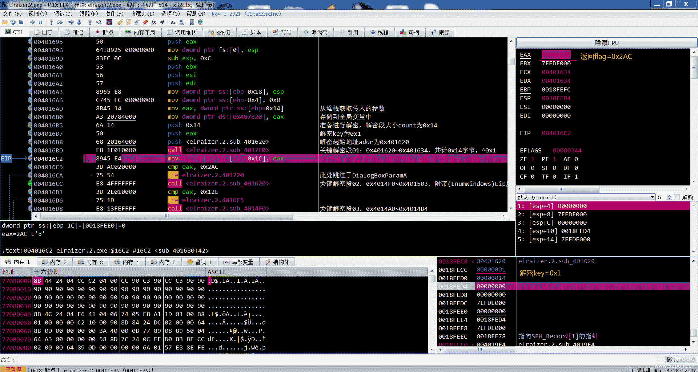
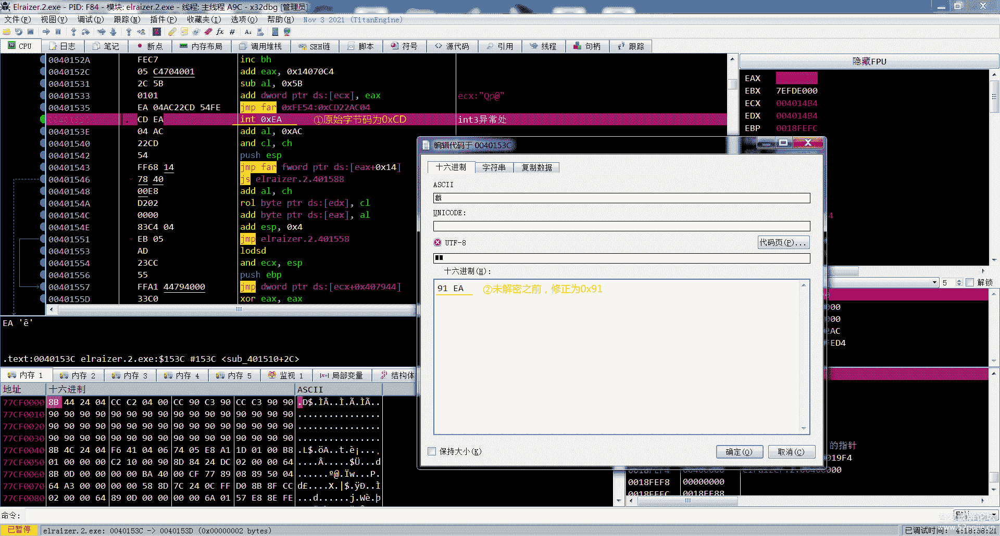
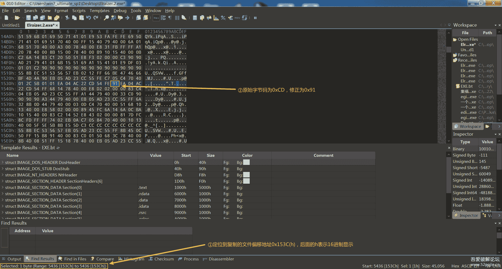
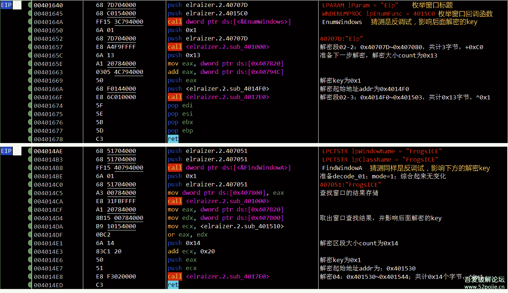

# [原创] 梅开x度-160cm之cm056 Elraizer.2 爆破与keygen分析

- 原帖: https://www.52pojie.cn/forum.php?mod=viewthread&tid=1593925
- 抓取时间: 2026-11-01T23:35:11

## 160cm-cm056

### 0、前言 & 工具

#### 0.1 前言

开始在论坛上查找关于`crackme056`的资料时，发现标注`crackme056`无法打开，尝试一番无果。

又在网上查找相关的内容，发现CSDN上一篇关于`crackme056`的文章，链接：“https://blog.csdn.net/zfy1996/article/details/107402027”，感谢文章提供的思路。

参考该文章后，慢慢研究下来，发现`crackme056`很有意思，亮点及难点如下：动态解密使得程序能够正常运行、注册码算法更是在动态解密的基础上增加了难度。

从开始接触的无从下手，到后面的参考经验循序渐进，以至最后成功`crack`；这个`crackme`慢慢的在提升难度，且难度系数提升平滑；所以想把自己分析过的程记录一下，和大家一起交流学习。

#### 0.2 分析工具

`xdbg`、`ollydbg`动态调试；
`IDA`静态分析；
`DIE`查壳。

### 1、无法运行

初始拿到`cm`时，都是查壳、运行观察、调试分析。

查壳，发现程序无壳；运行程序，程序没有反应，也没有报错异常；

#### 1.1 初步静态分析

没办法了，直接上`xdbg`调试，暂停在`OEP`处，并且有`GetVersion`调用，进一步说明程序没有加壳；



01-调试器调试.png (317.28 KB, 下载次数: 271)

```
00401AD6      | 68 F4194000           | push              | 压入SEH链回调函数
00401ADB      | 64:A1 00000000        | mov eax, dword ptr fs:[0]                | 获取当前SEH结构体的指针
00401AE1      | 50                    | push eax                                 | 压入指针，在esp处形成了一个标准的SEH结构体
00401AE2      | 64:8925 00000000      | mov dword ptr fs:[0], esp                | 将标准的SEH结构体置为当前的SEH链表表头
```

往后分析，在调用`GetVersion`后，将结果进行运算，并存储到内存变量中，且操作的内存地址处于`data`区段，猜测是在初始化一些全局变量。

```
00401AE9      | 83EC 58               | sub esp, 0x58                            |
00401AEC      | 53                    | push ebx                                 |
00401AED      | 56                    | push esi                                 |
00401AEE      | 57                    | push edi                                 |
00401AEF      | 8965 E8               | mov dword ptr ss:[ebp-0x18], esp         |
00401AF2      | FF15 80914000         | call dword ptr ds:[]        |
00401AF8      | 33D2                  | xor edx, edx                             | 
00401AFA      | 8AD4                  | mov dl, ah                               |
00401AFC      | 8915 8C7A4000         | mov dword ptr ds:[0x407A8C], edx         | 
00401B02      | 8BC8                  | mov ecx, eax                             |
00401B04      | 81E1 FF000000         | and ecx, 0xFF                            |
00401B0A      | 890D 887A4000         | mov dword ptr ds:[0x407A88], ecx         |
00401B10      | C1E1 08               | shl ecx, 0x8                             |
00401B13      | 03CA                  | add ecx, edx                             | 
00401B15      | 890D 847A4000         | mov dword ptr ds:[0x407A84], ecx         |
00401B1B      | C1E8 10               | shr eax, 0x10                            |
00401B1E      | A3 807A4000           | mov dword ptr ds:[0x407A80], eax         |
```

再后面就是一些自定义的函数了，这里仅做了部分分析：

```
00401B23      | 6A 01                 | push 0x1                                 |
00401B25      | E8 670B0000           | call              | 申请内存空间
00401B2A      | 59                    | pop ecx                                  |
00401B2B      | 85C0                  | test eax, eax                            |
00401B2D      | 75 08                 | jne elraizer.2.401B37                    | 判断是否申请成功
00401B2F      | 6A 1C                 | push 0x1C                                |
00401B31      | E8 C3000000           | call              | 准备exitProcess
00401B36      | 59                    | pop ecx                                  |
00401B37      | E8 870A0000           | call              | 填充线程数据到申请的空间中
00401B3C      | 85C0                  | test eax, eax                            |
00401B3E      | 75 08                 | jne elraizer.2.401B48                    |
00401B40      | 6A 10                 | push 0x10                                |
00401B42      | E8 B2000000           | call              | 准备exitProcess
00401B47      | 59                    | pop ecx                                  |
00401B48      | 33F6                  | xor esi, esi                             |
```

其他的地方都是成片的`call`函数地址，静态分析较为困难，所以开始动态调试分析。

#### 1.2 动态调试查找可疑call

首先要搞清楚是哪里导致程序没有运行起来，所以前面那些已经分析过的`call`在动态调试中可直接`F8`步过。

调试后，发现程序退出的地址为`0x00401BA7`，相应的汇编语句为`call`。

```
00401B7C      | 50                    | push eax                                 |
00401B7D      | FF15 78914000         | call dword ptr ds:[]   | 
00401B83      | E8 EF030000           | call              | 对路径字符进行了未知运算，作用应该不大
00401B88      | 8945 9C               | mov dword ptr ss:[ebp-0x64], eax         |
00401B8B      | F645 D0 01            | test byte ptr ss:[ebp-0x30], 0x1         |
00401B8F      | 74 06                 | je elraizer.2.401B97                     | 
00401B91      | 0FB745 D4             | movzx eax, word ptr ss:[ebp-0x2C]        |
00401B95      | EB 03                 | jmp elraizer.2.401B9A                    |
00401B97      | 6A 0A                 | push 0xA                                 |
00401B99      | 58                    | pop eax                                  |
00401B9A      | 50                    | push eax                                 | 
00401B9B      | FF75 9C               | push dword ptr ss:[ebp-0x64]             |
00401B9E      | 56                    | push esi                                 |
00401B9F      | 56                    | push esi                                 |
00401BA0      | FF15 74914000         | call dword ptr ds:[]  | 
00401BA6      | 50                    | push eax                                 |
00401BA7      | E8 D4FAFFFF           | call              | 退出！
```

说明这个`call`的嫌疑很大，跟进去，运行到返回，查看`ret`语句后面的数据。

发现内部有两个`ret`，其中一个直接就是`ret`，不过前面有`jmp`跳过该`ret`；第二个为`ret 0x10`，说明这个`call`应该是带有4个参数。

```
00401711      | EB 0D                 | jmp elraizer.2.401720                    |
00401713      | 8B55 EC               | mov edx, dword ptr ss:[ebp-0x14]         |
00401716      | 52                    | push edx                                 |
00401717      | E8 24000000           | call              |
0040171C      | C3                    | ret                                      |
0040171D      | 8B65 E8               | mov esp, dword ptr ss:[ebp-0x18]         |
00401720      | C745 FC FFFFFFFF      | mov dword ptr ss:[ebp-0x4], 0xFFFFFFFF   |
00401727      | 33C0                  | xor eax, eax                             |
00401729      | 8B4D F0               | mov ecx, dword ptr ss:[ebp-0x10]         |
0040172C      | 64:890D 00000000      | mov dword ptr fs:[0], ecx                |
00401733      | 5F                    | pop edi                                  |
00401734      | 5E                    | pop esi                                  |
00401735      | 5B                    | pop ebx                                  |
00401736      | 8BE5                  | mov esp, ebp                             |
00401738      | 5D                    | pop ebp                                  |
00401739      | C2 1000               | ret 0x10                                 |
```

#### 1.3 可疑call分析

这部分的分析有点困难，在参考资料后，才发现导致程序退出的`call`其实是`WinMain`，前面的`GetStartupInfoA`、`GetModuleHandleA`都是获取进程的信息。

```
//参数部分
00401B8F      | 74 06                 | je elraizer.2.401B97                     | 
00401B91      | 0FB745 D4             | movzx eax, word ptr ss:[ebp-0x2C]        |
00401B95      | EB 03                 | jmp elraizer.2.401B9A                    |
00401B97      | 6A 0A                 | push 0xA                                 |
```


```
00401B99      | 58                    | pop eax                                  |
00401B9A      | 50                    | push eax                                 | 参数4
00401B9B      | FF75 9C               | push dword ptr ss:[ebp-0x64]             | 参数3
00401B9E      | 56                    | push esi                                 | 参数2
00401B9F      | 56                    | push esi                                 | 
00401BA0      | FF15 74914000         | call dword ptr ds:[]  | 
00401BA6      | 50                    | push eax                                 | 参数1
//call调用地址
00401BA7      | E8 D4FAFFFF           | call              | 退出！
```

## 进入`WinMain`内部分析

这里直接先给出分析后的结果，再慢慢说明。



02-WinMain内部分析.png (124 KB, 下载次数: 273)

[href="forum.php?mod=attachment&aid=MjQ5Nzg4OXw2YzExMGI0ZHwxNzkzNTc2MTA4fDE2ODA4NnwxNTkzOTI1&nothumb=yes" target="_blank"](https://www.52pojie.cn/forum.php?mod=attachment&aid=MjQ5Nzg4OXw2YzExMGI0ZHwxNzkzNTc2MTA4fDE2ODA4NnwxNTkzOTI1&nothumb=yes)

02-WinMain内部分析

2022-2-26 11:28 上传

### 1.3.1 call `sub_4017E0` 分析

先分析第一个`call`，外层调用查看可能传入了3个参数，初步记录为`sub_4017E0(0x401620, eax, 0x14)`；第一个参数可能为地址，第二个参数是是`WinMain`外部传入的数据，第三个参数为常数`0x14`。

```
004016AD      | 8B45 14               | mov eax, dword ptr ss:[ebp+0x14]         | 从堆栈获取传入的参数
004016B0      | A3 20784000           | mov dword ptr ds:[0x407820], eax         |
004016B5      | 6A 14                 | push 0x14                                | 参数3
004016B7      | 50                    | push eax                                 | 参数2
004016B8      | 68 20164000           | push              | 参数1
004016BD      | E8 1E010000           | call              | call
```

`F7`跟入`call`内部，查看返回为`ret 0xC`，证实这个`call`确实是带有3个参数；

004017E0

`call sub_4017E0`内部代码不长，且没有其他的`call`跳转，可单步着手分析，大致跟了几遍，发现重点汇编代码如下：

```
//call sub_4017E0内部
004017E9      | 33F6                  | xor esi, esi             //esi初始化为0
...
004017F8      | 8A19                  | mov bl, byte ptr ds:[ecx]//取出ecx地址数据
004017FA      | 32D8                  | xor bl, al               //进行异或运算
004017FC      | 0FBEFB                | movsx edi, bl            //存储结果到edi
004017FF      | 8819                  | mov byte ptr ds:[ecx], bl//将结果存到原来地址处
00401801      | 03F7                  | add esi, edi             //esi=esi+edi
...
00401809      | 8BC6                  | mov eax, esi
...
00401810      | 8BC6                  | mov eax, esi
//call sub_4017E0调用处
004016B5      | 6A 14                 | push 0x14                                | 参数3
004016B7      | 50                    | push eax                                 | 参数2
004016B8      | 68 20164000           | push              | 参数1
004016BD      | E8 1E010000           | call              | call
004016C2      | 8945 E4               | mov dword ptr ss:[ebp-0x1C], eax         |
004016C5      | 3D AC020000           | cmp eax, 0x2AC                           |
004016CA      | 75 54                 | jne elraizer.2.401720                    | 此处跳过了DialogBoxParamA
004016CC      | E8 4FFFFFFF           | call              | 
```

相信脱壳的朋友们很熟悉这种类型汇编码，解密数据，且`esi`存储每个解密结果的和，最后将`esi`的值赋给`eax`，外部`call sub_4017E0`调用后紧接着就对`eax`的值进行判断，不相等则跳过了`DialogBoxParamA`；且下一个`call`的地址刚好是`call sub_4017E0`的第一个参数。

为了显示窗口，所以`call sub_4017E0`外部不能执行跳转；分析到这里，可以确定`call sub_4017E0`是解密函数，解密完成后，判断解密标志是否正确，正确则执行刚才解密完成的内容。

### 1.3.2 call `sub_4017E0` 解密函数 IDA伪代码

方便理解，可使用`IDA`进行静态分析，查看`call sub_4017E0`的`C++`伪代码如下：

```
//call sub_4017E0 IDA伪代码
int __stdcall sub_4017E0(unsigned int a1, char a2, int a3)
{
  _BYTE *v3; // ecx
  int v4; // esi
  char v5; // bl
  v3 = (_BYTE *)a1;
  v4 = 0;
  if ( a1 >= a1 + a3 )
    return 0;
  do
  {
    v5 = a2 ^ *v3;
    *v3 = v5;
    v4 += v5;
    ++v3;
  }
  while ( (unsigned int)v3 
```

结合`IDA`伪代码，可得到`call sub_4017E0`的函数原型为：`decode(addr, key, count)`；`addr`为解密的起始地址，`key`为异或运算的数值，`count`为解密区段的大小，函数返回4字节大小的`flag`标志，用于验证是否正确解密。

### 1.3.3 call `sub_4017E0` 解密函数 C++ 代码 实现

可以很容易的实现`decode(addr, key, count)`，这里给出`C++`版本的解密代码：

```
#include
//解密程序段
void decodeByte(char* decodeAddr,char key,char count,long& flag)
//char* decodeAddr（解密起始地址）,char key（解密key，进行异或运算，所以该函数既能加密又能解密）,char count（解密区段大小）
{
    flag=0;
    for(long i=0;i
```

最终发现正确的解密`key`为`0x1`，跟踪堆栈值，发现解密`key`来源于`WinMain`的参数4，所以只需将`push 0xA`该为`push 0x1`即可。

```
//参数部分
00401B8F      | 74 06                 | je elraizer.2.401B97                      
00401B91      | 0FB745 D4             | movzx eax, word ptr ss:[ebp-0x2C]        
00401B95      | EB 03                 | jmp elraizer.2.401B9A                    
00401B97      | 6A 0A                 | push 0xA                        //更改为push 0x1
00401B99      | 58                    | pop eax                                  
00401B9A      | 50                    | push eax                        //参数4，更改的参数
00401B9B      | FF75 9C               | push dword ptr ss:[ebp-0x64]    //参数3
00401B9E      | 56                    | push esi                        //参数2
00401B9F      | 56                    | push esi                                  
00401BA0      | FF15 74914000         | call dword ptr ds:[]   
00401BA6      | 50                    | push eax                        //参数1
//call调用地址
00401BA7      | E8 D4FAFFFF           | call              WinMain
```

解密成功时如下：



03-解密区段01.png (262.8 KB, 下载次数: 274)

[href="forum.php?mod=attachment&aid=MjQ5Nzg5MHxmMTZlZjc1YXwxNzkzNTc2MTA4fDE2ODA4NnwxNTkzOTI1&nothumb=yes" target="_blank"](https://www.52pojie.cn/forum.php?mod=attachment&aid=MjQ5Nzg5MHxmMTZlZjc1YXwxNzkzNTc2MTA4fDE2ODA4NnwxNTkzOTI1&nothumb=yes)

03-解密区段01

2022-2-26 11:28 上传

## 2、梅开二度-无法运行02

打上补丁后，准备运行看看程序界面，程序还是没反应；一番调试无果，再次查找资料，发现前面只是这个`CrackMe`的“开胃菜”，后面还有更多“惊喜”。

### 2.1 int 3 异常

查阅参考资料发现程序还有一个`int 3`异常位于`0x40153C`，且该异常是由`decode(addr, key, count)`解密函数解密后产生，所以需要再次分析解密函数，使得解密后的字节码`[0x40153C]`变为`0x90 nop`。虽说有点麻烦，但还是能够继续分析，不至于无从下手。

```
//int 3异常外部调用
004016E4      | E8 B7FDFFFF           | call      //解密int 3异常
004016E9      | 3D 12000000           | cmp eax, 0x12                    //解密falg比较
004016EE      | 75 05                 | jne elraizer.2.4016F5                
004016F0      | E8 1BFEFFFF           | call      //内部存在int3异常
...
//调用call内部int 3异常，存在花指令，干扰静态分析
0040153C      | CC                    | int3                             //int3异常处
0040153D      | EB 05                 | jmp elraizer.2.401544            //jmp 花指令
```

分析发现在`call sub_4014A0`内部存在解密函数，动态单步调试，得到解密函数`decode(0x401530, 0X1, 0X14)`，囊括了异常字节码`[0x40153C]`，解密过程`[0x40153C]`由`0xCD->0xCC`，对应`[0x40153C] xor 0x1=0xCD xor 0x1=0xCC`，所以可以反推`0x90 xor 0x1=0x91=[0x40153C]`；直接补丁修改即可。

解决`int 3`后，对应解密函数的`flag`也会变化，这里由两个思路：①`nop`解密`flag`的判断跳转即可；②修改比较的`flag`值，这里得到的`flag=0xFFFFFFD6`。

```
004014DA      | B9 10154000           | mov ecx,          |
004014DF      | 0BC2                  | or eax, edx                              |
004014E1      | 6A 14                 | push 0x14                                | 解密区段大小count为0x14
004014E3      | 83C1 20               | add ecx, 0x20                            |
004014E6      | 50                    | push eax                                 | 解密key为0x1
004014E7      | 51                    | push ecx                                 | 解密起始地址addr为：0x401530
004014E8      | E8 F3020000           | call              | 解密04：0x401530~0x401544；共计0x14个字节，^0x1
```

一番修正补丁后，程序已经可以正常运行。


04-程序正常运行.png (29 KB, 下载次数: 282)

[href="forum.php?mod=attachment&aid=MjQ5Nzg5MXw5ZTUzZDg3MXwxNzkzNTc2MTA4fDE2ODA4NnwxNTkzOTI1&nothumb=yes" target="_blank"](https://www.52pojie.cn/forum.php?mod=attachment&aid=MjQ5Nzg5MXw5ZTUzZDg3MXwxNzkzNTc2MTA4fDE2ODA4NnwxNTkzOTI1&nothumb=yes)

04-程序正常运行

2022-2-26 11:28 上传

### 2.2 补丁方法

像前面的动态解密`int 3`异常，补丁方式可能不同于平常的直接修改，不过基本思想方法大同小异。

#### 2.2.1 使用调试器修正补丁

使用调试器修正要在解密函数未进行解密之前，`xdbg`->右键->二进制编辑修正字节码，应用补丁即可。


### 2.2.2 使用010 edit修正文件



`05-xdbg 修正补丁.png` (256.15 KB, 下载次数: 273)  
[05-xdbg 修正补丁](https://www.52pojie.cn/forum.php?mod=attachment&aid=MjQ5Nzg5MnxkMzdmOGQ2ZXwxNzkzNTc2MTA4fDE2ODA4NnwxNTkzOTI1&nothumb=yes)  
2022-2-26 11:28 上传

同样先使用调试器获取文件偏移，`xdbg`->右键->复制->文件偏移复制汇编指令的文件偏移，这里的偏移=`0x153C`，打开010 edit定位修正即可。



`06-010 edit 修正补丁.png` (270.8 KB, 下载次数: 282)  
[06-010 edit 修正补丁](https://www.52pojie.cn/forum.php?mod=attachment&aid=MjQ5Nzg5M3xmMjk4MTIyN3wxNzkzNTc2MTA4fDE2ODA4NnwxNTkzOTI1&nothumb=yes)  
2022-2-26 11:28 上传

## 3、 其他分析补充

以上部分仅针对程序无法运行处分析，还有其他有意思的地方没有涉及，这部分做出补充。

### 3.1 解密函数补充

到目前为止，程序的解密函数总共有两个，分别为：`call sub_4017E0`、`call sub_401000`。

上面仅分析了`call sub_4017E0`，由于是动态解密汇编字节码，以字节为一个解密单位，所以这里更改函数原型为：`decodeByte(addr,key,count)`，具体作用与实现可参考IDA伪代码和在上面的C++示例代码。

#### 3.1.1 `call sub_401000` 补充分析

这里分析`call sub_401000`，查看`call sub_401000`内部返回处为`ret 0x8`，可知带有两个参数；第一个参数仍然为内存地址，第二个参数可能为0、1。

```
//外部调用01
0040162D      | 6A 00                 | push 0x0                                 | 参数2
0040162F      | 68 7D704000           | push elraizer.2.40707D                   | 参数1
00401634      | E8 C7F9FFFF           | call              | call
...
//外部调用02
00401650      | 6A 01                 | push 0x1                                 | 参数2
00401652      | 68 7D704000           | push elraizer.2.40707D                   | 参数1
00401657      | E8 A4F9FFFF           | call              | call
...
//call sub_401000 内部
00401000 ]          | 
0040100C      | 03C6                  | add eax, esi                             |
0040100E      | 3BF0                  | cmp esi, eax                             |
00401010      | 73 22                 | jae elraizer.2.401034                    |
00401012      | 53                    | push ebx                                 |
00401013      | 8A5C24 10             | mov bl, byte ptr ss:[esp+0x10]           | 
00401017      | 8A06                  | mov al, byte ptr ds:[esi]                |
00401019      | 84DB                  | test bl, bl                              |
0040101B      | 75 04                 | jne elraizer.2.401021                    |
0040101D      | 04 40                 | add al, 0x40                             | 
0040101F      | EB 02                 | jmp elraizer.2.401023                    |
00401021      | 04 C0                 | add al, 0xC0                             | 
00401023      | 8806                  | mov byte ptr ds:[esi], al                | 
00401025      | 46                    | inc esi                                  |
00401026      | 56                    | push esi                                 |
00401027      | FF15 10784000         | call dword ptr ds:[]          |
0040102D      | 03C6                  | add eax, esi                             |
0040102F      | 3BF0                  | cmp esi, eax                             |
00401031      | 72 E4                 | jb elraizer.2.401017                     | 
00401033      | 5B                    | pop ebx                                  |
00401034      | 5E                    | pop esi                                  |
00401035      | C2 0800               | ret 0x8                                  | 0x8
```

查看`call sub_401000`内部，发现`lstrlenA`，返回字符串长度，且传入的参数从`ss:[esp+0x8]`中获取，正是传入的内存地址参数，这里可以猜测`call sub_401000`与字符串相关。

查看`[0x40707D]`地址处的内容如下，为不可识别的字符内容，这里可直接上手分析`call sub_401000`内部；由于`call sub_401000`内部除了`call lstrlenA`外没有其他的函数调用，可运行到返回后在观察`[0x40707D]`地址处的内容。

```
//call sub_401000之前，0x40707D

0040707D 05 29 30 00 .)0.

...

//call sub_401000运行到返回，0x40707D

0040707D 45 69 70 00 Eip.
```

对比前后`[0x40707D]`地址处的内容，不难发现`call sub_401000`的作用就是解码字符串，结合`call sub_401000`内部字节码分析，可得到关键解码语句如下。

```
00401013      | 8A5C24 10             | mov bl, byte ptr ss:[esp+0x10]//获取参入参数2
00401017      | 8A06                  | mov al, byte ptr ds:[esi]     //取出地址内容
00401019      | 84DB                  | test bl, bl                   //判断参数2是否为0
0040101B      | 75 04                 | jne elraizer.2.401021         
0040101D      | 04 40                 | add al, 0x40                  //参数2等于0
0040101F      | EB 02                 | jmp elraizer.2.401023         
00401021      | 04 C0                 | add al, 0xC0                  //参数2不等于0
00401023      | 8806                  | mov byte ptr ds:[esi], al     //解码后填回
```

根据参数2的值，分别加上不同的数值解码：参数2等于0时，字符串逐字符`+0x40`，否则逐字符`+0xC0`。

刚好有`0x40+0xC0=0x100`，对于字节码来说，可以认为`+0x40`为解码，结果再`+0xC0`为加密，所以参数2就是一个标志位，标识字符串加解密的方式。如果觉得难以理解，可借助IDA的伪代码帮助分析。

```
//call sub_401000 IDA伪代码

char *__stdcall sub_401000(char *a1, char a2)
{

  char *v2; // esi

  char *result; // eax

  char v4; // al

  char v5; // al

  v2 = a1;

  result = &a1[dword_407810(a1)];

  if ( a1 
```

#### 3.1.2 `call sub_401000` 解密函数 C++ 代码 实现

所以可得到`call sub_401000`的函数原型为`decodeStr(addr,mode)`，这里给出C++版本的解码代码：

```
#include

//解码字符串
void decodeStr(char* decodeAddr,char decodeMode)
{
    long len=strlen(decodeAddr);
    char key=(decodeMode==0?0x40:0xC0);
    for(long i=0;i
```

分析了`decodeStr(addr,mode)`字符串解码函数，解码作用猜测是反调试，影响后续解密`key`的数值，并且解码使用之后马上又是加密成原始字节码！



`07-字符解码反调试.png` (174.9 KB, 下载次数: 275)  
[07-字符解码反调试](https://www.52pojie.cn/forum.php?mod=attachment&aid=MjQ5Nzg5NHw4NzkyYmJjMXwxNzkzNTc2MTA4fDE2ODA4NnwxNTkzOTI1&nothumb=yes)  
2022-2-26 11:28 上传

### 3.2 解密区段整理

到目前为止，所有解密函数解密的区段、函数原型、调用等都整合在下表。

| 序号 | 函数原型 | 备注 | 外部调用 |
| --- | --- | --- | --- |
| 解密01 |  |  |  |
