# [分享] 最新版`zhuanzhuan`破解思路

- 原帖：https://www.52pojie.cn/forum.php?mod=viewthread&tid=1595032
- 抓取时间：2026-11-01T23:35:01

在写简历时，需要一遍遍的完善，转`pdf`看看效果，但是百度文库转的格式不行，下载了转转大师，但是非会员有次数限制，寻思能不能绕过，再写博客的时候，复现一下，一不小心就直接解锁了，现在所有的功能登录即可使用；仅供学习调试器的使用方法和软件思路。

## 1. 先查壳

无壳；妙哉。

## 2. 问题与解决

**问题**：直接开始调试会先走许多库函数进行程序加载，比较慢。

**解决**：直接将软件运行起来，用`x64dbg`附加上去。注意管理员打开。

## 3. 开始调试

### 3.1 附加进程并下断点

首先打开软件，找到需要的模块，找到`zhuanzhuan`进程附加，附加上去之后等一会，看到栈窗口稳定了，这时候看到代码段还不在用户领空，这时候找到**符号**，选第一行**用户模块**，就来到了用户模块，之后发现的函数，进去函数之后下断点。然后开始调试。

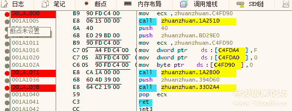

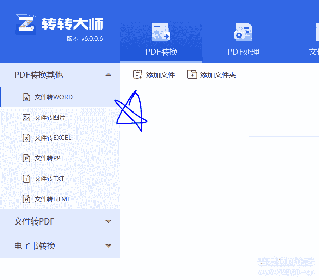

### 3.2 打开软件并重新附加

打开软件，等着加载完成，重新附加进程（找不到就是没用管理员模式），点击文件转`pdf`，程序直接断在了刚刚的第二个`call`的断点上。`F9`两次，程序正常开始。

### 3.3 添加文件并单步调试

添加文件，程序又回到刚刚的断点，`F8`单步配合`F9`，成功选中文件，程序断在了

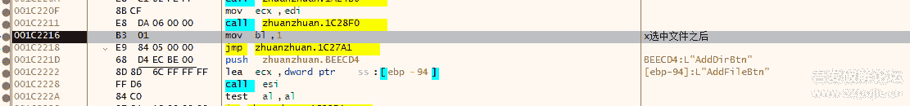

### 3.4 换思路：搜索字符串

这样程序容易自己跑死，换思路，直接搜索字符串，找到了

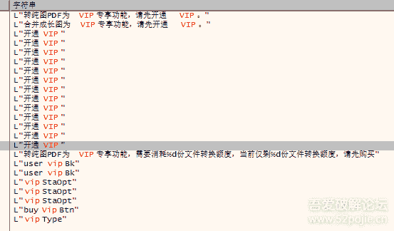

所有的`vip`都下断，然后等程序自己断，果然在转换的时候程序断在弹窗之前

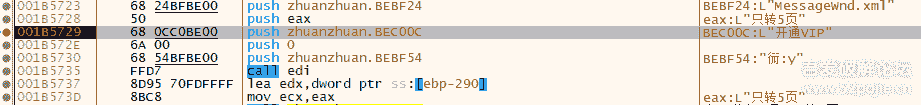

### 3.5 分析上下文

浏览上下文，分析得到下文：

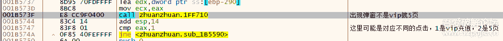

这里的`call`出现弹窗，可选的，下面的`cmp`引人注目，选择只转五页的选项，`jnz`跳转到一处地址，下断。`jnz`跳转的地方就可以正常的执行转换，虽然只有五页。这里迷惑的是如何判断的会员身份，没有找到判断逻辑。再看到上文，寻找大跳转，看看能不能跳过弹窗。找到一处`JE`

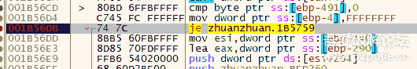

可以看到这里直接跳过了弹窗

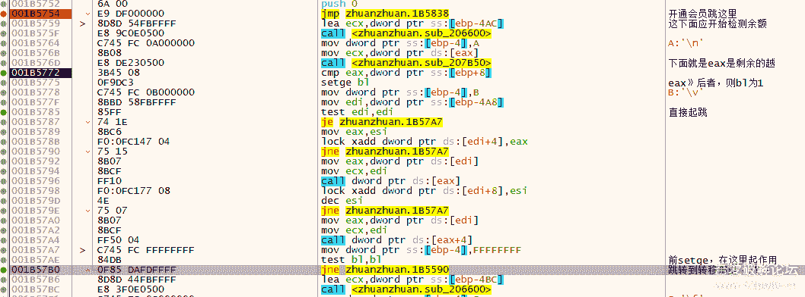

### 3.6 修改判断函数

这一块代码通过判断`eax`，然后对`bl`赋值，最后检测`bl`，非零跳转到刚刚进入转换程序的那里，看到`eax`的值通过函数得到。

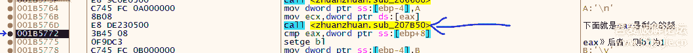

进去这个函数，分析发现就是对`eax`的一个`0`和`1`的赋值，这里直接把`0`全改`1`

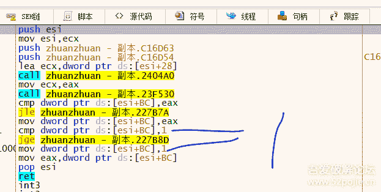

通过设置断点发现这函数是全局的判断函数，这样就基本上解锁了80%的功能，即使有的功能有弹窗，直接忽略内容，程序也是可以正常执行的

### 3.7 额外的发现

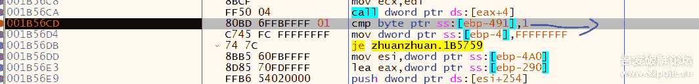

程序中有许多类似于这样的结构，一个`cmp`，一个`mov`和一个`je`，这样把`cmp`都改成`1`，就可以连弹窗一起消灭，具体很多，自己找找就行。

我的版本是最新版`6.0.0.6`，仅供学习使用，`exe`文件放到了链接：勿发[//www.52pojie.cn" target="_blank" class="relatedlink"](https://www.52pojie.cn:href="https)成品
