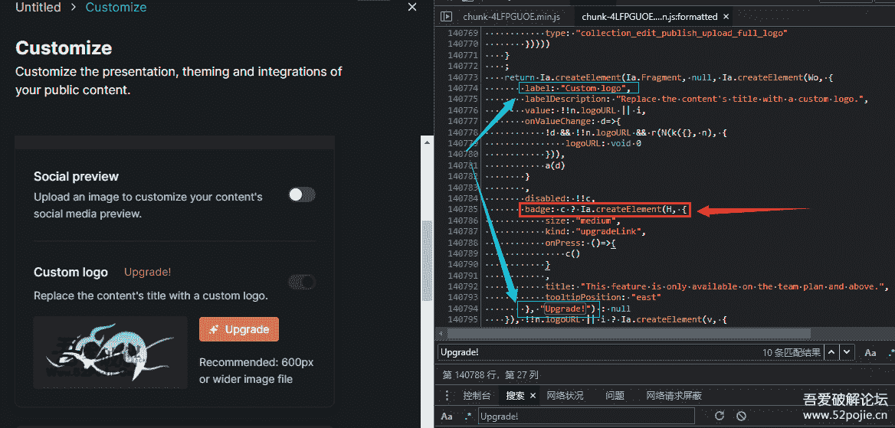
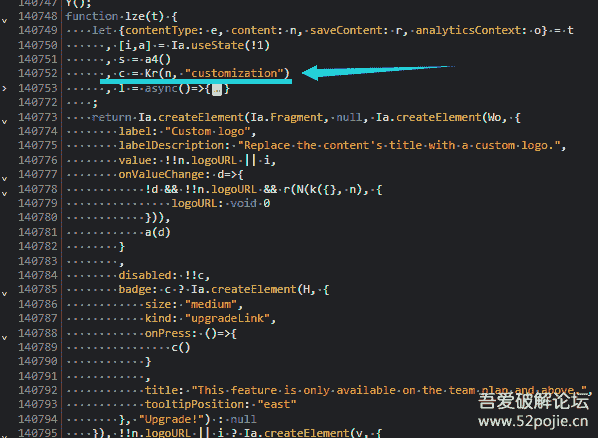
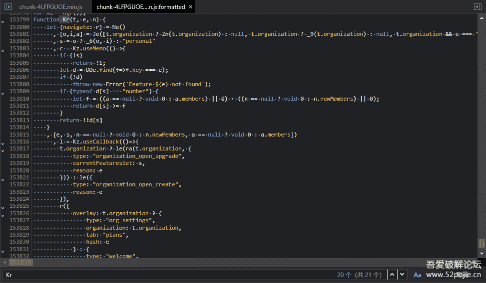
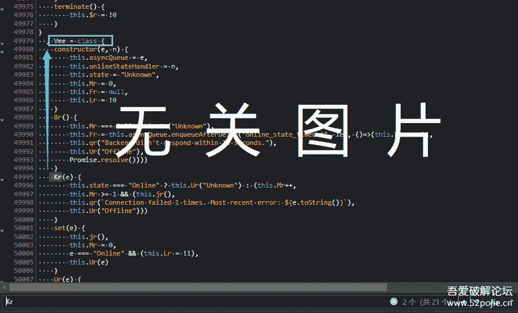
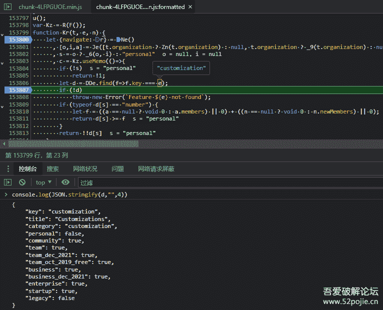
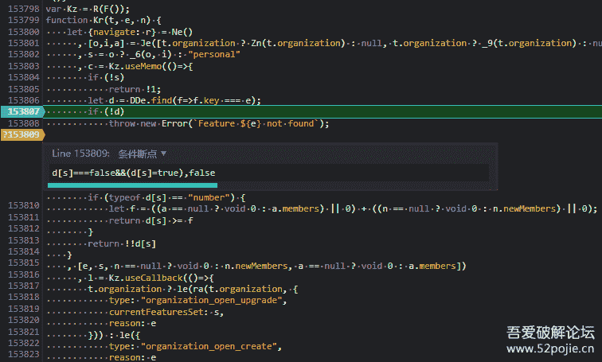

# [Web逆向] 【油猴脚本】gitbookVIP解锁

- 原帖: https://www.52pojie.cn/forum.php?mod=viewthread&tid=1598299
- 抓取时间: 2026-11-01T23:34:45

## 准备

### 创建环境

打开 [https://app.gitbook.com/](https://app.gitbook.com/) ，github登陆一下

随便新建一个项目

### 找会员独有功能

找个需要会员的功能（比如我选择的定制(customize)功能）


emmm

反正就是需要会员才能定制logo的。

就假装是我曾经开过会员然后过期了吧😅

## 开整

### 关键词定位

看到红色的Upgrade!，F12搜之。



巧了这不是（其实是必然的），蓝色框里的Custom logo和Upgrade!都与这里对应上了，

在Upgrade!文本前面红色的框里还有个判断。

### 找判断

可见变量`c`是关键，向上找变量`c`赋值、或者最后一次修改的位置



### 顺藤摸瓜

再查找`Kr`定义的位置，勾选区分大小写，只有21处，一路查看，找到唯一定义：



（好吧好吧，其实还有个`Kr`函数的定义，但是显然是在另外的类里，因此无关，实在不行就动态调试呗。。。）



emmm

看着有点麻烦。。。

好吧好吧，函数的第一行下断点，动态调试函数`Kr`。

### 动态调试

调用`Kr`时，第二个参数为`customization`，从此下手，找到`e`涉及到运算：



绿色高亮的上一行有一个明显的比较，不过是在数组里，寻找到出来的结果打印在下面的控制台里了，结合`s`变量的值是字符串`"personal"`，可以得到`d[s]`是`false`（这不又巧了，刚好我们是没有权限的）

## 修改

### 控制台注入法

（我反正是这么称呼的，似乎这个方法也是我第一个发出来的，原理参见我之前发的帖【[https://www.52pojie.cn/thread-1485179-1-1.html#39473163_%E8%A7%A3%E5%86%B3](https://www.52pojie.cn/thread-1485179-1-1.html#39473163_%E8%A7%A3%E5%86%B3)】，至少我之前没有看到过）

注入脚本测试一下，代码如下，注入的示意图如下下：

```
d[s]===false&&(d[s]=true),false
```



代码的意思就是到`Line:153809`时，判断上述注入的表达式是否为真，表达式先判断：当`d[s]`的内容是`false`时，就把其改成`true`，并且始终对于断点判断返回假（防止断下）。

运行发现可行。（成功示意图见[最终效果图]部分）

### 油猴

（老油猴了。。。）

几乎没有什么是油猴做不到的。。。如果有，那就是服务器功能了。

上述代码均以模块形式从代码里直接`import`导入，于是考虑从`native`层入手，比如这里判断的时候，有如下的代码：

```
let d = DDe.find(f=>f.key === e)
```

（说句题外话，这个不应该用`const`么？）

查看`DDe`的定义，是定义好的权限数组，这里我选择重写`Array`的`find`

代码很简单，两行搞定：

```
[].constructor.prototype._find=[].constructor.prototype._find||[].constructor.prototype.find;
[].constructor.prototype.find=function(){return(JSON.stringify(this).includes('github-sync')?this.map(a=>{for(const i in a)a[i]===false&&(a[i]=true);return a}):this)._find(arguments[0],arguments[1])};
```

第一行：备份数组的`find`（不然就真没这个功能了）

第二行：判断数组是否包含`github-sync`（理论来说任意一个不会在数组里重复定义的都可以），如果包含则把数组里所有`key`的`false`全都改成`true`，然后再继续调用系统数组的`find`，如果不包含则直接调用系统数组的`find`。

啥？

为啥用`[].constructor`？

哦，这不是长显得专业么。。。你要是愿意，直接用`Array`也行。。。

[https://greasyfork.org/zh-CN/scripts/441008](https://greasyfork.org/zh-CN/scripts/441008)

代码丢greasyfork了，需要的自取emmmm虽然上面也有代码。。。

### 最终效果图


收工！
