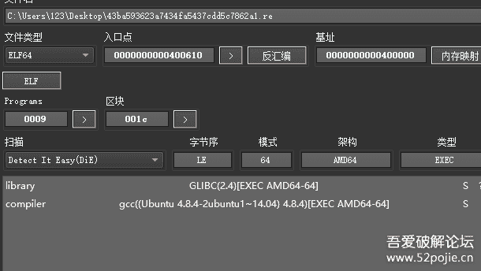
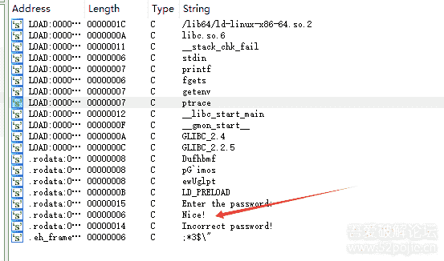
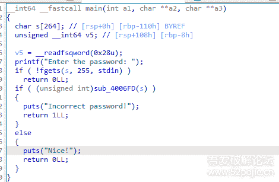
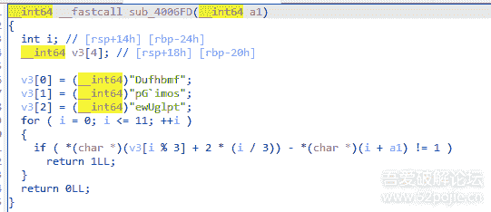
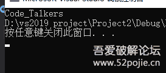

# [CTF] 算法分析：Reversing-x64Elf-100逆向题

- 原帖: https://www.52pojie.cn/forum.php?mod=viewthread&tid=1599041
- 抓取时间: 2026-11-01T23:34:31

## 算法分析：Reversing-x64Elf-100逆向题

### 1. 下载查壳


image-20220307225112114.png (20.11 KB, 下载次数: 2)
[href="forum.php?mod=attachment&aid=MjUwMDMwMXxlNDczYzUyZHwxNzkzNTc2MDY5fDE2ODA4NnwxNTk5MDQx&nothumb=yes" target="_blank"](https://www.52pojie.cn/forum.php?mod=attachment&aid=MjUwMDMwMXxlNDczYzUyZHwxNzkzNTc2MDY5fDE2ODA4NnwxNTk5MDQx&nothumb=yes)
2022-3-7 23:10 上传

#### 64位无壳

### 2. 拖进IDA具体分析

#### ① shift+F12查找是否有关键字符串


image-20220307225240825.png (16.91 KB, 下载次数: 3)
[href="forum.php?mod=attachment&aid=MjUwMDMwMnw1ZGI3ZGI2ZnwxNzkzNTc2MDY5fDE2ODA4NnwxNTk5MDQx&nothumb=yes" target="_blank"](https://www.52pojie.cn/forum.php?mod=attachment&aid=MjUwMDMwMnw1ZGI3ZGI2ZnwxNzkzNTc2MDY5fDE2ODA4NnwxNTk5MDQx&nothumb=yes)
2022-3-7 23:11 上传

发现关键字符串“nice!”，按照经验来看这就是成功验证后的提示

#### ② 找到引用关键字符函数


image-20220307225355258.png (21.76 KB, 下载次数: 2)
[href="forum.php?mod=attachment&aid=MjUwMDMwM3w2OThmNzViMHwxNzkzNTc2MDY5fDE2ODA4NnwxNTk5MDQx&nothumb=yes" target="_blank"](https://www.52pojie.cn/forum.php?mod=attachment&aid=MjUwMDMwM3w2OThmNzViMHwxNzkzNTc2MDY5fDE2ODA4NnwxNTk5MDQx&nothumb=yes)
2022-3-7 23:11 上传

#### ③ 阅读代码可以知道流程：要求用户输入一个字符串存入` s`中，将` s`地址作为参数传给` sub_4006FD`，将` sub_4006FD`的返回值作为调用` sub_4006FD`函数的` if`判断条件，如果返回值为非零值则提示“Incorrect password!”，所以要让` sub_4006FD`返回值为0

#### ⑤ 跟进` sub_4006FD`函数


image-20220307225734777.png (18.75 KB, 下载次数: 2)
[href="forum.php?mod=attachment&aid=MjUwMDMwNHxiMjBkZTY4ZnwxNzkzNTc2MDY5fDE2ODA4NnwxNTk5MDQx&nothumb=yes" target="_blank"](https://www.52pojie.cn/forum.php?mod=attachment&aid=MjUwMDMwNHxiMjBkZTY4ZnwxNzkzNTc2MDY5fDE2ODA4NnwxNTk5MDQx&nothumb=yes)
2022-3-7 23:11 上传

阅读代码可以发现只有` for`中的` if`条件满足时才会返回非零1，但是我们想要的是返回，所以要在这11次循环中让` if`条件不成立，那查看条件

```
*(char *)(v3[i % 3] + 2 * (i / 3)) - *(char *)(i + a1) != 1
```

6> 使每次循环` v3`对应数组的值加上` 2 * (i / 3)`的值作为地址，取该地址的值
6> 减去每次`(i + a1)`地址的值，判断相减的结果是否为1，不为1的话就继续循环，为1的话就会返回1，那么我们肯定是使它循环完11次返回0，仔细看这里的` a1`就是我们在` main`函数中出入进来的我们输入的字符串的地址值，那么重点来了，我们的目的就是不然` if`条件成立，那么就可以写成

```
*(char *)(v3[i % 3] + 2 * (i / 3)) - *(char *)(i + a1) == 1
```

6> 这样算出来的`(i + a1)`对应地址的值就是正确的值
6> 那直接写脚本

```
#include 
int main()
{
    int i; // [rsp+14h] [rbp-24h]
    int n = 0;
    __int64 v3[4]; // [rsp+18h] [rbp-20h]
    int a1[11] = {1};
    v3[0] = (__int64)"Dufhbmf";
    v3[1] = (__int64)"pG`imos";
    v3[2] = (__int64)"ewUglpt";
    for (i = 0; i 
```

5> 定义一个变量` n`为主我们输入的每个字符对应的` ASCLL`码值，设` n`的最大` ASCLL`码值为200,通过不断地判断`(char)(v3[i % 3] + 2  (i / 3)) - n == 1`来把满足条件的` n`存入我们的正确` flag`数组中
4> 3.结果


image-20220307230949131.png (7.88 KB, 下载次数: 2)
[href="forum.php?mod=attachment&aid=MjUwMDMwNXxmYWNmMTE3ZnwxNzkzNTc2MDY5fDE2ODA4NnwxNTk5MDQx&nothumb=yes" target="_blank"](https://www.52pojie.cn/forum.php?mod=attachment&aid=MjUwMDMwNXxmYWNmMTE3ZnwxNzkzNTc2MDY5fDE2ODA4NnwxNTk5MDQx&nothumb=yes)
2022-3-7 23:11 上传
