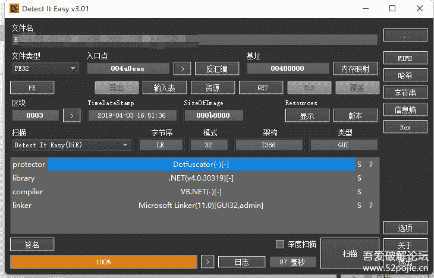
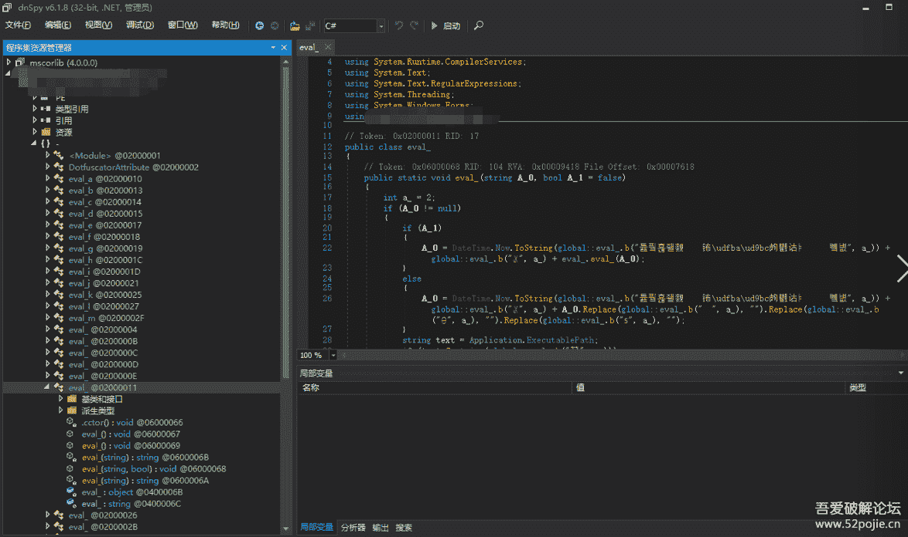
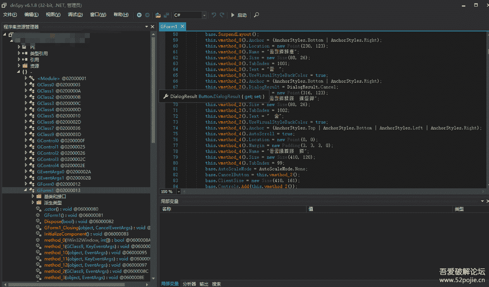
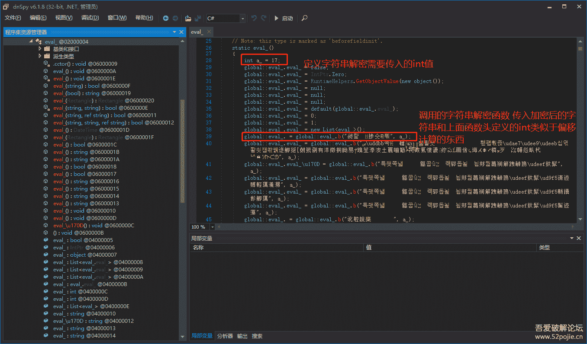
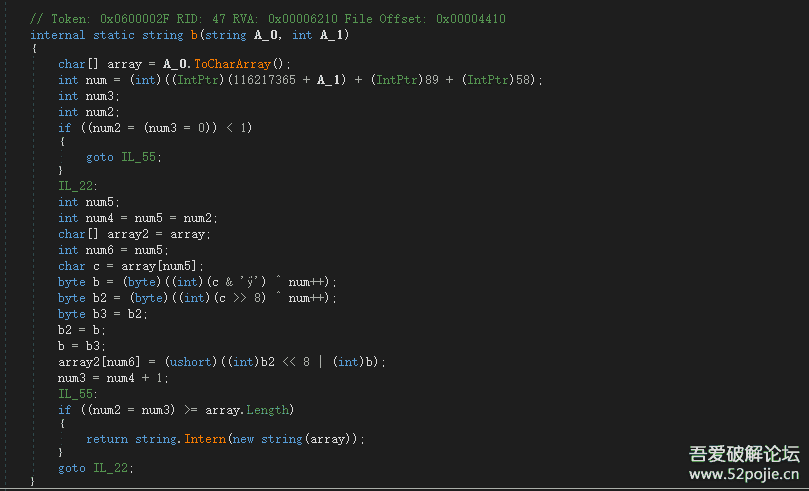
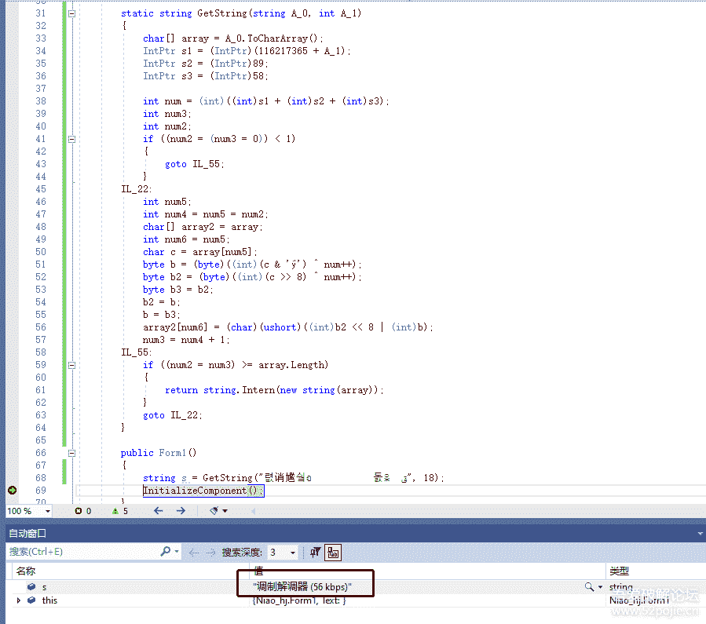
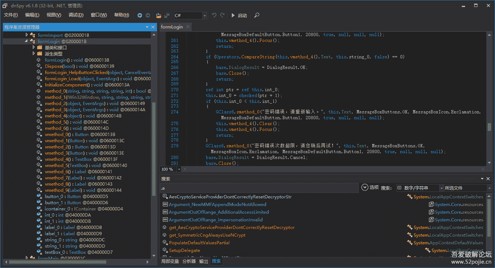

# [.NET逆向] .NET 某rdp工具 Dotfuscator混淆字符串还原

- 原帖: https://www.52pojie.cn/forum.php?mod=viewthread&tid=1599394
- 抓取时间: 2026-11-01T23:34:29

## 查壳

`Dotfuscator`，同时字符串被混淆了，见下图。



`查壳.png` (36.09 KB, 下载次数: 0)

[href="forum.php?mod=attachment&aid=MjUwMDQ4NXw4MDc3NDU0OHwxNzkzNTc2MDY2fDE2ODA4NnwxNTk5Mzk0&nothumb=yes" target="_blank"](https://www.52pojie.cn/forum.php?mod=attachment&aid=MjUwMDQ4NXw4MDc3NDU0OHwxNzkzNTc2MDY2fDE2ODA4NnwxNTk5Mzk0&nothumb=yes)

2022-3-8 16:56 上传



`不脱直接dnspy.png` (310.3 KB, 下载次数: 2)

[href="forum.php?mod=attachment&aid=MjUwMDQ4NHxlZmNjMjIyOXwxNzkzNTc2MDY2fDE2ODA4NnwxNTk5Mzk0&nothumb=yes" target="_blank"](https://www.52pojie.cn/forum.php?mod=attachment&aid=MjUwMDQ4NHxlZmNjMjIyOXwxNzkzNTc2MDY2fDE2ODA4NnwxNTk5Mzk0&nothumb=yes)

2022-3-8 16:56 上传

## 字符串还原

字符串还原应在`de4dot`之前，貌似`de4dot`也带还原字符串功能，这点未解，正常拖入字符串还原成了乱码，所以产生了现在手动还原的研究。

直接不处理字符串使用`de4dot`脱壳（字符串乱码）：



`脱壳后.png` (402.44 KB, 下载次数: 2)

[href="forum.php?mod=attachment&aid=MjUwMDQ4N3xkNzIzZWE3NHwxNzkzNTc2MDY2fDE2ODA4NnwxNTk5Mzk0&nothumb=yes" target="_blank"](https://www.52pojie.cn/forum.php?mod=attachment&aid=MjUwMDQ4N3xkNzIzZWE3NHwxNzkzNTc2MDY2fDE2ODA4NnwxNTk5Mzk0&nothumb=yes)

2022-3-8 16:56 上传

`Dotfuscator`字符串还原能在`dnspy`里查到调用函数和传入参数（每个地方可能不一样，传入`int`不同，或调用的函数不同），如图。



`字符串解密方法.png` (160.63 KB, 下载次数: 1)

[href="forum.php?mod=attachment&aid=MjUwMDQ4OHwxNTRlMzg2MHwxNzkzNTc2MDY2fDE2ODA4NnwxNTk5Mzk0&nothumb=yes" target="_blank"](https://www.52pojie.cn/forum.php?mod=attachment&aid=MjUwMDQ4OHwxNTRlMzg2MHwxNzkzNTc2MDY2fDE2ODA4NnwxNTk5Mzk0&nothumb=yes)

2022-3-8 16:56 上传

所以我们要做的就是想办法根据函数头上定义的`int`变量(类似于字符串还原的偏移吧，且他有多个还原函数 通常为`a` `b`命名， 偏移不一致)，拿出来还原函数，跟入还原函数：



`字符串解密函数体.png` (19.66 KB, 下载次数: 2)

[href="forum.php?mod=attachment&aid=MjUwMDQ5MXwxZmI5ZjhlZHwxNzkzNTc2MDY2fDE2ODA4NnwxNTk5Mzk0&nothumb=yes" target="_blank"](https://www.52pojie.cn/forum.php?mod=attachment&aid=MjUwMDQ5MXwxZmI5ZjhlZHwxNzkzNTc2MDY2fDE2ODA4NnwxNTk5Mzk0&nothumb=yes)

2022-3-8 16:57 上传

放入`C#` 测试（这里要注意`Intptr`类型无法互相使用加法运算，要先转`int`。 所以直接抄过来会报错。 有错则修复即可）。 如图



`字符串解密复现.png` (41.53 KB, 下载次数: 1)

[href="forum.php?mod=attachment&aid=MjUwMDQ4OXw0OTYzMWI0ZnwxNzkzNTc2MDY2fDE2ODA4NnwxNTk5Mzk0&nothumb=yes" target="_blank"](https://www.52pojie.cn/forum.php?mod=attachment&aid=MjUwMDQ4OXw0OTYzMWI0ZnwxNzkzNTc2MDY2fDE2ODA4NnwxNTk5Mzk0&nothumb=yes)

2022-3-8 16:57 上传

## 使用de4dot解密字符串

这里既然拿到字符串的加密函数,那么我们取出地址：`0600002F` 注意不是`0x0600002F`！

然后使用命令：

```
de4dot.exe E:\xxxx\xxxxx --strtyp delegate --strtok 0600002F
```

即可得出解密且脱壳后的程序



`解密成功后.png` (164.61 KB, 下载次数: 2)

[href="forum.php?mod=attachment&aid=MjUwMDQ4Nnw1NzA1ZTAyOXwxNzkzNTc2MDY2fDE2ODA4NnwxNTk5Mzk0&nothumb=yes" target="_blank"](https://www.52pojie.cn/forum.php?mod=attachment&aid=MjUwMDQ4Nnw1NzA1ZTAyOXwxNzkzNTc2MDY2fDE2ODA4NnwxNTk5Mzk0&nothumb=yes)

字符串还原后

2022-3-8 16:56 上传

2> 完结

完成，待下一步尝试！

希望有更简洁或者文章里有错误的地方大家可以交流，感谢。

软件名称等已打码。
