# [CTF] 算法分析：XCTF 4th-WHCTF-2017

- 原帖: https://www.52pojie.cn/forum.php?mod=viewthread&tid=1600084
- 抓取时间: 2026-11-01T23:34:22

## 算法分析：XCTF 4th-WHCTF-2017

### 1. 下载附件是一个32位无壳console的exe，运行一遍发现基本逻辑就是提示输入一个字符串，输入以后通过一个判断来提示不同内容

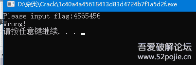
image-20220309132114998.png (10.42 KB, 下载次数: 278)
[href="forum.php?mod=attachment&aid=MjUwMDgxNnw2Y2NiOWZhZXwxNzkzNTc2MDU5fDE2ODA4NnwxNjAwMDg0&nothumb=yes" target="_blank"](https://www.52pojie.cn/forum.php?mod=attachment&aid=MjUwMDgxNnw2Y2NiOWZhZXwxNzkzNTc2MDU5fDE2ODA4NnwxNjAwMDg0&nothumb=yes)
1
2022-3-9 19:36 上传

### 2. 既然是exe，那先用`OD`跑一边

#### ① 查看是否有关键字符串

#### 发现关键字符“`Wrong！`”，这个字符就在我们输入错误后提示的，可以看第一大步的图，双击找到这个字符串的引用（如下图）

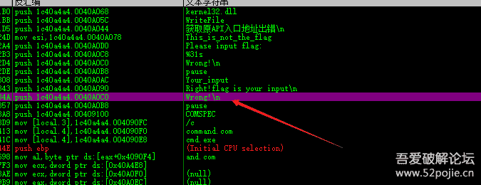
image-20220309132505801.png (18.55 KB, 下载次数: 270)
[href="forum.php?mod=attachment&aid=MjUwMDgxN3w0NGU0ZjdiNHwxNzkzNTc2MDU5fDE2ODA4NnwxNjAwMDg0&nothumb=yes" target="_blank"](https://www.52pojie.cn/forum.php?mod=attachment&aid=MjUwMDgxN3w0NGU0ZjdiNHwxNzkzNTc2MDU5fDE2ODA4NnwxNjAwMDg0&nothumb=yes)
2
2022-3-9 19:36 上传

#### ② 大概分析引用“`Wrong!`”的代码段

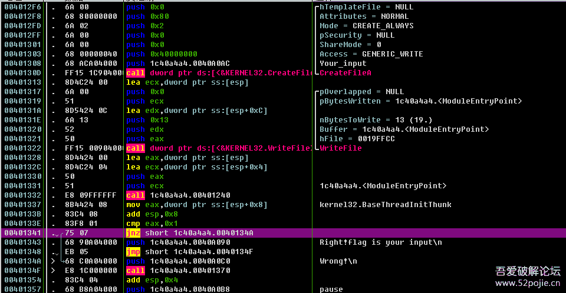
image-20220309133047232.png (30.71 KB, 下载次数: 280)
[href="forum.php?mod=attachment&aid=MjUwMDgxOHwxNTgyYmY5M3wxNzkzNTc2MDU5fDE2ODA4NnwxNjAwMDg0&nothumb=yes" target="_blank"](https://www.52pojie.cn/forum.php?mod=attachment&aid=MjUwMDgxOHwxNTgyYmY5M3wxNzkzNTc2MDU5fDE2ODA4NnwxNjAwMDg0&nothumb=yes)
3
2022-3-9 19:36 上传

发现跳转到输出“`Wrong!`”函数的`jnz`在`00401341`，跳转条件就是`eax`不等于1，那说明只要`eax`只要等于1则就不跳转，执行输出“`Right!flag is your input`”，那现在我们需要做的就是逆推`EAX`的来源（如上图）

#### ③ 逆推`EAX`的来源

```
00401337  |.  8B4424 08     mov eax,dword ptr ss:[esp+0x8]           ;  kernel32.BaseThreadInitThunk
0040133B  |.  83C4 08       add esp,0x8
0040133E  |.  83F8 01       cmp eax,0x1
00401341  |.  75 07         jnz short 1c40a4a4.0040134A 
00401343  |.  68 90A04000   push 1c40a4a4.0040A090                   ;  Right!flag is your input\n
00401348  |.  EB 05         jmp short 1c40a4a4.0040134F
0040134A  |>  68 C0A04000   push 1c40a4a4.0040A0C0                   ;  Wrong!\n
0040134F  |>  E8 1C000000   call 1c40a4a4.00401370
```

5> 阅读代码可以看到第一步跟踪到的`eax`是在`00401337`处被`ss:[esp+0x8]`赋值，那我们断点到`00401337`查看`ss:[esp+0x8]`的值，但是断点运行后居然没停下来而直接判断输出了“`Wrong!`”，（如下图）

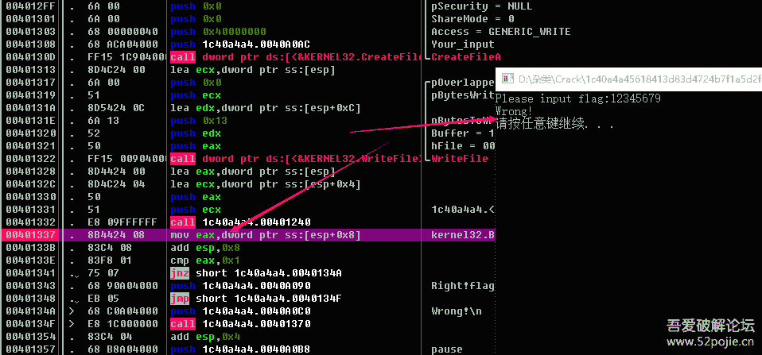
image-20220309133848337.png (36.96 KB, 下载次数: 263)
[href="forum.php?mod=attachment&aid=MjUwMDgxOXwyYTBhNTBmMHwxNzkzNTc2MDU5fDE2ODA4NnwxNjAwMDg0&nothumb=yes" target="_blank"](https://www.52pojie.cn/forum.php?mod=attachment&aid=MjUwMDgxOXwyYTBhNTBmMHwxNzkzNTc2MDU5fDE2ODA4NnwxNjAwMDg0&nothumb=yes)
4
2022-3-9 19:37 上传

5> 往上浏览代码，发现在`004012D4`出还有一个`Wrong`字符串和提示我们输入的信息，那说明这里有有一个初步的对我们输入的判断（如下图）

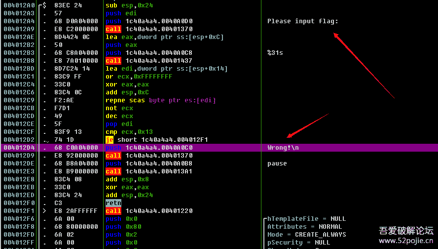
image-20220309134206340.png (29.98 KB, 下载次数: 276)
[href="forum.php?mod=attachment&aid=MjUwMDgyMHxiMmIzNmMzOHwxNzkzNTc2MDU5fDE2ODA4NnwxNjAwMDg0&nothumb=yes" target="_blank"](https://www.52pojie.cn/forum.php?mod=attachment&aid=MjUwMDgyMHxiMmIzNmMzOHwxNzkzNTc2MDU5fDE2ODA4NnwxNjAwMDg0&nothumb=yes)
5
2022-3-9 19:37 上传

```
004012A4  |.  68 D0A04000   push 1c40a4a4.0040A0D0                   ;  Please input flag:
004012A9  |.  E8 C2000000   call 1c40a4a4.00401370
004012AE  |.  8D4424 0C     lea eax,dword ptr ss:[esp+0xC]
004012B2  |.  50            push eax
004012B3  |.  68 C8A04000   push 1c40a4a4.0040A0C8                   ;  %31s
004012B8  |.  E8 7A010000   call 1c40a4a4.00401437
004012BD  |.  8D7C24 14     lea edi,dword ptr ss:[esp+0x14]
004012C1  |.  83C9 FF       or ecx,0xFFFFFFFF
004012C4  |.  33C0          xor eax,eax
004012C6  |.  83C4 0C       add esp,0xC
004012C9  |.  F2:AE         repne scas byte ptr es:[edi]
004012CB  |.  F7D1          not ecx
004012CD  |.  49            dec ecx
004012CE  |.  5F            pop edi
004012CF  |.  83F9 13       cmp ecx,0x13
004012D2  |.  74 1D         je short 1c40a4a4.004012F1
004012D4  |.  68 C0A04000   push 1c40a4a4.0040A0C0                   ;  Wrong!\n
004012D9  |.  E8 92000000   call 1c40a4a4.00401370
004012DE  |.  68 B8A04000   push 1c40a4a4.0040A0B8                   ;  pause
004012E3  |.  E8 B9000000   call 1c40a4a4.004013A1
```

5> 阅读上面代码可以知道要执行输出“`Wrong!`”则使得`004012D2`处不跳转，那我们的目的是要让他不执行，所以要使得`ecx`等于`0x13`(19)，经过我对`004012D2`处断点测试得到这个`0x13`(19)就是要求输入的长度等于19

5> 那我们继续往下走，发现`004012D2`处的跳转跳到了`004012FA1`（如下图）

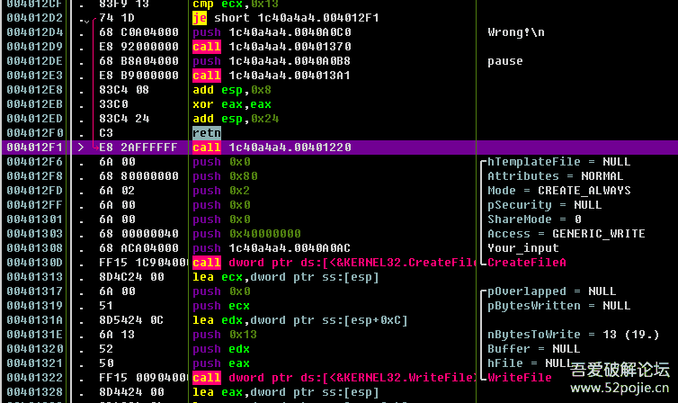
image-20220309134907327.png (26.12 KB, 下载次数: 277)
[href="forum.php?mod=attachment&aid=MjUwMDgyMXxkYmVhMzFiZHwxNzkzNTc2MDU5fDE2ODA4NnwxNjAwMDg0&nothumb=yes" target="_blank"](https://www.52pojie.cn/forum.php?mod=attachment&aid=MjUwMDgyMXxkYmVhMzFiZHwxNzkzNTc2MDU5fDE2ODA4NnwxNjAwMDg0&nothumb=yes)
6
2022-3-9 19:37 上传

5> 那我们断点来到这个`004012D2`函数（记得输入19个字符）（如下图）

5> 跳转成功以后执行了`CreatfeFileA`函数，第一个参数便是文件名“`Your_input`”,那我们执行完`CreateFileA`后exe就会在它所在目录创建一个叫作`Your_input`的文件（如果文件在则不创建），最后`CreatfeFileA`函数返回`Your_input`文件句柄值，返回的值放在`eax`中（通常函数返回值都是存在`eax`中，这里就是）

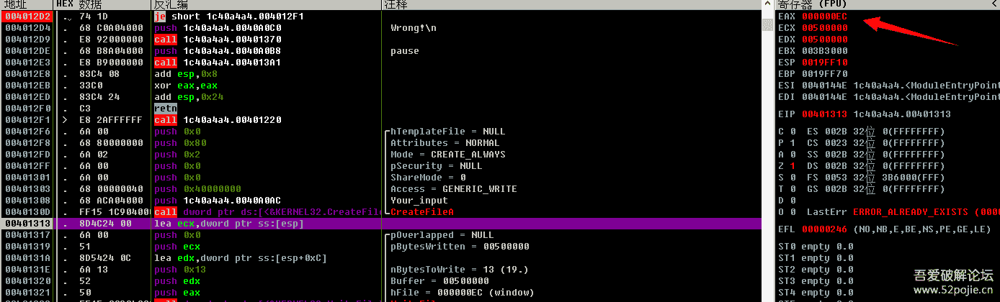
image-20220309141751019.png (35.2 KB, 下载次数: 275)
[href="forum.php?mod=attachment&aid=MjUwMDgyMnw3YzYwZjQ4YXwxNzkzNTc2MDU5fDE2ODA4NnwxNjAwMDg0&nothumb=yes" target="_blank"](https://www.52pojie.cn/forum.php?mod=attachment&aid=MjUwMDgyMnw3YzYwZjQ4YXwxNzkzNTc2MDU5fDE2ODA4NnwxNjAwMDg0&nothumb=yes)
7
2022-3-9 19:38 上传

5> 继续往下走（如下图）

5> 程序继续执行`WriteFile`函数，第一个函数便是待写入文件的文件的句柄值（`hfile`），第二个函数便是待写入的数据存储地址(`Buffer`)，第三个便是要写入的字节数(`nBytesToWrite` ),那就可以知道exe是想把`0019FF14`处的内容写19个字节到刚才生成的`Your_input`文件中，查看`0019FF14`地址便可以看到写入的字符就是我们输入的19个字符

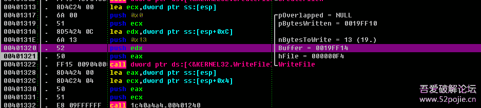
image-20220309141448868.png (15.58 KB, 下载次数: 261)
[href="forum.php?mod=attachment&aid=MjUwMDgyM3w2ZWMzZjZlZXwxNzkzNTc2MDU5fDE2ODA4NnwxNjAwMDg0&nothumb=yes" target="_blank"](https://www.52pojie.cn/forum.php?mod=attachment&aid=MjUwMDgyM3w2ZWMzZjZlZXwxNzkzNTc2MDU5fDE2ODA4NnwxNjAwMDg0&nothumb=yes)
8
2022-3-9 19:38 上传

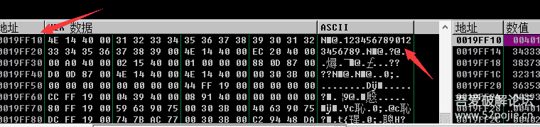
image-20220309142842863.png (19.31 KB, 下载次数: 269)
[href="forum.php?mod=attachment&aid=MjUwMDgyNHw1OGVhMDg1M3wxNzkzNTc2MDU5fDE2ODA4NnwxNjAwMDg0&nothumb=yes" target="_blank"](https://www.52pojie.cn/forum.php?mod=attachment&aid=MjUwMDgyNHw1OGVhMDg1M3wxNzkzNTc2MDU5fDE2ODA4NnwxNjAwMDg0&nothumb=yes)
9
2022-3-9 19:38 上传

5> 那我们先执行完`WriteFile`函数去看看是否存在`Your_input`文件并且写入成功了（如下图）

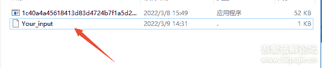
image-20220309143216877.png (13.79 KB, 下载次数: 262)
[href="forum.php?mod=attachment&aid=MjUwMDgyNXxiYjEzOThiOHwxNzkzNTc2MDU5fDE2ODA4NnwxNjAwMDg0&nothumb=yes" target="_blank"](https://www.52pojie.cn/forum.php?mod=attachment&aid=MjUwMDgyNXxiYjEzOThiOHwxNzkzNTc2MDU5fDE2ODA4NnwxNjAwMDg0&nothumb=yes)
10
2022-3-9 19:38 上传

5> 打开`Your_input`文件以后发现里面的内容根本就不是我们写入的1234567890123456789啊，而是一些其他字符但是`WriteFile`写入的字符串就是1234567890123456789，所以`WriteFile`指定出现了问题，我们跟进`WriteFile`看下函数（如下图）

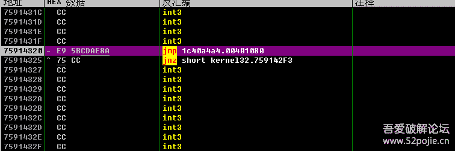
image-20220309143526185.png (12.66 KB, 下载次数: 251)
[href="forum.php?mod=attachment&aid=MjUwMDgyNnxkZTQwMzMxZXwxNzkzNTc2MDU5fDE2ODA4NnwxNjAwMDg0&nothumb=yes" target="_blank"](https://www.52pojie.cn/forum.php?mod=attachment&aid=MjUwMDgyNnxkZTQwMzMxZXwxNzkzNTc2MDU5fDE2ODA4NnwxNjAwMDg0&nothumb=yes)
11
2022-3-9 19:39 上传

5> 跟进`WriteFile`内发现居然是个`jmp`！！！，那说明这个函数被做过手脚啊，通常这种写`jmp`的都是对这个函数进行了`HOOK`，所以，我们跳到`00401080`去看看到底发生了啥？（如下图）

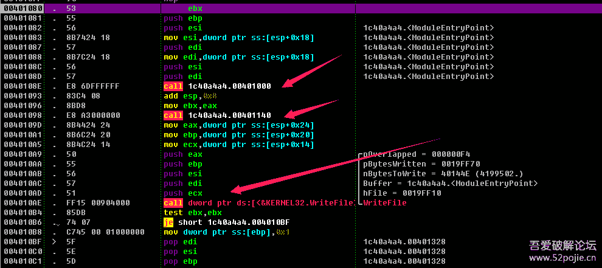
image-20220309143820697.png (30.58 KB, 下载次数: 254)
[href="forum.php?mod=attachment&aid=MjUwMDgyN3wxN2M4NDhiY3wxNzkzNTc2MDU5fDE2ODA4NnwxNjAwMDg0&nothumb=yes" target="_blank"](https://www.52pojie.cn/forum.php?mod=attachment&aid=MjUwMDgyN3wxN2M4NDhiY3wxNzkzNTc2MDU5fDE2ODA4NnwxNjAwMDg0&nothumb=yes)
12
2022-3-9 19:39 上传

5> 果然是对`WriteFile`函数进行了`HOOK`,在执行了`401000`、`401140`函数后才执行了


# WriteFile 函数逆向分析

## 5. WriteFile 函数跟踪

`WriteFile` 函数，那决定最终写入 `Your_input` 文件的字符串重点就是在这两个函数了，所以我们就跟进 `401000`、`401140` 两个函数进行分析, 此时为了方便分析我们采用 `IDA` 来分析

### 拖入 IDA Pro 跳转 `401000`

拖进 `IDA Pro` 直接按 `G` 跳转到 `401000`（如下图）

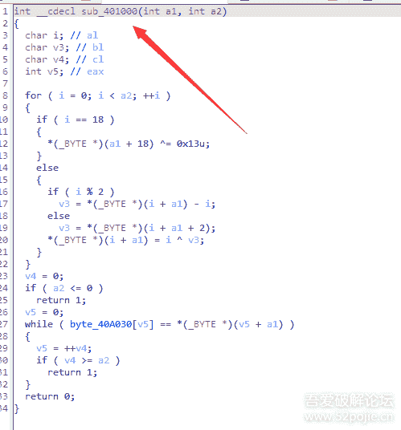

image-20220309180546210.png (30 KB, 下载次数: 262)

[href="forum.php?mod=attachment&aid=MjUwMDgyOHwyN2VkOGZmYXwxNzkzNTc2MDU5fDE2ODA4NnwxNjAwMDg0&nothumb=yes" target="_blank"](https://www.52pojie.cn/forum.php?mod=attachment&aid=MjUwMDgyOHwyN2VkOGZmYXwxNzkzNTc2MDU5fDE2ODA4NnwxNjAwMDg0&nothumb=yes)

### `401000` 函数代码

```
int __cdecl sub_401000(int a1, int a2)
{
  char i; // al
  char v3; // bl
  char v4; // cl
  int v5; // eax

  for ( i = 0; i = a2 )
      return 1;
  }
  return 0;
}
```

### 参数 `a1`、`a2` 解析

`401000` 两个参数 `a1`、`a2` 是什么呢？如下图

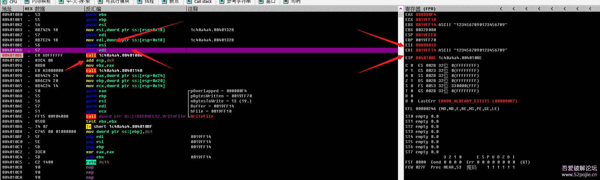

image-20220309181313579.png (53.64 KB, 下载次数: 265)

[href="forum.php?mod=attachment&aid=MjUwMDgyOXwxY2YyYzM5ZHwxNzkzNTc2MDU5fDE2ODA4NnwxNjAwMDg0&nothumb=yes" target="_blank"](https://www.52pojie.cn/forum.php?mod=attachment&aid=MjUwMDgyOXwxY2YyYzM5ZHwxNzkzNTc2MDU5fDE2ODA4NnwxNjAwMDg0&nothumb=yes)

可以看到 `esi` 是我们输入字符的长度，`edi` 是我们输入的字符长度，但是这里有个入栈细节

```
0040108C   .  56                   push esi
0040108D   .  57                   push edi
0040108E   .  E8 6DFFFFFF          call 1c40a4a4.00401000
```

这里的推入参数入栈是从参数的左边开始向右边推入，例如：

```
//c调用约定
void add(a,b){}
//对应汇编
push b
push a
call add
```

所以 `esi` 是 `IDA` 中伪代码的 `a2`，也就是我们输入字符的长度，`edi` 是 `IDA` 中伪代码的 `a1`，也就是我们输入字符所在的地址，那么此时我们阅读 `401000` 函数伪代码，就可以得到逻辑：

## 6. 深入逻辑分析

1. 循环 `a2`（`0x13`）次，循环体内：判断此时的循环次数是否为19次，如果是第19次循环的话则将我们输入的字符串第19位字符 `a[18]` 与 `0x13` 异或再返回第19位，如果循环次数取模2不为0的话则将 `a[i+a1]-i` 的值赋值给 `v3`, 否则将 `a[i+a1+2]` 赋值给 `v3`，最后，无论当前循环次数是否取模2等于0都将 `v3` 异或循环次数 `i` 的值赋值给 `a[i]`

2. 循环结束后判断 `a2`（我们输入字符的长度）是否小于等于0，满足的话则推出函数返回1，但是看来这个判断是毫无意义的

3. 判断我们输入的字符串的每一位字符是否等于 `byte_40A030` 数组中的每一个对应的值，等于的话就一直循环，知道循环了 `strlen(byte_40A030)` 后退出函数返回1，那我们查看一下 `byte_40A030` 数组是多少？（如图）

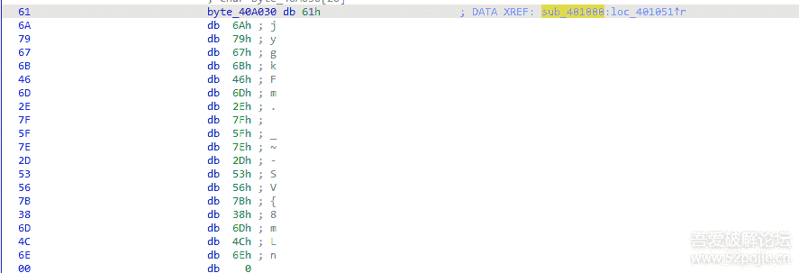

image-20220309183642625.png (24.88 KB, 下载次数: 272)

[href="forum.php?mod=attachment&aid=MjUwMDgzMHxiZmNjZmNhOXwxNzkzNTc2MDU5fDE2ODA4NnwxNjAwMDg0&nothumb=yes" target="_blank"](https://www.52pojie.cn/forum.php?mod=attachment&aid=MjUwMDgzMHxiZmNjZmNhOXwxNzkzNTc2MDU5fDE2ODA4NnwxNjAwMDg0&nothumb=yes)

`strlen(byte_40A030)` 就是等于我们输入字符串的正确长度（`0x13`）, 其实这里可以有很大程度可以确定 `byte_40A030` 就是 `flag` 最后的加密结果，但是为了严谨我们还是通过函数调用来具体分析

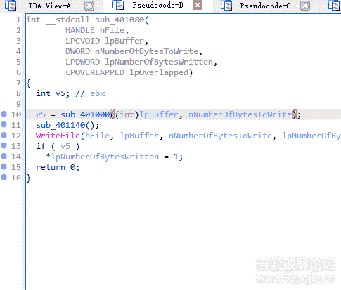

image-20220309183957081.png (24.13 KB, 下载次数: 264)

[href="forum.php?mod=attachment&aid=MjUwMDgzMXwxYjlmOGE2N3wxNzkzNTc2MDU5fDE2ODA4NnwxNjAwMDg0&nothumb=yes" target="_blank"](https://www.52pojie.cn/forum.php?mod=attachment&aid=MjUwMDgzMXwxYjlmOGE2N3wxNzkzNTc2MDU5fDE2ODA4NnwxNjAwMDg0&nothumb=yes)

如上图，找到了 `401000` 函数的调用者 `401080`，我们分析一下 `401080` 的逻辑：

定义整数变量 `v5` 接受 `401000` 的返回值（刚才分析过，只有0或1），接下来执行 `401140` 函数，跟进去看以后就只是一个 `HOOK` 相关的功能，不影响数据

最下面有一个判断，如果 `v5` 不为0则将 `lpNumberOfBytesWritten` 指向的值赋值为1

```
if ( v5 )
    *lpNumberOfBytesWritten = 1;
```

往上一看 `lpNumberOfBytesWritten` 就是 `WriteFile` 中的第三个参数，也就是我们设定写入文件的字节数，从这里就得不到更多信息了，所以我们现在需要找到 `WriteFile` 函数的调用者，如下图

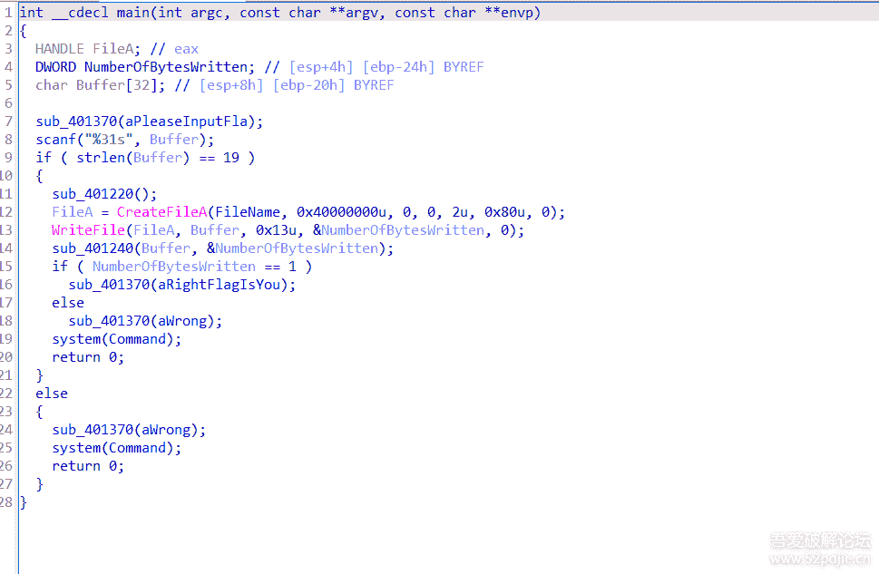

image-20220309190345090.png (49.56 KB, 下载次数: 266)

[href="forum.php?mod=attachment&aid=MjUwMDgzMnw1YWMxZWY0NHwxNzkzNTc2MDU5fDE2ODA4NnwxNjAwMDg0&nothumb=yes" target="_blank"](https://www.52pojie.cn/forum.php?mod=attachment&aid=MjUwMDgzMnw1YWMxZWY0NHwxNzkzNTc2MDU5fDE2ODA4NnwxNjAwMDg0&nothumb=yes)

主函数调用了 `WriteFile` 函数，我们先理一下主函数的逻辑是什么？

```
if ( NumberOfBytesWritten == 1 )
      sub_401370(aRightFlagIsYou);
    else
      sub_401370(aWrong);
```

通过跟入 `sub_401370` 函数发现该函数就是一个 `printf` 函数，参数就是输出的字符串变量，`aRightFlagIsYou` 变量是提示我们输入的 `flag` 正确的字符串，`aWrong` 字符串是提示我们输入的 `flag` 是错误的字符串，而要想执行提示我们输入正确则需要使得 `NumberOfBytesWritten == 1`，这个 `NumberOfBytesWritten` 就是 `HOOK` 了 `WriteFile` 的函数中做出的赋值更改，但是在主函数中查案代码发现 `NumberOfBytesWritten` 还参与了 `sub_401240` 函数，而且还是在 `hook` 之后，也就是说有可能这个 `sub_401240` 函数更改了 `NumberOfBytesWritten` , 那到底 `sub_401240` 函数是否对 `NumberOfBytesWritten` 做出更改还是得跟进去才知道如下图

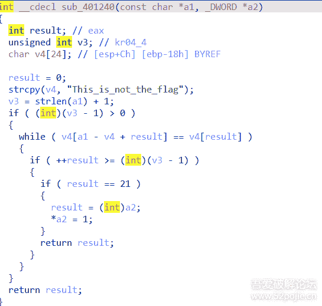

image-20220309191048516.png (29.82 KB, 下载次数: 264)

[href="forum.php?mod=attachment&aid=MjUwMDgzM3xjOGEyN2I5NHwxNzkzNTc2MDU5fDE2ODA4NnwxNjAwMDg0&nothumb=yes" target="_blank"](https://www.52pojie.cn/forum.php?mod=attachment&aid=MjUwMDgzM3xjOGEyN2I5NHwxNzkzNTc2MDU5fDE2ODA4NnwxNjAwMDg0&nothumb=yes)

`a1` 是我们输入得字符串所在的地址，`a2` 是 `NumberOfBytesWritten` 所在的地址，阅读代码逻辑：

将字符串 `v4="This_is_not_the_flag"` 中 `v4[a1 - v4 + result]` 元素与 `v4[result]` 对比，如果相等则循环以下代码：

```
if ( ++result >= (int)(v3 - 1) )
      {
        if ( result == 21 )
        {
          result = (int)a2;
          *a2 = 1;
        }
        return result;
      }
```

从上面代码中可以看出唯一对 `NumberOfBytesWritten` 操作且等于1的地方只有 `for` 中的 `if` 满足条件执行，那我们就想办法去执行这个 `*a2 = 1`，但是再仔细读代码后发现这个函数中我们输入的字符串未参与任何运算，也得不到一个中继的加密值，所以我们无法从这个函数中获得任何切确的信息，而且一看 `v4` 字符串是 `"This_is_not_the_flag"`，这很有可能说明作者写这个函数是用来误导我们的，所以综上所述我们只能去找 `NumberOfBytesWritten` 的另一个函数，也就是之前我们分析过的 `sub_401000` 函数，因为刚才我们上面已经分析过了，所以先通过 `sub_401000` 中的写出 `byte_40A030` 变量来反推出我们输入的 `flag` 因该是多少，解密脚本如下：

```
#include 
#include 

int main()
{
        int v3 = 0;
        unsigned char a1[] =
        {
                0x61, 0x6A, 0x79, 0x67, 0x6B, 0x46, 0x6D, 0x2E, 0x7F, 0x5F,
                0x7E, 0x2D, 0x53, 0x56, 0x7B, 0x38, 0x6D, 0x4C, 0x6E, 0x00
        };
        for (size_t i = 19; i >0; i--)
        {
                if (i == 18)
                {
                        *(BYTE *)(a1 + 18) ^=  0x13;

                }
                else
                {
                        v3 = *(BYTE *)(i + a1) ^ i;
                        if (i%2)
                        {
                                *(BYTE *)(i + a1) = v3 + i;
                        }
                        else
                        {
                                *(BYTE *)(i + a1 + 2) = v3;
                        }
                }
        }
        printf("%s",a1);
        system("pause");
        return 0;
}
```

此时我们得到了我们应该输入的 `flag`，此时 `NumberOfBytesWritten` 的值已经是1了，那我们继续带入下面的 `sub_401240` 中看这个函数是否会将 `NumberOfBytesWritten` 改为0就可以了，经过测试，`sub_401240` 带入我们推出的 `flag` 也是使得 `NumberOfBytesWritten` 变为1，所以 `main` 函数执行了输出提示正确的功能。

cm下载地址


[href="forum.php?mod=attachment&aid=MjUwMDgzN3w3ZWRhZjY4YXwxNzkzNTc2MDU5fDE2ODA4NnwxNjAwMDg0" target="_blank"](https://www.52pojie.cn/forum.php?mod=attachment&aid=MjUwMDgzN3w3ZWRhZjY4YXwxNzkzNTc2MDU5fDE2ODA4NnwxNjAwMDg0)

(21 KB, 下载次数: 10)

2022-3-9 19:49 上传

点击文件名下载附件

下载积分: 吾爱币 -1 CB
