# [.NET逆向] C# to C++ 等语言转换软件注册分析

原帖: https://www.52pojie.cn/forum.php?mod=viewthread&tid=1600497

抓取时间: 2026-11-01T23:34:18

## 1、引言

最近逛论坛的时候，无意发现一款编程语言转换软件，该软件可以将现有C#语言转换成C++。同时该网站还包含其他语言转换工具，如果没有许可证，每个文件的转换输出限制为100行。正好最近有空，分析学习看看该软件的注册方式，顺便可以提高一下自己的算法分析能力，接下来让我们一起来看看。

## 2、查壳

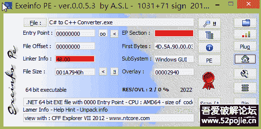

.Net拖进dnspy查看

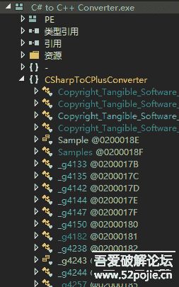

发现是.NET64，类名已经被混淆，简单看了下方法，还能看，直接动态调试。

## 3、调试

拖入dnspy,直接运行，窗口名称显示Free Edition，搜索

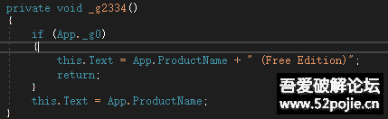

关键值为`App._g0`，查找变量分析

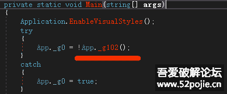

只需要让`App._g0`返回false即可，查找方法调用`_g102()`，需让该方法返回true

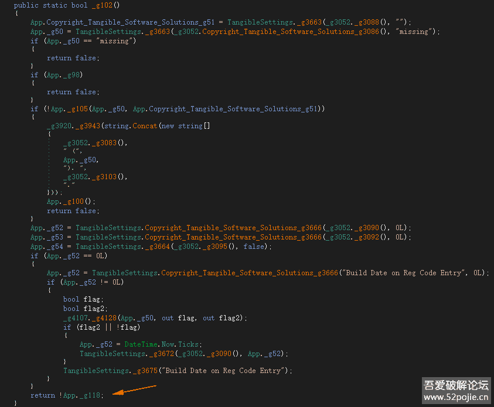

分析需要将`App._g118`返回false

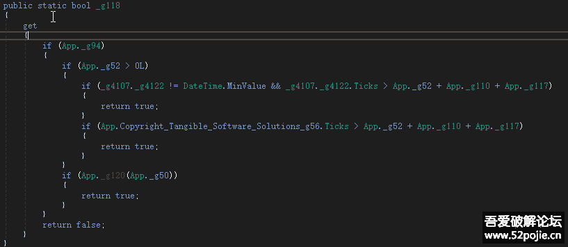

观察分析该方法是判断软件授权时间是否过期，需要找上个方法看赋值的地方

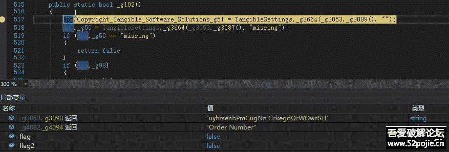

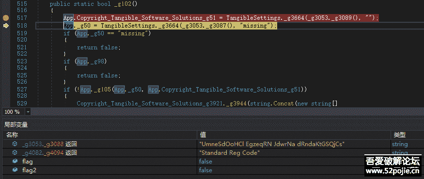

赋值字符串首先读取加密字符串，然后去除头尾3个字符，间隔获取字符后再反序生成

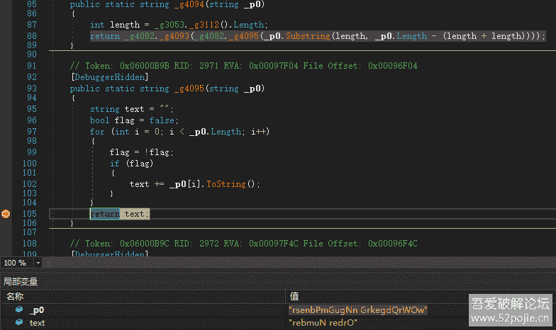

两个赋值地方都是从文件反序列化读取的键值，配置文件默认保存到C盘

`C:\Users\***\AppData\Roaming\***\C# to C++ Converter\C# to C++ Converter.usr`

打开文件参考其他节点增加两组节点`{"Key":"Order Number","Value":"12345"}`和`{"Key":"Standard Reg Code","Value":"12345"}`，重新运行

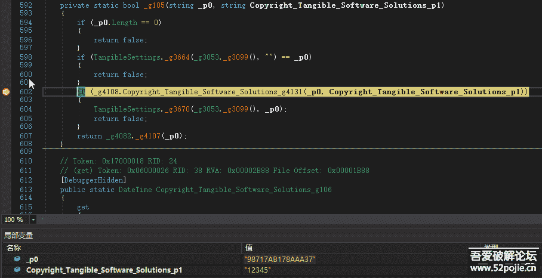

该方法会联网请求注册信息

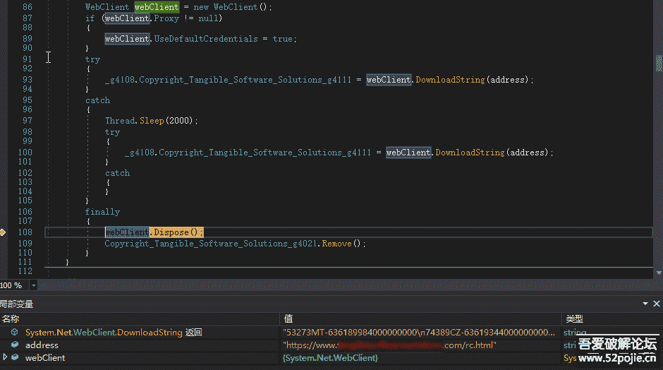

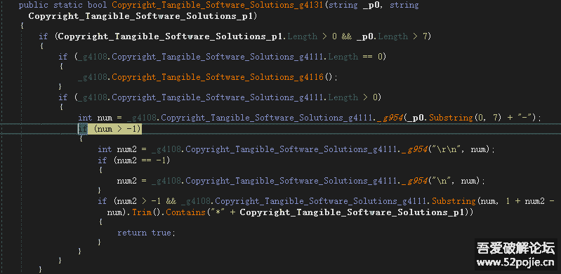

接着判断输入值长度是否大于7，是否包含‘-’、‘*’等字符，接着判断`_g4082._g4107(_p0);`

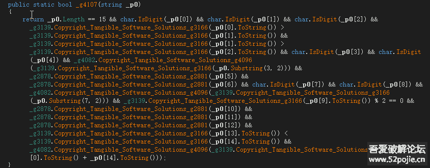

分析该方法，输入的第二组`"Standard Reg Code"`值需满足以下条件

长度=15 (0 1 2 3 4)字符必须是数字 (3 4)组成的十进制数必须是质数 (5 6)不是特殊字符，字母即可 (7 8 9)都为数字 9必须是2的整数倍 (10 11 12)是字母即可

(13 14)必须是数字，并且13需小于14 (0 14)组成的十进制必须是质数。根据规则，构造相应注册码`98717AB178AAA47`，保存文件重新运行

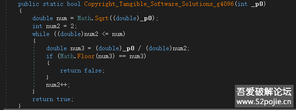

判断是否为质数

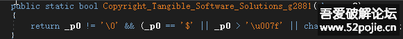

中间字符判断

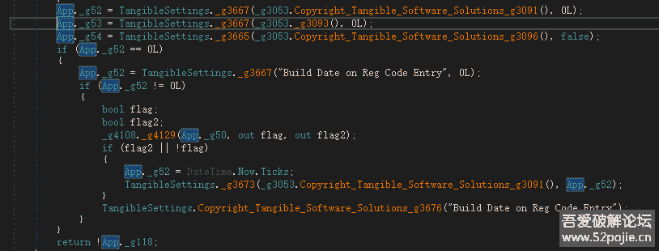

`_g52` `g53` `g54`分别从文件获取键值（`Ticks at Reg Code Entry`，`Extension Ticks`，`Promotional Subscription`），参考上方构造3组值，前两组是long型数据，第三个是bool,通过后面逻辑分析可知

第一组值是注册时间，第二个是可用时间，第三个是是否订阅标志，时间类型是`DateTime.Now.Ticks`，用C#调用编写代码获取一组值`637765920010000000`，`31241376010000000`

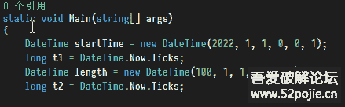

最终构造5组数据，完成软件注册，效果如下图

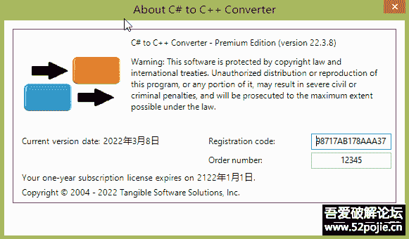

其他语言转换工具判断逻辑一样。

## 4、附录

附上官方网址`https://www.tangiblesoftwaresolutions.com`
