# [原创] 160个CrakeMe之Acid_burn

- 原帖: https://www.52pojie.cn/forum.php?mod=viewthread&tid=1601375
- 抓取时间: 2026-11-01T23:33:59

## 1 实现打开软件熟悉下

先分析第一个 注册码和名称

发现不正确会提示

## 2 `x96Dbg` 附加

将 `MessageBoxA` `-A` `-W` `-ExA` `-ExW` 全都下断点 注意下到返回的地方

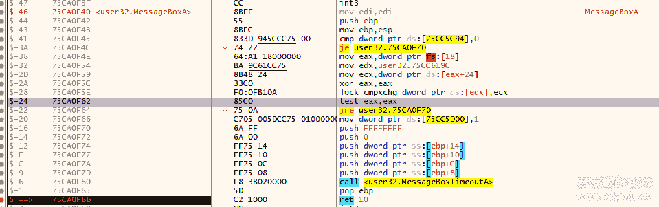

image.png (69.67 KB, 下载次数: 1)

[href="forum.php?mod=attachment&aid=MjUwMTUyMXw4YTAxNDljMXwxNzkzNTc2MDM3fDE2ODA4NnwxNjAxMzc1&nothumb=yes" target="_blank"](https://www.52pojie.cn/forum.php?mod=attachment&aid=MjUwMTUyMXw4YTAxNDljMXwxNzkzNTc2MDM3fDE2ODA4NnwxNjAxMzc1&nothumb=yes)

2022-3-11 21:59 上传

在 `MessageBoxA` 断下了 然后我们 `F7`

我们到了这个地方

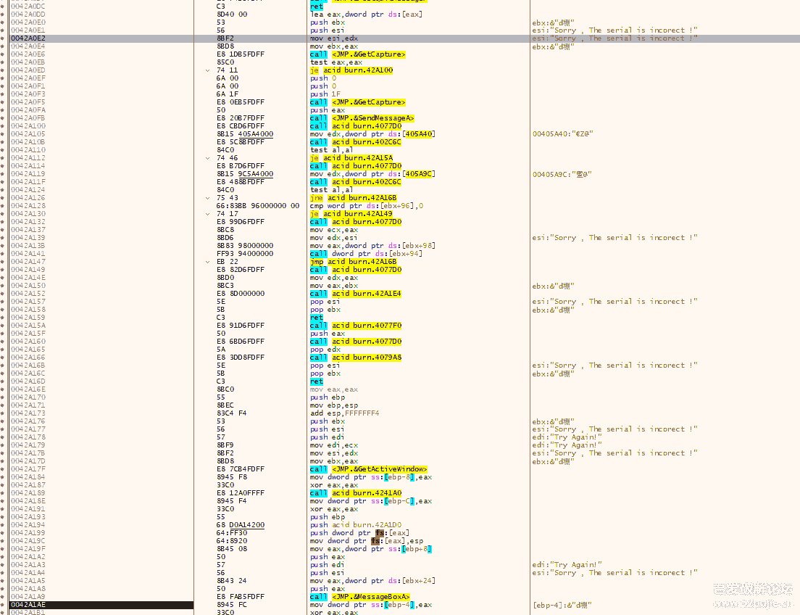

image.png (171.31 KB, 下载次数: 2)

[href="forum.php?mod=attachment&aid=MjUwMTUyMnw2YjEyYjExM3wxNzkzNTc2MDM3fDE2ODA4NnwxNjAxMzc1&nothumb=yes" target="_blank"](https://www.52pojie.cn/forum.php?mod=attachment&aid=MjUwMTUyMnw2YjEyYjExM3wxNzkzNTc2MDM3fDE2ODA4NnwxNjAxMzc1&nothumb=yes)

2022-3-11 21:59 上传

先观察下 发现并没有检测

## 3 然后 `ctrl+F9` 跳到上一级

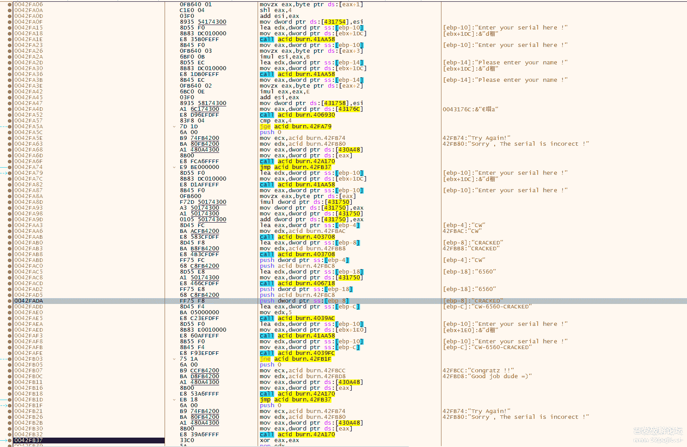

image.png (306.11 KB, 下载次数: 2)

[href="forum.php?mod=attachment&aid=MjUwMTUyM3w4NDQ5NjIyM3wxNzkzNTc2MDM3fDE2ODA4NnwxNjAxMzc1&nothumb=yes" target="_blank"](https://www.52pojie.cn/forum.php?mod=attachment&aid=MjUwMTUyM3w4NDQ5NjIyM3wxNzkzNTc2MDM3fDE2ODA4NnwxNjAxMzc1&nothumb=yes)

2022-3-11 21:59 上传

明显是判断的

### #1 简单方法直接 `nop`

`[C++]` 纯文本查看 复制代码

```
0042FAFE    | E8 F93EFDFF               | call acid burn.4039FC
```

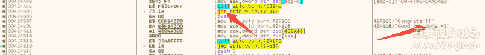

image.png (56.92 KB, 下载次数: 1)

[href="forum.php?mod=attachment&aid=MjUwMTUyNHw5ZDhmNTYwN3wxNzkzNTc2MDM3fDE2ODA4NnwxNjAxMzc1&nothumb=yes" target="_blank"](https://www.52pojie.cn/forum.php?mod=attachment&aid=MjUwMTUyNHw5ZDhmNTYwN3wxNzkzNTc2MDM3fDE2ODA4NnwxNjAxMzc1&nothumb=yes)

2022-3-11 22:00 上传


image.png (9.19 KB, 下载次数: 3)

[href="forum.php?mod=attachment&aid=MjUwMTUyNnxkNmU5OGY1N3wxNzkzNTc2MDM3fDE2ODA4NnwxNjAxMzc1&nothumb=yes" target="_blank"](https://www.52pojie.cn/forum.php?mod=attachment&aid=MjUwMTUyNnxkNmU5OGY1N3wxNzkzNTc2MDM3fDE2ODA4NnwxNjAxMzc1&nothumb=yes)

2022-3-11 22:00 上传

### #2 分析下名称和注册码

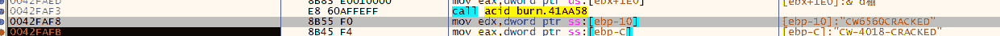

image.png (16.06 KB, 下载次数: 2)

[href="forum.php?mod=attachment&aid=MjUwMTUyOXw4NjdlZjViNHwxNzkzNTc2MDM3fDE2ODA4NnwxNjAxMzc1&nothumb=yes" target="_blank"](https://www.52pojie.cn/forum.php?mod=attachment&aid=MjUwMTUyOXw4NjdlZjViNHwxNzkzNTc2MDM3fDE2ODA4NnwxNjAxMzc1&nothumb=yes)

2022-3-11 22:01 上传

`edx` 是我写的 猜测 `eax`=`CW-4018-CRACKED` 是注册码 在之前改调 `edx` 的内容改为 `eax`

发现也成功的 然后我们改变名称 发现 注册码不一样了

## 4 观察发现 注册码是在上面得出 在这一级的头部下断点

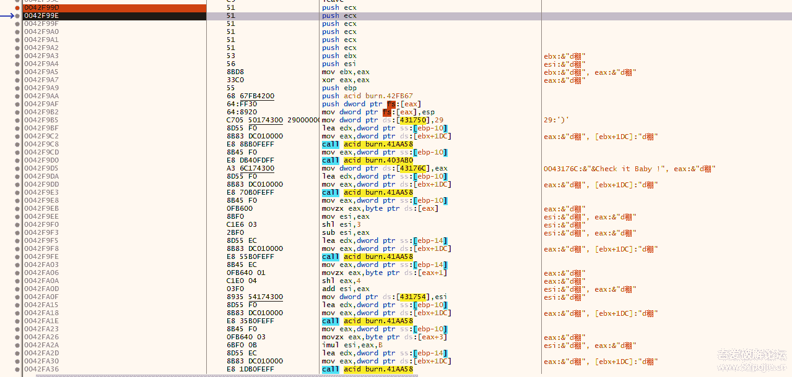

image.png (151.44 KB, 下载次数: 1)

[href="forum.php?mod=attachment&aid=MjUwMTUzMHwyMjI1NzQxMnwxNzkzNTc2MDM3fDE2ODA4NnwxNjAxMzc1&nothumb=yes" target="_blank"](https://www.52pojie.cn/forum.php?mod=attachment&aid=MjUwMTUzMHwyMjI1NzQxMnwxNzkzNTc2MDM3fDE2ODA4NnwxNjAxMzc1&nothumb=yes)

2022-3-11 22:01 上传

`F8` 往下跟

看传参和返回

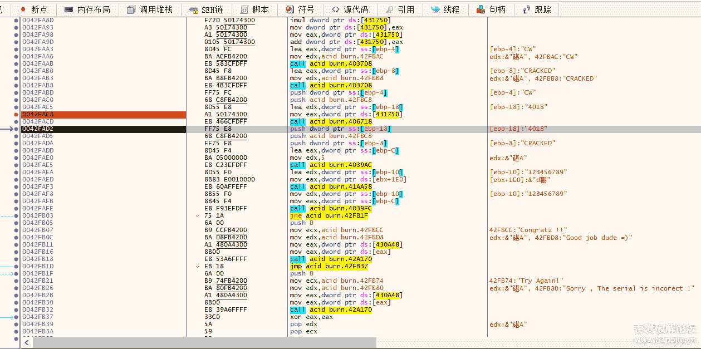

image.png (159.84 KB, 下载次数: 2)

[href="forum.php?mod=attachment&aid=MjUwMTUzMXxjMDg5M2U1MHwxNzkzNTc2MDM3fDE2ODA4NnwxNjAxMzc1&nothumb=yes" target="_blank"](https://www.52pojie.cn/forum.php?mod=attachment&aid=MjUwMTUzMXxjMDg5M2U1MHwxNzkzNTc2MDM3fDE2ODA4NnwxNjAxMzc1&nothumb=yes)

2022-3-11 22:01 上传

这里出现的 `4018` 注册码

进来函数发现是得到 `eax` 的

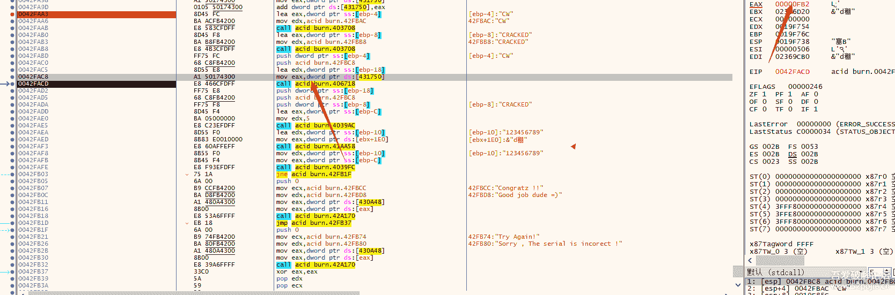

image.png (181.13 KB, 下载次数: 3)

[href="forum.php?mod=attachment&aid=MjUwMTUzMnwyY2ZhN2QxY3wxNzkzNTc2MDM3fDE2ODA4NnwxNjAxMzc1&nothumb=yes" target="_blank"](https://www.52pojie.cn/forum.php?mod=attachment&aid=MjUwMTUzMnwyY2ZhN2QxY3wxNzkzNTc2MDM3fDE2ODA4NnwxNjAxMzc1&nothumb=yes)

2022-3-11 22:01 上传

确定 `eax`=`431750` 然后高亮 `[431750]`

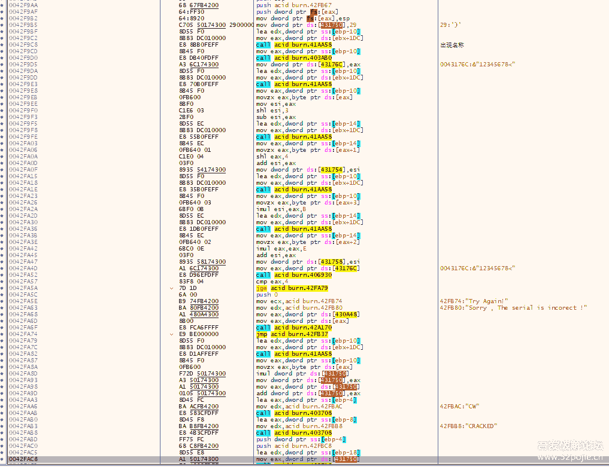

image.png (186.32 KB, 下载次数: 2)

[href="forum.php?mod=attachment&aid=MjUwMTUzM3w0NzRiMjhkY3wxNzkzNTc2MDM3fDE2ODA4NnwxNjAxMzc1&nothumb=yes" target="_blank"](https://www.52pojie.cn/forum.php?mod=attachment&aid=MjUwMTUzM3w0NzRiMjhkY3wxNzkzNTc2MDM3fDE2ODA4NnwxNjAxMzc1&nothumb=yes)

2022-3-11 22:02 上传

重新来一遍 在 `42F9B5` 下断点 在内存查看 `431750` 记得刷新 可以使用 `CE` 和内存断点

这边使用的是内存断点

`#define [431750]  值`

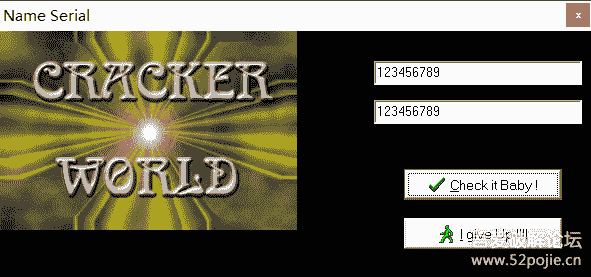

image.png (78.27 KB, 下载次数: 0)

[href="forum.php?mod=attachment&aid=MjUwMTUzNHw5ODM4YjYxNXwxNzkzNTc2MDM3fDE2ODA4NnwxNjAxMzc1&nothumb=yes" target="_blank"](https://www.52pojie.cn/forum.php?mod=attachment&aid=MjUwMTUzNHw5ODM4YjYxNXwxNzkzNTc2MDM3fDE2ODA4NnwxNjAxMzc1&nothumb=yes)

2022-3-11 22:02 上传

`[C++]` 纯文本查看 复制代码

```
值=41  // ov dword ptr ds:[0x00431750], 0x29
```

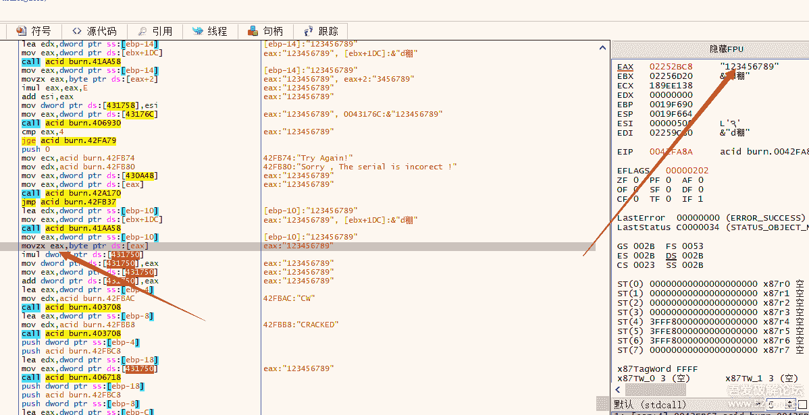

image.png (148.14 KB, 下载次数: 1)

[href="forum.php?mod=attachment&aid=MjUwMTUzNXw3YzhiM2M0ZnwxNzkzNTc2MDM3fDE2ODA4NnwxNjAxMzc1&nothumb=yes" target="_blank"](https://www.52pojie.cn/forum.php?mod=attachment&aid=MjUwMTUzNXw3YzhiM2M0ZnwxNzkzNTc2MDM3fDE2ODA4NnwxNjAxMzc1&nothumb=yes)

2022-3-11 22:02 上传

这里开始

`movzx` 一般用于将较小值拷贝到较大值中

`eax`=`0x31` =='1'

`imul` 有符号乘法，将被乘数与乘数均作为有符号数

`[C++]` 纯文本查看 复制代码

```
值=值*第一个字符  =2009  本例中 第一个字符是'1'=0x31=49

mov eax, 50dword ptr ds:[0x00431750]
add dword ptr ds:[0x00431750], eax
这二句应该都看得懂 就是 值=值+值 就是值*2  
完整得出答案  
```

检验

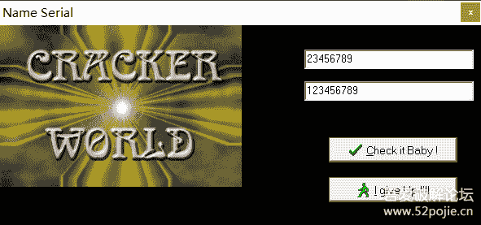

image.png (78.17 KB, 下载次数: 1)

[href="forum.php?mod=attachment&aid=MjUwMTUzNnwyOGNhOTU3NXwxNzkzNTc2MDM3fDE2ODA4NnwxNjAxMzc1&nothumb=yes" target="_blank"](https://www.52pojie.cn/forum.php?mod=attachment&aid=MjUwMTUzNnwyOGNhOTU3NXwxNzkzNTc2MDM3fDE2ODA4NnwxNjAxMzc1&nothumb=yes)

2022-3-11 22:02 上传

第一个字符是'2'==50  

(41*50)*2=4100

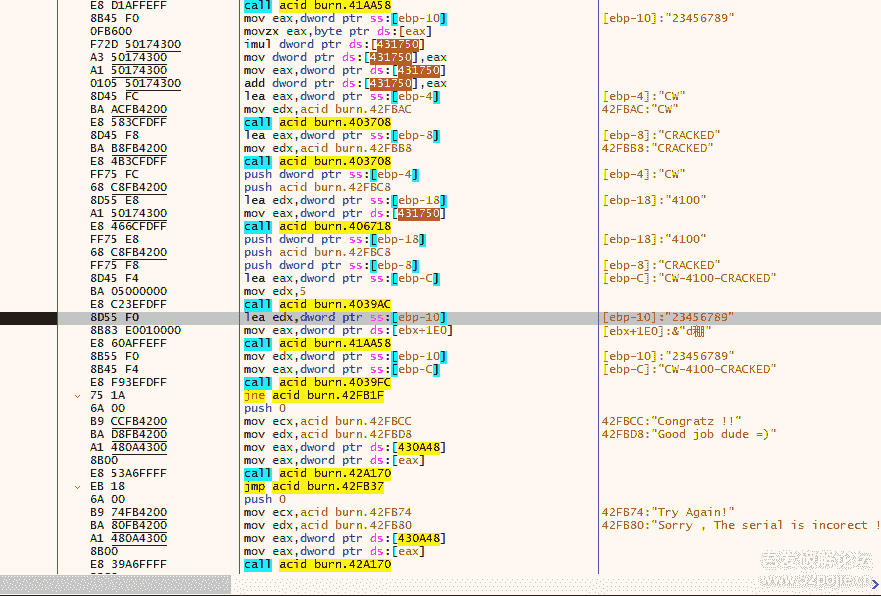

image.png (115.71 KB, 下载次数: 1)

[href="forum.php?mod=attachment&aid=MjUwMTUzOHw2OTM1MGViNXwxNzkzNTc2MDM3fDE2ODA4NnwxNjAxMzc1&nothumb=yes" target="_blank"](https://www.52pojie.cn/forum.php?mod=attachment&aid=MjUwMTUzOHw2OTM1MGViNXwxNzkzNTc2MDM3fDE2ODA4NnwxNjAxMzc1&nothumb=yes)

2022-3-11 22:02 上传

成功 

算法   注册码=`CW-(string_name[0]*41)*2-CRACKED`

## 5 我们最后做个一键填写名称和注册码的机器 下面源码

`[C++]` 纯文本查看 复制代码

```
#include 
#include 
#include 
using namespace std;
int main()
{
    srand(time(NULL));
    HWND Handle = FindWindowW(L"TNS", L"Name Serial");
    HWND HandleRegistration = FindWindowExW(Handle, NULL, L"TEdit", NULL);
    HWND HandleName = FindWindowExW(Handle, HandleRegistration, L"TEdit", NULL);
    HWND HandleCliek = FindWindowExW(Handle, NULL, L"TBitBtn",L"&Check it Baby !");
    CString str = L"天晨";
    int Name = rand();
    CString str2;
    str2.Format(L"%d", Name);
        CString str3;
    str3.Format(L"CW-%d-CRACKED", (str2[0] * 41) * 2);
    //int i = ::SetWindowTextA(HandleName,(LPSTR)str.c_str());
    SendMessageW(Handle, WM_SETTEXT, 0, (LPARAM)str.GetBuffer());
    SendMessageW(HandleName, WM_SETTEXT, 0, (LPARAM)str2.GetBuffer());
    SendMessageW(HandleRegistration, WM_SETTEXT, 0, (LPARAM)str3.GetBuffer());
    SendMessageW(HandleCliek, WM_LBUTTONDOWN, 0, NULL);
    Sleep(10);
    SendMessageW(HandleCliek, WM_LBUTTONUP, 0, NULL);
    int erro=GetLastError();
    system("pause");
}
```

运行即

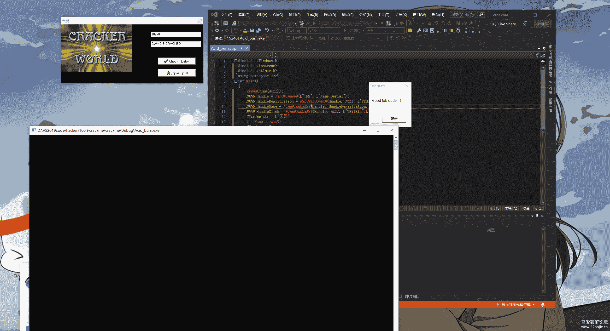

image.png (730.77 KB, 下载次数: 1)

[href="forum.php?mod=attachment&aid=MjUwMTUzOXxkNDY5YTlkYnwxNzkzNTc2MDM3fDE2ODA4NnwxNjAxMzc1&nothumb=yes" target="_blank"](https://www.52pojie.cn/forum.php?mod=attachment&aid=MjUwMTUzOXxkNDY5YTlkYnwxNzkzNTc2MDM3fDE2ODA4NnwxNjAxMzc1&nothumb=yes)

2022-3-11 22:02 上传

## 7 第二个简单提下

仿造上面即可 `serial`=Hello Dude!
