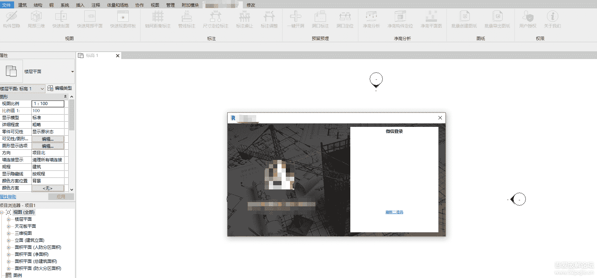
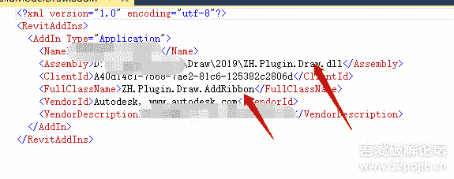
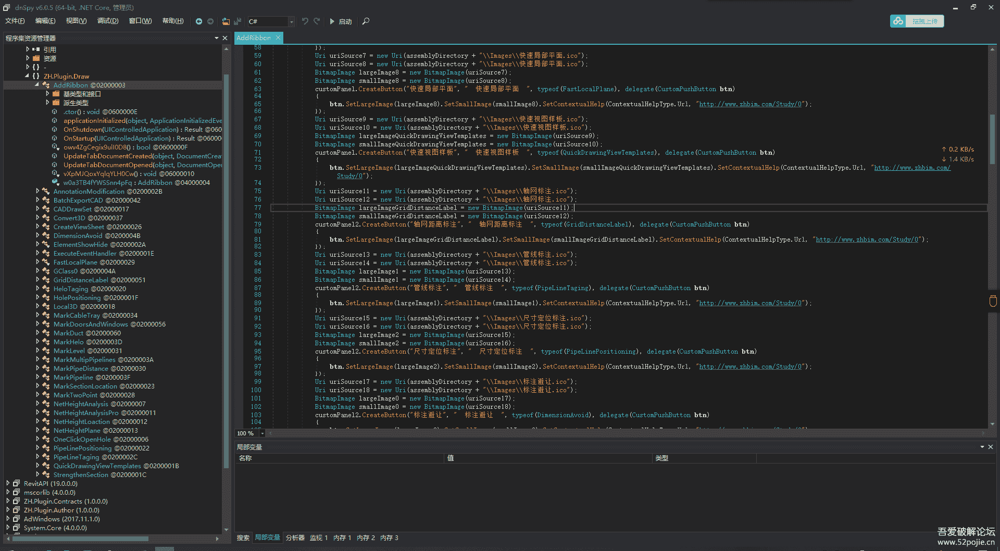
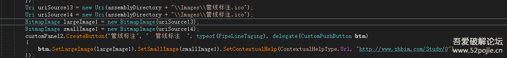
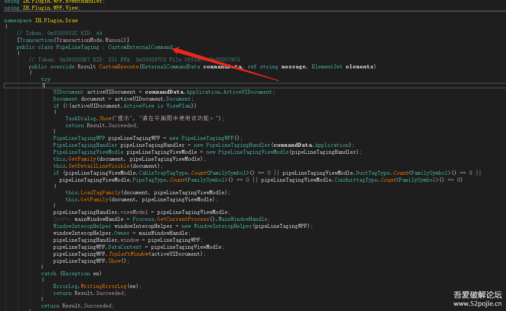
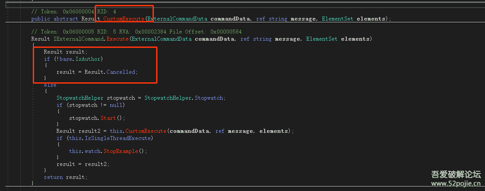
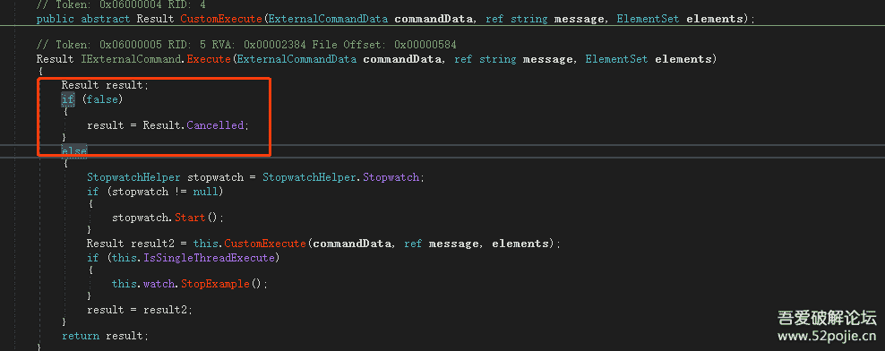
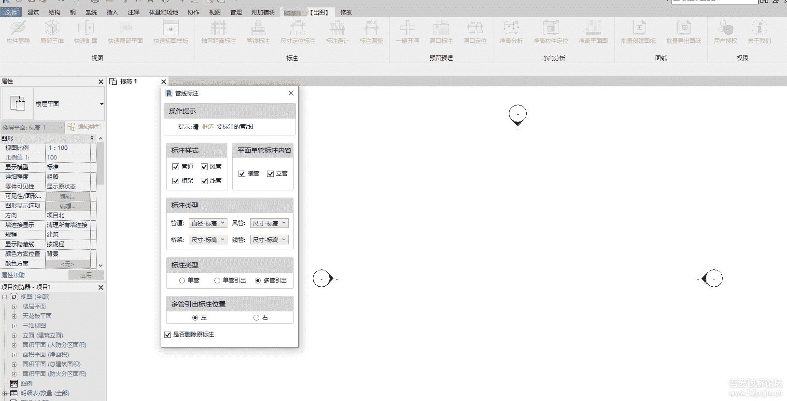

# [.NET逆向] 记一BIM出图插件和谐过程（大神略过）

> 原帖：[https://www.52pojie.cn/forum.php?mod=viewthread&tid=1601869](https://www.52pojie.cn/forum.php?mod=viewthread&tid=1601869)  
> 抓取时间：2026-11-01T23:33:54

最近要从 Revit 导出大量图纸，并做简单标注，网上找到一款小巧插件。

## 使用工具

使用工具：`de4dot`、`dnSpyx64`。

`dnSpyx64` 安装完发现没有桌面快捷方式，打开 Revit 后使用功能发现直接弹出登录对话框：

  
图 01：`01.png`（321.62 KB，下载次数 0，2022-3-13 00:35 上传）

## 定位插件加载的 DLL

此时到 `C:\ProgramData\Autodesk\Revit\Addins\20xx` 查看 Revit 启动时加载的 `dll`（`xxx.addin` 文件），如下：

  
图 02：`02.png`（25.21 KB，下载次数 0，2022-3-13 00:36 上传）

记录 `ZH.Plugin.Draw.dll` 及 `FullClassName`，后在插件安装目录找到 `DLL`，使用 `dnSpyx64` 神器打开 `dll`。发现方法名全部混淆，使用 `de4dot` 大法去混淆。

  
图 03：`03.png`（285.25 KB，下载次数 0，2022-3-13 00:36 上传）

## 分析按钮事件

Revit 二次开发时定义按钮事件如下：

```
RibbonPanel Changyong = application.CreateRibbonPanel("插件名称", "一级菜单");

PushButtonData shensuoData = new PushButtonData("shensuo","功能名称",dll_path,"方法函数");

PushButton shensuoButton = Changyong.AddItem(shensuoData) as PushButton;
```

因此我们只需分析 `PushButtonData`，后找到绑定的方法函数。以管道标注为例，进入（该插件对方法进行了封装）：

  
图 04：`04.png`（18.84 KB，下载次数 0，2022-3-13 00:36 上传）

## 定位管道标注方法

比较明了，`PipeLineTaging` 应该就是方法名称。点进去后发现新 `dll`，去混淆后进入，找到同名称方法，如下图：

  
图 05：`05.png`（56.94 KB，下载次数 0，2022-3-13 00:36 上传）

  
图 06：`06.png`（29.18 KB，下载次数 0，2022-3-13 00:36 上传）

## 修改与测试

话不多说，直接让 `if` 不执行，直接到 `else`，修改如下：

  
图 07：`07.png`（27.88 KB，下载次数 0，2022-3-13 00:36 上传）

保存测试。

  
图 08：`08.png`（165.68 KB，下载次数 0，2022-3-13 00:36 上传）

发现已经秒杀，测试其他功能，已经可以使用了。

## 总结

Revit 插件主要还是要找到定义按钮时绑定的方法，而定义按钮时要吗数据全在 `dll` 里，要吗将数据写在 `xml` 里读取循环定义。
