# [Web逆向] 某牙直播flv地址解密

- 原帖: https://www.52pojie.cn/forum.php?mod=viewthread&tid=1602878
- 抓取时间: 2026-11-01T23:33:47

## 前言

闲来无事，趁着朋友需要的虎牙直播地址失效了又试着玩玩。要源码在最后。

接下来说正经。

相对于其他的，这个比较简单。

## 获取播放地址

首先打开虎牙地址，这里以陈翔六点半直播间为例：

[//m.huya.com/cxldb](https://m.huya.com/cxldb)

为什么要是手机页面？因为 PC 采用的是`p2p + wss`播放，因此抓不到地址。转为手机页面可以拿到`m3u8`或者`flv`，都是支持播放的。

右键查看源代码，用谷歌的自动换行，找到`liveLineUrl`，就是它的播放地址。经验而谈是经过`base64`编码的。解码后：

[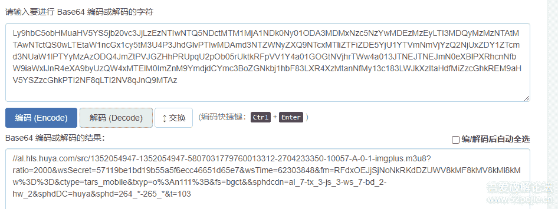](https://www.52pojie.cn/forum.php?mod=attachment&aid=MjUwMjQ2MXw0OGNiM2FmYnwxNzkzNTc2MDI0fDE2ODA4NnwxNjAyODc4&nothumb=yes)

2022-3-14 14:59 上传

解码。

貌似已经拿到了地址，是不是本帖子就可以结束了？

其实并不，打开链接就发现大写的`403`：

[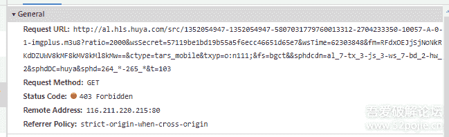](https://www.52pojie.cn/forum.php?mod=attachment&aid=MjUwMjQ2NXxmY2IwYzdjYnwxNzkzNTc2MDI0fDE2ODA4NnwxNjAyODc4&nothumb=yes)

`403`

2022-3-14 15:01 上传

这时发现事情并没有那么简单。

既然这样，我们用猫抓抓取一下地址：

[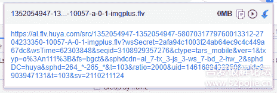](https://www.52pojie.cn/forum.php?mod=attachment&aid=MjUwMjQ2N3wzMjcxMjc1NnwxNzkzNTc2MDI0fDE2ODA4NnwxNjAyODc4&nothumb=yes)

猫抓地址

2022-3-14 15:02 上传

对比发现格式不一样就算了，还多了一些参数，也还有一些参数不一样。

既然这样，就拿出我们常用的 F12 大法干他：

[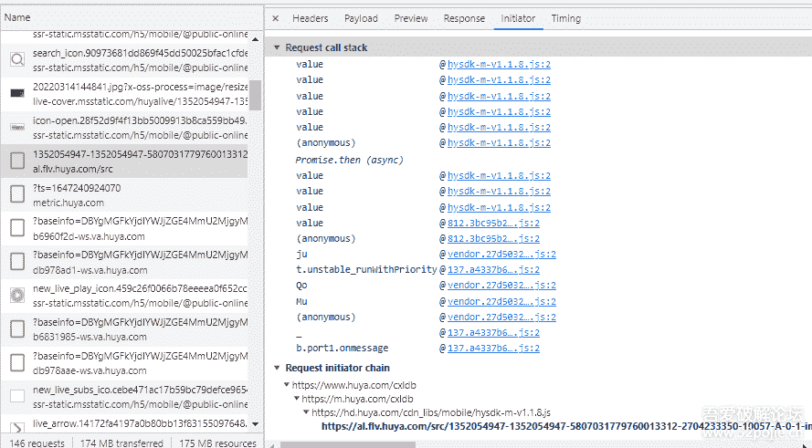](https://www.52pojie.cn/forum.php?mod=attachment&aid=MjUwMjQ3OXwyMzMwYThmY3wxNzkzNTc2MDI0fDE2ODA4NnwxNjAyODc4&nothumb=yes)

F12

2022-3-14 15:10 上传

找到播放的地址发现是[//hd.huya.com/cdn_libs/mobile/hysdk-m-v1.1.8.js](https://hd.huya.com/cdn_libs/mobile/hysdk-m-v1.1.8.js)发出的。

点进去，格式化代码，再重新看：

[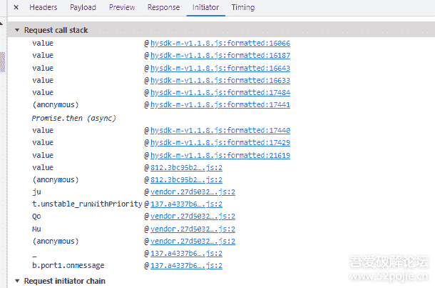](https://www.52pojie.cn/forum.php?mod=attachment&aid=MjUwMjQ4NHxhOTkyNzEzYnwxNzkzNTc2MDI0fDE2ODA4NnwxNjAyODc4&nothumb=yes)

格式化

2022-3-14 15:14 上传

## 调试与分析

点进去直接打断点，刷新网页发现真实的地址已经出来了。

说明这个不对，继续下一个函数，依次：

[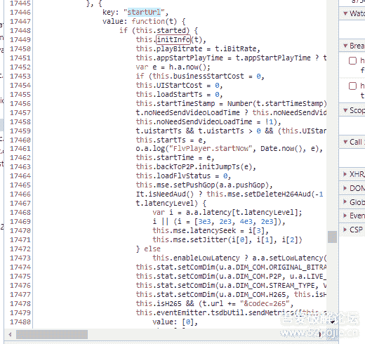](https://www.52pojie.cn/forum.php?mod=attachment&aid=MjUwMjUxM3xjY2RhZTVmZXwxNzkzNTc2MDI0fDE2ODA4NnwxNjAyODc4&nothumb=yes)

2022-3-14 15:35 上传

分析发现这里有处理，从上往下调试，进入了`initInfo`：

[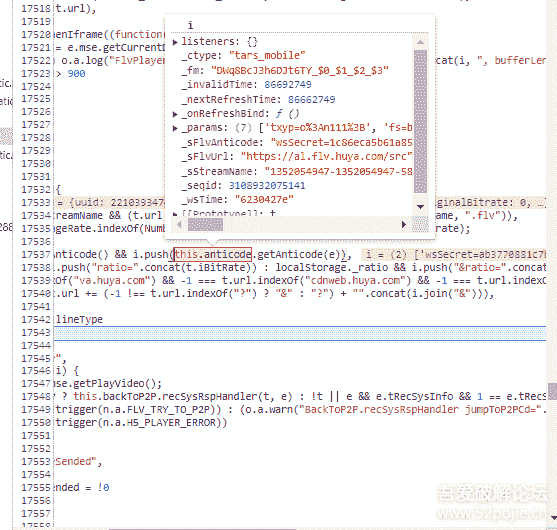](https://www.52pojie.cn/forum.php?mod=attachment&aid=MjUwMjUxOXw5ODYzNmY2MXwxNzkzNTc2MDI0fDE2ODA4NnwxNjAyODc4&nothumb=yes)

2022-3-14 15:42 上传

[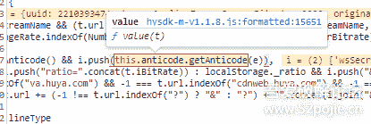](https://www.52pojie.cn/forum.php?mod=attachment&aid=MjUwMjUyM3w4YWQ3YTAxNnwxNzkzNTc2MDI0fDE2ODA4NnwxNjAyODc4&nothumb=yes)

2022-3-14 15:43 上传

发现这里对参数进行了重新组合并加了一些参数，那就进去看看。

这里面可以拿到`uid`、`seqid`：

[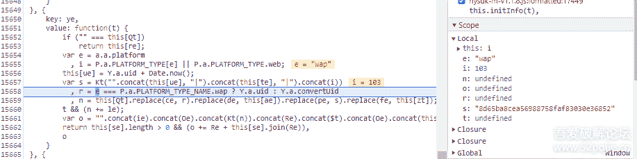](https://www.52pojie.cn/forum.php?mod=attachment&aid=MjUwMjUyNnxiMWViZDA1ZHwxNzkzNTc2MDI0fDE2ODA4NnwxNjAyODc4&nothumb=yes)

2022-3-14 15:47 上传

`Kt`函数拿到`s`，加密的内容直接在`console`里运行一下：

[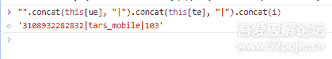](https://www.52pojie.cn/forum.php?mod=attachment&aid=MjUwMjUzNXw4OWRjYzBmZXwxNzkzNTc2MDI0fDE2ODA4NnwxNjAyODc4&nothumb=yes)

2022-3-14 15:50 上传

这里的`this[ue] = uid + 时间戳`；反复调试发现`uid`这边浏览器固定`1461688433250`。

这里的`s`是`Kt`函数算出来的，分析到`s`是 32 位字串符，所以大胆尝试了一下进行 MD5 加密，惊奇的发现居然加密出来的结果一致。

```
s = 8d65ba8cea56988758faf83030e36852
r = uid = 1461688433250
n = this[Qt].replace(ce, r).replace(de, this[ae]).replace(pe, s).replace(fe, this[zt]);
```

调试发现`Qt = _fm`，这不就是之前解码的参数`fm`吗？

对`fm`值进行`base64`解码得到`DWq8BcJ3h6DJt6TY_$0_$1_$2_$3`。

最后将`$0 $1 $2 $3`替换成`r`、`this[ae]`、`s`、`this[zt]`：

[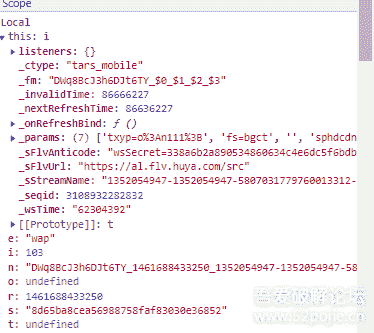](https://www.52pojie.cn/forum.php?mod=attachment&aid=MjUwMjU1MHw1MjdjNThmYXwxNzkzNTc2MDI0fDE2ODA4NnwxNjAyODc4&nothumb=yes)

2022-3-14 16:03 上传

最后就是拼接参数：

```
var o = "".concat(ie).concat(Oe).concat(Kt(n)).concat(Re).concat($t).concat(Oe).concat(this[zt]).concat(Re).concat(he).concat(Oe).concat(this[ue]).concat(Re).concat(ee).concat(Oe).concat(this[te]).concat(Re).concat(Le);
```

里面又对`n`进行了 MD5 加密：

```
$o = "wsSecret=$wsSecret&wsTime=$_wsTime&seqid=$_seqid&ctype=$_ctype&ver=1";
```

最后又拼接上了其余剩余参数：

[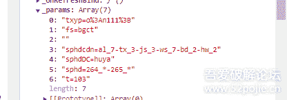](https://www.52pojie.cn/forum.php?mod=attachment&aid=MjUwMjU1NnxhMTg0OTY5ZnwxNzkzNTc2MDI0fDE2ODA4NnwxNjAyODc4&nothumb=yes)

2022-3-14 16:10 上传

至此`i`已经处理出来了。

然后拼接上`&uid=1461688433250&uuid=2210393474&t=103&sv=2110211124`，发现`uuid`是动态的，再搜索一下`uuid`的生成：

```
this.uuid = Number((Date.now() % 1e10 * 1e3 + (1e3 * Math.random() | 0)) % 4294967295))
```

## 最终地址与测试

最后修改域名为`al.flv.huya.com`，`m3u8`修改为`.flv`：

[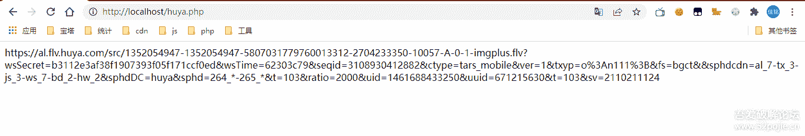](https://www.52pojie.cn/forum.php?mod=attachment&aid=MjUwMjU2MnwxNjgzYmUyNnwxNzkzNTc2MDI0fDE2ODA4NnwxNjAyODc4&nothumb=yes)

2022-3-14 16:19 上传

[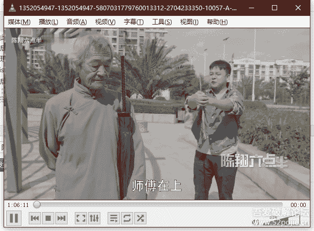](https://www.52pojie.cn/forum.php?mod=attachment&aid=MjUwMjU2M3w2MDVjYjliMHwxNzkzNTc2MDI0fDE2ODA4NnwxNjAyODc4&nothumb=yes)

2022-3-14 16:19 上传

测试播放 1 小时正常。至此本贴结束，说的有点模糊，希望可以动手试试。

源码下载：

[](https://www.52pojie.cn/forum.php?mod=attachment&aid=MjUwMjU2OHw4YWNmNjU5Y3wxNzkzNTc2MDI0fDE2ODA4NnwxNjAyODc4)

(1.66 KB, 下载次数: 624)

2022-3-14 16:21 上传

点击文件名下载附件

下载积分: 吾爱币 -1 CB
