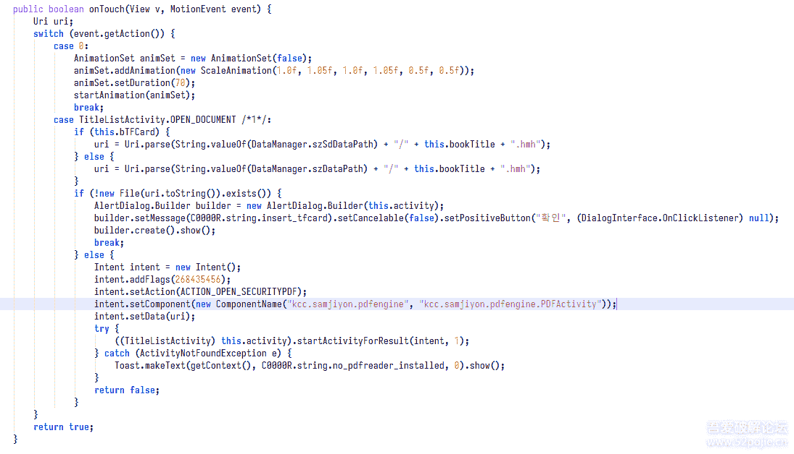
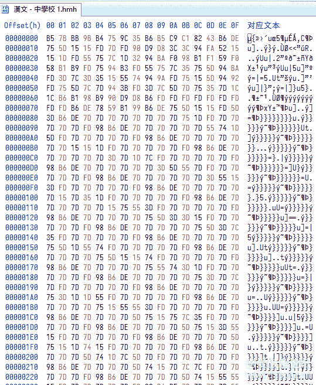
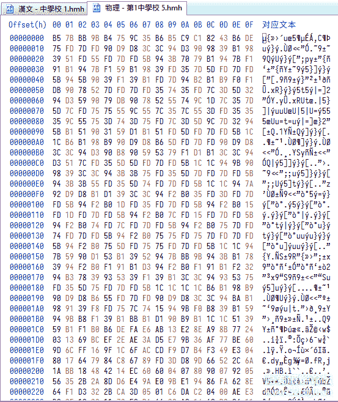
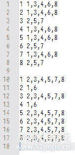
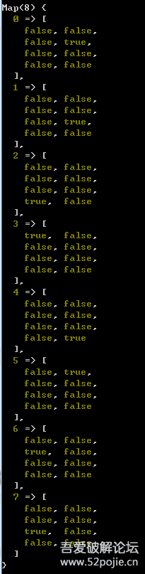
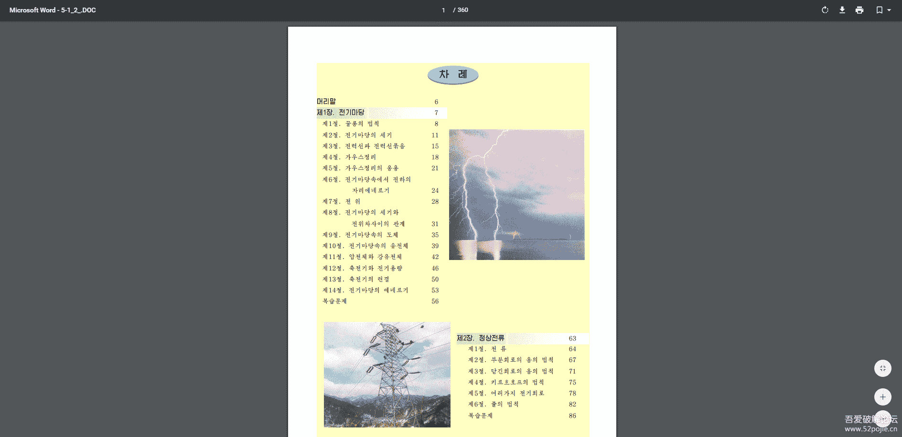

# [原创] 某课本阅读器内课本档案解密

- 原帖: https://www.52pojie.cn/forum.php?mod=viewthread&tid=1603067
- 抓取时间: 2026-11-01T23:33:44

虽说破译加密方式的工作是本人在 2021 年 12 月 20 日完成的，但因昨日开放注册时才注册账号，所以今日姑且在本坛炒炒冷饭。

这个阅读器本身是从某 `Android` 平板提取出来的，自然会因调用非通用的组件而无法在其它设备正常使用。而我并没有持有该平板，这样就无法调试实机来得知加密方法。

但也不能轻易放弃，总还是要反编译看看的。

课本档案本身的副档名是 `hmh`，那么就搜一下提到 `hmh` 的代码。


`0.png` (56.79 KB, 下载次数: 1)
[href="forum.php?mod=attachment&aid=MjUwMjcwMnwwOWU3MDk0NHwxNzkzNTc2MDIxfDE2ODA4NnwxNjAzMDY3&nothumb=yes" target="_blank"](https://www.52pojie.cn/forum.php?mod=attachment&aid=MjUwMjcwMnwwOWU3MDk0NHwxNzkzNTc2MDIxfDE2ODA4NnwxNjAzMDY3&nothumb=yes)
2022-3-14 18:38 上传

……很遗憾，并没有看到加密代码，似乎调用的是系统组件。但也没关系，至少知道是 `PDF` 了。

现在就只能观察加密后的档案了。


`1.png` (82.72 KB, 下载次数: 2)
[href="forum.php?mod=attachment&aid=MjUwMjcwNXwxMzQ2ZDg1N3wxNzkzNTc2MDIxfDE2ODA4NnwxNjAzMDY3&nothumb=yes" target="_blank"](https://www.52pojie.cn/forum.php?mod=attachment&aid=MjUwMjcwNXwxMzQ2ZDg1N3wxNzkzNTc2MDIxfDE2ODA4NnwxNjAzMDY3&nothumb=yes)
2022-3-14 18:46 上传

扑面而来的大量 `7D` 似乎表明很可能是逐位元组使用相同的方法加密。运气不错。


`2.png` (100.2 KB, 下载次数: 1)
[href="forum.php?mod=attachment&aid=MjUwMjcwN3w1ZjRjNjViNnwxNzkzNTc2MDIxfDE2ODA4NnwxNjAzMDY3&nothumb=yes" target="_blank"](https://www.52pojie.cn/forum.php?mod=attachment&aid=MjUwMjcwN3w1ZjRjNjViNnwxNzkzNTc2MDIxfDE2ODA4NnwxNjAzMDY3&nothumb=yes)
2022-3-14 18:48 上传

另一个档案就显得没那么整齐了，但是开头是一样的。也许不会随档案变化。

考虑到 `PDF` 的魔数是「%PDF-[版本号]」，盲猜 B5 7B BB 9B B4 75 9C 是 25 50 44 46 2D 31 2E（%PDF-1.）。

25 50 44 46 2D 31 2E

B5 7B BB 9B B4 75 9C

看一下二进制形式。

00100101 01010000 01000100 01000110 00101101 00110001 00101110

10110101 01111011 10111011 10011011 10110100 01110101 10011100

看不出甚么关联，至少不是反位。

不过，原文有 35 个 0、21 个 1，而密文有 21 个 0、35 个 1。进一步发现每个位元组内部也有这样的规律，恐怕是反位后打乱了顺序罢。

11011010 10101111 10111011 10111001 11010010 11001110 11010001

10110101 01111011 10111011 10011011 10110100 01110101 10011100

得到这个之后，就有位群友猜出顺序是 `46718235` 了。如果观察力（或运气）不是那么强，倒可以用一种比较笨的方法：


`3.png` (12.8 KB, 下载次数: 3)
[href="forum.php?mod=attachment&aid=MjUwMjczNnw1ZmM4ZDYzYnwxNzkzNTc2MDIxfDE2ODA4NnwxNjAzMDY3&nothumb=yes" target="_blank"](https://www.52pojie.cn/forum.php?mod=attachment&aid=MjUwMjczNnw1ZmM4ZDYzYnwxNzkzNTc2MDIxfDE2ODA4NnwxNjAzMDY3&nothumb=yes)
2022-3-14 19:08 上传

（少女列表中……）

「列出可能的位置然后取交集就好了呢，是不是很简单呢？」

……还是别人工列了，交给机器算了。

[JavaScript] 纯文本查看 复制代码
```
'use strict';

const samples = [['00100101', '10110101'], ['01010000', '01111011'], ['01000100', '10111011'], ['01000110', '10011011'], ['00101101', '10110100'], ['00110001', '01110101'], ['00101110', '10011100']];
let map = new Map();
 
let offset = 0;
while (offset 
```


`4.png` (14.49 KB, 下载次数: 0)
[href="forum.php?mod=attachment&aid=MjUwMjc3N3wyZjI3MmExYXwxNzkzNTc2MDIxfDE2ODA4NnwxNjAzMDY3&nothumb=yes" target="_blank"](https://www.52pojie.cn/forum.php?mod=attachment&aid=MjUwMjc3N3wyZjI3MmExYXwxNzkzNTc2MDIxfDE2ODA4NnwxNjAzMDY3&nothumb=yes)
2022-3-14 19:37 上传

这样一看，仅凭藉开头七个位元组还真的足以确定是 `46718235`。而且考虑到该置换的逆置换为其本身，以及反位与置换交换复合顺序不改变结果的事实，加密算法即解密算法本身。

[JavaScript] 纯文本查看 复制代码
```
'use strict';

const fs = require('fs');

const byt = [255, 247, 223, 215, 191, 183, 159, 151, 254, 246, 222, 214, 190, 182, 158, 150, 127, 119, 95, 87, 63, 55, 31, 23, 126, 118, 94, 86, 62, 54, 30, 22, 253, 245, 221, 213, 189, 181, 157, 149, 252, 244, 220, 212, 188, 180, 156, 148, 125, 117, 93, 85, 61, 53, 29, 21, 124, 116, 92, 84, 60, 52, 28, 20, 251, 243, 219, 211, 187, 179, 155, 147, 250, 242, 218, 210, 186, 178, 154, 146, 123, 115, 91, 83, 59, 51, 27, 19, 122, 114, 90, 82, 58, 50, 26, 18, 249, 241, 217, 209, 185, 177, 153, 145, 248, 240, 216, 208, 184, 176, 152, 144, 121, 113, 89, 81, 57, 49, 25, 17, 120, 112, 88, 80, 56, 48, 24, 16, 239, 231, 207, 199, 175, 167, 143, 135, 238, 230, 206, 198, 174, 166, 142, 134, 111, 103, 79, 71, 47, 39, 15, 7, 110, 102, 78, 70, 46, 38, 14, 6, 237, 229, 205, 197, 173, 165, 141, 133, 236, 228, 204, 196, 172, 164, 140, 132, 109, 101, 77, 69, 45, 37, 13, 5, 108, 100, 76, 68, 44, 36, 12, 4, 235, 227, 203, 195, 171, 163, 139, 131, 234, 226, 202, 194, 170, 162, 138, 130, 107, 99, 75, 67, 43, 35, 11, 3, 106, 98, 74, 66, 42, 34, 10, 2, 233, 225, 201, 193, 169, 161, 137, 129, 232, 224, 200, 192, 168, 160, 136, 128, 105, 97, 73, 65, 41, 33, 9, 1, 104, 96, 72, 64, 40, 32, 8, 0];

let files = ['物理 - 第1中學校 5'];

for (let file of files) {

    let buf = fs.readFileSync(`${file}.hmh`);

    let offset = 0;

    while (offset 
```


`114514.png` (427.02 KB, 下载次数: 1)
[href="forum.php?mod=attachment&aid=MjUwMjc4NXxjMzEwNjQ0ZHwxNzkzNTc2MDIxfDE2ODA4NnwxNjAzMDY3&nothumb=yes" target="_blank"](https://www.52pojie.cn/forum.php?mod=attachment&aid=MjUwMjc4NXxjMzEwNjQ0ZHwxNzkzNTc2MDIxfDE2ODA4NnwxNjAzMDY3&nothumb=yes)
2022-3-14 19:50 上传

It works well.

只是这课本居然是用 `Word` 排的，真是太不可思议了（
