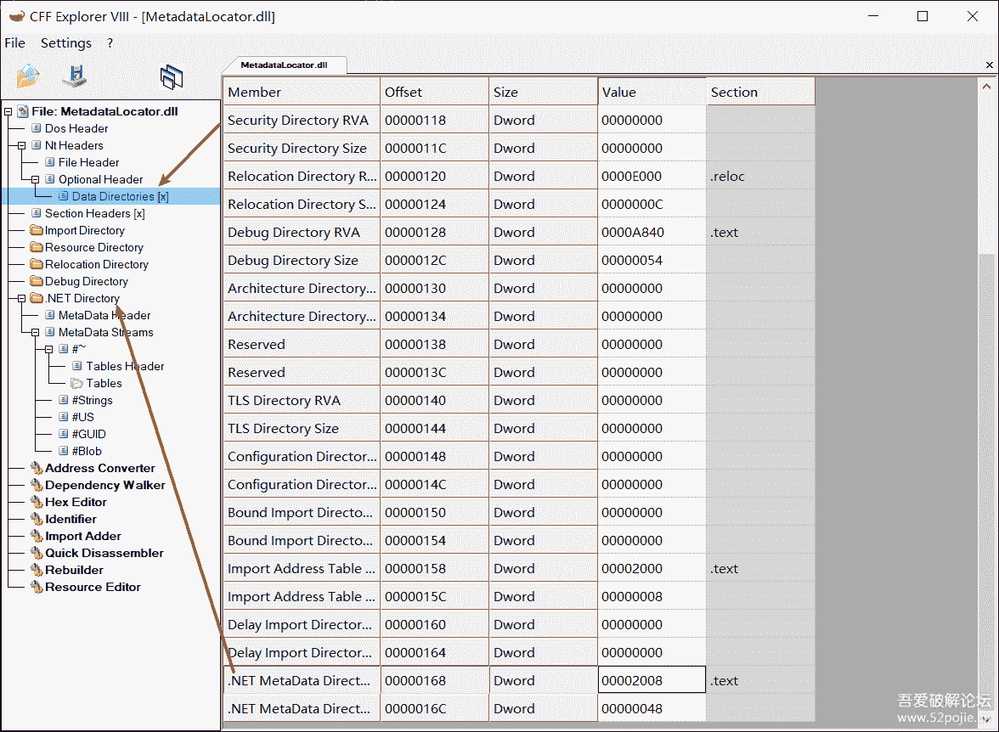
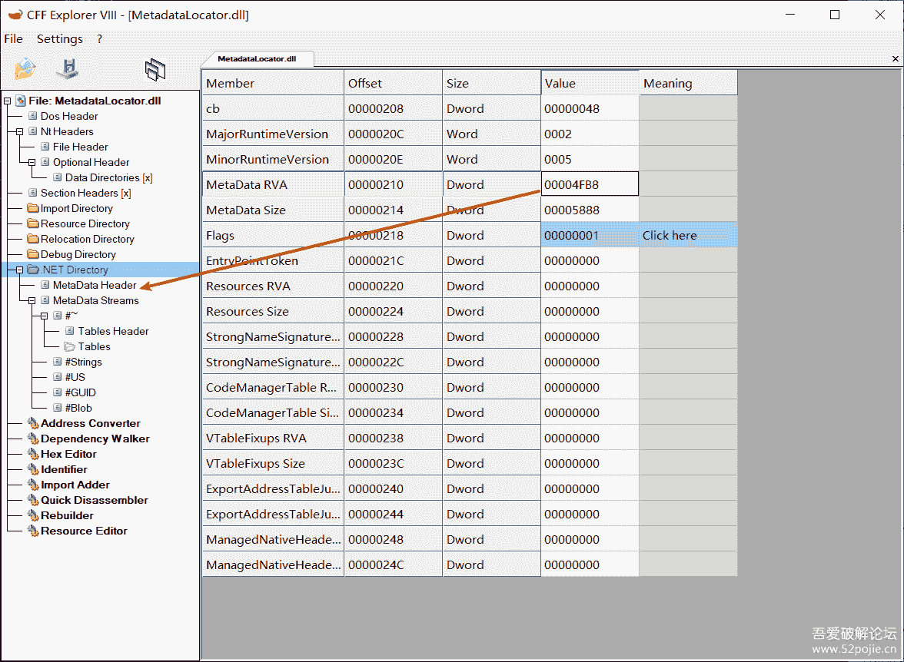
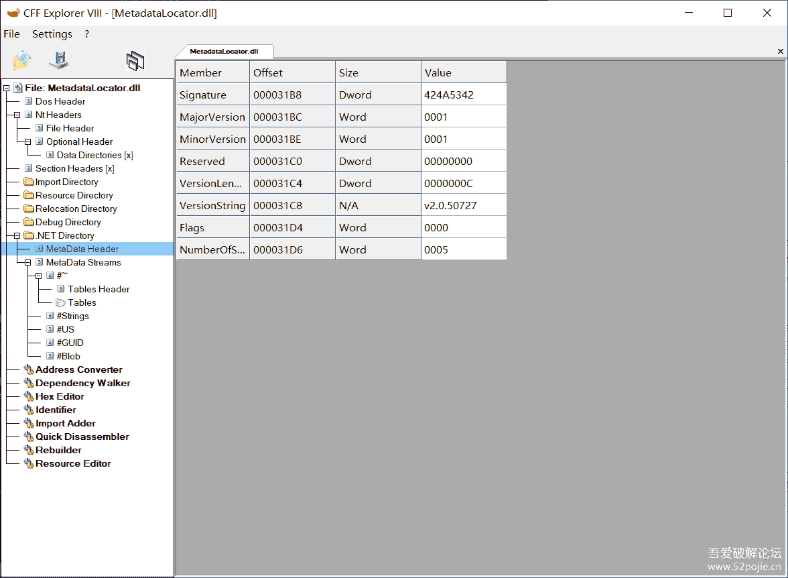
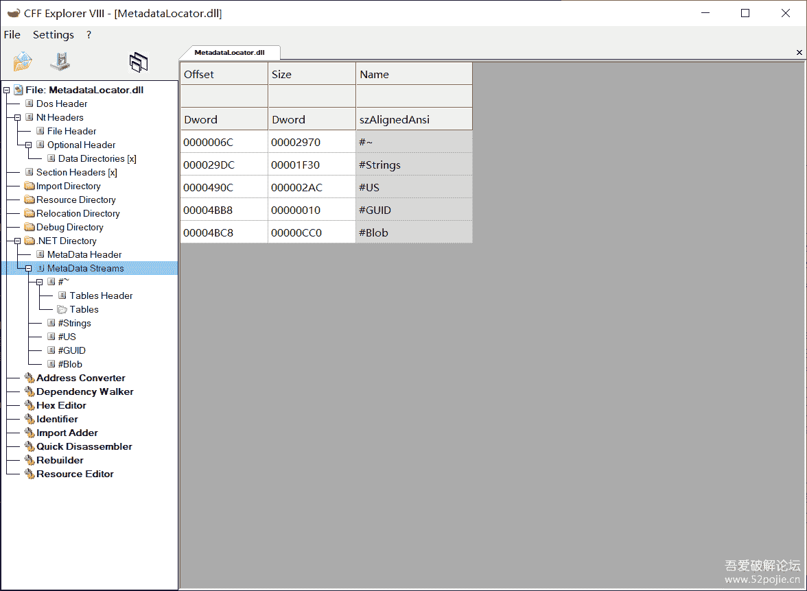
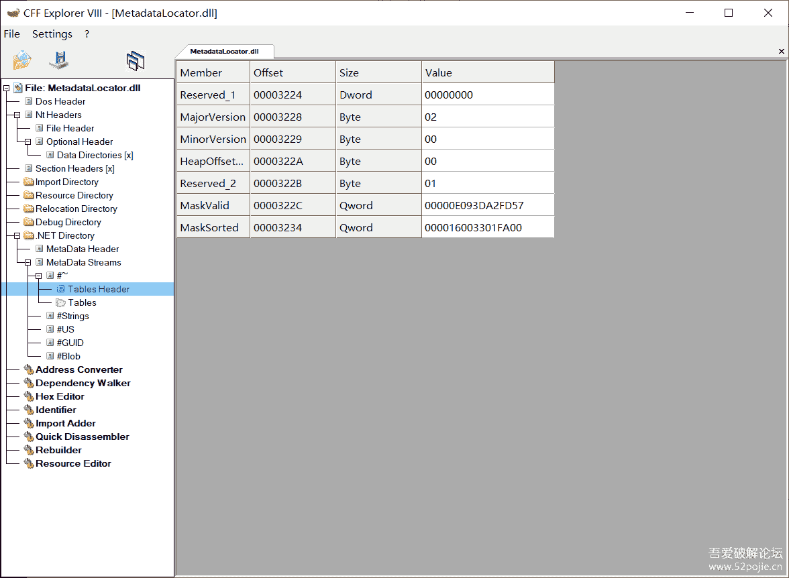

# [.NET逆向] .NET下绕过任意反Dump的方法

- 原帖: https://www.52pojie.cn/forum.php?mod=viewthread&tid=1604458
- 抓取时间: 2026-11-01T23:33:39

## .NET下绕过任意反Dump的方法

### 前言

.NET下的反Dump手段比较单一，无非是在运行后对PE头中的.NET部分进行抹除。由于`CLR`在加载程序集时已经保存了所有.NET元数据的偏移和大小，抹除这部分.NET头对程序的运行没有任何影响。但是如果我们直接Dump内存中的程序集，由于.NET头已经被抹除，Dump得到的文件是无法被`dnSpy`、`ILSpy`等工具读取的。利用`CLR`的内部对象，我们可以从中读取.NET的元数据信息，从而计算恢复出PE头中的.NET部分。本文将介绍如何通过这个办法，达到绕过任意反Dump技术的目的。

在本文开始前，必须要明确的一点是，绕过反Dump不意味着可以直接Dump下来可以运行和使用的文件！绕过反Dump的目的是恢复出必要的信息让`dnSpy`、`ILSpy`等工具可以直接反编译，从而快速分析这个.NET程序集，而不是恢复出和原始的一摸一摸的没有信息丢失的.NET头！如果想要脱壳，并不能依赖于这个方法！

文中`CLR`源码来自`CoreCLR v1.0`

### 恢复.NET头的思路

在前言中已经大致介绍，通过读取`CLR`内部对象，可以获取必要的信息来恢复.NET头。所以我们需要先了解PE头中的.NET部分和反Dump可以抹除的部分。

首先是`Data Directories`中的.NET元数据目录。这一项记录了.NET目录（`IMAGE_COR20_HEADER`）的偏移和大小。一般来说偏移是`0x2008`，也就是`.text`段的第8个字节，这是由`C#`和`VB.NET`编译器决定的。大小是`sizeof(IMAGE_COR20_HEADER)`，也就是固定的`0x48`。



1.png (119.93 KB, 下载次数: 271)

[href="forum.php?mod=attachment&aid=MjUwMzcyOHxlZDBlNmI1M3wxNzkzNTc2MDE3fDE2ODA4NnwxNjA0NDU4&nothumb=yes" target="_blank"](https://www.52pojie.cn/forum.php?mod=attachment&aid=MjUwMzcyOHxlZDBlNmI1M3wxNzkzNTc2MDE3fDE2ODA4NnwxNjA0NDU4&nothumb=yes)

2022-3-16 14:58 上传

`CFF Explorer`中的.NET Directory就是`IMAGE_COR20_HEADER`。



2.png (110.1 KB, 下载次数: 258)

[href="forum.php?mod=attachment&aid=MjUwMzcyOXxlYTBkZTc0M3wxNzkzNTc2MDE3fDE2ODA4NnwxNjA0NDU4&nothumb=yes" target="_blank"](https://www.52pojie.cn/forum.php?mod=attachment&aid=MjUwMzcyOXxlYTBkZTc0M3wxNzkzNTc2MDE3fDE2ODA4NnwxNjA0NDU4&nothumb=yes)

2022-3-16 14:58 上传

通过上一步的解析，我们可以得到`IMAGE_COR20_HEADER`的所在位置。其中`IMAGE_COR20_HEADER`的定义如下，重要的部分我给了注释。

```
typedef struct IMAGE_COR20_HEADER
{
    DWORD                   cb;                  // sizeof(IMAGE_COR20_HEADER)
    WORD                    MajorRuntimeVersion;
    WORD                    MinorRuntimeVersion;
    IMAGE_DATA_DIRECTORY    MetaData;            // .NET元数据
    DWORD                   Flags;               // 标志位，指示程序集类型，比如是否可执行，是否纯IL
    union {
        DWORD               EntryPointToken;     // Main方法的MDToken
        DWORD               EntryPointRVA;       // 入口点的RVA（如果入口是本机代码）
    } DUMMYUNIONNAME;
    IMAGE_DATA_DIRECTORY    Resources;           // .NET资源
    IMAGE_DATA_DIRECTORY    StrongNameSignature; // .NET强名称
    IMAGE_DATA_DIRECTORY    CodeManagerTable;
    IMAGE_DATA_DIRECTORY    VTableFixups;
    IMAGE_DATA_DIRECTORY    ExportAddressTableJumps;
    IMAGE_DATA_DIRECTORY    ManagedNativeHeader;
} IMAGE_COR20_HEADER, *PIMAGE_COR20_HEADER;
```

此结构中的大部分是可以被清除的（我知道的不能清除的有`Resources`，因为每次获取资源都要重新读取`IMAGE_COR20_HEADER::Resources`），但是必要的部分其实只有`MetaData`这个成员，其它部分如.NET资源只是作为附加项。为了让反编译器可以尽可能显示全部信息，我们恢复`MetaData`，`EntryPointToken`这三个成员即可。

`EntryPointToken`和`Resources`的恢复比较简单，只要恢复`IMAGE_COR20_HEADER`中的成员。而`MetaData`比较复杂，需要恢复`MetaData`指向的.NET元数据头。.NET元数据头的第一个结构是`STORAGESIGNATURE`，紧接着的是`STORAGEHEADER`，然后跟着`STORAGESTREAM`数组。这里给出它们在`CFF Explorer`中的显示和在`CLR`中的定义。

`CFF Explorer`中的`MetaData Header`就是`STORAGESIGNATURE + STORAGEHEADER`，`MetaData Streams`就是紧跟的`STORAGESTREAM`数组。



3.png (77.57 KB, 下载次数: 255)

[href="forum.php?mod=attachment&aid=MjUwMzczMHxmMzUyYWFmMXwxNzkzNTc2MDE3fDE2ODA4NnwxNjA0NDU4&nothumb=yes" target="_blank"](https://www.52pojie.cn/forum.php?mod=attachment&aid=MjUwMzczMHxmMzUyYWFmMXwxNzkzNTc2MDE3fDE2ODA4NnwxNjA0NDU4&nothumb=yes)

2022-3-16 14:59 上传



4.png (68.7 KB, 下载次数: 267)

[href="forum.php?mod=attachment&aid=MjUwMzczMXw4ZjYxZTU1ZXwxNzkzNTc2MDE3fDE2ODA4NnwxNjA0NDU4&nothumb=yes" target="_blank"](https://www.52pojie.cn/forum.php?mod=attachment&aid=MjUwMzczMXw4ZjYxZTU1ZXwxNzkzNTc2MDE3fDE2ODA4NnwxNjA0NDU4&nothumb=yes)

2022-3-16 14:59 上传

```
struct STORAGESIGNATURE
{
    ULONG       lSignature;             // "Magic" signature.
    USHORT      iMajorVer;              // Major file version.
    USHORT      iMinorVer;              // Minor file version.
    ULONG       iExtraData;             // Offset to next structure of information 
    ULONG       iVersionString;         // Length of version string
    BYTE        pVersion[0];            // Version string
};
struct STORAGEHEADER
{
    BYTE        fFlags;                 // STGHDR_xxx flags.
    BYTE        pad;
    USHORT      iStreams;               // How many streams are there.
};
struct STORAGESTREAM
{
    ULONG       iOffset;                // Offset in file for this stream.
    ULONG       iSize;                  // Size of the file.
    char        rcName[MAXSTREAMNAME];  // Start of name, null terminated.
};
```

`STORAGESIGNATURE`中的`iVersionString`成员表示`pVersion`的真实长度，也就是说`STORAGESIGNATURE`结构体的实际大小是`sizeof(STORAGESIGNATURE) + iVersionString`。`STORAGEHEADER`的`iStreams`成员表示`STORAGESTREAM`数组的元素数量。一般来说`iStreams`为5，5个`STORAGESTREAM`结构分别对应了`#~`、`#Strings`、`#US`、`#GUID`、`#Blob`这5个元数据流。

在反Dump中，`STORAGESIGNATURE`的`lSignature`的成员是一定会被抹除的，它和PE头的`"MZ"`类似，值恒为`0x424A5342`，也就是`"BSJB"`。如果不抹除这个成员，通过搜索特征`BSJB`可以非常容易地定位到.NET元数据头从而绕过反Dump。和上面提到的结构`IMAGE_COR20_HEADER`一样，这三个结构的所有成员也都是可以抹除的。恢复的时候，我们主要关注`STORAGESTREAM`这个结构中的所有三个成员，保存了指向.NET元数据流的信息，和这些元数据流对应的名称。其它两个结构体相对而言没那么重要，可以直接填预设值。

在上面提到的5个元数据流`#~`、`#Strings`、`#US`、`#GUID`、`#Blob`中，`#~`是表流，必须存在的。如果表流是未压缩的，它的名称也可以是`#-`，元数据结构上和`#~`是一致的。表流的头部是`CMiniMdSchemaBase`结构，这里给出它在`CFF Explorer`中的显示和在`CLR`中的定义。



5.png (75.26 KB, 下载次数: 254)

[href="forum.php?mod=attachment&aid=MjUwMzczMnw3MmQzY2ZiNHwxNzkzNTc2MDE3fDE2ODA4NnwxNjA0NDU4&nothumb=yes" target="_blank"](https://www.52pojie.cn/forum.php?mod=attachment&aid=MjUwMzczMnw3MmQzY2ZiNHwxNzkzNTc2MDE3fDE2ODA4NnwxNjA0NDU4&nothumb=yes)

2022-3-16 14:59 上传

```
class CMiniMdSchemaBase
{
    ULONG       m_ulReserved;           // Reserved, must be zero.
    BYTE        m_major;                // Version numbers.
    BYTE        m_minor;
    BYTE        m_heaps;                // Bits for heap sizes.
    BYTE        m_rid;                  // log-base-2 of largest rid.
    unsigned __int64    m_maskvalid;    // Bit mask of present table counts.
    unsigned __int64    m_sorted;       // Bit mask of sorted tables.
};
```

在`CMiniMdSchemaBase`结构后面，紧跟着一个`UINT32`数组，数组长度是`m_maskvalid`成员bit为1的数量。这个数组的元素按顺序表示了每个存在的表的行数。

`CLR`加载.NET程序集时，这些成员都会被保存到`CLR`内部，所以这些成员也都是可以抹除的。恢复时，我们主要关注哪些表是存在的，并且它们的行数分别是多少。通过这些数据我们可以恢复出`m_maskvalid`成员和行数数组。

### 关键的CLR内部对象

有了恢复.NET头的思路，我们可以开始了解`CLR`内部对象了，通过它们来恢复.NET头。这部分内容将展开介绍关键的`CLR`内部对象作为铺垫。这些`CLR`内部对象我会省略掉很多无关的部分，而且不同版本`CLR`的定义也略有区别，所以列出的成员在结构体中的偏移是不一定的。关于具体如何使用，将会在下一部分详细说明。

#### Module

`Module`类对应`mscorlib`里`System.Reflection.RuntimeModule`类的本机对象布局，定义在`ceeload.h`里。

```
class Module
{
    PTR_CUTF8               m_pSimpleName;
    PTR_PEFile              m_file;
    MethodDesc              *m_pDllMain;
    Volatile          m_dwTransientFlags;
    Volatile          m_dwPersistedFlags;
    VASigCookieBlock        *m_pVASigCookieBlock;
    PTR_Assembly            m_pAssembly;
    mdFile                  m_moduleRef;
};
```

- `m_pSimpleName`是模块名，值等于`C#`代码的`assembly.Module.Assembly.GetName().Name`，在`.NET Framework 4.5.3`之前不存在这个成员。
- `m_file`是指向`PEFile`结构的指针，可以用来获取模块基址和大小等信息，非常重要。
- `m_pDllMain`是指向`DllMain`方法的指针，仅对`C++/CLI`生成的程序集有效。
- `m_pAssembly`是指向`Assembly`结构的指针，这里不需要使用它。

#### PEFile

`PEFile`类`CLR`加载器的输入，表示一个抽象的`PE`文件。它的子类是`PEAssembly`和`PEModule`。如果被加载为程序集，那就创建`PEAssembly`，如果用`Assembly.LoadModule`方法加载为模块，那么就创建`PEModule`。在`.NET Core`里面，多模块程序集特性被移除了。所以`.NET Core`里面只有`PEAssembly`，没有`PEModule`了。

`PEFile`有多种加载方式：

- `HMODULE` - `PEFile`是在响应“自发的”系统回调时加载的。只有通过`LoadLibrary`加载`exe`主模块和`IJW dll`，或非托管代码中存在静态导入才会出现这种情况。
- `Fusion loads` - 这是最常见的情况。从`Fusion`中获得路径，并通过`PEImage`加载`PEFile`。
- `Display name loads` - 这些是基于元数据的绑定。
- `Path loads` - 从完整的绝对路径加载
- `Byte arrays` - 由用户代码显式加载。这也是通过`PEImage`加载的。
- `Dynamic` - 此时`PEFile`不是实际的`PE`映像，而是基于反射的模块的占位符。


## `PEFile`

```
class PEFile
{
    PTR_PEImage              m_identity;
    PTR_PEImage              m_openedILimage;
    PTR_PEImage              m_nativeImage;
    BOOL                     m_fCanUseNativeImage;
    BOOL                     m_MDImportIsRW_Debugger_Use_Only;
    Volatile           m_bHasPersistentMDImport;
    IMDInternalImport       *m_pMDImport;
    IMetaDataImport2        *m_pImporter;
    IMetaDataEmit           *m_pEmitter;
};
```
- `m_identity`是作为标识符的指向`PEImage`结构的指针。一般情况下不用这个成员，而是使用`m_openedILimage`。在`PEFile::GetILimage`函数里，如果`m_openedILimage`为空，`m_identity`的值会赋给`m_openedILimage`。
- `m_openedILimage`是作为提供元数据的指向`PEImage`结构的指针。我们恢复`.NET`头会使用这个成员获取信息。
- `m_nativeImage`是用于NGEN等情况的指向`PEImage`结构的指针。比如`mscorlib.ni.dll`这种NGEN创建的预编译的模块，就会加载并保存到`m_nativeImage`成员。
- `m_pMDImport`是指向`IMDInternalImport`接口的指针，我们可以用这个接口读取一些元数据信息。
`PEFile`的子类`PEAssembly`和`PEModule`我们不需要过于关心，里面没有什么可用的信息。通过观察`PEFile`的成员，我们可以大概认为`PEFile`是对`PEImage`的包装，封装了各种情况下`.NET`程序集加载的结果。`CLR`只需要使用抽象的`IMDInternalImport`接口来获取元数据即可，不需要关心PE映像的具体细节。

## `PEImage`

`PEImage`是由`CLR`的“模拟`LoadLibrary`”机制加载的PE文件。`PEImage`可以加载为`FLAT`（与磁盘上的文件布局相同）或`MAPPED`（PE区段映射到虚拟地址）。

```
class PEImage

{

    SString     m_path;

    LONG        m_refCount;

    SString     m_sModuleFileNameHintUsedByDac;

    BOOL        m_bIsTrustedNativeImage;

    BOOL        m_bIsNativeImageInstall;

    BOOL        m_bPassiveDomainOnly;

    SimpleRWLock *m_pLayoutLock;

    PTR_PEImageLayout m_pLayouts[IMAGE_COUNT];

    BOOL      m_bInHashMap;

    IMDInternalImport* m_pMDImport;

    IMDInternalImport* m_pNativeMDImport;

};
```
- `m_path`是PE映像的路径。如果`PEImage`是通过文件加载的，那么`m_path`就是这个文件的路径。如果`PEImage`是通过内存加载的，也就是使用了`Assembly.Load(byte[])`等方法加载，那么`m_path`就是空。
- `m_pLayouts`保存了`PEImageLayout`指针的数组。`PEImageLayout`提供了具体的PE映像的布局信息，包括模块基址和模块大小。所以`m_pLayouts`是一个很重要的成员。
- `m_pMDImport`是指向`IMDInternalImport`接口的指针，我们可以用这个接口读取一些元数据信息。这个成员和`PEFile`的`m_pMDImport`可以认为是一样的。

## `PEImageLayout`

`PEImageLayout`是指具体的PE映像布局，有`MappedImageLayout`、`LoadedImageLayout`、`FlatImageLayout`等子类。子类的成员不需要关心，重要的部分都在基类`PEImageLayout`中。

```
class PEDecoder
{
    TADDR               m_base;
    COUNT_T             m_size;
    ULONG               m_flags;
    PTR_IMAGE_NT_HEADERS   m_pNTHeaders;
    PTR_IMAGE_COR20_HEADER m_pCorHeader;
    PTR_CORCOMPILE_HEADER  m_pNativeHeader;
    PTR_READYTORUN_HEADER  m_pReadyToRunHeader;
};

class PEImageLayout : public PEDecoder
{
    Volatile m_refCount;
    PEImage* m_pOwner;
    DWORD m_Layout;
};
```
- `m_base`是模块基址。
- `m_size`是模块大小。
- `m_pCorHeader`是指向`IMAGE_COR20_HEADER`结构的指针。被反Dump保护抹除的偏移就可以使用这个成员恢复。
- `m_Layout`表示当前布局是什么类型，比如`FLAT`、`MAPPED`、`LOADED`。

## `MDInternalRO` && `MDInternalRW`

这两个类是`CLR`内部元数据接口`IMDInternalImport`的实现类。获取了`IMDInternalImport`接口的指针意味着拿到了这两个类的实例。通过这两个类，我们可以获取关于元数据表流和堆流的所有信息。

```
class MDInternalRO : public IMDInternalImport, IMDCommon

{

    CLiteWeightStgdb   m_LiteWeightStgdb;

    CMethodSemanticsMap *m_pMethodSemanticsMap; // Possible array of method semantics pointers, ordered by method token.

    mdTypeDef           m_tdModule;         //  typedef value.

    LONG                m_cRefs;            // Ref count.

};
```
- `m_LiteWeightStgdb`是保存了元数据信息的成员，通过它可以读取元数据信息从而恢复`.NET`头。

```
class MDInternalRW : public IMDInternalImportENC, public IMDCommon
{
    CLiteWeightStgdbRW  *m_pStgdb;
    mdTypeDef           m_tdModule;         //  typedef value.
    LONG                m_cRefs;            // Ref count.
    bool                m_fOwnStgdb;
    IUnknown            *m_pUnk;
    IUnknown            *m_pUserUnk;        // Release at shutdown.
    IMetaDataHelper     *m_pIMetaDataHelper;// pointer to cached public interface
    UTSemReadWrite      *m_pSemReadWrite;   // read write lock for multi-threading.
    bool                m_fOwnSem;          // Does MDInternalRW own this read write lock object?
};
```
- `m_pStgdb`和上面的`MDInternalRO::m_LiteWeightStgdb`一样，是保存了元数据信息的成员，通过它可以读取元数据信息从而恢复`.NET`头。

## `CLiteWeightStgdb` && `CLiteWeightStgdbRW`

这两个是对`CMiniMd`和`CMiniMdRW`的包装。`CLiteWeightStgdbRW`这个类不是非常重要，没有恢复`.NET`头需要的信息。实际上我们只需要`CLiteWeightStgdb`这个类。它们的定义如下。

```
template 

class CLiteWeightStgdb

{

    MiniMd      m_MiniMd;               // embedded compress meta data schemas definition

    const void  *m_pvMd;                // Pointer to meta data.

    ULONG       m_cbMd;                 // Size of the meta data.

}
class CLiteWeightStgdbRW : public CLiteWeightStgdb

{

    UINT32      m_cbSaveSize;               // Size of the saved streams.

    int         m_bSaveCompressed;          // If true, save as compressed stream (#-, not #~)

    VOID*       m_pImage;                   // Set in OpenForRead, NULL for anything but PE files

    DWORD       m_dwImageSize;              // On-disk size of image

    DWORD       m_dwPEKind;                 // The kind of PE - 0: not a PE.

    DWORD       m_dwMachine;                // Machine as defined in NT header.

    STORAGESTREAMLST *m_pStreamList;

    CLiteWeightStgdbRW *m_pNextStgdb;

    FILETYPE m_eFileType;

    WCHAR *  m_wszFileName;     // Database file name (NULL or non-empty string)

    DWORD    m_dwDatabaseLFT;   // Low bytes of the database file's last write time

    DWORD    m_dwDatabaseLFS;   // Low bytes of the database file's size

    StgIO *  m_pStgIO;          // For file i/o.

}
```
- `m_MiniMd`是`CMiniMd`和`CMiniMdRW`，下一小节会提到这两个类。
- `m_pvMd`是指向元数据的指针，对应`CFF Explorer`中`.NET Directory`的`MetaData RVA`。
- `m_cbMd`是元数据的大小，对应`CFF Explorer`中`.NET Directory`的`MetaData Size`。值得注意的一点是对于`CMiniMdRW`，也就是未压缩的表流，`m_cbMd`是无效的，我们需要自己计算元数据总大小。

## `CMiniMd` & `CMiniMdRW`

`CMiniMd`是`CLR`内部的元数据`Provider`实现，与其类似的还有一个`CMiniMdRW`。两者不同之处是，`CMiniMd`是用于`#~`这种已压缩的表流，而`CMiniMdRW`是用于`#-`这种未压缩的表流。
从结构上来说它们有一个共同的基类`CMiniMdBase`。

```
class CMiniMdBase
{
    CMiniMdSchema   m_Schema;                       // data header.
    ULONG           m_TblCount;                     // Tables in this database.
    BOOL            m_fVerifiedByTrustedSource;     // whether the data was verified by a trusted source
    CMiniTableDef   m_TableDefs[TBL_COUNT];
    ULONG           m_iStringsMask;
    ULONG           m_iGuidsMask;
    ULONG           m_iBlobsMask;
};
```
- `m_Schema`是上面提到的`CMiniMdSchemaBase`结构的子类，是用来恢复表流头部的关键之一。
`CLR`会为压缩的表流使用`CMiniMd`，因为它不可扩充，结构体积更小，运行速度也更快。

```
class CMiniMd : public CMiniMdBase

{

    MetaData::TableRO m_Tables[TBL_COUNT];

    struct MetaData::HotTablesDirectory * m_pHotTablesDirectory;

    MetaData::StringHeapRO m_StringHeap;

    MetaData::BlobHeapRO   m_BlobHeap;

    MetaData::BlobHeapRO   m_UserStringHeap;

    MetaData::GuidHeapRO   m_GuidHeap;

};
```
- `m_Tables`是保存了每一个元数据表的数组。数组元素类型`TableRO`内部保存了指向每一个元数据表起始地址的指针。用来恢复`#~`。
- `m_StringHeap`是字符串流，保存了方法名、类名等元数据字符串。类型`StringHeapRO`的最终基类是`StgPoolSeg`，下文会介绍。用来恢复`#Strings`。
- `m_BlobHeap`是二进制对象流。类型`BlobHeapRO`的最终基类是`StgPoolSeg`，下文会介绍。用来恢复`#Blob`。
- `m_UserStringHeap`是用户字符串流，保存了用户定义的字符串，如`string s = "Hello World"`。类型`BlobHeapRO`的最终基类是`StgPoolSeg`，下文会介绍。用来恢复`#US`。
- `m_GuidHeap`是GUID流。类型`GuidHeapRO`的最终基类是`StgPoolSeg`，下文会介绍。用来恢复`#GUID`。
对于未压缩的表流`#-`，`CLR`会使用`CMiniMdRW`。它是可以扩充追加数据的。下面列出的只是一部分成员，还有很多没列出的。总之就是比`CMiniMd`大而且复杂了不少。


## CMiniMdRW

```
class CMiniMdRW : public CMiniMdBase
{
    CMemberRefHash *m_pMemberRefHash;
    CMemberDefHash *m_pMemberDefHash;
    CLookUpHash * m_pLookUpHashs[TBL_COUNT];
    MapSHash m_StringPoolOffsetHash;
    CMetaDataHashBase *m_pNamedItemHash;
    ULONG       m_maxRid;               // Highest RID so far allocated.
    ULONG       m_limRid;               // Limit on RID before growing.
    ULONG       m_maxIx;                // Highest pool index so far.
    ULONG       m_limIx;                // Limit on pool index before growing.
    enum        {eg_ok, eg_grow, eg_grown} m_eGrow; // Is a grow required? done?
    MetaData::TableRW m_Tables[TBL_COUNT];
    VirtualSort *m_pVS[TBL_COUNT];      // Virtual sorters, one per table, but sparse.
    MetaData::StringHeapRW m_StringHeap;
    MetaData::BlobHeapRW   m_BlobHeap;
    MetaData::BlobHeapRW   m_UserStringHeap;
    MetaData::GuidHeapRW   m_GuidHeap;
    IMapToken  *m_pHandler;     // Remap handler.
    ULONG m_cbSaveSize;         // Estimate of save size.
};
```
- `m_Tables`是保存了每一个元数据表的数组。数组元素类型`TableRW`内部是一个`StgPoolSeg`的子类。用来恢复#~。
- `m_StringHeap`是字符串流，保存了方法名、类名等元数据字符串。类型`StringHeapRW`的最终基类是`StgPoolSeg`，下文会介绍。用来恢复#Strings。
- `m_BlobHeap`是二进制对象流。类型`BlobHeapRW`的最终基类是`StgPoolSeg`，下文会介绍。用来恢复#Blob。
- `m_UserStringHeap`是用户字符串流，保存了用户定义的字符串，如'string s = "Hello World"'。类型`BlobHeapRW`的最终基类是`StgPoolSeg`，下文会介绍。用来恢复#US。
- `m_GuidHeap`是GUID流。类型`GuidHeapRW`的最终基类是`StgPoolSeg`，下文会介绍。用来恢复#GUID。

这里RW和RO的区别就是，RW是可写的，可以在数据段后再追加数据段，而RO是只读的，初始化之后就不能更改了。

### `CMiniTableDef`
`CMiniTableDef`是表示元数据表定义的结构，里面保存了表的字段、大小、行数，其中行数是我们用来恢复.NET头的。

```
struct CMiniColDef
{
    BYTE        m_Type;                 // Type of the column.
    BYTE        m_oColumn;              // Offset of the column.
    BYTE        m_cbColumn;             // Size of the column.
};
struct CMiniTableDef
{
    CMiniColDef *m_pColDefs;            // Array of field defs.
    BYTE        m_cCols;                // Count of columns in the table.
    BYTE        m_iKey;                 // Column which is the key, if any.
    USHORT      m_cbRec;                // Size of the records.
};
```
- `m_pColDefs`是表示表内有哪些字段的数组。
- `m_cCols`是表内字段数量，也就是`m_pColDefs`数组的长度。
- `m_cbRec`是表的行数，这个是用来恢复.NET头中表流头部的关键之一。

### `StgPoolSeg`
上面提到的`StringHeapRO`、`BlobHeapRO`、`GuidHeapRO`、`StringHeapRW`、`BlobHeapRW`、`GuidHeapRW`都是最终继承自`StgPoolSeg`的子类。关键的保存数据位置和大小的成员就在基类`StgPoolSeg`中。所以了解`StgPoolSeg`的机构即可。

```
class StgPoolSeg
{
    BYTE       *m_pSegData;     // Pointer to the data.
    StgPoolSeg *m_pNextSeg;     // Pointer to next segment, or NULL.
    // Size of the segment buffer. If this is last segment (code:m_pNextSeg is NULL), then it's the 
    // allocation size. If this is not the last segment, then this is shrinked to segment data size 
    // (code:m_cbSegNext).
    ULONG       m_cbSegSize;
    ULONG       m_cbSegNext;    // Offset of next available byte in segment. Segment relative.
};
```

## 通过CLR内部对象恢复.NET头
在大致了解反Dump保护可能抹除的数据和CLR内部对象后，我们就可以通过代码定位CLR内部对象，然后恢复.NET头了。这里我们做最极端的假设，反Dump技术抹除了所有可能的数据，我们要依赖CLR内部对象恢复它们。我们按顺序，从外向内地一层一层恢复。
以下提到的代码在文末都有完整地实现。

### 定位IMAGE_COR20_HEADER
对于Data Directories的.NET MetaData Directory。
我们可以使用反射API得到`System.Reflection.RuntimeModule`。然后使用反射API获取它的私有字段`m_pData`。这个字段的值是指向CLR内部对象`Module`的指针。
获取`Module`对象后，我们使用`Module::m_file`，得到`PEFile`对象，这个`PEFile`是`PEAssembly`和`PEModule`，但是实际上只需要使用基类`PEFile`的内容。
然后我们找到`PEFile::m_openedILimage`，用来拿到作为`PEFile`后端的`PEImage`。
最后我们从`PEImage`中，获取`PEImageLayout`即可拿到`IMAGE_COR20_HEADER`，也就是Data Directories的.NET MetaData Directory。但是`PEImage`中有好几个`PEImageLayout`，我们需要的布局是`LOADED`。`LOADED`指用来提供IL代码的那一个，并不是一个具体的布局如`FLAT`、`MAPPED`，而是一个抽象的。CLR会从已有的布局里面选取一个已经打开的，作为`LOADED`布局。
简单地用C#代码表示就是：
```
var module = assembly.Module.m_pData;
// Get native Module object
var pCorHeader = module->m_file->m_openedILimage.m_pLayouts[IMAGE_LOADED]->m_pCorHeader;
// Get IMAGE_COR20_HEADER
```
然后搜索是这些成员偏移的关键代码：
```
static Pointer ScanLoadedImageLayoutPointer(out bool isMappedLayoutExisting) {
        const bool InMemory = true;

        var assemblyFlags = InMemory ? TestAssemblyFlags.InMemory : 0;
        var assembly = TestAssemblyManager.GetAssembly(assemblyFlags);
        nuint module = assembly.ModuleHandle;
        Utils.Check((Module*)module, assembly.Module.Assembly.GetName().Name);
        // Get native Module object

        uint m_file_Offset;
        if (RuntimeEnvironment.Version >= RuntimeVersion.Fx453)
                m_file_Offset = (uint)((nuint)(&Module_453.Dummy->m_file) - (nuint)Module_453.Dummy);
        else
                m_file_Offset = (uint)((nuint)(&Module_20.Dummy->m_file) - (nuint)Module_20.Dummy);
        nuint m_file = *(nuint*)(module + m_file_Offset);
        Utils.Check((PEFile*)m_file);
        // Module.m_file

        uint m_openedILimage_Offset = (uint)((nuint)(&PEFile.Dummy->m_openedILimage) - (nuint)PEFile.Dummy);
        nuint m_openedILimage = *(nuint*)(m_file + m_openedILimage_Offset);
        Utils.Check((PEImage*)m_openedILimage, InMemory);
        // PEFile.m_openedILimage

        nuint m_pMDImport = MetadataImport.Create(assembly.Module).This;
        uint m_pMDImport_Offset;
        bool found = false;
        for (m_pMDImport_Offset = 0x40; m_pMDImport_Offset = m_pLayouts_Offset_Min; m_pLayouts_Loaded_Offset -= 4) {
                var m_pLayout = *(RuntimeDefinitions.PEImageLayout**)(m_openedILimage + m_pLayouts_Loaded_Offset);
                if (!Memory.TryReadUIntPtr((nuint)m_pLayout, out _))
                        continue;
                if (!Memory.TryReadUIntPtr(m_pLayout->__vfptr, out _))
                        continue;
                if (actualModuleBase != m_pLayout->__base.m_base)
                        continue;
                Debug2.Assert(InMemory);
                var m_pLayout_prev1 = *(RuntimeDefinitions.PEImageLayout**)(m_openedILimage + m_pLayouts_Loaded_Offset - (uint)sizeof(nuint));
                var m_pLayout_prev2 = *(RuntimeDefinitions.PEImageLayout**)(m_openedILimage + m_pLayouts_Loaded_Offset - (2 * (uint)sizeof(nuint)));
                if (m_pLayout_prev2 == m_pLayout)
                        isMappedLayoutExisting = true;
                else if (m_pLayout_prev1 == m_pLayout)
                        isMappedLayoutExisting = false; // latest .NET, TODO: update comment when .NET 7.0 released
                found = true;
                break;
        }
        Utils.Check(found);
        nuint m_pLayouts_Loaded = *(nuint*)(m_openedILimage + m_pLayouts_Loaded_Offset);
        Utils.Check((RuntimeDefinitions.PEImageLayout*)m_pLayouts_Loaded, InMemory);
        // PEImage.m_pLayouts[IMAGE_LOADED]

        uint m_pCorHeader_Offset = (uint)((nuint)(&RuntimeDefinitions.PEImageLayout.Dummy->__base.m_pCorHeader) - (nuint)RuntimeDefinitions.PEImageLayout.Dummy);
        nuint m_pCorHeader = *(nuint*)(m_pLayouts_Loaded + m_pCorHeader_Offset);
        Utils.Check((IMAGE_COR20_HEADER*)m_pCorHeader);
        // PEImageLayout.m_pCorHeader

        var pointer = new Pointer(new[] {
                m_file_Offset,
                m_openedILimage_Offset,
                m_pLayouts_Loaded_Offset
        });
        Utils.Check(Utils.Verify(pointer, null, p => Memory.TryReadUIntPtr(p + (uint)sizeof(nuint), out nuint @base) && (ushort)[//www.52pojie.cn/home.php?mod=space&uid=1282447" target="_blank"](https://www.52pojie.cn/home.php?mod=space&uid=1282447:href="https) == 0));
        Utils.Check(Utils.Verify(Utils.WithOffset(pointer, m_pCorHeader_Offset), null, p => Memory.TryReadUInt32(p, out uint cb) && cb == 0x48));
        return pointer;
}
```

### 定位CLiteWeightStgdb
在定位`MetaData`之前，我们获取元数据相关信息需要先定位到`CLiteWeightStgdb`结构。
简单表示：
```
var pMDImport = GetMetadataImport(assembly.Module);
// Get IMDInternalImport
var pStgdb = null;

if (table_stream_is_compressed)
    pStgdb =  &(((MDInternalRO*)pMDImport)->m_LiteWeightStgdb);
else
    pStgdb =  ((MDInternalRW*)pMDImport->m_pStgdb);
// Get CLiteWeightStgdb
```
关键代码：


```
static Pointer ScanLiteWeightStgdbPointer(bool uncompressed, out nuint vfptr) {
        const bool InMemory = false;

        var assemblyFlags = InMemory ? TestAssemblyFlags.InMemory : 0;
        if (uncompressed)
                assemblyFlags |= TestAssemblyFlags.Uncompressed;
        var assembly = TestAssemblyManager.GetAssembly(assemblyFlags);
        nuint module = assembly.ModuleHandle;
        Utils.Check((Module*)module, assembly.Module.Assembly.GetName().Name);
        // Get native Module object

        uint m_file_Offset;
        if (RuntimeEnvironment.Version >= RuntimeVersion.Fx453)
                m_file_Offset = (uint)((nuint)(&Module_453.Dummy->m_file) - (nuint)Module_453.Dummy);
        else
                m_file_Offset = (uint)((nuint)(&Module_20.Dummy->m_file) - (nuint)Module_20.Dummy);
        nuint m_file = *(nuint*)(module + m_file_Offset);
        Utils.Check((PEFile*)m_file);
        // Module.m_file

        var metadataImport = MetadataImport.Create(assembly.Module);
        vfptr = metadataImport.Vfptr;
        nuint m_pMDImport = metadataImport.This;
        uint m_pMDImport_Offset;
        bool found = false;
        for (m_pMDImport_Offset = 0; m_pMDImport_Offset = RuntimeVersion.Fx45)
                        m_pStgdb_Offset = (uint)((nuint)(&MDInternalRW_45.Dummy->m_pStgdb) - (nuint)MDInternalRW_45.Dummy);
                else
                        m_pStgdb_Offset = (uint)((nuint)(&MDInternalRW_20.Dummy->m_pStgdb) - (nuint)MDInternalRW_20.Dummy);
        }
        // MDInternalRW.m_pStgdb

        var pointer = new Pointer(new[] {
                m_file_Offset,
                m_pMDImport_Offset
        });
        if (m_pStgdb_Offset != 0)
                pointer.Add(m_pStgdb_Offset);
        Utils.Check(Utils.Verify(pointer, uncompressed, p => Memory.TryReadUInt32(p, out _)));
        return pointer;
}
```

## 定位元数据

在定位了`IMAGE_COR20_HEADER`之后，里面有一个最关键的成员`MetaData`需要定位。

简单表示：

```
var pMDImport = GetMetadataImport(assembly.Module);
// Get IMDInternalImport
var m_pvMd = null;
if (table_stream_is_compressed)
    m_pvMd =  ((MDInternalRO*)pMDImport)->m_LiteWeightStgdb.m_pvMd;
else
    m_pvMd =  ((MDInternalRW*)pMDImport->m_pStgdb->m_pvMd;
// Get metadata address
```

关键代码：

```
static void ScanMetadataOffsets(Pointer stgdbPointer, bool uncompressed, out uint metadataAddressOffset, out uint metadataSizeOffset) {
        const bool InMemory = false;

        var assemblyFlags = InMemory ? TestAssemblyFlags.InMemory : 0;
        if (uncompressed)
                assemblyFlags |= TestAssemblyFlags.Uncompressed;
        var assembly = TestAssemblyManager.GetAssembly(assemblyFlags);
        nuint module = assembly.ModuleHandle;
        Utils.Check((Module*)module, assembly.Module.Assembly.GetName().Name);
        // Get native Module object

        nuint pStgdb = Utils.ReadUIntPtr(stgdbPointer, module);
        var peInfo = PEInfo.Create(assembly.Module);
        var imageLayout = peInfo.MappedLayout.IsInvalid ? peInfo.LoadedLayout : peInfo.MappedLayout;
        var m_pCorHeader = (IMAGE_COR20_HEADER*)imageLayout.CorHeaderAddress;
        nuint m_pvMd = imageLayout.ImageBase + m_pCorHeader->MetaData.VirtualAddress;
        uint m_cbMd = uncompressed ? 0x1c : m_pCorHeader->MetaData.Size;
        // *pcb = sizeof(STORAGESIGNATURE) + pStorage->GetVersionStringLength();
        // TODO: we should calculate actual metadata size for uncompressed metadata
        uint start = uncompressed ? (sizeof(nuint) == 4 ? 0x1000u : 0x19A0) : (sizeof(nuint) == 4 ? 0x350u : 0x5B0);
        uint end = uncompressed ? (sizeof(nuint) == 4 ? 0x1200u : 0x1BA0) : (sizeof(nuint) == 4 ? 0x39Cu : 0x5FC);
        uint m_pvMd_Offset = 0;
        for (uint offset = start; offset  Memory.TryReadUInt32(p, out uint signature) && signature == 0x424A5342));
        metadataAddressOffset = m_pvMd_Offset;
        metadataSizeOffset = m_pvMd_Offset + (uint)sizeof(nuint);
}
```

## 定位元数据表流头部

表流相对来说麻烦一些，有更多的数据要填。首先是获取表流`Schema`。

简单表示：

```
var pMDImport = GetMetadataImport(assembly.Module);
// Get IMDInternalImport
var pMiniMd = null;
if (table_stream_is_compressed)
    pMiniMd =  &(((MDInternalRO*)pMDImport)->m_LiteWeightStgdb.m_MiniMd);
else
    pMiniMd =  &(((MDInternalRW*)pMDImport->m_pStgdb->m_MiniMd);
// Get CMiniMd
var m_Schema = pMiniMd->m_Schema;
// Get metadata schema
```

关键代码：

```
static void ScanSchemaOffset(Pointer stgdbPointer, MiniMetadataInfo info, bool uncompressed, out uint schemaOffset) {
        const bool InMemory = false;

        var assemblyFlags = InMemory ? TestAssemblyFlags.InMemory : 0;
        if (uncompressed)
                assemblyFlags |= TestAssemblyFlags.Uncompressed;
        var assembly = TestAssemblyManager.GetAssembly(assemblyFlags);
        nuint module = assembly.ModuleHandle;
        Utils.Check((Module*)module, assembly.Module.Assembly.GetName().Name);
        // Get native Module object

        nuint pStgdb = Utils.ReadUIntPtr(stgdbPointer, module);
        for (schemaOffset = 0; schemaOffset 
```

在获取`Schema`后，我们还要获取目标模块存在哪些元数据表，行数分别是多少。由于CLR内部没有保存行数，而是直接保存了指向每个元数据表的指针，所以我们需要获取每个元数据表的地址，然后计算通过表的大小除以每行大小，计算求出每个元数据表的行数。

简单表示：

```
var pMDImport = GetMetadataImport(assembly.Module);
// Get IMDInternalImport
var pMiniMd = null;
if (table_stream_is_compressed)
    pMiniMd =  &(((MDInternalRO*)pMDImport)->m_LiteWeightStgdb.m_MiniMd);
else
    pMiniMd =  &(((MDInternalRW*)pMDImport->m_pStgdb->m_MiniMd);
// Get CMiniMd
var m_TableDefs = pMiniMd->m_TableDefs;
// Get metadata table definitions (to get row size)
var m_Tables = pMiniMd->m_Tables;
// Get metadata tables (to get table address)
```

关键代码：

```
static void ScanTableDefsOffsets(Pointer stgdbPointer, bool uncompressed, uint schemaOffset, out uint tableCountOffset, out uint tableDefsOffset) {
        const bool InMemory = false;

        var assemblyFlags = InMemory ? TestAssemblyFlags.InMemory : 0;
        if (uncompressed)
                assemblyFlags |= TestAssemblyFlags.Uncompressed;
        var assembly = TestAssemblyManager.GetAssembly(assemblyFlags);
        nuint module = assembly.ModuleHandle;
        Utils.Check((Module*)module, assembly.Module.Assembly.GetName().Name);
        // Get native Module object

        nuint pSchema = Utils.ReadPointer(Utils.WithOffset(stgdbPointer, schemaOffset), module);
        nuint p = pSchema + (uint)sizeof(CMiniMdSchema);
        uint m_TblCount = *(uint*)p;
        tableCountOffset = schemaOffset + (uint)(p - pSchema);
        Utils.Check(m_TblCount == TBL_COUNT_V1 || m_TblCount == TBL_COUNT_V2);
        // CMiniMdBase.m_TblCount

        if (RuntimeEnvironment.Version >= RuntimeVersion.Fx40)
                p += (uint)((nuint)(&CMiniMdBase_40.Dummy->m_TableDefs) - (nuint)(&CMiniMdBase_40.Dummy->m_TblCount));
        else
                p += (uint)((nuint)(&CMiniMdBase_20.Dummy->m_TableDefs) - (nuint)(&CMiniMdBase_20.Dummy->m_TblCount));
        tableDefsOffset = schemaOffset + (uint)(p - pSchema);
        var m_TableDefs = (CMiniTableDef*)p;
        for (int i = 0; i 
```

## 定位元数据堆流

最后我们定位元数据堆流，也就是`#Strings`、`#US`、`#GUID`、`#Blob`这四个堆流。还原的时候比较简单，我们只需要把这4个堆流的偏移、大小和名字写入到.NET头。

简单表示：

```
var pMDImport = GetMetadataImport(assembly.Module);
// Get IMDInternalImport
var pMiniMd = null;
if (table_stream_is_compressed)
    pMiniMd =  &(((MDInternalRO*)pMDImport)->m_LiteWeightStgdb.m_MiniMd);
else
    pMiniMd =  &(((MDInternalRW*)pMDImport->m_pStgdb->m_MiniMd);
// Get CMiniMd
var m_StringHeap = pMiniMd->m_StringHeap;
// Get #Strings
var m_BlobHeap = pMiniMd->m_BlobHeap;
// Get #Blob
var m_UserStringHeap = pMiniMd->m_UserStringHeap;
// Get #US
var m_GuidHeap = pMiniMd->m_GuidHeap;
// Get #GUID
```

关键代码：


```
static void ScanHeapOffsets(Pointer stgdbPointer, MiniMetadataInfo info, bool uncompressed, out uint[] heapAddressOffsets, out uint[] heapSizeOffsets) {
        const bool InMemory = false;

        var assemblyFlags = InMemory ? TestAssemblyFlags.InMemory : 0;
        if (uncompressed)
                assemblyFlags |= TestAssemblyFlags.Uncompressed;
        var assembly = TestAssemblyManager.GetAssembly(assemblyFlags);
        nuint module = assembly.ModuleHandle;
        Utils.Check((Module*)module, assembly.Module.Assembly.GetName().Name);
        // Get native Module object

        nuint pStgdb = Utils.ReadUIntPtr(stgdbPointer, module);
        uint start = uncompressed ? (sizeof(nuint) == 4 ? 0xD00u : 0x1500) : (sizeof(nuint) == 4 ? 0x2A0u : 0x500);
        uint end = uncompressed ? (sizeof(nuint) == 4 ? 0x1000u : 0x1900) : (sizeof(nuint) == 4 ? 0x3A0u : 0x600);
        heapAddressOffsets = new uint[4];
        heapSizeOffsets = new uint[heapAddressOffsets.Length];
        int found = 0;
        for (uint offset = start; offset  Memory.TryReadUInt32(p, out _)));
}
```
### 恢复.NET头

在寻找完需要的`CLR`内部对象的成员偏移后，我们就可以通过这些信息来还原`.NET`头了。

```
static unsafe void FixDotNetHeaders(byte[] data, MetadataInfo metadataInfo, PEImageLayout imageLayout) {

        fixed (byte* p = data) {

                var pNETDirectory = (IMAGE_DATA_DIRECTORY*)(p + GetDotNetDirectoryRVA(data));

                pNETDirectory->VirtualAddress = (uint)imageLayout.CorHeaderAddress;

                pNETDirectory->Size = (uint)sizeof(IMAGE_COR20_HEADER);

                // Set Data Directories

                var pCor20Header = (IMAGE_COR20_HEADER*)(p + (uint)imageLayout.CorHeaderAddress);

                pCor20Header->cb = (uint)sizeof(IMAGE_COR20_HEADER);

                pCor20Header->MajorRuntimeVersion = 0x2;

                pCor20Header->MinorRuntimeVersion = 0x5;

                pCor20Header->MetaData.VirtualAddress = (uint)metadataInfo.MetadataAddress;

                pCor20Header->MetaData.Size = GetMetadataSize(metadataInfo);

                // Set .NET Directory

                var pStorageSignature = (STORAGESIGNATURE*)(p + (uint)metadataInfo.MetadataAddress);

                pStorageSignature->lSignature = 0x424A5342;

                pStorageSignature->iMajorVer = 0x1;

                pStorageSignature->iMinorVer = 0x1;

                pStorageSignature->iExtraData = 0x0;

                pStorageSignature->iVersionString = 0xC;

                var versionString = Encoding.ASCII.GetBytes("v4.0.30319");

                for (int i = 0; i pVersion[i] = versionString[i];

                // versionString仅仅占位用，程序集具体运行时版本用dnlib获取

                // Set StorageSignature

                var pStorageHeader = (STORAGEHEADER*)((byte*)pStorageSignature + 0x10 + pStorageSignature->iVersionString);

                pStorageHeader->fFlags = 0x0;

                pStorageHeader->pad = 0x0;

                pStorageHeader->iStreams = 0x5;

                // Set StorageHeader

                var pStreamHeader = (uint*)((byte*)pStorageHeader + sizeof(STORAGEHEADER));

                var tableStream = metadataInfo.TableStream;

                if (!tableStream.IsInvalid) {

                        *pStreamHeader = (uint)tableStream.Address;

                        *pStreamHeader -= (uint)metadataInfo.MetadataAddress;

                        pStreamHeader++;

                        *pStreamHeader = tableStream.Length;

                        pStreamHeader++;

                        *pStreamHeader = tableStream.IsCompressed ? 0x00007E23u : 0x000002D23;

                        pStreamHeader++;

                }

                // Set #~ or #-

                var stringHeap = metadataInfo.StringHeap;

                if (!stringHeap.IsInvalid) {

                        *pStreamHeader = (uint)stringHeap.Address;

                        *pStreamHeader -= (uint)metadataInfo.MetadataAddress;

                        pStreamHeader++;

                        *pStreamHeader = stringHeap.Length;

                        pStreamHeader++;

                        *pStreamHeader = 0x72745323;

                        pStreamHeader++;

                        *pStreamHeader = 0x73676E69;

                        pStreamHeader++;

                        *pStreamHeader = 0x00000000;

                        pStreamHeader++;

                }

                // Set #Strings

                var userStringHeap = metadataInfo.UserStringHeap;

                if (!userStringHeap.IsInvalid) {

                        *pStreamHeader = (uint)userStringHeap.Address;

                        *pStreamHeader -= (uint)metadataInfo.MetadataAddress;

                        pStreamHeader++;

                        *pStreamHeader = userStringHeap.Length;

                        pStreamHeader++;

                        *pStreamHeader = 0x00535523;

                        pStreamHeader++;

                }

                // Set #US

                var guidHeap = metadataInfo.GuidHeap;

                if (!guidHeap.IsInvalid) {

                        *pStreamHeader = (uint)guidHeap.Address;

                        *pStreamHeader -= (uint)metadataInfo.MetadataAddress;

                        pStreamHeader++;

                        *pStreamHeader = guidHeap.Length;

                        pStreamHeader++;

                        *pStreamHeader = 0x49554723;

                        pStreamHeader++;

                        *pStreamHeader = 0x00000044;

                        pStreamHeader++;

                }

                // Set #GUID

                var blobHeap = metadataInfo.BlobHeap;

                if (!blobHeap.IsInvalid) {

                        *pStreamHeader = (uint)blobHeap.Address;

                        *pStreamHeader -= (uint)metadataInfo.MetadataAddress;

                        pStreamHeader++;

                        *pStreamHeader = blobHeap.Length;

                        pStreamHeader++;

                        *pStreamHeader = 0x6F6C4223;

                        pStreamHeader++;

                        *pStreamHeader = 0x00000062;

                        pStreamHeader++;

                }

                // Set #GUID

                switch (GetCorLibVersion(data).Major) {

                case 2:

                        versionString = Encoding.ASCII.GetBytes("v2.0.50727");

                        break;

                case 4:

                        versionString = Encoding.ASCII.GetBytes("v4.0.30319");

                        break;

                default:

                        throw new NotSupportedException();

                }

                for (int i = 0; i pVersion[i] = versionString[i];

                // Re set Version

        }

}
```
### 源码与成品下载

这个方法已经在我最新的`ExtremeDumper`里面实现了，可以实现对`.NET`程序集反Dump保护绕过。

元数据定位的代码：[//github.com/wwh1004/MetadataLocator" target="_blank" rel="noopener noreferrer nofollow"](https://github.com/wwh1004/MetadataLocator:rel="nofollow noopener" href="https)

通过`CLR`内部对象还原`.NET`头：[//github.com/wwh1004/ExtremeDumper/tree/master/ExtremeDumper.AntiAntiDump" target="_blank" rel="noopener noreferrer nofollow"](https://github.com/wwh1004/ExtremeDumper/tree/master/ExtremeDumper.AntiAntiDump:rel="nofollow noopener" href="https)
