# [原创] 某卸载工具的破解过程

- 原帖: https://www.52pojie.cn/forum.php?mod=viewthread&tid=1606492
- 抓取时间: 2026-11-01T23:32:14

目标软件：`Uninstall Tool 3.5.10`，未注册版本只能试用30天。本人使用的环境：Windows 7

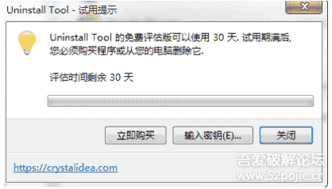

测试发现，软件使用了重启验证的方式，猜测是将输入的注册名和密钥保存在注册表或文件中，然后当软件启动的时候读取注册表或文件，判断输入内容是否正确。

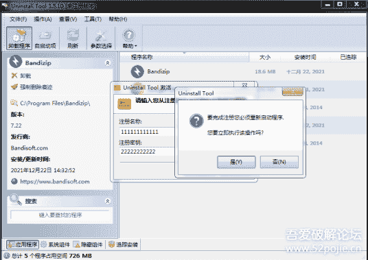

对写注册表函数`RegSetValueXXX`下断点。

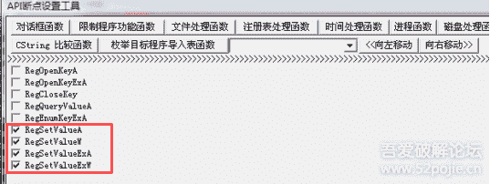

运行程序，随便输注册名和密钥，点注册后程序会停下来。

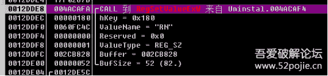

发现程序对`RN`键写入了`0x002CB828`处的字符串，在寄存器窗口可以看见这个字符串，这个应该就是加密后的注册名或者密钥。

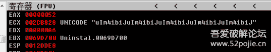

再确定一下`RN`键在哪个位置，`Alt+K`查看调用堆栈，在如图所示位置右键->显示调用。

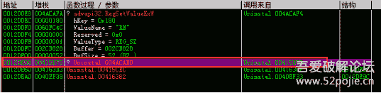

可以确定`RN`键在`HKEY_CURRENT_USER\Software\CrystalIdea Software\Uninstall Tool`。

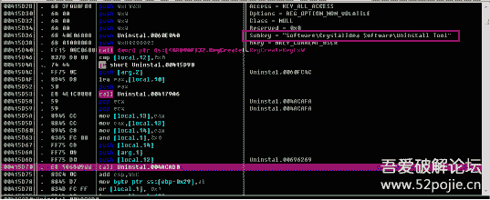

继续运行程序，又在`RegSetValueExW`断下来，这次写入了`RC`键，键值和`RN`键的类似，是经过加密的字符串，应该是加密后的注册名或者密钥。

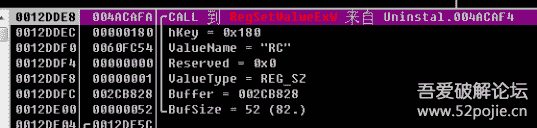

继续运行程序，弹出信息框，提示要重启验证。

所以现在有了清晰的思路，该程序将注册名和密钥加密后写注册表，然后重启，当再次运行时读取注册表中的值，解密，判断输入内容是否正确。因此下一步就是对读注册表函数下断点。

分别尝试对`RegOpenKeyA`、`RegOpenKeyEx`、`RegQueryValueA`、`RegQueryValueEx`下断点，重新载入程序运行，但是经过反复重载、运行，并没有发现程序有对`RC`键、`RN`键操作。只能换另一种方式。

窗口的标题有“未注册版本”字样，猜测应该有个地方对是否注册进行判断，然后再设置窗口标题，因此想到对`SetWindowTextA`/`SetWindowTextW`下断点。

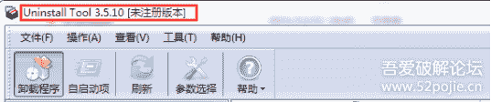

分别在Command编辑框输入`bp SetWindowTextA`回车、`bp SetWindowTextW`回车，重新载入程序，多次按`F9`运行，直到堆栈窗口出现“未注册版本”。

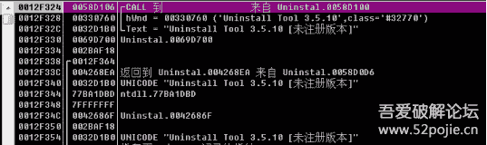

`Alt+K`，查看调用堆栈，在最后一项右键->显示调用。

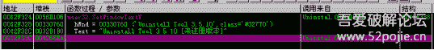

发现上面有个跳转跳到显示“未注册版本”的`CALL`，猜测这个可能是关键跳，改成`je`试试。

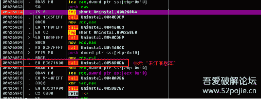

确实没有“未注册版本”了，但是程序还是没有注册，因为帮助菜单还有“输入密钥”，而且关闭窗口时提示还能试用30天。

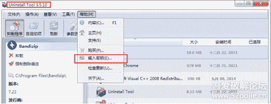

所以程序不止一处判断，应该有个函数用于判断是否注册，在程序的多个位置调用。这个函数应该就在上面。往上找看看哪一条指令改变了标志位。

发现`jnz`上面有个`test al,al`，这条指令是对`al`执行与运算，只改变标志位，也就是说：

如果`al=0` -> 执行`test al,al` -> `Z=1` ->未注册

如果`al=1` -> 执行`test al,al` -> `Z=0` ->已注册

并且`test al,al`上面有个`call`，`call`的返回值在`eax`，因此这个`call`的作用应该是判断有没有注册的。

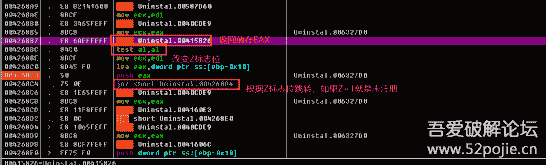

进入`call 0x00415826`，直接在最后一行汇编`mov al,0x1`，保存到可执行文件。

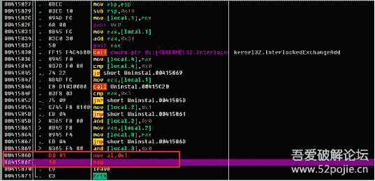

帮助菜单没有“输入密钥”了，关闭窗口也不提示还有30天试用了。

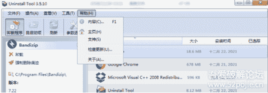

更改系统日期为一年后，依然可用，成功。

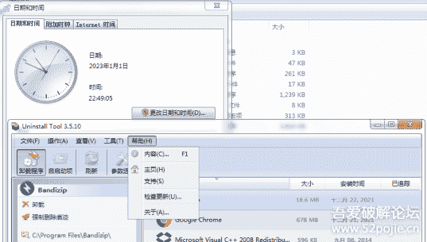

[href="`forum.php?mod=attachment&aid=MjUwNTA3OXw0ZmNhY2U3ZHwxNzkzNTc1OTMyfDE2ODA4NnwxNjA2NDky&nothumb=yes`" target="_blank"](`https://www.52pojie.cn/forum.php?mod=attachment&aid=MjUwNTA3OXw0ZmNhY2U3ZHwxNzkzNTc1OTMyfDE2ODA4NnwxNjA2NDky&nothumb=yes`)
17
2022-3-19 11:39 上传
