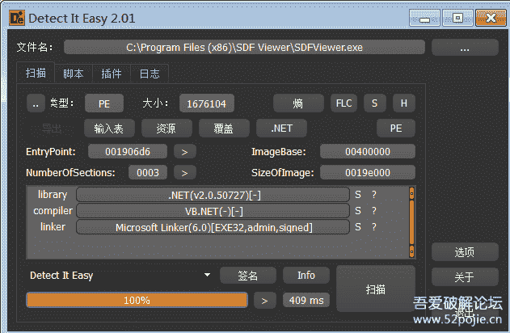
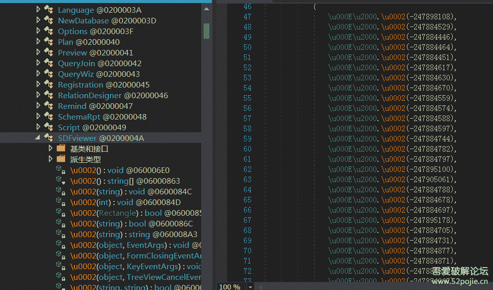
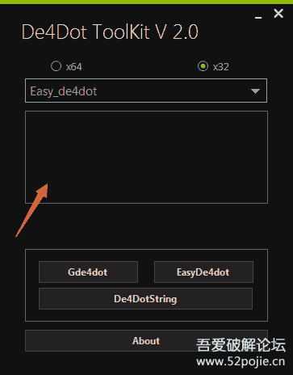
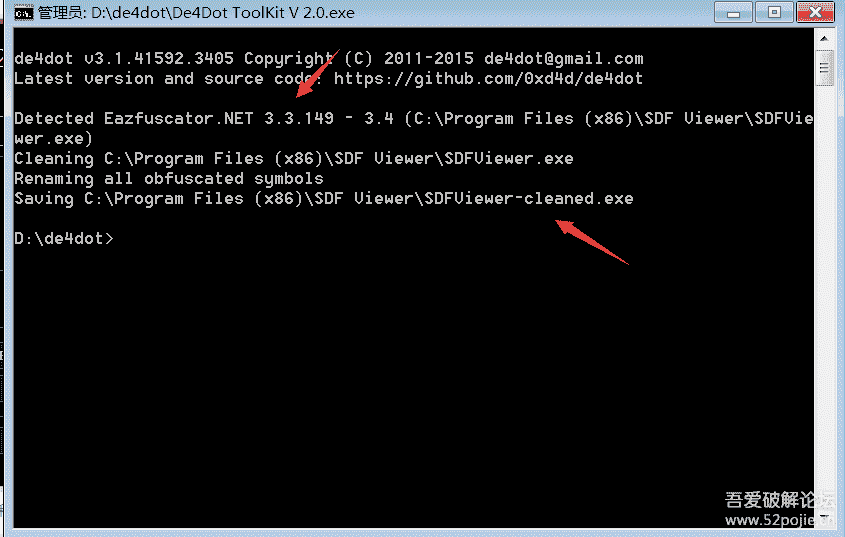
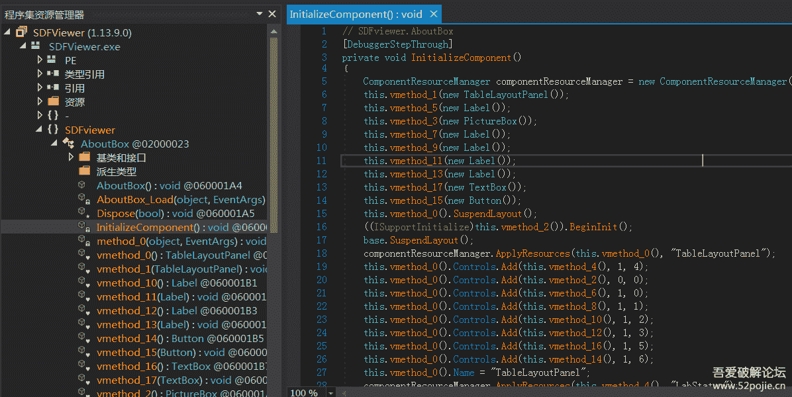
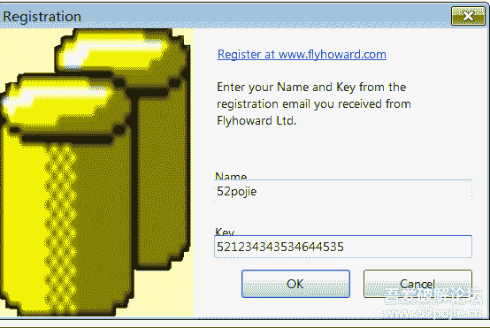
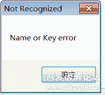
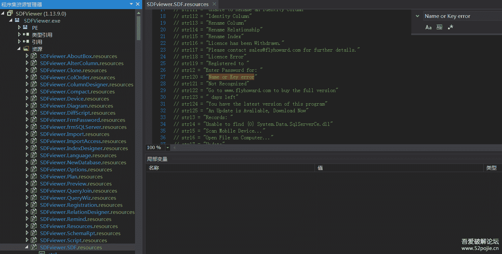
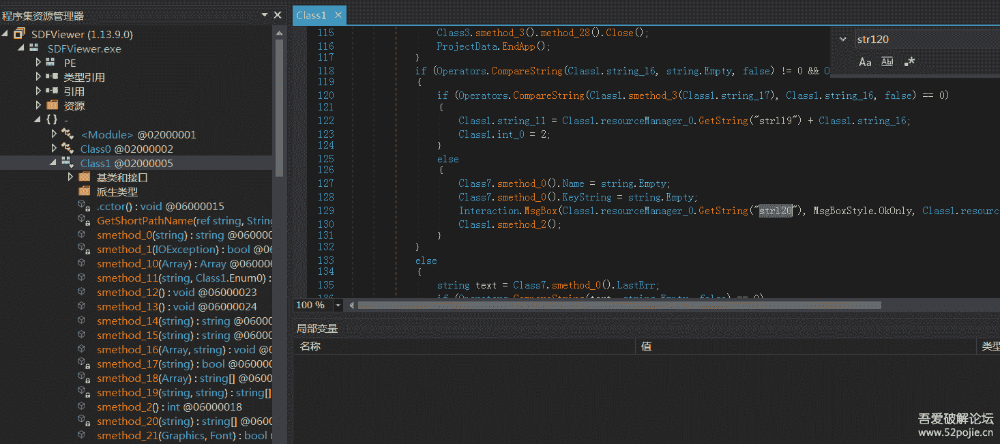

# [.NET逆向] SDF Viewer KEY算法分析1

- 原帖：https://www.52pojie.cn/forum.php?mod=viewthread&tid=1608219
- 抓取时间：2026-11-01T23:32:02

这是我在52pojie发的第一篇内容，因为我昨天才注册。

最近在分析某工业机器人仿真软件插件的时候发现关键数据都是用SDF数据库保存的，网上搜了一下SDF Viewer适合干这个活，所以就下载了一个，用了几天提示剩余天数，想想顺便研究一下算法吧，于是，就开始了~

## 使用工具

1. Detect It Easy（查壳工具）
2. `dnspy`（反编译工具）
3. De4Dot ToolKit V 2.0（脱壳工具）
4. C#代码在线执行网站（加密解密代码执行 KeyGen）

## 分析过程

首先我们先用查壳工具看一下



QQ截图20220322032730.png (43.69 KB, 下载次数: 0)

[附件下载](https://www.52pojie.cn/forum.php?mod=attachment&aid=MjUwNjA3MXwyZmU5ZmRjN3wxNzkzNTc1OTIwfDE2ODA4NnwxNjA4MjE5&nothumb=yes)

2022-3-22 04:04 上传

显示VB.NET，嗯有的搞

`dnspy`载入看一下



QQ截图20220322033148.png (115.56 KB, 下载次数: 0)

[附件下载](https://www.52pojie.cn/forum.php?mod=attachment&aid=MjUwNjA3MnwwMTIwYjg4MHwxNzkzNTc1OTIwfDE2ODA4NnwxNjA4MjE5&nothumb=yes)

2022-3-22 04:04 上传

这明显就是加了壳的

试着用`De4Dot`脱一下



QQ截图20220322032831.png (15.21 KB, 下载次数: 0)

[附件下载](https://www.52pojie.cn/forum.php?mod=attachment&aid=MjUwNjA3M3xmODFmMjJlMHwxNzkzNTc1OTIwfDE2ODA4NnwxNjA4MjE5&nothumb=yes)

2022-3-22 04:05 上传



QQ截图20220322032925.png (26.62 KB, 下载次数: 0)

[附件下载](https://www.52pojie.cn/forum.php?mod=attachment&aid=MjUwNjA3NHw1NjYzNDY1ZnwxNzkzNTc1OTIwfDE2ODA4NnwxNjA4MjE5&nothumb=yes)

2022-3-22 04:05 上传

代码基本上算是能看了



QQ截图20220322033240.png (112.12 KB, 下载次数: 0)

[附件下载](https://www.52pojie.cn/forum.php?mod=attachment&aid=MjUwNjA3NXxjOGEyZGVkMHwxNzkzNTc1OTIwfDE2ODA4NnwxNjA4MjE5&nothumb=yes)

2022-3-22 04:05 上传

打开软件的注册，试着随便输入注册，看提示信息



QQ截图20220322034330.png (50.11 KB, 下载次数: 0)

[附件下载](https://www.52pojie.cn/forum.php?mod=attachment&aid=MjUwNjA3Nnw5YmQ4MjlhYXwxNzkzNTc1OTIwfDE2ODA4NnwxNjA4MjE5&nothumb=yes)

2022-3-22 04:06 上传



QQ截图20220322034341.png (11.77 KB, 下载次数: 1)

[附件下载](https://www.52pojie.cn/forum.php?mod=attachment&aid=MjUwNjA3N3wxMTI3Yjc0OXwxNzkzNTc1OTIwfDE2ODA4NnwxNjA4MjE5&nothumb=yes)

2022-3-22 04:06 上传

Name or Key error

记住这个消息，然后用`dnspy`打开脱壳后的程序。

`CTRL+F`打开查找信息框输入这个错误信息

漫长的查找时间...



QQ截图20220322034554.png (122.19 KB, 下载次数: 0)

[附件下载](https://www.52pojie.cn/forum.php?mod=attachment&aid=MjUwNjA3OHw5YjAyMzUwY3wxNzkzNTc1OTIwfDE2ODA4NnwxNjA4MjE5&nothumb=yes)

2022-3-22 04:06 上传

最后在资源文件的`SDFviewer.SDF.resources`找到了这个字符串

记住前面这个`str120`，这个是程序里引用的资源名

顺便记录一下其他的关键信息

```csharp
// str116‎ = "Licence has been Withdrawn."//注册码被撤销
// str117‎ = "Please contact sales@flyhoward.com for further details."
// str118‎ = "Licence Error"
// str119‎ = "Registered to "//注册到    这里很关键,提示注册成功了
// str12‎ = "Enter Password for: "
// str120‎ = "Name or Key error"  //注册码错误信息
```

然后我们在所有代码数据里面查找`str120`和`str119`

又是漫长的查找过程...



QQ截图20220322034634.png (115.97 KB, 下载次数: 1)

[附件下载](https://www.52pojie.cn/forum.php?mod=attachment&aid=MjUwNjA3OXxiOTIwNTIxY3wxNzkzNTc1OTIwfDE2ODA4NnwxNjA4MjE5&nothumb=yes)

2022-3-22 04:07 上传

```csharp
if (Operators.CompareString(Class1.smethod_3(Class1.string_17), Class1.string_16, false) == 0)
{
        Class1.string_11 = Class1.resourceManager_0.GetString("str119") + Class1.string_16;//Registered to  
        Class1.int_0 = 2;
}
else
{
        Class7.smethod_0().Name = string.Empty;
        Class7.smethod_0().KeyString = string.Empty;//Name or Key error
        Interaction.MsgBox(Class1.resourceManager_0.GetString("str120"), MsgBoxStyle.OkOnly, Class1.resourceManager_0.GetString("str121"));
        Class1.smethod_2();
}
```

仔细看代码`if (Operators.CompareString(Class1.smethod_3(Class1.string_17), Class1.string_16, false) == 0)`

其中调用了`Class1.smethod_3`，我们找一下这个方法的作用

```csharp
private static string smethod_3(string string_29)
{
        byte[] rgbKey = new byte[0];
        byte[] rgbIV = new byte[] { 18, 52, 86, 115, 144, 171, 205, 239 };
        byte[] array = new byte[checked(string_29.Length + 1)];
        string result;
        try
        {
                rgbKey = Encoding.UTF8.GetBytes("f1owChk1");
                DESCryptoServiceProvider descryptoServiceProvider = new DESCryptoServiceProvider();
                array = Convert.FromBase64String(string_29);//1.Key先从BASE64转换成二进制
                MemoryStream memoryStream = new MemoryStream();
                CryptoStream cryptoStream = new CryptoStream(memoryStream, descryptoServiceProvider.CreateDecryptor(rgbKey, rgbIV), CryptoStreamMode.Write);//2.然后执行Decryptor解密方法
                cryptoStream.Write(array, 0, array.Length);//3.然后把二进制Key写进解密方法
                cryptoStream.FlushFinalBlock();
                result = Encoding.UTF8.GetString(memoryStream.ToArray());//4.最后ToArry的数据转换成字符串
        }
        catch (Exception ex)
        {
                result = string.Empty;
        }
        return result;
}
```

解密算法就摆在眼前

仔细看这行代码`array = Convert.FromBase64String(string_29);`

还有`CreateDecryptor(rgbKey, rgbIV)`、`CryptoStreamMode.Write`

### 梳理一下这个算法

1. `Key`先从BASE64转换成二进制
2. 然后执行`Decryptor`解密方法
3. 然后把二进制`Key`写进解密方法
4. 最后`ToArry`的数据转换成字符串
5. 把结果返回到上一个方法进行比较

加密算法就是反过来

1. 把`Name`（字符串）转换成二进制
2. 然后执行`Encryptor`加密方法
3. 然后把二进制`Name`写进加密算法
4. 最后`ToArry`的数据转换成BASE64字符串
5. 最后BASE64字符串就是`Key`

```csharp
private static string smethod_3(string Nametext)
{
        byte[] rgbKey = new byte[0];
        byte[] rgbIV = new byte[] { 18, 52, 86, 115, 144, 171, 205, 239 };
        byte[] array = new byte[checked(Nametext.Length)];
        string result;
        try
        {
                rgbKey = Encoding.UTF8.GetBytes("f1owChk1");
                DESCryptoServiceProvider descryptoServiceProvider = new DESCryptoServiceProvider();
                array = new ASCIIEncoding().GetBytes(NameText);//1.把Name(字符串)转换成二进制
                MemoryStream memoryStream = new MemoryStream();
                CryptoStream cryptoStream = new CryptoStream(memoryStream, descryptoServiceProvider.CreateEncryptor(rgbKey, rgbIV), CryptoStreamMode.Write);//2.然后执行Encryptor加密方法
                cryptoStream.Write(array, 0, array.Length);//3.然后把二进制Name写进加密算法
                cryptoStream.FlushFinalBlock();
                result = Convert.ToBase64String(memoryStream.ToArray());//4.最后ToArry的数据转换成BASE64字符串
        }
        catch (Exception ex)
        {
                result = string.Empty;
        }
        return result;
}
```

把这些代码转化一下，找个在线C#代码执行网站试一下看看能不能算出来注册码

完整代码如下:


## KeyGen 代码

```
using System;
using System.Text;//文本处理命名空间
using System.IO;//MemoryStream读写数据流用的命名空间
using System.Security.Cryptography;//加密解密用的命名空间

namespace KeyGen
{
    class Program
    {
        static void Main(string[] args)
        {
            string Name = "52pojie";//双引号内是Name内容,不支持特殊符号和中文
            //
            byte[] rgbKey = Encoding.UTF8.GetBytes("f1owChk1");
            byte[] rgbIV = new byte[] { 18, 52, 86, 115, 144, 171, 205, 239 };
            byte[] array = new ASCIIEncoding().GetBytes(Name);
            DESCryptoServiceProvider descryptoServiceProvider = new DESCryptoServiceProvider();;
            MemoryStream memoryStream = new MemoryStream();
            CryptoStream cryptoStream = new CryptoStream(memoryStream, descryptoServiceProvider.CreateEncryptor(rgbKey, rgbIV), CryptoStreamMode.Write);
            cryptoStream.Write(array, 0, array.Length);
            cryptoStream.FlushFinalBlock();
            string result = Convert.ToBase64String(memoryStream.ToArray());
            Console.WriteLine(result);

        }
    }
}
```

把执行的代码结果在软件内进行注册,完美!

## 插曲

其实分析期间在解密的代码那里我是下过断点调试过的,因为不确定是不是解密的Key秘钥.

在对比秘钥之前的代码里有一段代码非常有意思

```
if (Operators.CompareString(Class1.string_17, "SIWphRddOncC+9dfqM39Cw==", false) == 0 || Operators.CompareString(Class1.string_17, "yoU2LTox9ji1ME2xsQ21UA==", false) == 0 || Operators.CompareString(Class1.string_17, "9hzsfFcMHlaq7e9ItbsEHsutKigmkZgM", false) == 0 || Operators.CompareString(Class1.string_17, "5Prfc4iGPGwH3w84uOx84w==", false) == 0 || Operators.CompareString(Class1.string_17, "oIGoCNG9iBn0GaHaD1KuAA==", false) == 0 || Operators.CompareString(Class1.string_17, "bi1F2hrFoxWbDy9/9XW38A==", false) == 0 || Operators.CompareString(Class1.string_17, "o4rHyS9417d+TiSf6vpCxA==", false) == 0 || Operators.CompareString(Class1.string_17, "8vUnN+97Lmo=", false) == 0)

                {

                        Class7.smethod_0().Name = string.Empty;

                        Class7.smethod_0().KeyString = string.Empty;

                        Class7.smethod_0().Save();

                        Interaction.MsgBox(Class1.resourceManager_0.GetString("str116") + "\r\n" + Class1.resourceManager_0.GetString("str117"), MsgBoxStyle.OkOnly, Class1.resourceManager_0.GetString("str118"));

                        Class1.int_0 = 0;

                        Class3.smethod_3().method_28().Close();

                        ProjectData.EndApp();

                }
```

仔细看代码里有`GetString("str116")`

前面有提到:

```
// str116‎ = "Licence has been Withdrawn."//注册码被撤销
```

软件开发者比较狠,因为不知道是注册码泄露还是其他人破解的秘钥,作者发现了直接把这些秘钥列到黑名单里面啦,哈哈哈~

不过因为上面判断代码里面`Class1.string_17`的判断字符串都是BASE64编码,所以我很确定解密算法里面肯定是解密的Key,而且是BASE64编码

通过我用C#做的界面程序进行解密,把这些黑名单的用户名发一下:

| `Key` | `Name` |
| --- | --- |
|  | `SIWphRddOncC+9dfqM39Cw==` |
