# [.NET逆向] SDF Viewer KEY算法分析2

- 原帖: https://www.52pojie.cn/forum.php?mod=viewthread&tid=1608831
- 抓取时间: 2026-11-01T23:32:00

前一篇关于SDF Viewer算法分析内容详细介绍了解密算法和推演过程,
原文地址:

[//www.52pojie.cn/thread-1608219-1-1.html" target="_blank" rel="noopener noreferrer nofollow"](https://www.52pojie.cn/thread-1608219-1-1.html:href="https)

我们换个思路,解决更多的问题,同时也学习更多的知识,在分析其他软件时提供一定的参考方法:
这篇文章也算是给`dnspy`这个软件的初学者介绍它的使用方法.

## 步入正题

所需工具：
1. 火绒剑(系统监控用)
2. `dnspy`(反编译代码软件)

首先我们先考虑几个问题:
1、注册成功之后的注册码存在哪里了?
2、软件打开的时候是如何检测软件有没有注册?
3、如何能更快的定位到我们要查找的注册相关程序代码?
4、我们分析它的目的是什么?

### 第一部分:注册码存在哪里?

众所周知,注册码一般是存放在注册表里面或者是文件中(网络验证除外)

打开火绒剑,点击开始监控,先让他运行一会,然后过滤掉其他进程

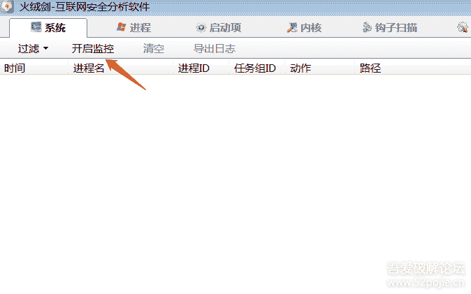

微信截图_20220322174124.png (27.9 KB, 下载次数: 0)

[href="forum.php?mod=attachment&aid=MjUwNjQxMnwzN2NlMjc2ZnwxNzkzNTc1OTE4fDE2ODA4NnwxNjA4ODMx&nothumb=yes" target="_blank"](https://www.52pojie.cn/forum.php?mod=attachment&aid=MjUwNjQxMnwzN2NlMjc2ZnwxNzkzNTc1OTE4fDE2ODA4NnwxNjA4ODMx&nothumb=yes)

2022-3-22 22:57 上传

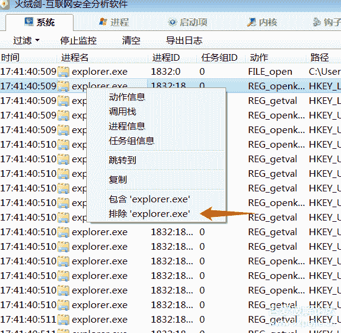

微信截图_20220322174209.png (94.04 KB, 下载次数: 1)

[href="forum.php?mod=attachment&aid=MjUwNjQyMXwxZmYzZTJkMHwxNzkzNTc1OTE4fDE2ODA4NnwxNjA4ODMx&nothumb=yes" target="_blank"](https://www.52pojie.cn/forum.php?mod=attachment&aid=MjUwNjQyMXwxZmYzZTJkMHwxNzkzNTc1OTE4fDE2ODA4NnwxNjA4ODMx&nothumb=yes)

2022-3-22 22:57 上传

等没有出现其他干扰信息之后我们打开SDF Viewer软件

在火绒剑里面搜索SDF关键字

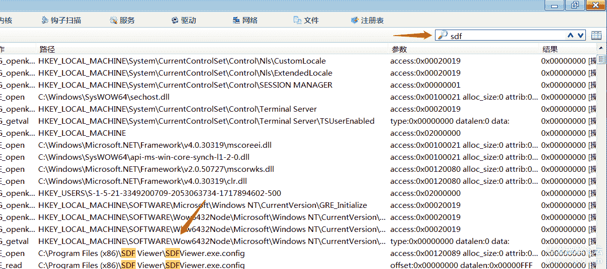

微信截图_20220322174651.png (98.31 KB, 下载次数: 2)

[href="forum.php?mod=attachment&aid=MjUwNjQxNHwzZmQ0MmI1MHwxNzkzNTc1OTE4fDE2ODA4NnwxNjA4ODMx&nothumb=yes" target="_blank"](https://www.52pojie.cn/forum.php?mod=attachment&aid=MjUwNjQxNHwzZmQ0MmI1MHwxNzkzNTc1OTE4fDE2ODA4NnwxNjA4ODMx&nothumb=yes)

2022-3-22 22:58 上传

这个过程其实是很漫长的,你需要有一定的注册表和系统目录文件系统经验,去判断哪些是关键的东西

而且还要去打开那些东西去看是不是需要的东西

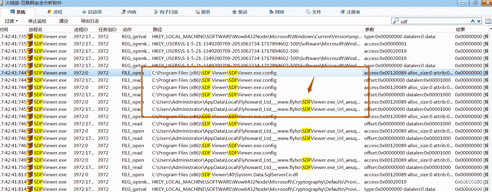

微信截图_20220322174854.png (171.8 KB, 下载次数: 0)

[href="forum.php?mod=attachment&aid=MjUwNjQxNXw3ZDU3NDdjNnwxNzkzNTc1OTE4fDE2ODA4NnwxNjA4ODMx&nothumb=yes" target="_blank"](https://www.52pojie.cn/forum.php?mod=attachment&aid=MjUwNjQxNXw3ZDU3NDdjNnwxNzkzNTc1OTE4fDE2ODA4NnwxNjA4ODMx&nothumb=yes)

2022-3-22 22:58 上传

`C:\Users\Administrator\AppData\Local\Flyhoward_Ltd_www.flyho\SDFViewer.exe_Url_aeuqqh5gnyd4qxg0zt1efpds2suvjuxw\1.13.9.0\`

找到这个关键点,右键选择动作信息,复制路径并打开(火绒剑右键选项有直接可以跳转到这个目录的菜单)

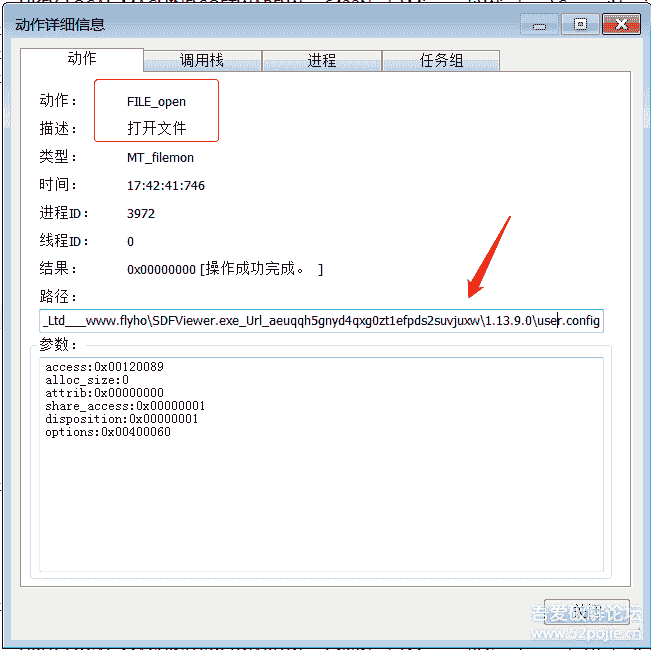

微信截图_20220322174945.png (29.33 KB, 下载次数: 0)

[href="forum.php?mod=attachment&aid=MjUwNjQxNnw5YjllMGZjZHwxNzkzNTc1OTE4fDE2ODA4NnwxNjA4ODMx&nothumb=yes" target="_blank"](https://www.52pojie.cn/forum.php?mod=attachment&aid=MjUwNjQxNnw5YjllMGZjZHwxNzkzNTc1OTE4fDE2ODA4NnwxNjA4ODMx&nothumb=yes)

2022-3-22 22:58 上传

用记事本打开这个文件

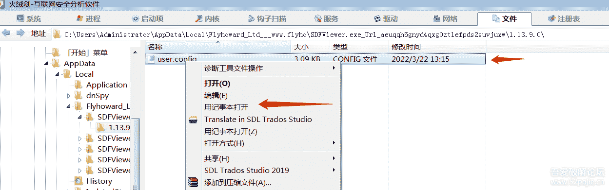

微信截图_20220322175038.png (80.01 KB, 下载次数: 1)

[href="forum.php?mod=attachment&aid=MjUwNjQxN3xkZDk5MDgxN3wxNzkzNTc1OTE4fDE2ODA4NnwxNjA4ODMx&nothumb=yes" target="_blank"](https://www.52pojie.cn/forum.php?mod=attachment&aid=MjUwNjQxN3xkZDk5MDgxN3wxNzkzNTc1OTE4fDE2ODA4NnwxNjA4ODMx&nothumb=yes)

2022-3-22 22:58 上传

`user.config`

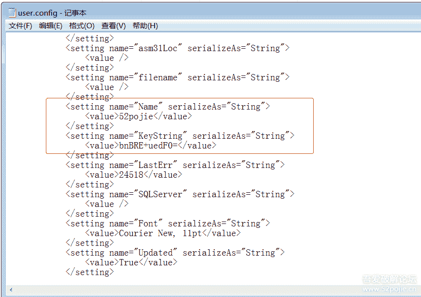

微信截图_20220322175111.png (54.29 KB, 下载次数: 2)

[href="forum.php?mod=attachment&aid=MjUwNjQxOHxlMDRiNDc5NHwxNzkzNTc1OTE4fDE2ODA4NnwxNjA4ODMx&nothumb=yes" target="_blank"](https://www.52pojie.cn/forum.php?mod=attachment&aid=MjUwNjQxOHxlMDRiNDc5NHwxNzkzNTc1OTE4fDE2ODA4NnwxNjA4ODMx&nothumb=yes)

2022-3-22 22:58 上传

找到这个关键点,因为这个软件是已经注册过的,所以有`Name`和`Key`

好了,我们可以把这个文件删除掉,再打开软件,提示未注册了~

额外大家看一下这个文件上面的字段,开发程序的都知道这个是`XML`方法读取写入文件,所以软件里面肯定有和`XML`相关的方法.

(研究这个对一些文件授权的软件尤为重要,因为文件授权的软件是没有注册对话框的,所以不存在关键字查找方法)

本文不重点讨论这个东西,大家了解一下就可以了.

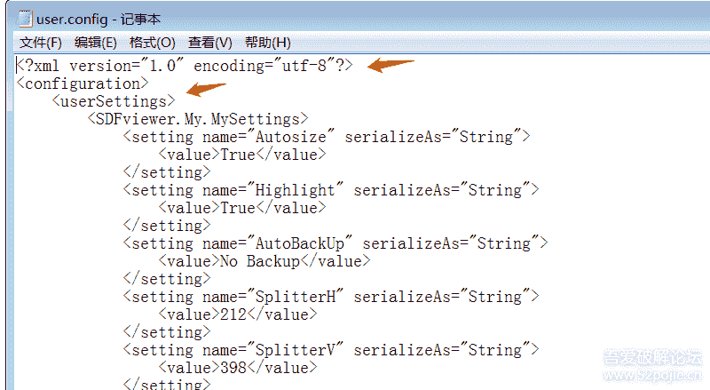

微信截图_20220322175232.png (46.2 KB, 下载次数: 0)

[href="forum.php?mod=attachment&aid=MjUwNjQxOXw1YzgzZTJhNHwxNzkzNTc1OTE4fDE2ODA4NnwxNjA4ODMx&nothumb=yes" target="_blank"](https://www.52pojie.cn/forum.php?mod=attachment&aid=MjUwNjQxOXw1YzgzZTJhNHwxNzkzNTc1OTE4fDE2ODA4NnwxNjA4ODMx&nothumb=yes)

2022-3-22 22:58 上传

### 第二部分:换一种方法找注册关键点&dnspy的使用

我们用`dnspy`打开脱壳后的软件程序

#### 阅读理解

类型引用是什么?

类型引用里面记录着所有这个程序使用的方法的表

比如使用的手机,手机桌面就是类型引用,桌面的图标就是方法的表,所有你使用的功能都放在桌面上.

比如微信或者支付宝,里面的小程序之类的,比如收款码,付款码,公交码,小程序入口,搜索功能,把这些功能都放在桌面上,

这样你一眼就能看到这个手机的主人都使用了什么功能.

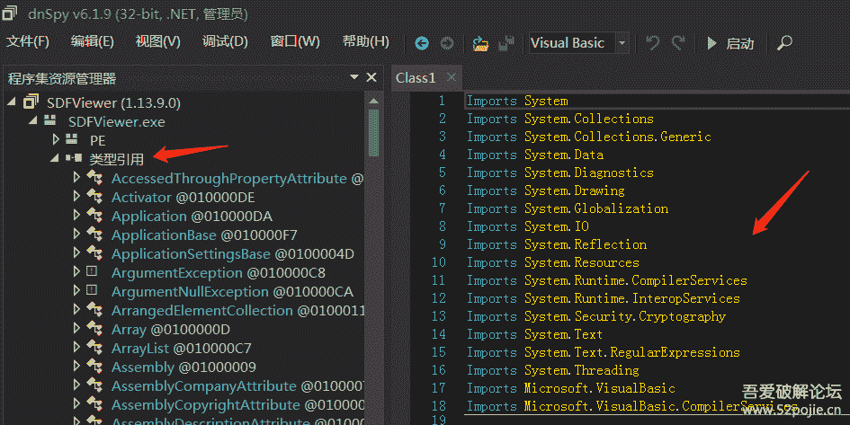

微信截图_20220322175655.png (78.13 KB, 下载次数: 2)

[href="forum.php?mod=attachment&aid=MjUwNjQyMHxlMGY3NTdmZnwxNzkzNTc1OTE4fDE2ODA4NnwxNjA4ODMx&nothumb=yes" target="_blank"](https://www.52pojie.cn/forum.php?mod=attachment&aid=MjUwNjQyMHxlMGY3NTdmZnwxNzkzNTc1OTE4fDE2ODA4NnwxNjA4ODMx&nothumb=yes)

2022-3-22 23:00 上传

引用是什么?

引用里面是这个程序使用的插件(比如`DLL`文件),也就是说程序启动前首先要确认这些文件存在才能正常使用.

比如使用的手机,我要使用付款功能(方法),正好支付宝有这个付款功能,首先我要保证手机里面装了支付宝这个APP(引用插件),

但是我只使用付款功能.

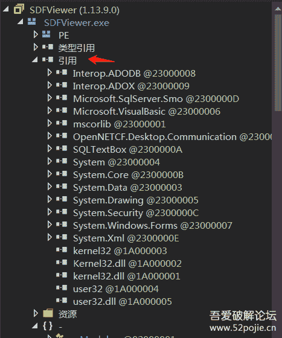

微信截图_20220322180354.png (56.74 KB, 下载次数: 2)

[href="forum.php?mod=attachment&aid=MjUwNjQyMXwxMTliNTg1MnwxNzkzNTc1OTE4fDE2ODA4NnwxNjA4ODMx&nothumb=yes" target="_blank"](https://www.52pojie.cn/forum.php?mod=attachment&aid=MjUwNjQyMXwxMTliNTg1MnwxNzkzNTc1OTE4fDE2ODA4NnwxNjA4ODMx&nothumb=yes)

2022-3-22 23:00 上传

方法是什么?

方法就是一个已经继承好的功能模块,不需要你自己用底层代码去写,只需要调用方法并且给需要的参数,就会自动执行.

比如你需要吃(方法)酸辣土豆丝(参数),你只需要告诉厨师(引用插件),厨师就会让采购(厨师使用的方法)购买食材和调料(采购给的参数)

采购找菜农(采购使用的方法)买土豆(菜农使用的参数),等等吧,再往下分的话估计要讨论到大棚,铁锹之类的参数了.

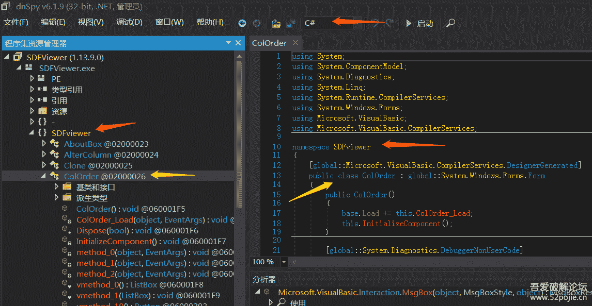

微信截图_20220322180506.png (109.87 KB, 下载次数: 0)

[href="forum.php?mod=attachment&aid=MjUwNjQyMnwyZDcyYmIxZXwxNzkzNTc1OTE4fDE2ODA4NnwxNjA4ODMx&nothumb=yes" target="_blank"](https://www.52pojie.cn/forum.php?mod=attachment&aid=MjUwNjQyMnwyZDcyYmIxZXwxNzkzNTc1OTE4fDE2ODA4NnwxNjA4ODMx&nothumb=yes)

2022-3-22 23:00 上传

所以我们只需要调用方法并给参数(我要吃酸辣土豆丝),就好了,剩下的工作就不需要你亲自去干了,节省下来的时间就可以做更多的事.

在上一个帖子里面大家有没有注意到提示信息前面的这个方法,就是注册失败弹出的对话框

因为这个程序是`VB.NET`的写的,所以大概率会使用`VB.NET`的对话框方法

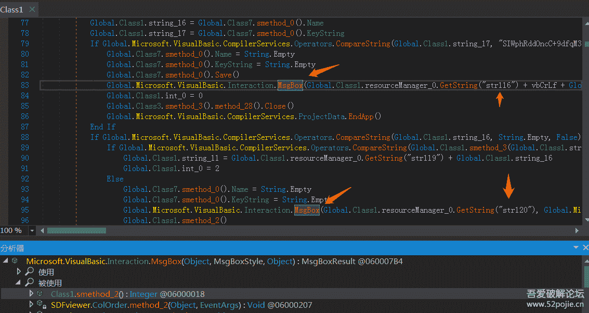

微信截图_20220322180212.png (69.43 KB, 下载次数: 2)

[href="forum.php?mod=attachment&aid=MjUwNjQyM3wyMzIzNWEwNnwxNzkzNTc1OTE4fDE2ODA4NnwxNjA4ODMx&nothumb=yes" target="_blank"](https://www.52pojie.cn/forum.php?mod=attachment&aid=MjUwNjQyM3wyMzIzNWEwNnwxNzkzNTc1OTE4fDE2ODA4NnwxNjA4ODMx&nothumb=yes)

2022-3-22 23:01 上传

`Interaction.MsgBox(对话框提示内容,对话框标题内容(可省略),按钮样式(确定;是/否;可省略),提示图标类型(可省略))`

`C#` 的方法是`Messagebox.show(参数和上面的一样)`

既然弹出了对话框,肯定是要调用这个方法的,我们直接在类型引用里面找到这个方法

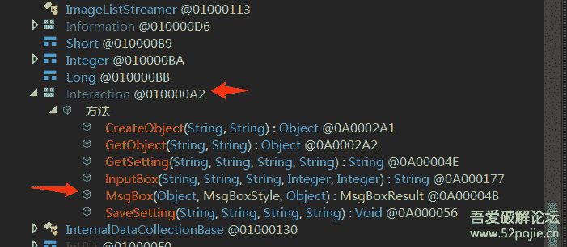

微信截图_20220322180013.png (48.16 KB, 下载次数: 1)

[href="forum.php?mod=attachment&aid=MjUwNjQyNXxhMzFkNWY0OXwxNzkzNTc1OTE4fDE2ODA4NnwxNjA4ODMx&nothumb=yes" target="_blank"](https://www.52pojie.cn/forum.php?mod=attachment&aid=MjUwNjQyNXxhMzFkNWY0OXwxNzkzNTc1OTE4fDE2ODA4NnwxNjA4ODMx&nothumb=yes)

2022-3-22 23:02 上传

然后右键选择分析,并转到分析窗口查看

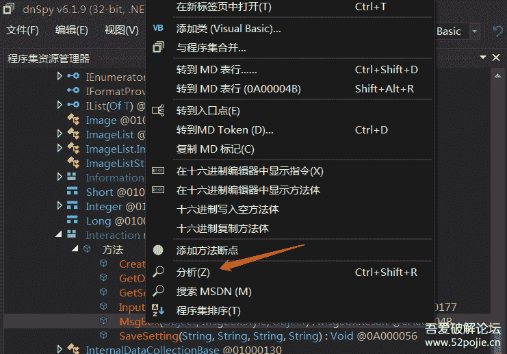

微信截图_20220322180042.png (83.26 KB, 下载次数: 2)

[href="forum.php?mod=attachment&aid=MjUwNjQyNnxjNGZmMjVmNHwxNzkzNTc1OTE4fDE2ODA4NnwxNjA4ODMx&nothumb=yes" target="_blank"](https://www.52pojie.cn/forum.php?mod=attachment&aid=MjUwNjQyNnxjNGZmMjVmNHwxNzkzNTc1OTE4fDE2ODA4NnwxNjA4ODMx&nothumb=yes)

2022-3-22 23:02 上传

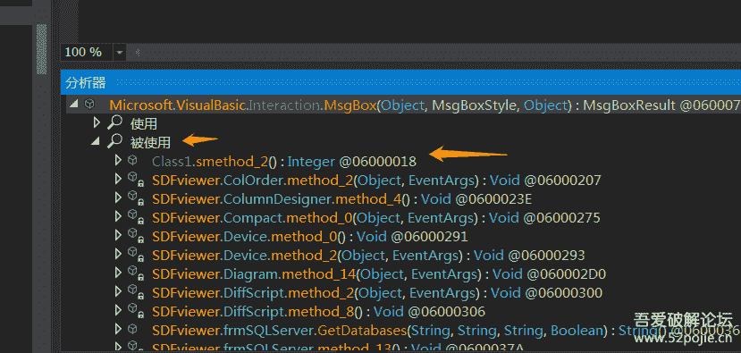

微信截图_20220322180122.png (80.98 KB, 下载次数: 1)

[href="forum.php?mod=attachment&aid=MjUwNjQyN3w0NDUyNTk5NXwxNzkzNTc1OTE4fDE2ODA4NnwxNjA4ODMx&nothumb=yes" target="_blank"](https://www.52pojie.cn/forum.php?mod=attachment&aid=MjUwNjQyN3w0NDUyNTk5NXwxNzkzNTc1OTE4fDE2ODA4NnwxNjA4ODMx&nothumb=yes)

2022-3-22 23:02 上传

双击,直接跳转到目标位置了

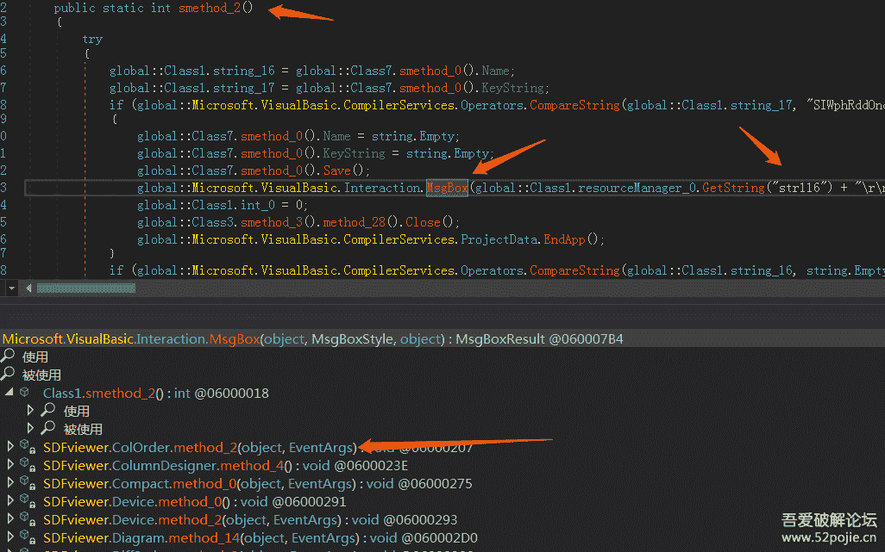

微信截图_20220322230539.png (83.88 KB, 下载次数: 1)

[href="forum.php?mod=attachment&aid=MjUwNjQyOHw5NWRlNDI0NXwxNzkzNTc1OTE4fDE2ODA4NnwxNjA4ODMx&nothumb=yes" target="_blank"](https://www.52pojie.cn/forum.php?mod=attachment&aid=MjUwNjQyOHw5NWRlNDI0NXwxNzkzNTc1OTE4fDE2ODA4NnwxNjA4ODMx&nothumb=yes)
2022-3-22 23:05 上传
对于初学者我建议打开这个参数,这样你就可以知道这个方法是放在哪个命名空间里面
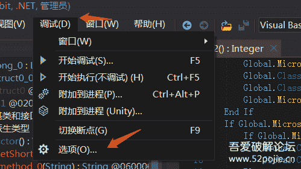
微信截图_20220322175819.png (40.97 KB, 下载次数: 2)
[href="forum.php?mod=attachment&aid=MjUwNjQyOXxmYTA5NjUwZHwxNzkzNTc1OTE4fDE2ODA4NnwxNjA4ODMx&nothumb=yes" target="_blank"](https://www.52pojie.cn/forum.php?mod=attachment&aid=MjUwNjQyOXxmYTA5NjUwZHwxNzkzNTc1OTE4fDE2ODA4NnwxNjA4ODMx&nothumb=yes)
2022-3-22 23:07 上传
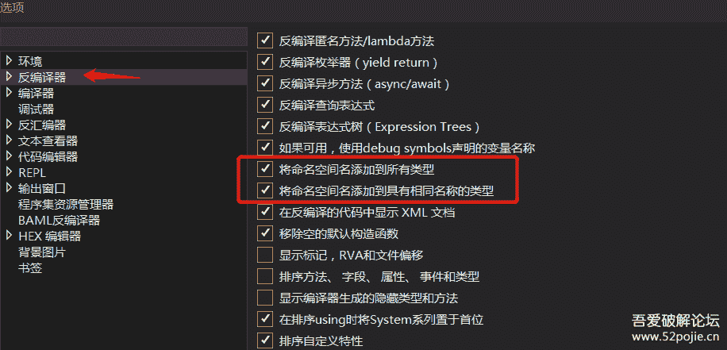
微信截图_20220322175850.png (63.61 KB, 下载次数: 2)
[href="forum.php?mod=attachment&aid=MjUwNjQzMHw3MDYyZDNjMXwxNzkzNTc1OTE4fDE2ODA4NnwxNjA4ODMx&nothumb=yes" target="_blank"](https://www.52pojie.cn/forum.php?mod=attachment&aid=MjUwNjQzMHw3MDYyZDNjMXwxNzkzNTc1OTE4fDE2ODA4NnwxNjA4ODMx&nothumb=yes)
2022-3-22 23:07 上传
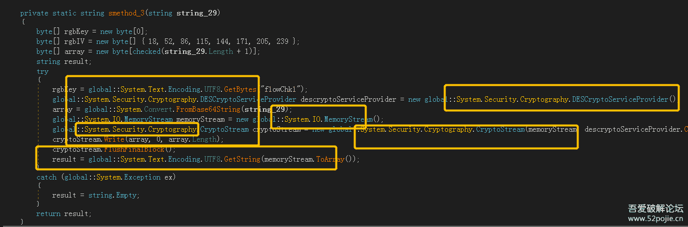
微信截图_20220322230910.png (35.67 KB, 下载次数: 1)
[href="forum.php?mod=attachment&aid=MjUwNjQzMXw5M2I2N2EzNXwxNzkzNTc1OTE4fDE2ODA4NnwxNjA4ODMx&nothumb=yes" target="_blank"](https://www.52pojie.cn/forum.php?mod=attachment&aid=MjUwNjQzMXw5M2I2N2EzNXwxNzkzNTc1OTE4fDE2ODA4NnwxNjA4ODMx&nothumb=yes)
2022-3-22 23:09 上传
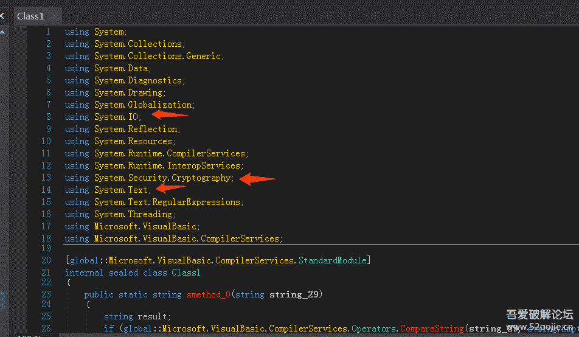
微信截图_20220322230942.png (29.62 KB, 下载次数: 2)
[href="forum.php?mod=attachment&aid=MjUwNjQzMnxhYTdlNzMwY3wxNzkzNTc1OTE4fDE2ODA4NnwxNjA4ODMx&nothumb=yes" target="_blank"](https://www.52pojie.cn/forum.php?mod=attachment&aid=MjUwNjQzMnxhYTdlNzMwY3wxNzkzNTc1OTE4fDE2ODA4NnwxNjA4ODMx&nothumb=yes)
2022-3-22 23:09 上传

## 阅读理解
*什么是 命名空间(`namespace`),类(`class`),方法?
我们把一个程序比作一个公司.
命名空间就是公司的一个部门
类就是这个部门下的一个小组
方法就是这个小组里的人.
类上面为什么会有`using` `import`之类的东西?
比如小组里的张三,需要买一箱矿泉水,首先他要找到超市(引入的命名空间),然后联系超市的配送员李四(引入的命名空间的方法名称)
通知他送一箱矿泉水(参数).就这么简单.
如果你不引用这个命名空间,那么你就需要自己去实现这个功能(自己开生产线,自己生产水瓶,生产净化设备,生产灌装设备,生产运输车,生产包装箱)
回到正题,打开了这个功能之后,程序代码里面就黄色高亮显示这个方法前面的公司,部门了.
否则对于初学者你都知道这个人是哪个公司的,以后想找找个帮忙都不知道怎么联系.

## 练习题
按照上面所讲到的内容,试着用加密解密代码中的
`CryptoStream` (加密参数处理方法)
`DESCryptoServiceProvider`(加密方式处理方法)
`MemoryStream`(流式数据读写方法)
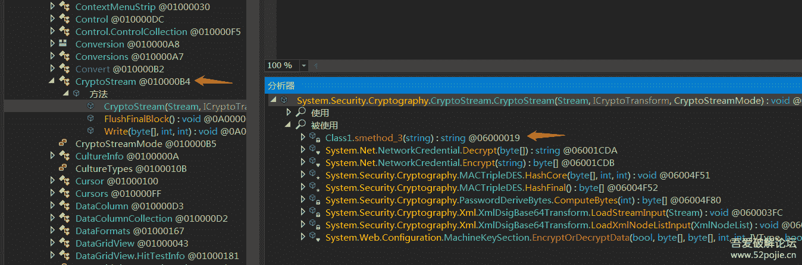
微信截图_20220322231154.png (132.71 KB, 下载次数: 1)
[href="forum.php?mod=attachment&aid=MjUwNjQzNXw5ZWIwMDlkMXwxNzkzNTc1OTE4fDE2ODA4NnwxNjA4ODMx&nothumb=yes" target="_blank"](https://www.52pojie.cn/forum.php?mod=attachment&aid=MjUwNjQzNXw5ZWIwMDlkMXwxNzkzNTc1OTE4fDE2ODA4NnwxNjA4ODMx&nothumb=yes)
2022-3-22 23:13 上传
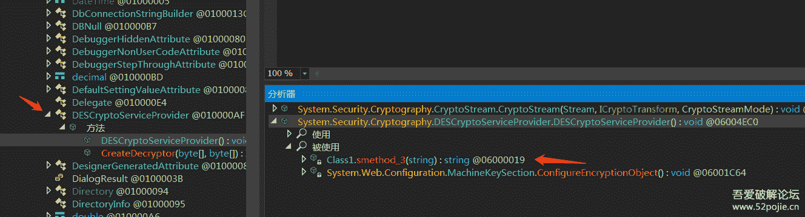
微信截图_20220322231236.png (82 KB, 下载次数: 2)
[href="forum.php?mod=attachment&aid=MjUwNjQzN3w4MjRjNmI5ZXwxNzkzNTc1OTE4fDE2ODA4NnwxNjA4ODMx&nothumb=yes" target="_blank"](https://www.52pojie.cn/forum.php?mod=attachment&aid=MjUwNjQzN3w4MjRjNmI5ZXwxNzkzNTc1OTE4fDE2ODA4NnwxNjA4ODMx&nothumb=yes)
2022-3-22 23:13 上传
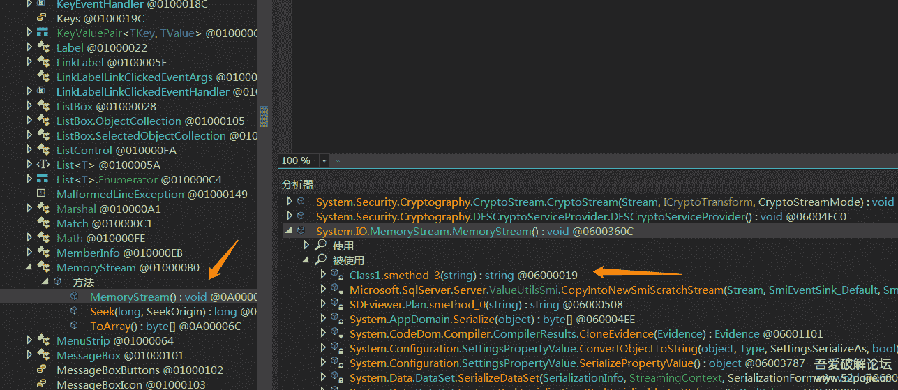
微信截图_20220322231338.png (150.22 KB, 下载次数: 1)
[href="forum.php?mod=attachment&aid=MjUwNjQzN3w4MjRjNmI5ZXwxNzkzNTc1OTE4fDE2ODA4NnwxNjA4ODMx&nothumb=yes" target="_blank"](https://www.52pojie.cn/forum.php?mod=attachment&aid=MjUwNjQzN3w4MjRjNmI5ZXwxNzkzNTc1OTE4fDE2ODA4NnwxNjA4ODMx&nothumb=yes)
2022-3-22 23:13 上传

在类型引用中快速定位加密解密算法
`System`命名空间是系统自带的(`dotnet`,我们常说的`.net3.5`,4.0,4.5,4.7之类的东西),一般不用考虑
对于有一定调试经验的人和写程序的人,这种方法应对大型程序十分有用,
因为大型程序动辄几千万行的代码,你要是查找关键字的话,估计好久好久.
有时候软件的授权方式无非就那么几种,秘钥伪装也无非是常用的几种,
[i]比如我们买衣服一样,
1.我要保暖的(筛选出一批)
2.我要蓝色的(筛选出一批)
3.我要带绒的(筛选出一批)
4.我要这个款式的(筛选出一批)
最后四轮下来一对比可能只有一两件衣服符合以上条件
这样我们就没必要去一件一件衣服去选择了.
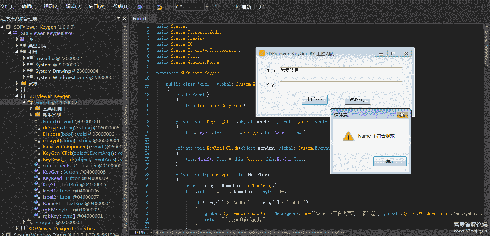
微信截图_20220322232124.png (156.02 KB, 下载次数: 1)
[href="forum.php?mod=attachment&aid=MjUwNjQzOHwzNTAxODgzOHwxNzkzNTc1OTE4fDE2ODA4NnwxNjA4ODMx&nothumb=yes" target="_blank"](https://www.52pojie.cn/forum.php?mod=attachment&aid=MjUwNjQzOHwzNTAxODgzOHwxNzkzNTc1OTE4fDE2ODA4NnwxNjA4ODMx&nothumb=yes)
2022-3-22 23:26 上传
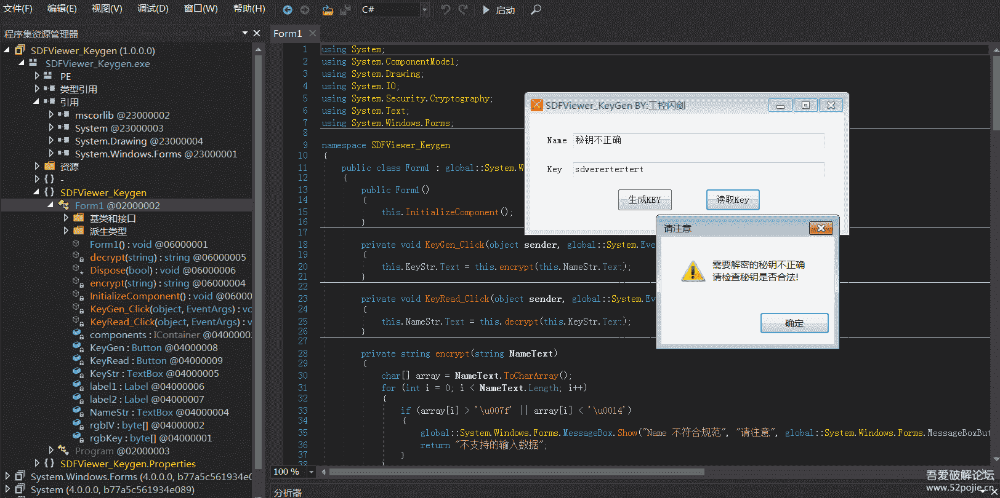
微信截图_20220322232203.png (165.66 KB, 下载次数: 1)
[href="forum.php?mod=attachment&aid=MjUwNjQzOXwyZTkwMmZiOXwxNzkzNTc1OTE4fDE2ODA4NnwxNjA4ODMx&nothumb=yes" target="_blank"](https://www.52pojie.cn/forum.php?mod=attachment&aid=MjUwNjQzOXwyZTkwMmZiOXwxNzkzNTc1OTE4fDE2ODA4NnwxNjA4ODMx&nothumb=yes)
2022-3-22 23:26 上传
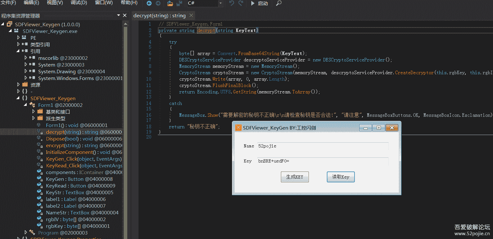
微信截图_20220322232350.png (129.56 KB, 下载次数: 2)
[href="forum.php?mod=attachment&aid=MjUwNjQ0MHw3OGRlYTU5OHwxNzkzNTc1OTE4fDE2ODA4NnwxNjA4ODMx&nothumb=yes" target="_blank"](https://www.52pojie.cn/forum.php?mod=attachment&aid=MjUwNjQ0MHw3OGRlYTU5OHwxNzkzNTc1OTE4fDE2ODA4NnwxNjA4ODMx&nothumb=yes)
2022-3-22 23:26 上传
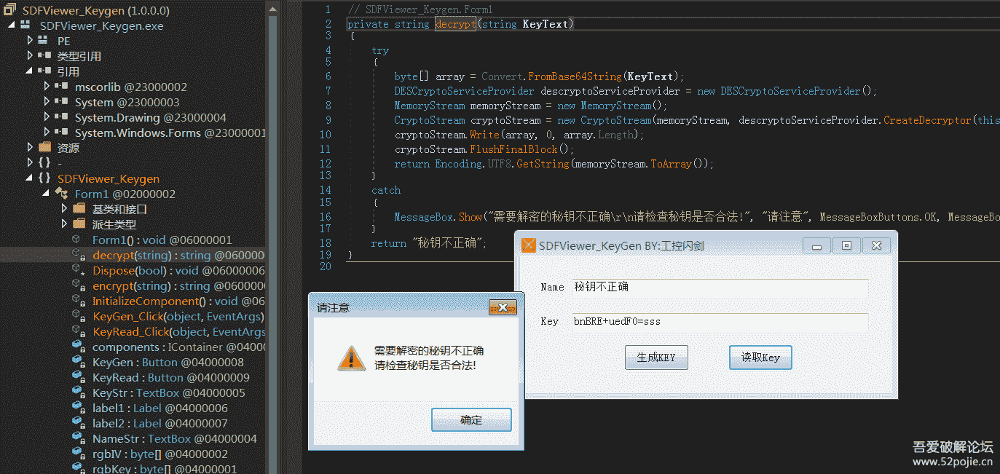
微信截图_20220322232423.png (121.48 KB, 下载次数: 1)
[href="forum.php?mod=attachment&aid=MjUwNjQ0MXxmZDYzZTdlNXwxNzkzNTc1OTE4fDE2ODA4NnwxNjA4ODMx&nothumb=yes" target="_blank"](https://www.52pojie.cn/forum.php?mod=attachment&aid=MjUwNjQ0MXxmZDYzZTdlNXwxNzkzNTc1OTE4fDE2ODA4NnwxNjA4ODMx&nothumb=yes)
2022-3-22 23:26 上传
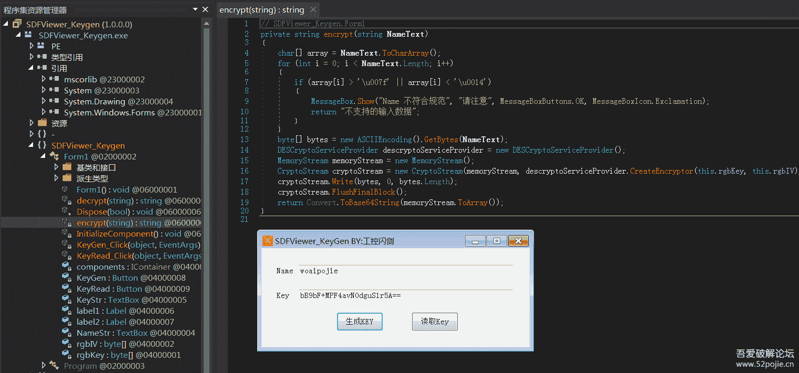
微信截图_20220322232507.png (121.83 KB, 下载次数: 2)
[href="forum.php?mod=attachment&aid=MjUwNjQ0Mnw3ZGJjYTMyN3wxNzkzNTc1OTE4fDE2ODA4NnwxNjA4ODMx&nothumb=yes" target="_blank"](https://www.52pojie.cn/forum.php?mod=attachment&aid=MjUwNjQ0Mnw3ZGJjYTMyN3wxNzkzNTc1OTE4fDE2ODA4NnwxNjA4ODMx&nothumb=yes)
2022-3-22 23:26 上传
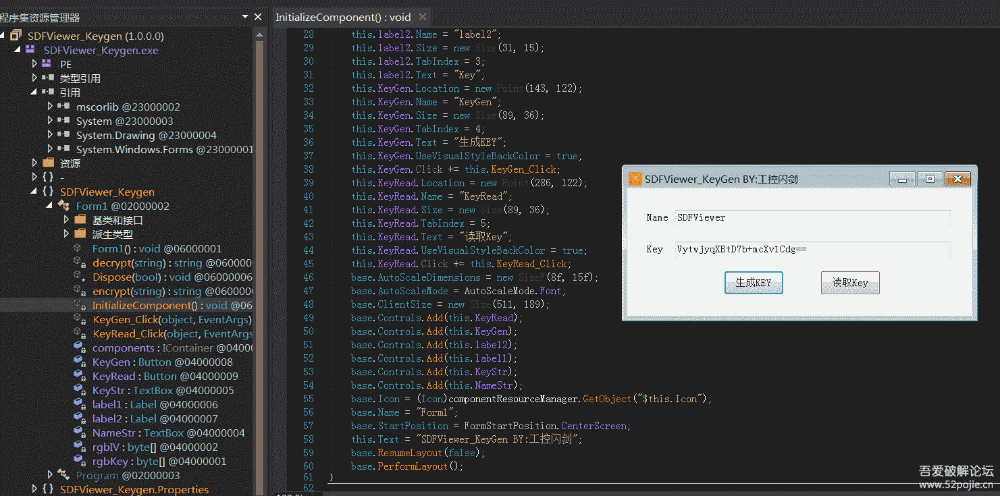
微信截图_20220322232558.png (139.32 KB, 下载次数: 1)
[href="forum.php?mod=attachment&aid=MjUwNjQ0M3w0NWQwY2NiNnwxNzkzNTc1OTE4fDE2ODA4NnwxNjA4ODMx&nothumb=yes" target="_blank"](https://www.52pojie.cn/forum.php?mod=attachment&aid=MjUwNjQ0M3w0NWQwY2NiNnwxNzkzNTc1OTE4fDE2ODA4NnwxNjA4ODMx&nothumb=yes)
2022-3-22 23:26 上传

论坛不允许发成品,所以我就把关键代码截图了,也是给大家一个学习C#编程开始的动力.

## 总结
[b][u]我相信接触过反编译的一部分人如果走出来了,大概率会向编程方面发展,
[b][u]毕竟你要反编译别人的东西,首先要知道别人的思路和别人的程序架构流程,
这就像你要研究一道菜的秘方,首先你要自己弄懂这道菜都下了什么料,所有食材都需要了解
当你能弄懂99%的东西,剩下那百分之一只需要看一下流程就知道是怎么下的料.
当别人的菜有缺陷的时候,你还可以去完善这道菜.
希望这篇文章对你了解`dnspy`有一定帮助.
