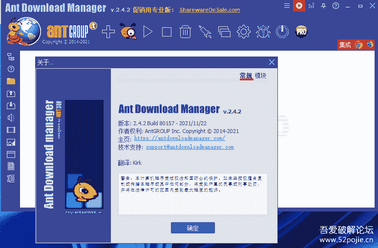

# [原创] 去某下载工具的使用日期限制

- 原帖: `https://www.52pojie.cn/forum.php?mod=viewthread&tid=1609192`
- 抓取时间: `2026-11-01T23:31:53`

ＩＤＭ 想下载种子文件，要二次加工，就想找个好用的下载工具。看到这个某下载工具。想测试一下。结果，很多限制。看到其中一个早期版本是全功能版，但只能在特定日期安装使用。`2020-12-15` 这个日期很重要。还是标出来吧。只是测试就用他吧。改日期安装完成。运行正常。但日期改来改去多麻烦。手痒就去掉这个限制吧。大神可以飘过了。不过做为新手练手还真的不错。全过程还是比较简单的。不再多说，进入主题。

## 运行软件

出来 专业版只能在限定时间内安装


1.png (13.92 KB, 下载次数: 1)

[href="forum.php?mod=attachment&aid=MjUwNjY1NXwyZWM1NDMzYnwxNzkzNTc1OTEwfDE2ODA4NnwxNjA5MTky&nothumb=yes" target="_blank"](https://www.52pojie.cn/forum.php?mod=attachment&aid=MjUwNjY1NXwyZWM1NDMzYnwxNzkzNTc1OTEwfDE2ODA4NnwxNjA5MTky&nothumb=yes)

2022-3-23 15:22 上传

ＯＤ 载入 把有关日期时间的断点都下上

实际上我在运行程序的时候看到了 `msvcr120`

所以 `bp _localtime64_s` 这个最好使。

来到这里

[Asm] 纯文本查看 复制代码
```
01153A59  /$  68 4C020000          push 0x24C
01153A5E  |.  B8 2E9C1B01          mov eax,AntDM.011B9C2E
01153A63  |.  E8 B5FB0300          call AntDM.0119361D
01153A68  |.  8D85 A8FDFFFF        lea eax,[local.150]
01153A6E  |.  68 90312401          push AntDM.01243190
01153A73  |.  50                   push eax
01153A74  |.  FF15 04061C01        call dword ptr ds:[]   ;  msvcr120._localtime64_s
01153A7A  |.  8D85 A8FDFFFF        lea eax,[local.150]
01153A80  |.  50                   push eax                                         ; /t = 6239F280
01153A81  |.  68 40F41F01          push AntDM.011FF440                              ; |fmt = "%d %B %Y"
01153A86  |.  8D85 E4FDFFFF        lea eax,[local.135]                              ; |
01153A8C  |.  68 04010000          push 0x104                                       ; |maxcount = 104 (260.)
01153A91  |.  50                   push eax                                         ; |wstr = 6239F280
01153A92  |.  FF15 A0061C01        call dword ptr ds:[]         ; \wcsftime
01153A98  |.  83C4 18              add esp,0x18
01153A9B  |.  EB 08                jmp short AntDM.01153AA5
01153A9D  |>  6A 64                /push 0x64                                       ; /Timeout = 100. ms
01153A9F  |.  FF15 DC021C01        |call dword ptr ds:[]           ; \Sleep
01153AA5  |>  8B0D FC152401         mov ecx,dword ptr ds:[0x12415FC]
01153AAB  |.  85C9                 |test ecx,ecx
01153AAD  |.^ 74 EE                \je short AntDM.01153A9D
01153AAF  |.  E8 2C0DF3FF          call AntDM.010847E0
```

往下看

[Asm] 纯文本查看 复制代码
```
01153B46  |.  33C9                 xor ecx,ecx
01153B48  |.  E8 B07BFBFF          call AntDM.0110B6FD
01153B4D  |.  59                   pop ecx                                          ;  AntDM.01153C33
01153B4E  |.  59                   pop ecx                                          ;  AntDM.01153C33
01153B4F  |.  53                   push ebx
01153B50  |.  6A 01                push 0x1
01153B52  |.  8D8D CCFDFFFF        lea ecx,[local.141]
01153B58  |.  E8 EB03E9FF          call AntDM.00FE3F48
01153B5D  |.  53                   push ebx                                         ; /ExitCode = 0x157C8E8
01153B5E  \.  FF15 60011C01        call dword ptr ds:[]      ; \ExitProcess
01153B64      CC                   int3
```

跟一次就明白了，出来对话框。然后程序退出

`ExitProcess`

能看到这，工作就算是完成 ８０％ 了

然后看是谁ｃａｌｌ 这段代码。看堆栈。

`071AFDE4   01153C33  返回到 AntDM.01153C33 来自 AntDM.01153A59`

`071AFDE8   0157C8E8`

`071AFDEC   00000000`

右键跟踪。来到这里

`01153C2E  |> \E8 26FEFFFF          call AntDM.01153A59`

`01153C33  |.  CC                   int3`

`01153C2E` 这个地址往上找

`01153BBF  |.  3915 94312401        cmp dword ptr ds:[0x1243194],edx`

`01153BC5  |.  7F 0A                jg short AntDM.01153BD1`

`01153BC7  |.  7C 65                jl short AntDM.01153C2E －－－这里`

`01153BC9  |.  3905 90312401        cmp dword ptr ds:[0x1243190],eax`

`01153BCF  |.  72 5D                jb short AntDM.01153C2E  －－－这里`

`01153BD1  |>  E8 870EEBFF          /call AntDM.01004A5D`

`01153BD6  |.  8945 F8              |mov [local.2],eax`

`01153BD9  |.  0BC2                 |or eax,edx`

`01153BDB  |.  8955 FC              |mov [local.1],edx`

`01153BDE  |.  75 10                |jnz short AntDM.01153BF0`

`01153BE0  |.  B9 C0D40100          |mov ecx,0x1D4C0`

`01153BE5  |.  E8 97A8FEFF          |call AntDM.0113E481`

`01153BEA  |.  84C0                 |test al,al`

`01153BEC  |.^ 74 E3                \je short AntDM.01153BD1`

`01153BEE  |.  EB 39                jmp short AntDM.01153C29`

`01153BF0  |>  8D4D F8              lea ecx,[local.2]`

`01153BF3  |.  E8 9243EAFF          call AntDM.00FF7F8A`

`01153BF8  |.  8945 F8              mov [local.2],eax`

`01153BFB  |.  8955 FC              mov [local.1],edx`

`01153BFE  |.  3B15 94312401        cmp edx,dword ptr ds:[0x1243194]`

`01153C04  |.  7F 28                jg short AntDM.01153C2E－－－这里`

`01153C06  |.  7C 08                jl short AntDM.01153C10`

`01153C08  |.  3B05 90312401        cmp eax,dword ptr ds:[0x1243190]`

`01153C0E  |.  77 1E                ja short AntDM.01153C2E－－－这里`

好了，在上面下断吧。看看吧。就是对比时间

然后在 内存地址下 硬件写入断点 别的断点都删除了吧。没什么用了。过河拆桥，当然你喜欢不删除也无所谓。

重新加载

`01153509  |.  A3 90312401          mov dword ptr ds:[0x1243190],eax                 ;  AntDM.0123D1DC`

断在这了。

往上看

[Asm] 纯文本查看 复制代码
```
011534D6  |.  8365 DC 00           and [local.9],0x0
011534DA  |.  8D45 D8              lea eax,[local.10]
011534DD  |.  8365 D8 00           and [local.10],0x0
011534E1  |.  50                   push eax                                         ;  AntDM.0123D1DC
011534E2  |.  C745 E0 08000000     mov [local.8],0x8
011534E9  |.  C745 E4 0F000000     mov [local.7],0xF
011534F0  |.  C745 E8 0B000000     mov [local.6],0xB
011534F7      C745 EC AA000000     mov dword ptr ss:[ebp-0x14],0x78
011534FE  |.  FF15 08061C01        call dword ptr ds:[]        ;  msvcr120._mktime64
```

这个就是生成了 `2020-12-15 08:00:00`

好了。我们给加个30年就把 `0x78`改 成 `0xAA`

`011534F7      C745 EC AA000000     mov dword ptr ss:[ebp-0x14],0xAA`

ＯＫ！收工。


2.png (46.54 KB, 下载次数: 2)

[href="forum.php?mod=attachment&aid=MjUwNjY1Nnw2YzgyNzRmZXwxNzkzNTc1OTEwfDE2ODA4NnwxNjA5MTky&nothumb=yes" target="_blank"](https://www.52pojie.cn/forum.php?mod=attachment&aid=MjUwNjY1Nnw2YzgyNzRmZXwxNzkzNTc1OTEwfDE2ODA4NnwxNjA5MTky&nothumb=yes)

2022-3-23 15:23 上传

=========================分割符============================

有问我要原版的。我也不知道违规不违规。

论坛里就有，大家也不搜一搜，版本比我这个测试着玩的还新一年。

哈也别说 上 地址：`//www.52pojie.cn/forum.php?mod=viewthread&tid=1551716" target="_blank"`](https://www.52pojie.cn/forum.php?mod=viewthread&tid=1551716:href="https)

如果大家看到了我下的断点那就秒破

下断点  `_localtime64_s`

断在这

[Asm] 纯文本查看 复制代码
```
657E7888 >  55              push ebp
657E7889    8BEC            mov ebp,esp
657E788B    83EC 14         sub esp,0x14
657E788E    53              push ebx
657E788F    56              push esi
```

返回 返回 返回 到 程序领空

`001D4CE8  |.  C745 E0 08000>mov [local.8],0x8`

`001D4CEF  |.  C745 E4 0F000>mov [local.7],0xF`

`001D4CF6  |.  C745 E8 0B000>mov [local.6],0xB`

`001D4CFD      C745 EC AA000>mov dword ptr ss:[ebp-0x14],0xAA -----这里给 AA`

`001D4D04  |.  FF15 1C162400 call dword ptr ds:[>;  msvcr120._mktime64`

`001D4D0A  |.  BB D0692400   mov ebx,AntDM.002469D0                   ;  UNICODE "S"`

收工，想练手的 试试吧。



4.png (107.49 KB, 下载次数: 1)

[href="forum.php?mod=attachment&aid=MjUwNjcyOXxmYzdmZWEzNnwxNzkzNTc1OTEwfDE2ODA4NnwxNjA5MTky&nothumb=yes" target="_blank"](https://www.52pojie.cn/forum.php?mod=attachment&aid=MjUwNjcyOXxmYzdmZWEzNnwxNzkzNTc1OTEwfDE2ODA4NnwxNjA5MTky&nothumb=yes)

2022-3-23 18:00 上传

对了，练的爽的给我支持一下。用不到的也就不强求了。

祝大家开心每一天吧！！！！
