# [原创] Crack入门

- 原帖: https://www.52pojie.cn/forum.php?mod=viewthread&tid=1610105
- 抓取时间: 2026-11-01T23:31:38

## Crack入门：abex'crackme

### 1.前期信息探查：

#### 1.EXEinfo：

无壳，32位，用VB编写的程序：

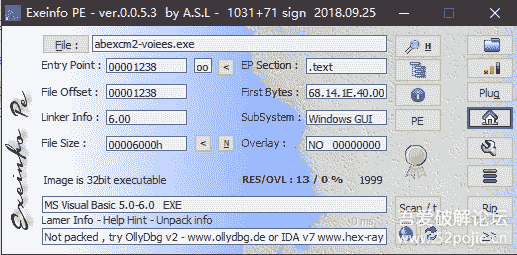

R\`LI3Q[SSP(A0Y}FX]Y62_3.png (93.74 KB, 下载次数: 1)

[附件下载](https://www.52pojie.cn/forum.php?mod=attachment&aid=MjUwNzgwMnw5MjBiOGIwYnwxNzkzNTc1ODk1fDE2ODA4NnwxNjEwMTA1&nothumb=yes)

2022-3-26 00:17 上传

#### 2.运行一下：

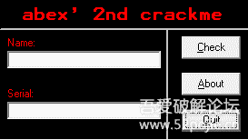

%L0VB13Z7Y7}$I9\`YH1]A[P.png (8.29 KB, 下载次数: 2)

[附件下载](https://www.52pojie.cn/forum.php?mod=attachment&aid=MjUwNzgwM3w0ODczZThjNHwxNzkzNTc1ODk1fDE2ODA4NnwxNjEwMTA1&nothumb=yes)

2022-3-26 00:18 上传

要求我们输入 `name` 和序列号，随便输入一些东西，查看报错：

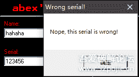

[]@HBPY)U~9HA56HCI2)F9A.png (10.68 KB, 下载次数: 1)

[附件下载](https://www.52pojie.cn/forum.php?mod=attachment&aid=MjUwNzgwNHxjZGY0ZjE2ZHwxNzkzNTc1ODk1fDE2ODA4NnwxNjEwMTA1&nothumb=yes)

2022-3-26 00:19 上传

### 2.前置知识补充：

#### 1.what is the visual basic？

- VB文件使用名为 `MSVBVM60.dll` 的VB专用引擎（Microsoft Visual Basic Virtual Machine 6.0）
- 根据使用的编译选项不同VB文件可以编译为本地代码（N code）与伪代码（P code），前者适用于调试器解析的IA-32指令；后者是一种解释器语言，它使用由VB引擎实现虚拟机并课自解析的指令（字节码）。因此，若想准确解析VB的伪代码就需要分析VB引擎并实现模拟器。
- 该语言适用于编写GUI图形界面,VB程序采用windows操作系统的事件驱动方式工作，所以在 `main( )` 或 `Winmain( )` 中并不存在用户代码(希望调试的代码)，用户代码存在于各个事件处理程序之中。

### 3、动态调试：

执行程序后，在EP代码中首先要做的是调用VB引擎的主函数。EP的地址为 `401238`

```
401232 jmp dword ptr ds:[0x4010A0]  ；该jmp指令会跳转至VB引擎的主函数ThunRTMain()前面压入栈的地址                                       值作为ThunRTMain()的参数
401238 push 401e14                  ；=>ep入口，push用来把RT_MainStruct结构体的地址压入栈
40123d call 401232
```

- 间接调用：`40123D` 处的 `call` 跳转去的地方是一个 `jmp`，并不是直接转到 `MSVBVM60.dll`，而是通过中间地址 `4010A0` 跳转（`4010A0` 处为 `IAT`）
- `RT_MainStruct` 结构体：`ThunRTMain( )` 函数的参数 `RT_MainStruct` 结构体，其成员是其他结构体的地址，也就是VB引擎通过参数传递过来的 `RT_MainStruct` 结构体获取程序运行需要的信息

汇编指令回顾：

- `ZF` 标志：判断结果是否为0，为零则值为一，反之则为零。
- `JE`：条件转移指令，若 `ZF` 为1，则跳转
- `test`：做 `and` 操作，但和 `and` 不同的是它不会赋值，单纯的修改指令寄存器

#### 4> 1.寻找核心判断：

现阶段首先考虑的是从字符串下手，之前出现了错误提示 `Nope， this serial is wrong！` 于是我们右击→查找→所有参考文本字串。找到对应字符串，双击进入汇编代码，有错误的就有正确，所以一定有判断语句，往上翻就能看到 `je`（条件跳转），和上面的 `test`（`and` 操作）


OL8(]U6\`J%K%JOUUT(ADN\`X.png (14.21 KB, 下载次数: 2)

[附件下载](https://www.52pojie.cn/forum.php?mod=attachment&aid=MjUwNzgwNXxmYmRiMDA1NXwxNzkzNTc1ODk1fDE2ODA4NnwxNjEwMTA1&nothumb=yes)

2022-3-26 00:24 上传

注意到 `call` 指令调用的是 `__vbaVarTstEQ()` 函数，这个函数的作用就是字符串比较

为了验证可以在 `403332` 处下个断点，然后 `F9` 运行到这里将 `ZF` 的值改成 `0`，这样 `F9` 就可以看到成功的提示了。

#### 4> 2.查看当前序列号：

既然已经知道字符串比较函数在 `403329` 处，那么上面的 `push` 很明显就是要比较的两个字符串，在 `403329` 处下断点。然后 `F9` 运行，还是随便输入点东西：

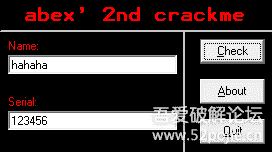

$I_D%WWVZ3YY@VWX@7YK1DF.png (8.08 KB, 下载次数: 2)

[附件下载](https://www.52pojie.cn/forum.php?mod=attachment&aid=MjUwNzgwN3w3YjdiMWNjY3wxNzkzNTc1ODk1fDE2ODA4NnwxNjEwMTA1&nothumb=yes)

2022-3-26 00:25 上传

当程序停在 `403329` 处时，在寄存器处选中 `EAX`，`EDX` 然后 `Follow in dump` 就可以看到真正的序列号了

```
00403327   .  52            push edx                                 ; /var18 = 0019F1AC
00403328   .  50            push eax                                 ; |var28 = 0019F1BC
00403329   .  FF15 58104000 call dword ptr ds:[; \__vbaVarTstEq
```

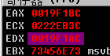

24]5Z%8ICO[83LK4F]DAM]M.png (1.73 KB, 下载次数: 2)

[附件下载](https://www.52pojie.cn/forum.php?mod=attachment&aid=MjUwNzgwOHwyMzcyMGZkMnwxNzkzNTc1ODk1fDE2ODA4NnwxNjEwMTA1&nothumb=yes)

2022-3-26 00:29 上传

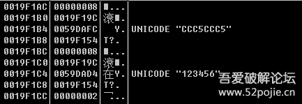

4~FUXER(XR\`9M@DIC4YP]DQ.png (8.03 KB, 下载次数: 1)

[附件下载](https://www.52pojie.cn/forum.php?mod=attachment&aid=MjUwNzgwOXw2YmNiODdjNHwxNzkzNTc1ODk1fDE2ODA4NnwxNjEwMTA1&nothumb=yes)

2022-3-26 00:29 上传

现在可以去验证一下看序列号是否正确：

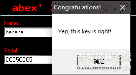

E5A}T8@X7\`WQG1IOFWZE~}X.png (10.35 KB, 下载次数: 1)

[附件下载](https://www.52pojie.cn/forum.php?mod=attachment&aid=MjUwNzgxMHxlOThkZWNiN3wxNzkzNTc1ODk1fDE2ODA4NnwxNjEwMTA1&nothumb=yes)

2022-3-26 00:30 上传

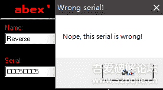

9T8KO05}136R6UZ}~G}K6HP.png (10.56 KB, 下载次数: 2)

[附件下载](https://www.52pojie.cn/forum.php?mod=attachment&aid=MjUwNzgxMXxjM2RjNjEwYnwxNzkzNTc1ODk1fDE2ODA4NnwxNjEwMTA1&nothumb=yes)

2022-3-26 00:31 上传

很显然两者对比发现序列号是根据 `name` 来随机生成的，所以继续分析 `Serial` 的算法

#### 4> 2.算法分析：

在代码分析之前先预测一下加密算法的代码，如果是win32 API程序，则会有如下特点：

- 读取 `name` 字符串（使用 `GetWindowText`、`GetDlgItemText` 等API）
- 开始循环，对字符串进行加密（`XOR`，`ADD`，`SUB` 等）

在之前的程序分析时已经知道有一个关于序列号的条件判断语句（`403332`），下面就是往上分析代码，理解算法逻辑了。

tips：VB文件的函数之间存在着 `NOP` 指令

根据tips的特点我们直接往上翻，可以定位到 `402ED0` 处：

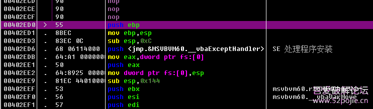

45IYV0SKHV]TL23(108SK~I.png (14.78 KB, 下载次数: 1)

[附件下载](https://www.52pojie.cn/forum.php?mod=attachment&aid=MjUwNzgxMnxiMDFjYzlhYnwxNzkzNTc1ODk1fDE2ODA4NnwxNjEwMTA1&nothumb=yes)

2022-3-26 00:34 上传

`402ED0` 和 `402ED1` 可以看到一个典型的形成新的栈帧的操作，这里确定这是函数开始的部分。

然后这个part相当与初始化个变量

```
00402F7E   .  50            push eax     ;类对象模版地址
00402F7F   .  8D85 74FFFFFF lea eax,dword ptr ss:[ebp-0x8C]
00402F85   .  50            push eax     ;欲要设置引用对象指针给eax
00402F86   .  FF15 38104000 call dword ptr ds:[;  msvbvm60.__vbaObjSet
```

接着就是获取 `name` 字符串，这里结合 `F9` 分析：

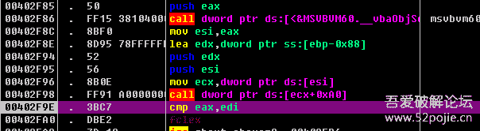

RHGCX]RY~_GG\`W$)2CB%\`JD.png (12.82 KB, 下载次数: 1)

[附件下载](https://www.52pojie.cn/forum.php?mod=attachment&aid=MjUwNzgxNHw4MzlhY2Q1N3wxNzkzNTc1ODk1fDE2ODA4NnwxNjEwMTA1&nothumb=yes)

2022-3-26 00:37 上传

当执行到 `402F9E` 处时，`ebp-0x88` 处就放入了 `“hahaha”`

```
00402F8C   .  8BF0          mov esi,eax
00402F8E   .  8D95 78FFFFFF lea edx,dword ptr ss:[ebp-0x88]   ;用于保存Name字符串的对象
00402F94   .  52            push edx
00402F95   .  56            push esi
00402F96   .  8B0E          mov ecx,dword ptr ds:[esi]               ;  abexcm2-.004042F0
00402F98   .  FF91 A0000000 call dword ptr ds:[ecx+0xA0]    ;获取Name
```

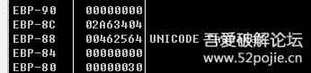

GG%O78PE}~M@KN2]U_{%JZ2.png (6.32 KB, 下载次数: 1)

[附件下载](https://www.52pojie.cn/forum.php?mod=attachment&aid=MjUwNzgxNXw2ODY3MmNiN3wxNzkzNTc1ODk1fDE2ODA4NnwxNjEwMTA1&nothumb=yes)

2022-3-26 00:39 上传

当然也可以直接点汇编窗口的 `402F8E` 处的 `ss:[ebp-0x88]`，右击数据窗口跟随。

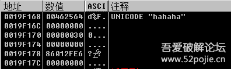

%7T$)33OW@T9LJ\`[NV6F2[W.png (7.3 KB, 下载次数: 0)

[附件下载](https://www.52pojie.cn/forum.php?mod=attachment&aid=MjUwNzgxNnxhNWY1NmI0NXwxNzkzNTc1ODk1fDE2ODA4NnwxNjEwMTA1&nothumb=yes)

2022-3-26 00:40 上传


# `Name` 字符串存储与长度判断

`Name` 字符串（以字符串的对象的形式）存储的地址为：`[ebp-0x88]`。

## 长度判断

接受到字符串后，下一步是判断 `Name` 的长度是否小于 4（这个部分的代码一直到 `4030F9`，其实有一部分是小于 4 时的错误输出），判断依据为：

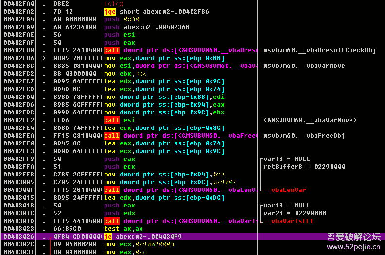

``6{56)GN7B7S{`@YZ9)J4(6G.png`` (31.74 KB, 下载次数: 1)

[href="forum.php?mod=attachment&aid=MjUwNzgxOHwyNjE2ODE5YnwxNzkzNTc1ODk1fDE2ODA4NnwxNjEwMTA1&nothumb=yes" target="_blank"](https://www.52pojie.cn/forum.php?mod=attachment&aid=MjUwNzgxOHwyNjE2ODE5YnwxNzkzNTc1ODk1fDE2ODA4NnwxNjEwMTA1&nothumb=yes)

2022-3-26 00:43 上传

`__vbaLenVar` 函数判断的是字符串长度。

`__vbavartstLt` 这里是上一个函数返回的长度，是否大于等于于 4，这里注意是大于四时才跳转到 `4030F9` 处的地址继续执行，否则执行下方代码（也就是报错）。

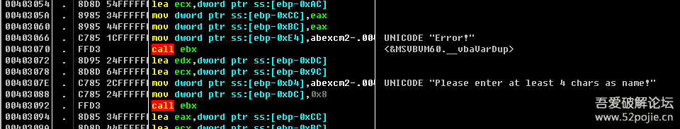

``284{G1H@}FCZ}R(%}5O`[0G.png`` (15.06 KB, 下载次数: 0)

[href="forum.php?mod=attachment&aid=MjUwNzgxOXwyMzNjOGU1ZXwxNzkzNTc1ODk1fDE2ODA4NnwxNjEwMTA1&nothumb=yes" target="_blank"](https://www.52pojie.cn/forum.php?mod=attachment&aid=MjUwNzgxOXwyMzNjOGU1ZXwxNzkzNTc1ODk1fDE2ODA4NnwxNjEwMTA1&nothumb=yes)

2022-3-26 00:45 上传

### 长度小于 4 时的测试

这里尝试了一下长度小于四时：

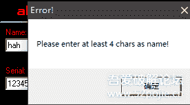

`QF4[5BZHU4J$ET)RE$P5BWN.png` (9.91 KB, 下载次数: 1)

[href="forum.php?mod=attachment&aid=MjUwNzgyMHwxYWUwMGU2Y3wxNzkzNTc1ODk1fDE2ODA4NnwxNjEwMTA1&nothumb=yes" target="_blank"](https://www.52pojie.cn/forum.php?mod=attachment&aid=MjUwNzgyMHwxYWUwMGU2Y3wxNzkzNTc1ODk1fDE2ODA4NnwxNjEwMTA1&nothumb=yes)

2022-3-26 00:47 上传

## 加密循环

当输入的数值不小于 4 跳转到 `4030F9` 处后，下面代码进行的就是加密循环了，大概流程如下：

```
00403102   .  BB 04000000   mov ebx,0x4                                ; EBX = 4(loop count)
···
0040318B   .  FF15 30104000 call dword ptr ds:[  ; \__vbaVarForInit
00403191   .  8B1D 4C104000 mov ebx,dword ptr ds:[  ;     msvbvm60.rtcMidCharVar
00403197   >  85C0          test eax,eax                               ; loop start
00403199   .  0F84 06010000 je abexcm2-.004032A5
···
0040329A   .  FF15 C0104000 call dword ptr ds:[  ; \__vbaVarForNext
004032A0   .^ E9 F2FEFFFF   jmp abexcm2-.00403197                      ; loop end
004032A5   >  8B45 08       mov eax,dword ptr ss:[ebp+0x8]
```

先总体分析一下这个循环的框架，`EBX` 作为循环的次数，而 `vbaVarForInit()` 函数和 `vbaVarForNext()` 函数是对字符串对象进行逐个字符引用。

### 加密方法分析

下面我们主要对循环的加密方法进行分析：

在循环开始也就是 `403102` 处下个断点，`Ctrl+F2` 重新调试，弹出对话框随便输入一些东西：

开始一路 `F8` 分析，直到注意到下图

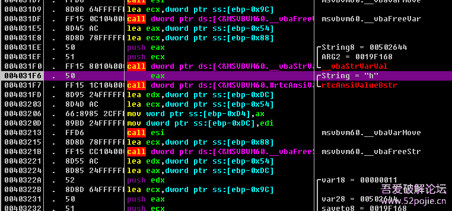

``5)2WC6@4{JV5EW`[TFSJRIE.png`` (23.67 KB, 下载次数: 1)

[href="forum.php?mod=attachment&aid=MjUwNzgyMnxkYmJhYWY4ZnwxNzkzNTc1ODk1fDE2ODA4NnwxNjEwMTA1&nothumb=yes" target="_blank"](https://www.52pojie.cn/forum.php?mod=attachment&aid=MjUwNzgyMnxkYmJhYWY4ZnwxNzkzNTc1ODk1fDE2ODA4NnwxNjEwMTA1&nothumb=yes)

2022-3-26 00:52 上传

`__vbaStrVarVal` 函数获取该字符的 `ASCII` 码的内存地址（直接指向该字符而不是字符变量）。

`__rtcAnsiValueBstr` 获取该字符的 `ASCII` 码的十六进制值并保存在 `eax` 中（`eax` 直接存储着这个码）。

当指令执行到 `4031FD` 处时，就可以看到 `eax` 的值为 68。

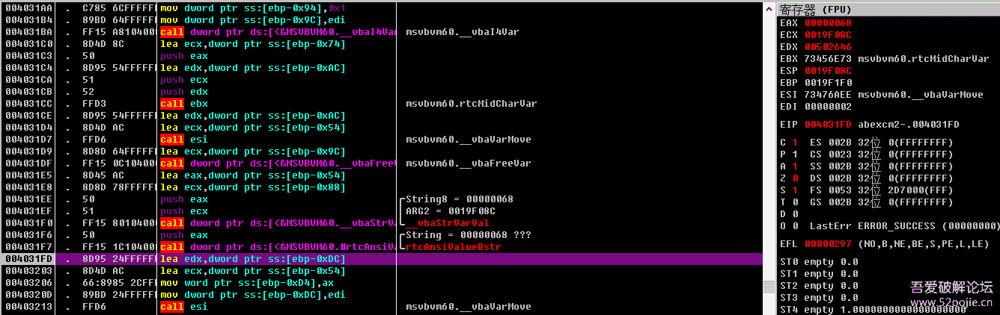

``%M7YBQK{QYSVY@ZBW`RE.png`` (34.75 KB, 下载次数: 1)

[href="forum.php?mod=attachment&aid=MjUwNzgyM3wzMmViMTdjNXwxNzkzNTc1ODk1fDE2ODA4NnwxNjEwMTA1&nothumb=yes" target="_blank"](https://www.52pojie.cn/forum.php?mod=attachment&aid=MjUwNzgyM3wzMmViMTdjNXwxNzkzNTc1ODk1fDE2ODA4NnwxNjEwMTA1&nothumb=yes)

2022-3-26 00:52 上传

#### 汇编代码解释

```
004031F0   .  FF15 80104000 call dword ptr ds:[]    ; \__vbaStrVarVal

004031F6   .  50            push eax                                          ; 从Name字符串中获取的一个字符(UNICODE)

                                                                              ; 这里获得的值为“h”

004031F7   .  FF15 1C104000 call dword ptr ds:[; \rtcAnsiValueBstr()获取字符的十六进制ASCII码值

00403221   .  8D55 AC       lea edx,dword ptr ss:[ebp-0x54]

00403224   .  8D85 24FFFFFF lea eax,dword ptr ss:[ebp-0xDC]

0040322A   .  52            push edx                                          ; EDX = 68

0040322B   .  8D8D 64FFFFFF lea ecx,dword ptr ss:[ebp-0x9C]                   

00403231   .  50            push eax                               

00403232   .  51            push ecx                                          ; dest

00403233   .  C785 2CFFFFFF>mov dword ptr ss:[ebp-0xD4],0x64                  

0040323D   .  89BD 24FFFFFF mov dword ptr ss:[ebp-0xDC],edi                   ; [EBP-DC] = EAX = 64
```

接着往下走 `call` 了一个 `__vbaVarAdd`，这个函数的作用是两个变量值相加。

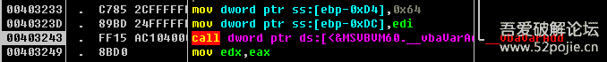

``%XLB_3K5Y{F8H@8I{O`~GVW.png`` (8.43 KB, 下载次数: 1)

[href="forum.php?mod=attachment&aid=MjUwNzgyNHwzZjY4ZGI1M3wxNzkzNTc1ODk1fDE2ODA4NnwxNjEwMTA1&nothumb=yes" target="_blank"](https://www.52pojie.cn/forum.php?mod=attachment&aid=MjUwNzgyNHwzZjY4ZGI1M3wxNzkzNTc1ODk1fDE2ODA4NnwxNjEwMTA1&nothumb=yes)

2022-3-26 00:54 上传

看上面的两条指令，第一个变量的值已经确定为 `0x64`，另一个的值跟踪数据地址可以发现就是用户名的第一个地址

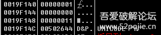

`QF67)6E@9ZA_UP}(MMQO99Q.png` (6.35 KB, 下载次数: 1)

[href="forum.php?mod=attachment&aid=MjUwNzgyNXxjMDIyYjA2OHwxNzkzNTc1ODk1fDE2ODA4NnwxNjEwMTA1&nothumb=yes" target="_blank"](https://www.52pojie.cn/forum.php?mod=attachment&aid=MjUwNzgyNXxjMDIyYjA2OHwxNzkzNTc1ODk1fDE2ODA4NnwxNjEwMTA1&nothumb=yes)

2022-3-26 00:58 上传

也就是说这条指令的作用就是 `0x68+0x64=0xcc`，这里的 `0x64` 可以理解成加密过程中的一个运算。

再看下一个函数：

`__rtcHexVarFromVar` 将计算结果转换为 `UNICODE` 形式：

指令 `F8` 到 `403261` 处，就可以看到此时值已经 `add` 后的结果已经变成了 `UNICODE` 形式：

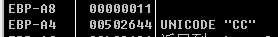

`C(9_%U8BG@63}[Q[N3HOM.png` (1.26 KB, 下载次数: 0)

[href="forum.php?mod=attachment&aid=MjUwNzgyOHw1MGI3ZWUwMXwxNzkzNTc1ODk1fDE2ODA4NnwxNjEwMTA1&nothumb=yes" target="_blank"](https://www.52pojie.cn/forum.php?mod=attachment&aid=MjUwNzgyOHw1MGI3ZWUwMXwxNzkzNTc1ODk1fDE2ODA4NnwxNjEwMTA1&nothumb=yes)

2022-3-26 01:02 上传

### 拼接生成字符串

循环的最后一部分是把生成的字符串连接出来：

```
0040326C   .  8D4D BC       lea ecx,dword ptr ss:[ebp-0x44]
0040326F   .  8D55 AC       lea edx,dword ptr ss:[ebp-0x54]
00403272   .  51            push ecx           ;Old
00403273   .  8D85 64FFFFFF lea eax,dword ptr ss:[ebp-0x9C]
00403279   .  52            push edx           ;NEW
0040327A   .  50            push eax           ;Serial = strcat(Old, New)
0040327B   .  FF15 84104000 call dword ptr ds:[]       ;  msvbvm60.__vbaVarCat
```

那具体是连接什么呢？

分别跟踪这三个值就会发现一处其实是 0，这让我有点想不明白，直到我做第二次循环才发现这个加密的逻辑：

- 接收用户名字符串，序列号从前四个字符生成
- 将每个字符的 `ASCII` 码值加上 `0x64` 然后把结果转换成 `UNICODE` 形式
- 将所有 `UNICODE` 值拼接在一起

## 写注册机

```
Old = input("请输入您的用户名：")

i = 0

Serial = ""

while i
```

写完试一下：

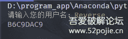

`~L1LYBABYOJSPDNSHPA$W1D.png` (29.76 KB, 下载次数: 1)

[href="forum.php?mod=attachment&aid=MjUwNzgyOXxjYWVjZjY0NXwxNzkzNTc1ODk1fDE2ODA4NnwxNjEwMTA1&nothumb=yes" target="_blank"](https://www.52pojie.cn/forum.php?mod=attachment&aid=MjUwNzgyOXxjYWVjZjY0NXwxNzkzNTc1ODk1fDE2ODA4NnwxNjEwMTA1&nothumb=yes)

2022-3-26 01:04 上传

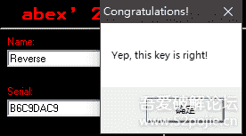

`@J8JVDYF]GV6IRFAUL)6ORB.png` (10.65 KB, 下载次数: 1)

[href="forum.php?mod=attachment&aid=MjUwNzgzMHwyNjMyMzYwYXwxNzkzNTc1ODk1fDE2ODA4NnwxNjEwMTA1&nothumb=yes" target="_blank"](https://www.52pojie.cn/forum.php?mod=attachment&aid=MjUwNzgzMHwyNjMyMzYwYXwxNzkzNTc1ODk1fDE2ODA4NnwxNjEwMTA1&nothumb=yes)

2022-3-26 01:05 上传
