# [原创] CrackMe160学习记录2 Afkayas

- 原帖：<https://www.52pojie.cn/forum.php?mod=viewthread&tid=1610514>
- 抓取时间：2026-11-01T23:31:33

## 2 Afkayas

### 1. 前期信息探查

#### 1. EXEinfo

32位，无壳，VB编写的程序。

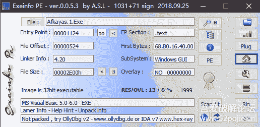

BEEPI0S)LB\`89N_HU8P_}N9.png (93.36 KB, 下载次数: 1)

<https://www.52pojie.cn/forum.php?mod=attachment&aid=MjUwNzgzMXwxNDczMWViN3wxNzkzNTc1ODkwfDE2ODA4NnwxNjEwNTE0&nothumb=yes>

2022-3-26 01:17 上传

#### 2. 运行一下

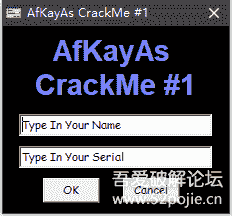

10YFWXYYU66G_I0]R~D]_UO.png (14.22 KB, 下载次数: 4)

<https://www.52pojie.cn/forum.php?mod=attachment&aid=MjUwNzgzM3xmNTBmOGEwNHwxNzkzNTc1ODkwfDE2ODA4NnwxNjEwNTE0&nothumb=yes>

2022-3-26 01:18 上传

随便输入一点东西：

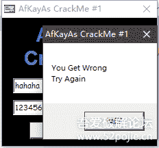

{@R[@3}WBSG]G~4CJ\`BMY73.png (14.2 KB, 下载次数: 3)

<https://www.52pojie.cn/forum.php?mod=attachment&aid=MjUwNzgzMnwzYTQ0MjlhZHwxNzkzNTc1ODkwfDE2ODA4NnwxNjEwNTE0&nothumb=yes>

2022-3-26 01:17 上传

主要关注一下出错后弹出的信息。

### 2. 动态调试

#### 1. 定位关键跳转

首先还是直接查找所有参考文本字串。

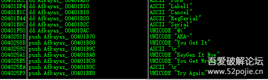

HXY%L)GE]X8C6(DRK7@6Q5P.png (11.74 KB, 下载次数: 3)

<https://www.52pojie.cn/forum.php?mod=attachment&aid=MjUwNzgzNHxkZjg4MTQ1MXwxNzkzNTc1ODkwfDE2ODA4NnwxNjEwNTE0&nothumb=yes>

2022-3-26 01:19 上传

直接跟过去康康：

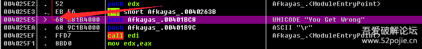

T14X){O@I{[9UL~Z5_J]F0Z.png (11.44 KB, 下载次数: 2)

<https://www.52pojie.cn/forum.php?mod=attachment&aid=MjUwNzgzNXw4OTFkMzc3ZXwxNzkzNTc1ODkwfDE2ODA4NnwxNjEwNTE0&nothumb=yes>

2022-3-26 01:20 上传

注意这个红色箭头，它告诉我们它是从哪里跳转过来的，跟着它往上看：

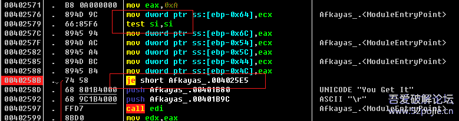

ZUTN9R)6KCEK\`L$I[4\`V()F.png (16.7 KB, 下载次数: 2)

<https://www.52pojie.cn/forum.php?mod=attachment&aid=MjUwNzgzNnw4NGNjNmM0YnwxNzkzNTc1ODkwfDE2ODA4NnwxNjEwNTE0&nothumb=yes>

2022-3-26 01:21 上传

这里就是校验跳转了，接下来就是往上看它的校验算法是怎么一回事。

#### 2. 分析校验算法

上一篇聊过VC代码的一个特点是函数之间有`nop`，所以直接往上划，找到构建栈帧的地方，然后略过那些初始化的函数，定位第一个对我们分析有用的函数调用：

栈帧构建处：

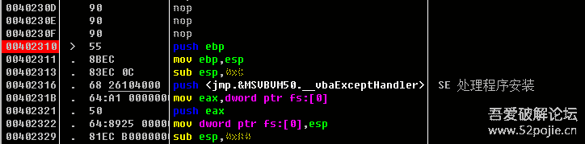

K29W\`~]@~_1A]RX]CJ1A(TF.png (11.68 KB, 下载次数: 2)

<https://www.52pojie.cn/forum.php?mod=attachment&aid=MjUwNzgzN3w1ZjgxYzE4YXwxNzkzNTc1ODkwfDE2ODA4NnwxNjEwNTE0&nothumb=yes>

2022-3-26 01:22 上传

第一个操作：返回输入字符串长度

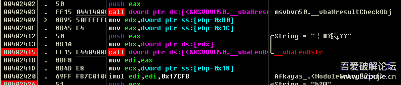

_E1J~CSZDWH(aDLBW5FQQ.png (14.36 KB, 下载次数: 4)

<https://www.52pojie.cn/forum.php?mod=attachment&aid=MjUwNzgzOHw0YzEwYzcxZHwxNzkzNTc1ODkwfDE2ODA4NnwxNjEwNTE0&nothumb=yes>

2022-3-26 01:23 上传

这里聊一聊我个人定位这个函数的方式：

在构建栈帧处下断点，结合动调一步一步`F8`，这里我输入的用户名为 `hahaha`

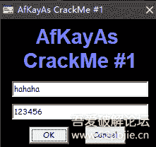

ON)J6WLZCZ]}21{8HI]}J@S.png (13.53 KB, 下载次数: 4)

<https://www.52pojie.cn/forum.php?mod=attachment&aid=MjUwNzgzOXw4NjhlNGZlOHwxNzkzNTc1ODkwfDE2ODA4NnwxNjEwNTE0&nothumb=yes>

2022-3-26 01:24 上传

从构建栈帧处往下看会出现一堆`__vbaObjSet`函数，它的作用是将对象变量指向内存中的对象，这里我选择忽略。

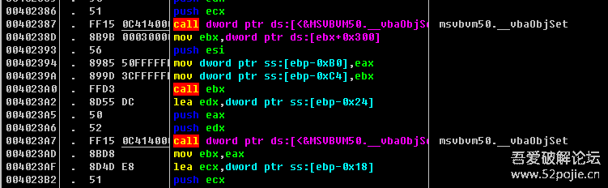

4{CRB7\`0L_AJL{7@TRTX29S.png (14.95 KB, 下载次数: 4)

<https://www.52pojie.cn/forum.php?mod=attachment&aid=MjUwNzg0MHw1MjI4MWZjY3wxNzkzNTc1ODkwfDE2ODA4NnwxNjEwNTE0&nothumb=yes>

2022-3-26 01:25 上传

一直调试到这里时，发现`__vbaLenBstr`函数将我输入的`name`作为参数调用，这个函数的作用是返回字符串串长

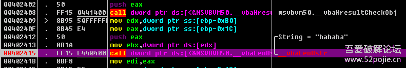

ZHZLG[~IJN[D~X4\`K55M)EB.png (13.09 KB, 下载次数: 1)

<https://www.52pojie.cn/forum.php?mod=attachment&aid=MjUwNzg0MXwyYmUyYzMzN3wxNzkzNTc1ODkwfDE2ODA4NnwxNjEwNTE0&nothumb=yes>

2022-3-26 01:27 上传

其实我的思路主要就是观察`call`调用的函数有啥作用，然后根据自己的输入，再配合栈窗口的变化来定位的。下面继续跟进指令，`__vbaLenBstr`函数将返回值存在了`eax`中：

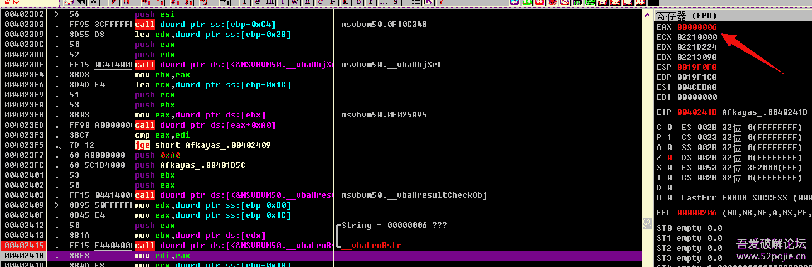

Y2_))}DU1WQ]I[}]9IZBVEJ.png (39.51 KB, 下载次数: 2)

<https://www.52pojie.cn/forum.php?mod=attachment&aid=MjUwNzg0MnxlYWJmZjI4MHwxNzkzNTc1ODkwfDE2ODA4NnwxNjEwNTE0&nothumb=yes>

2022-3-26 01:28 上传

分析一下`__vbaLenBstr`函数这一坨的操作（`402415~402427`）：

- `40241B`处，`eax`存着返回的串长，将其存入`edi`中
- `40241D`处，将`name`的值存入`ecx`

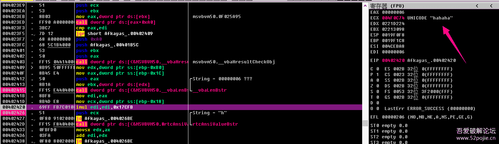

TI_2J72]$K]6N~Q3Y{A3G91.png (34.47 KB, 下载次数: 3)

<https://www.52pojie.cn/forum.php?mod=attachment&aid=MjUwNzg0NHxmYmZiYTM0MHwxNzkzNTc1ODkwfDE2ODA4NnwxNjEwNTE0&nothumb=yes>

2022-3-26 01:30 上传

- `402420`处，看到着个我觉得有点奇怪，`imul`指令是两个指令数的相乘，但是为啥这里有三个参数，这里我选择动调看结果就知道了

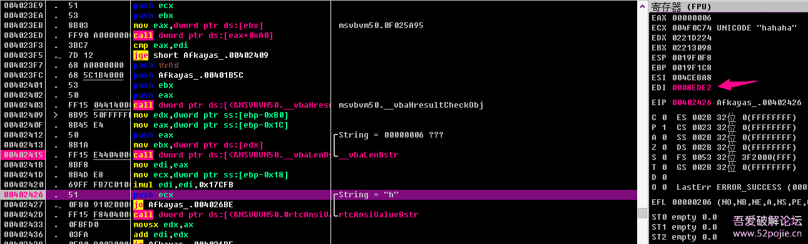

3JFMZCPBI4QCMQSHP}HJS9C.png (31.04 KB, 下载次数: 2)

<https://www.52pojie.cn/forum.php?mod=attachment&aid=MjUwNzg0NXw3YTMzOTBhMXwxNzkzNTc1ODkwfDE2ODA4NnwxNjEwNTE0&nothumb=yes>

2022-3-26 01:31 上传

当做完这个指令后`edi`的值为`8EDE2`，也就是`6*0x17CFB`。

- `402427`处，这里是判断`OF`寄存器的也就是判断是否溢出。所以我们输入的用户名不能过长

下一part是取出字符串的第一个值，然后加上`edi`的值，然后把这个值转成十进制，存起来：

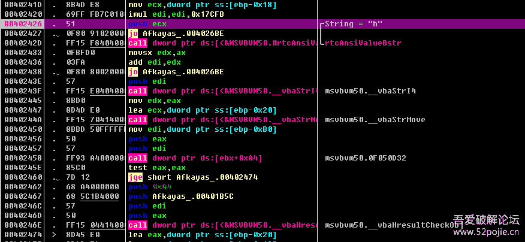

8U8Y\`8UDT{P{L2C[IZDAL24.png (24.21 KB, 下载次数: 2)

<https://www.52pojie.cn/forum.php?mod=attachment&aid=MjUwNzg0NnwzMzhiZWNmOXwxNzkzNTc1ODkwfDE2ODA4NnwxNjEwNTE0&nothumb=yes>

2022-3-26 01:32 上传

`__rtcAnsiValueBstr`之前遇到过，就是获取该字符的`ASCII`码的十六进制值并保存在`eax`中（`eax`直接存储着这个码），然后放入`edx`中，与`edi`的值相加。这里同样也验证了一次是否有溢出，然后将操作过后的值压栈保存

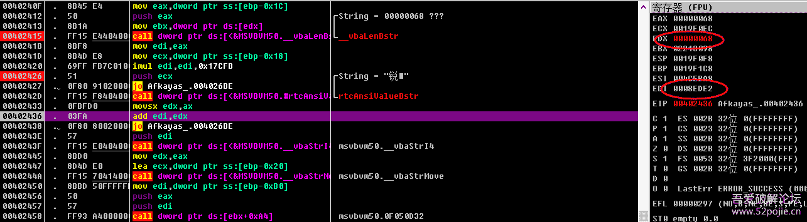

2}HH[\`94Y6TMF4TYB)3$EED.png (33.51 KB, 下载次数: 3)

<https://www.52pojie.cn/forum.php?mod=attachment&aid=MjUwNzg0N3w0Yzg5MzQzYXwxNzkzNTc1ODkwfDE2ODA4NnwxNjEwNTE0&nothumb=yes>

2022-3-26 01:35 上传

`0x8EDE2+0x68=8EE4A`

然后下面的函数`__vbaStrI4`：将十六进制转换成十进制

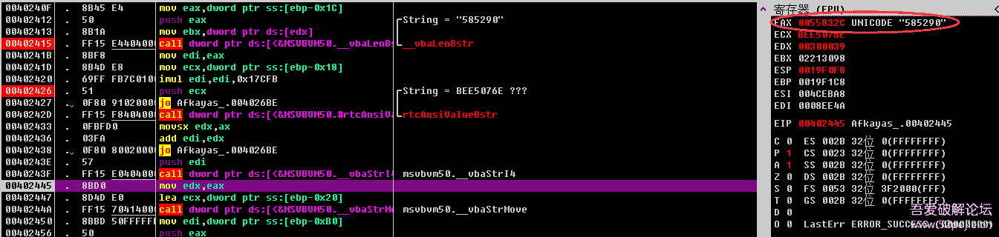

LZOS7]~OLX143HDIZ$LN_{F.png (30.69 KB, 下载次数: 3)

<https://www.52pojie.cn/forum.php?mod=attachment&aid=MjUwNzg0OHw4YmVmZGNjMXwxNzkzNTc1ODkwfDE2ODA4NnwxNjEwNTE0&nothumb=yes>

2022-3-26 01:36 上传

十六进制数`8EE4A`转换十进制后为：`585290`，然后将它作为参数调用`__vbaStrMove`进行字符串拷贝

最后一个部分在`402523`处：

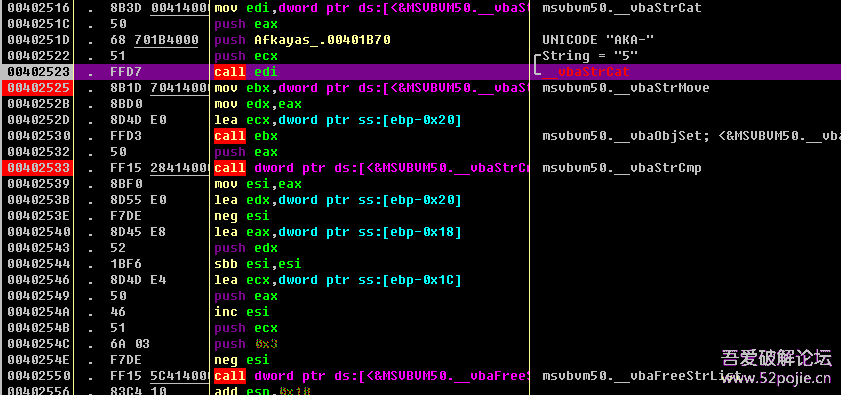


这个函数好理解，就是把“AKA-”与`ECX`寄存器的值(就是之前得出的585290)相连接，最后进行`strcmp`比较：

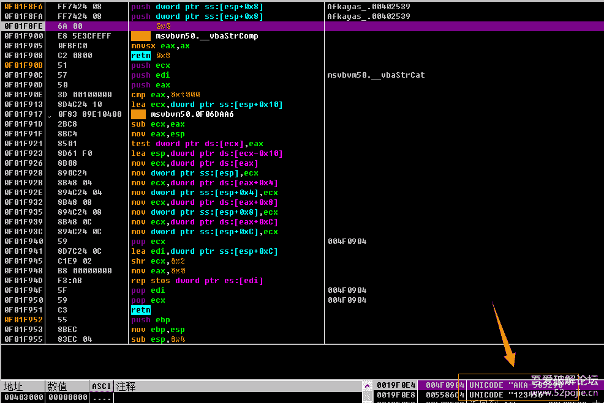

这个图就是比较函数内部，查看压栈的两个参数一个是经过算法运算后的序列号，一个是我们自己输入的序列号。这里没有必要管`strcmp`是怎么比较的直接`Ctrl+F9`。在之后的代码就是作比较然后根据`strcmp`的值确定跳转输出序列号成功与否。

## 3.注册机编写：

### 1.确认整个算法逻辑：

- 接受用户名字符串；
- 获取用户名的长度；
- 长度乘以`0x17CFB`，如果溢出的话跳转至处理溢出的函数
- 相乘的结果加上用户名字符串的第一个字符的ASCII码值
- 将结果转换成十进制
- 将“AKA-”与计算的结果连接便是最后的序列号了

### 2.注册机：

```
#include"stdio.h"
#include"stdlib.h"
#include"string.h"
int main()
{
        char str1[10] = "";
        int len,seriali;

        puts("Please Input Your Name:");
        scanf("%s", str1);
        len = strlen(str1);
        len = 0x17CFB * len;
        seriali = len + str1[0];

        printf("AKA-%d",seriali);

        return 0;
}
```

搞一下：

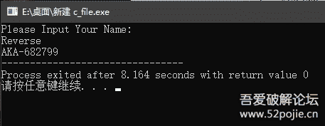

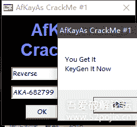
