# [原创] 破解易语言(萌新练手)

- 原帖: https://www.52pojie.cn/forum.php?mod=viewthread&tid=1610993
- 抓取时间: 2026-11-01T23:31:26

注:破解此软件没有任何商业用途,纯属用来练练手,请大家支持正版

我也是无意看中了 易语言 这款 编程 软件

## 进入正题

未购买 打开如下↓

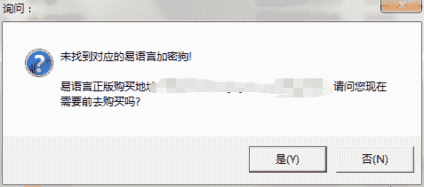

直接拖入 `OD` 解析

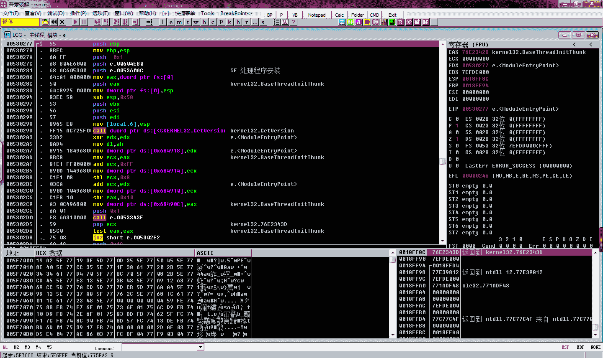

很好,没有壳

在 中文搜索引擎 搜索 购买页面的文字

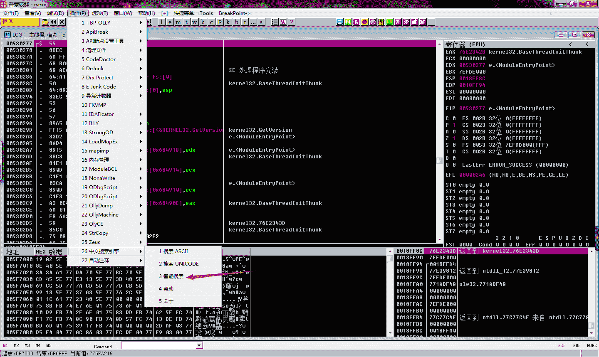

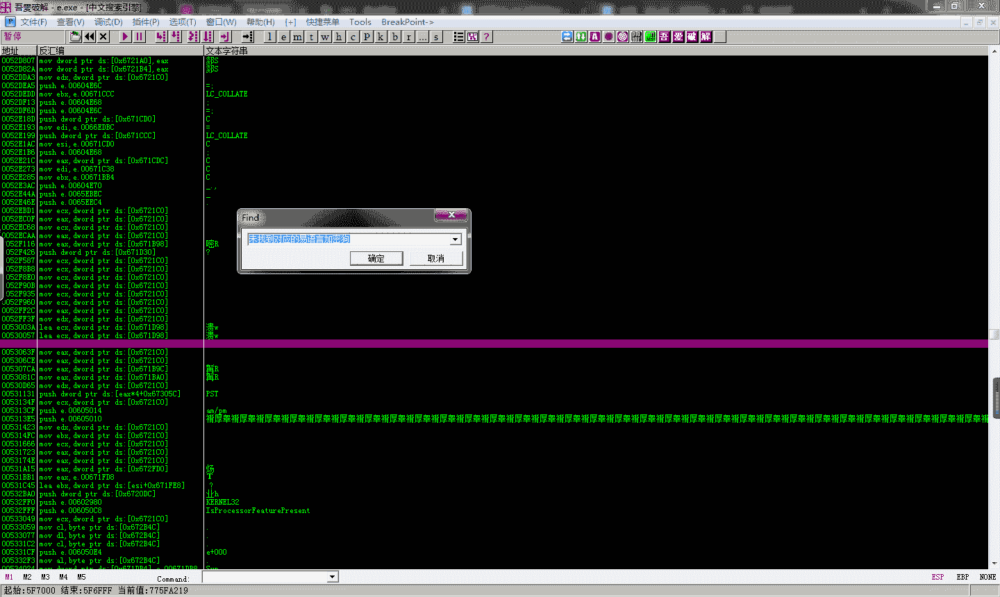

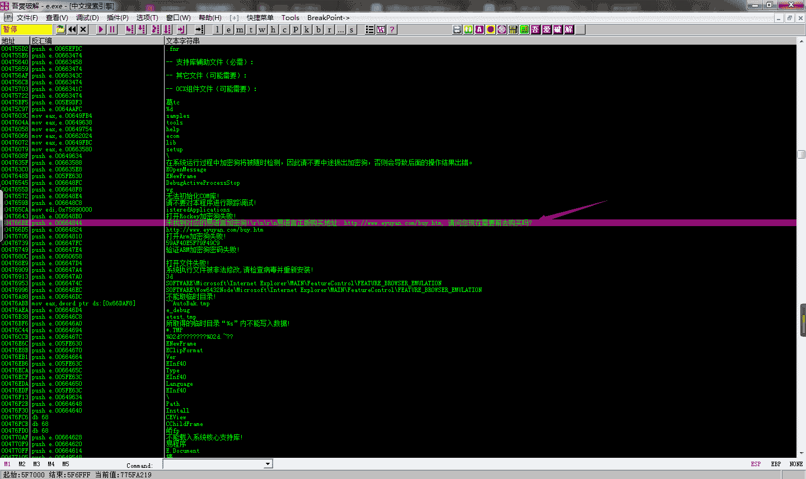

双击

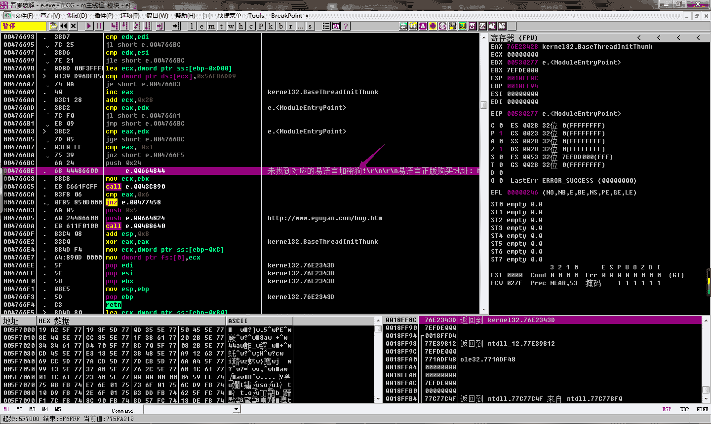

马上找到了一处 直接跳过此语句 的代码

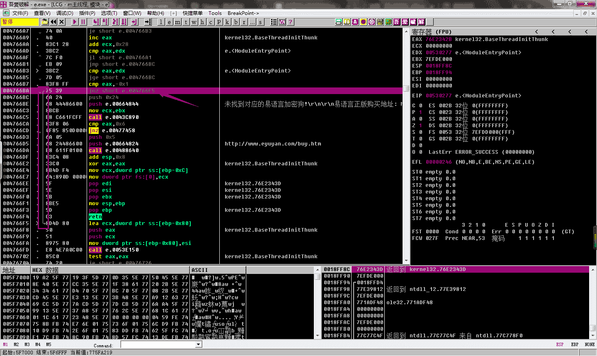

先不急着 修改代码 ,再往上找一找

发现上面有一个 超大jump (这里的`jmp`是 无条件跳转 ,只要执行到这里就会大jump)

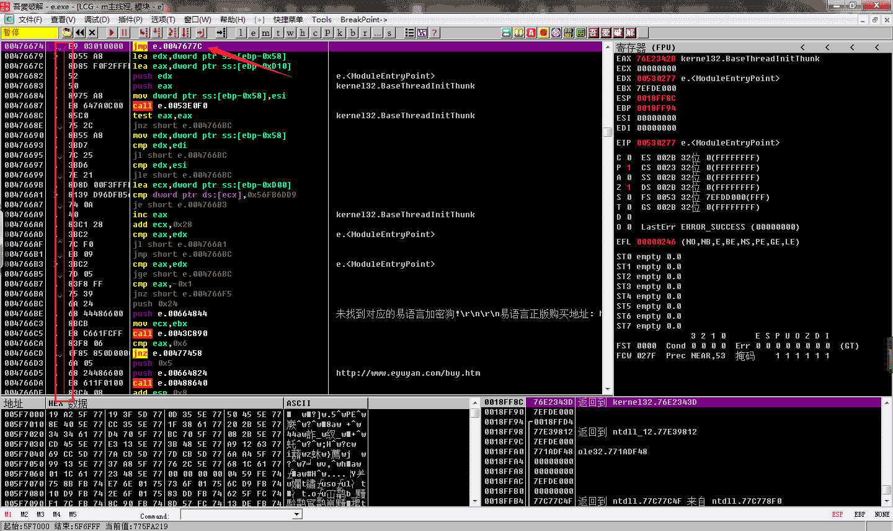

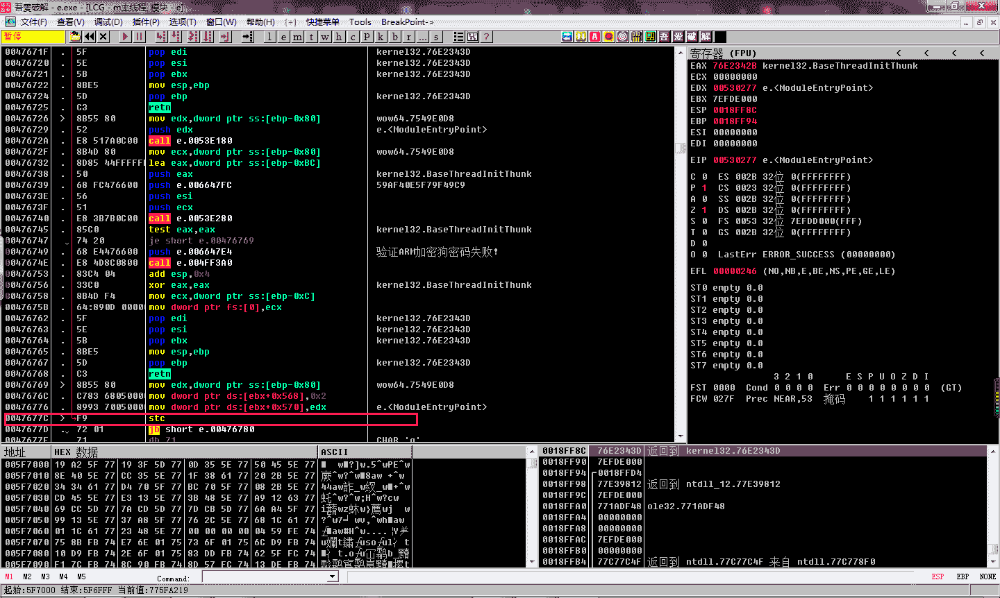

可以看最左边 16进制的地址 ,确实跳了一大段

再检查发现有一个 跳转 特别奇怪

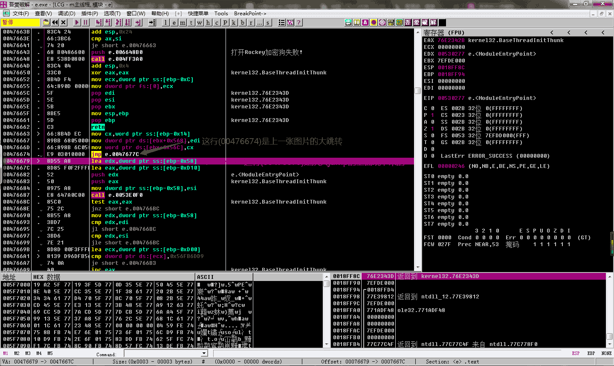

00476679的这行代码是从 大jump 的上面跳下来的,所以只要不让 上面跳进来的那行 跳进来,就可以直接跳过,成功破解

找到那行代码

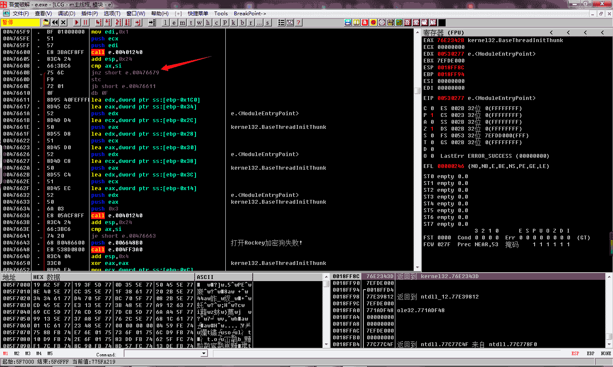

可以 复制 大jump 的代码,然后 粘贴 进那个 jump 里,就可以直接过

这样做比 直接把这句话废掉 有一个好处,就是直接 大jump 下去可以马上 跳过 中间过程

而把这句话废掉,会 继续执行下去 直到执行到 大jump

看上去好像没有差别

但是会发现把这句话 废掉 ,中间的 过程 会 执行,可能会有 "干扰的代码" 以至于更加麻烦

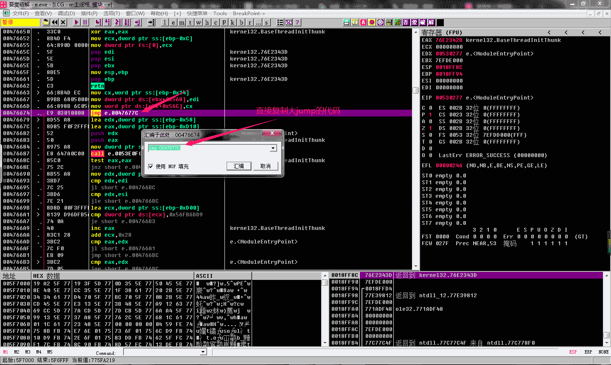

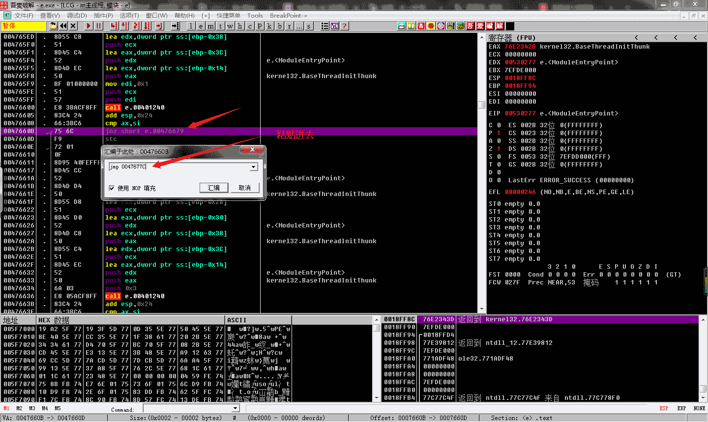

保存看看效果

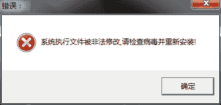

出现了 错误

按 同样的方法 进行解析

中文搜索引擎 找到文字出处

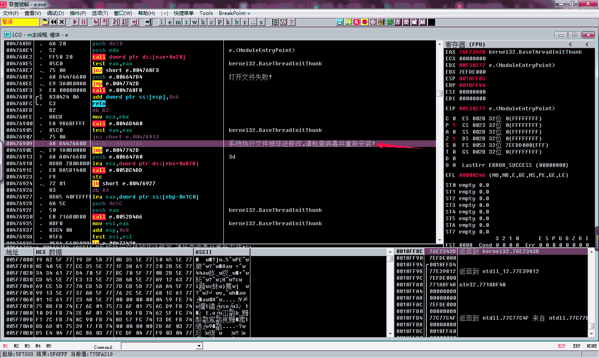

这里有 小jump ,怎么跳过呢?

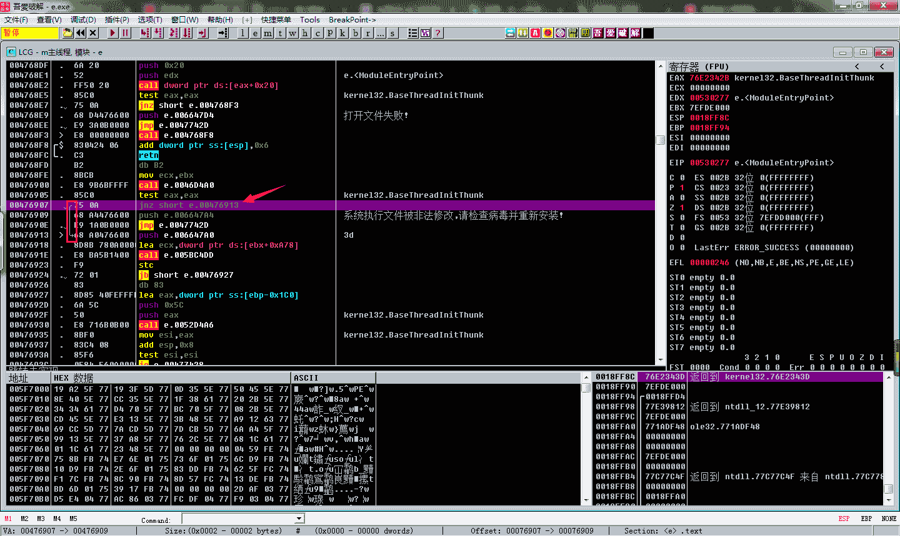

之前说了, `jmp` 是 无条件跳转 ,所以只要把 `jnz` 改成 `jmp` ,系统就会 直接跳过

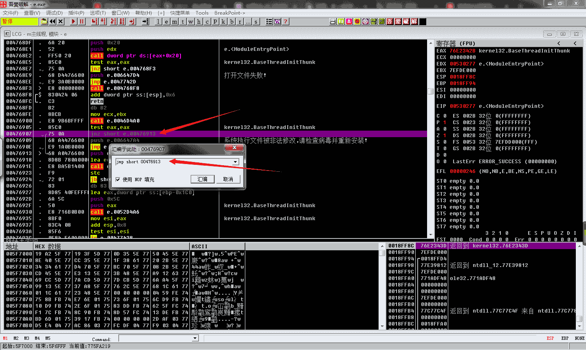

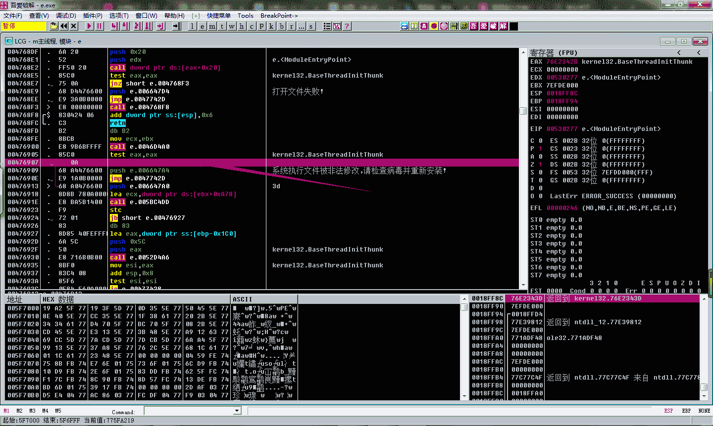

那么保存,运行?

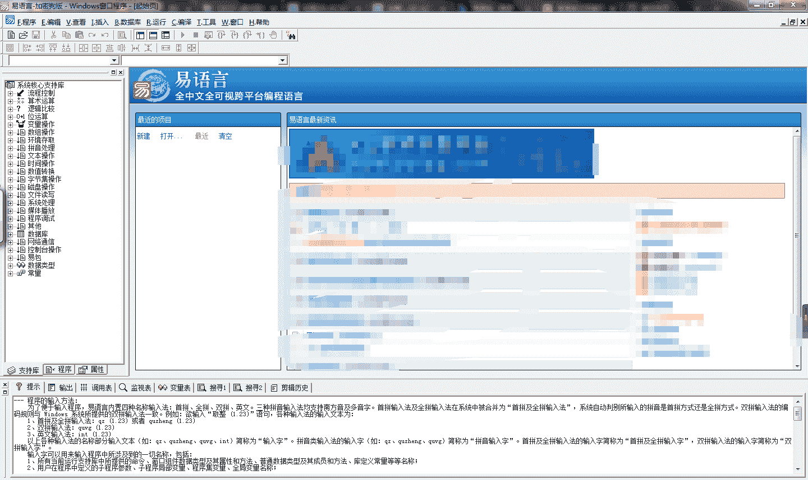

Oh my god,I do it!!!!!

这是我第一次破解正经软件

我是几天前刚刚开始用业余时间学的破解

我也是无聊在看哪些语言我完全没听说过的

我看中了易语言

发现需要购买时

熟悉的购买页面使我立刻想到了前几天学的破解

我便抱着玩玩的心态试了试

当我破解成功的时候

那种激动是掩盖不了的

所以发了这么一篇帖子

虽然我知道这个软件并不常用,破解也很简单

但使我对学习破击更加有信心

一起加油吧!!!
