# [Web逆向] 某网站webpack逆向

- 原帖: `https://www.52pojie.cn/forum.php?mod=viewthread&tid=1613466`
- 抓取时间: 2026-11-01T23:31:10

目标网站：aHR0cHM6Ly9tLmN0eXVuLmNuL3dhcC9tYWluL2F1dGgvbG9naW4/cmVkaXJlY3Q9JTJGbXk=

## 寻找加密函数入口

输入邮箱、密码点击登录抓取请求信息（user@163.com、654321）

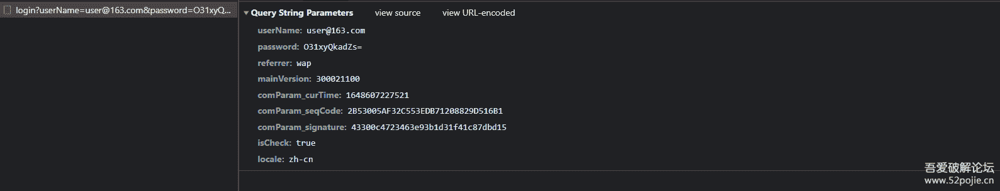

202203300922977.png (33.89 KB, 下载次数: 295)

[href="forum.php?mod=attachment&aid=MjUwOTM3OHwwZTJmYWMwMnwxNzkzNTc1ODY3fDE2ODA4NnwxNjEzNDY2&nothumb=yes" target="_blank"](https://www.52pojie.cn/forum.php?mod=attachment&aid=MjUwOTM3OHwwZTJmYWMwMnwxNzkzNTc1ODY3fDE2ODA4NnwxNjEzNDY2&nothumb=yes)

2022-3-30 13:05 上传

这里看到`password`加密了（des加密）

在请求中看堆栈信息（Initiator）可以看到`login`的信息，点进去看一下

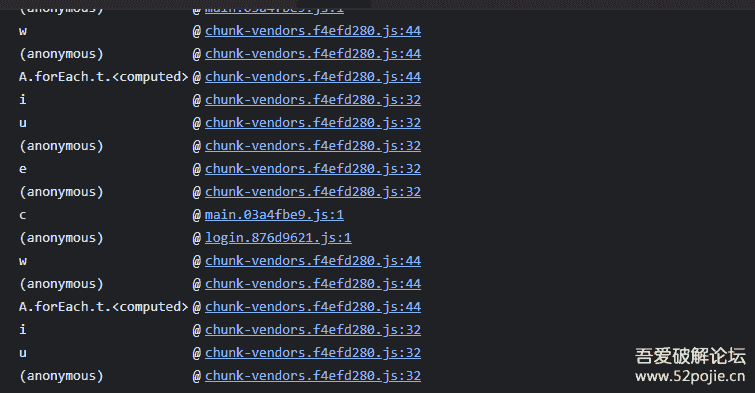

202203300922977.png (50.71 KB, 下载次数: 275)

[href="forum.php?mod=attachment&aid=MjUwOTI5NXw1NjZiNGFmMnwxNzkzNTc1ODY3fDE2ODA4NnwxNjEzNDY2&nothumb=yes" target="_blank"](https://www.52pojie.cn/forum.php?mod=attachment&aid=MjUwOTI5NXw1NjZiNGFmMnwxNzkzNTc1ODY3fDE2ODA4NnwxNjEzNDY2&nothumb=yes)

2022-3-30 11:55 上传

可以看到`password`的赋值操作,在这行打上断点重新请求一下

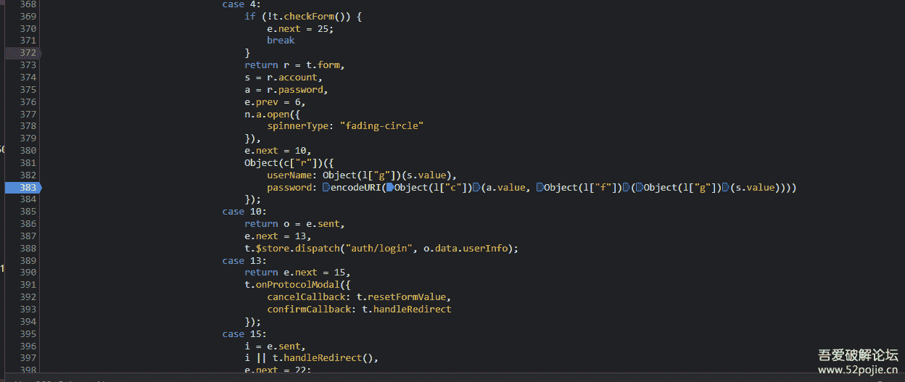

202203300922977.png (62.61 KB, 下载次数: 278)

[href="forum.php?mod=attachment&aid=MjUwOTI5NnwzMmYxNjAzM3wxNzkzNTc1ODY3fDE2ODA4NnwxNjEzNDY2&nothumb=yes" target="_blank"](https://www.52pojie.cn/forum.php?mod=attachment&aid=MjUwOTI5NnwzMmYxNjAzM3wxNzkzNTc1ODY3fDE2ODA4NnwxNjEzNDY2&nothumb=yes)

2022-3-30 11:56 上传

可以看到`a.value`是输入的密码，`s.value`是输入的邮箱

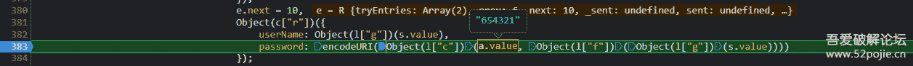

202203300922977.png (29.31 KB, 下载次数: 274)

[href="forum.php?mod=attachment&aid=MjUwOTI5N3xkMGQ0ZWM4MXwxNzkzNTc1ODY3fDE2ODA4NnwxNjEzNDY2&nothumb=yes" target="_blank"](https://www.52pojie.cn/forum.php?mod=attachment&aid=MjUwOTI5N3xkMGQ0ZWM4MXwxNzkzNTc1ODY3fDE2ODA4NnwxNjEzNDY2&nothumb=yes)

2022-3-30 11:57 上传


202203300922977.png (27.08 KB, 下载次数: 283)

[href="forum.php?mod=attachment&aid=MjUwOTMwNnxhMGQ3NGUzZnwxNzkzNTc1ODY3fDE2ODA4NnwxNjEzNDY2&nothumb=yes" target="_blank"](https://www.52pojie.cn/forum.php?mod=attachment&aid=MjUwOTMwNnxhMGQ3NGUzZnwxNzkzNTc1ODY3fDE2ODA4NnwxNjEzNDY2&nothumb=yes)

2022-3-30 11:59 上传

复制这行在控制台打印一下，可以看到密码就经过加密处理了

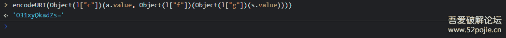

202203300922977.png (13.36 KB, 下载次数: 277)

[href="forum.php?mod=attachment&aid=MjUwOTMwN3w4YmNmMGVkMnwxNzkzNTc1ODY3fDE2ODA4NnwxNjEzNDY2&nothumb=yes" target="_blank"](https://www.52pojie.cn/forum.php?mod=attachment&aid=MjUwOTMwN3w4YmNmMGVkMnwxNzkzNTc1ODY3fDE2ODA4NnwxNjEzNDY2&nothumb=yes)

2022-3-30 11:59 上传

美化一下代码，在控制台打印一下结果一样


# 分析加密逻辑

```
encodeURI(Object(l["c"])(a.value, Object(l["f"])(Object(l["g"])(s.value))))
l["c"](a.value, l["f"](l["g"](s.value)))
```

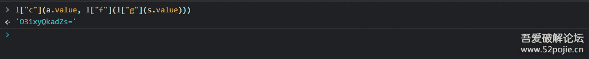

`202203300922977.png` (12.15 KB, 下载次数: 267) [附件下载](https://www.52pojie.cn/forum.php?mod=attachment&aid=MjUwOTMwOHxiM2FkZTk3ZXwxNzkzNTc1ODY3fDE2ODA4NnwxNjEzNDY2&nothumb=yes) 2022-3-30 12:00 上传

先找 `l["c"]` 方法，可以看到 `H` 方法，追进去看一下。

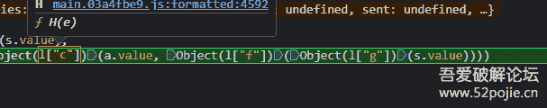

`202203300922977.png` (18.8 KB, 下载次数: 271) [附件下载](https://www.52pojie.cn/forum.php?mod=attachment&aid=MjUwOTMwOXwwMjBiZDcyMXwxNzkzNTc1ODY3fDE2ODA4NnwxNjEzNDY2&nothumb=yes) 2022-3-30 12:00 上传

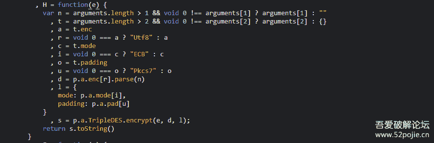

`202203300922977.png` (32.43 KB, 下载次数: 274) [附件下载](https://www.52pojie.cn/forum.php?mod=attachment&aid=MjUwOTMyMnw1OTdmZDBkOXwxNzkzNTc1ODY3fDE2ODA4NnwxNjEzNDY2&nothumb=yes) 2022-3-30 12:29 上传

可以看到最后返回 `s.toString()`，`s = p.a.TripleDES.encrypt(e, d, l)`。

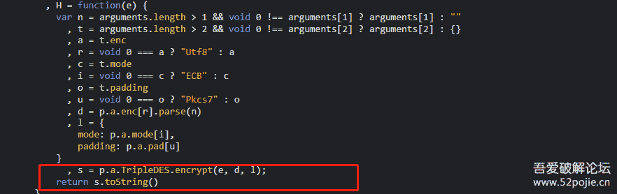

`202203300922977.png` (32.35 KB, 下载次数: 277) [附件下载](https://www.52pojie.cn/forum.php?mod=attachment&aid=MjUwOTMyM3xjYzc5MDIyOXwxNzkzNTc1ODY3fDE2ODA4NnwxNjEzNDY2&nothumb=yes) 2022-3-30 12:29 上传

这里参数 `e` 是传参过来的，`d` 也是 `p.a` 的方法生成的，`l` 也是 `p.a` 的方法生成的。找一下 `p.a` 在哪儿构建的，`ctrl+f` 搜索后发现找不到，那就找 `p` 的构建。

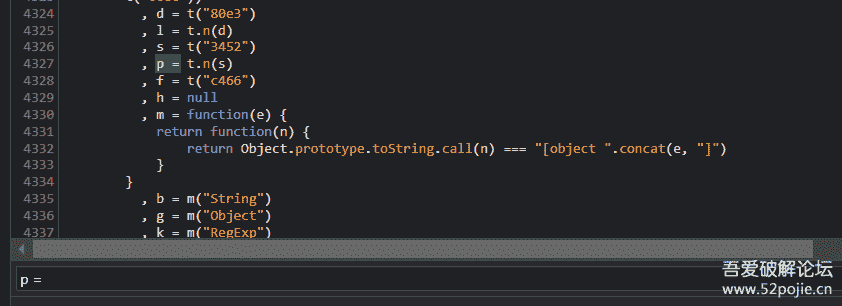

`202203300922977.png` (31.67 KB, 下载次数: 263) [附件下载](https://www.52pojie.cn/forum.php?mod=attachment&aid=MjUwOTMyNHw2NzY3ZGY0NXwxNzkzNTc1ODY3fDE2ODA4NnwxNjEzNDY2&nothumb=yes) 2022-3-30 12:30 上传

看到这里就可以确定是 webpack 了。

# webpack 处理

## 第一种姿势：使用 AST 自动扣 webpack

这里用漁佬（@漁滒）的 AST 自动扣 webpack。

这里附上神器地址：

- 使用教程：[https://www.52pojie.cn/thread-1572529-1-1.html](https://www.52pojie.cn/thread-1572529-1-1.html)
- 源码：[https://gitcode.net/zjq592767809/webpack_ast](https://gitcode.net/zjq592767809/webpack_ast)

寻找加载器的 js 文件保存到本地。

在 `password` 断点文件中看一下有没有加载器加载函数。

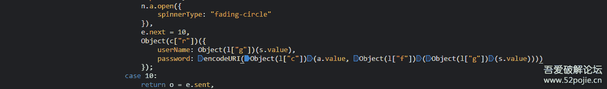

`202203300922977.png` (24.89 KB, 下载次数: 272) [附件下载](https://www.52pojie.cn/forum.php?mod=attachment&aid=MjUwOTMyNXw4Njg1NGJjMnwxNzkzNTc1ODY3fDE2ODA4NnwxNjEzNDY2&nothumb=yes) 2022-3-30 12:30 上传

在文件开头可以看到 `r("854c")` 这个 `r` 肯定就是加载器了，在这行打一个断点，重新刷新页面。

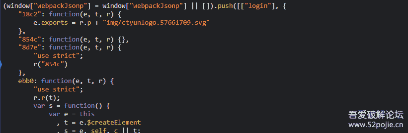

`202203300922977.png` (30.3 KB, 下载次数: 282) [附件下载](https://www.52pojie.cn/forum.php?mod=attachment&aid=MjUwOTMyNnw5MGNmNDRiZHwxNzkzNTc1ODY3fDE2ODA4NnwxNjEzNDY2&nothumb=yes) 2022-3-30 12:30 上传

这里可以看到 `r` 的函数体 `u()`，追进去。

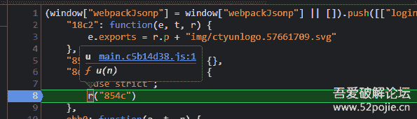

`202203300922977.png` (25.86 KB, 下载次数: 276) [附件下载](https://www.52pojie.cn/forum.php?mod=attachment&aid=MjUwOTMyN3xhODNjZTZmYnwxNzkzNTc1ODY3fDE2ODA4NnwxNjEzNDY2&nothumb=yes) 2022-3-30 12:31 上传

这个 `u()` 就是加载器了，直接将这个 js 文件保存到本地。

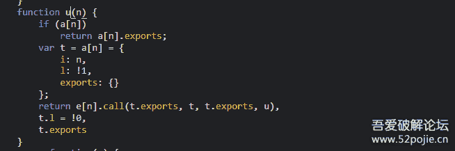

`202203300922977.png` (17.4 KB, 下载次数: 280) [附件下载](https://www.52pojie.cn/forum.php?mod=attachment&aid=MjUwOTMyOHw1OGZiNTAzYnwxNzkzNTc1ODY3fDE2ODA4NnwxNjEzNDY2&nothumb=yes) 2022-3-30 12:31 上传

寻找函数模块的 js 文件保存到本地。

刚刚发现 `p` 是通过 `t.n(t('3452'))` 加载出来的。在 `s = t("3452")` 打个断点重新刷新页面，发现这个的 `t` 就是我们的 `u` 构造器，那就好办了。

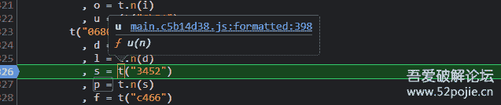

`202203300922977.png` (20.63 KB, 下载次数: 275) [附件下载](https://www.52pojie.cn/forum.php?mod=attachment&aid=MjUwOTMyOXxjMDA3NjAxOXwxNzkzNTc1ODY3fDE2ODA4NnwxNjEzNDY2&nothumb=yes) 2022-3-30 12:32 上传

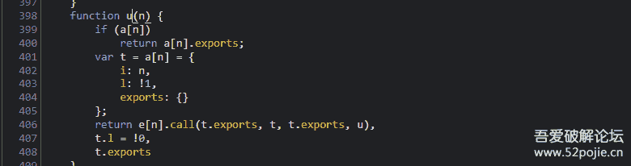

`202203300922977.png` (22.64 KB, 下载次数: 279) [附件下载](https://www.52pojie.cn/forum.php?mod=attachment&aid=MjUwOTMzMXwwYmEzMTdhZXwxNzkzNTc1ODY3fDE2ODA4NnwxNjEzNDY2&nothumb=yes) 2022-3-30 12:32 上传

`F11` 单步追 `t("3452")` 就可以找到函数模块，把这个文件保存到本地。

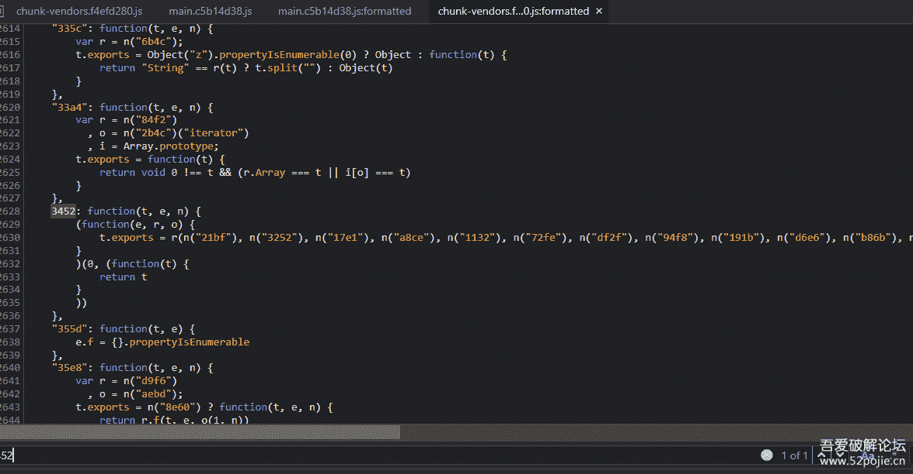

`202203300922977.png` (79.79 KB, 下载次数: 276) [附件下载](https://www.52pojie.cn/forum.php?mod=attachment&aid=MjUwOTMzMnwyNWEwODFhZXwxNzkzNTc1ODY3fDE2ODA4NnwxNjEzNDY2&nothumb=yes) 2022-3-30 12:33 上传

使用大佬写好的 AST 代码。现在目录下有 3 个文件。


`202203300922977.png` (23.88 KB, 下载次数: 271) [附件下载](https://www.52pojie.cn/forum.php?mod=attachment&aid=MjUwOTMzM3w4MWFkYmEyY3wxNzkzNTc1ODY3fDE2ODA4NnwxNjEzNDY2&nothumb=yes) 2022-3-30 12:33 上传

执行：

```
node .\webpack_mixer.js -l .\main.03a4fbe9.js -m .\chunk-vendors.f4efd280.js -o webpack_sdk.js
```

生成了扣好的 webpack 代码。

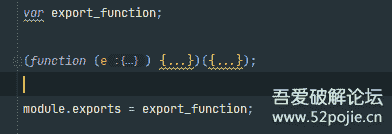

`202203300922977.png` (15.3 KB, 下载次数: 280) [附件下载](https://www.52pojie.cn/forum.php?mod=attachment&aid=MjUwOTMzNHwzYjNhYTk2NnwxNzkzNTc1ODY3fDE2ODA4NnwxNjEzNDY2&nothumb=yes) 2022-3-30 12:33 上传

## 第二种姿势：自己扣 webpack

往上看找加载器，可以看到开头 `function(e)` 先扣下来。将加载器 `(function(e) {` 里面的全部内容 `}` 扣下来，封装为匿名函数。

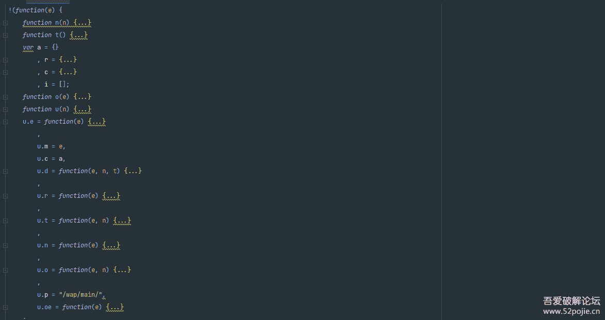

`202203300922977.png` (48.45 KB, 下载次数: 281) [附件下载](https://www.52pojie.cn/forum.php?mod=attachment&aid=MjUwOTMzNXw1YjNlN2MyN3wxNzkzNTc1ODY3fDE2ODA4NnwxNjEzNDY2&nothumb=yes) 2022-3-30 12:34 上传

声明一个全部变量，再将加载器 `u` 赋值给 `use`。

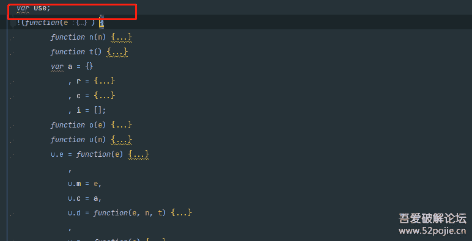

`202203300922977.png` (32.78 KB, 下载次数: 276) [附件下载](https://www.52pojie.cn/forum.php?mod=attachment&aid=MjUwOTMzNnw3ZGIxZDBkYXwxNzkzNTc1ODY3fDE2ODA4NnwxNjEzNDY2&nothumb=yes) 2022-3-30 12:34 上传

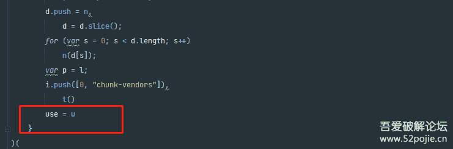

`202203300922977.png` (21.44 KB, 下载次数: 278) [附件下载](https://www.52pojie.cn/forum.php?mod=attachment&aid=MjUwOTMzN3wwNzg1NjE5NnwxNzkzNTc1ODY3fDE2ODA4NnwxNjEzNDY2&nothumb=yes) 2022-3-30 12:35 上传

先把函数模块 js 文件保存下来。

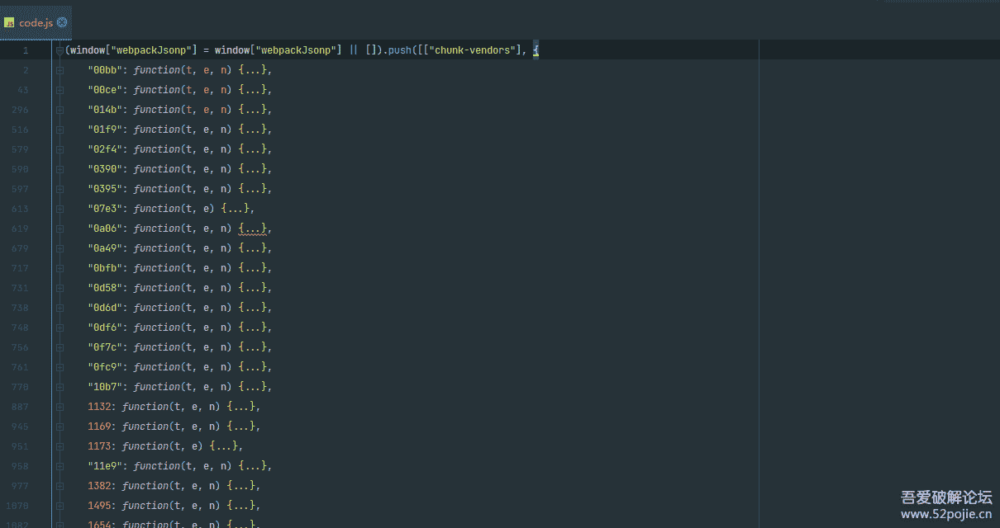

`202203300922977.png` (100.48 KB, 下载次数: 272) [附件下载](https://www.52pojie.cn/forum.php?mod=attachment&aid=MjUwOTMzOHw0ZjllYTgzOXwxNzkzNTc1ODY3fDE2ODA4NnwxNjEzNDY2&nothumb=yes) 2022-3-30 12:35 上传

搜索 `3452`，将 `3452` 传给匿名函数。

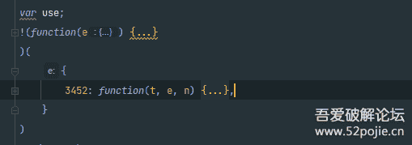

`202203300922977.png` (16.91 KB, 下载次数: 270) [附件下载](https://www.52pojie.cn/forum.php?mod=attachment&aid=MjUwOTMzOXw3YWQwNjQ2Y3wxNzkzNTc1ODY3fDE2ODA4NnwxNjEzNDY2&nothumb=yes) 2022-3-30 12:35 上传

加载一下 `3452` 函数，`window` 未定义，补上 `window`。


`202203300922977.png` (16.91 KB, 下载次数: 272) [附件下载](https://www.52pojie.cn/forum.php?mod=attachment&aid=MjUwOTM0MHwwZDQ0NTIzZHwxNzkzNTc1ODY3fDE2ODA4NnwxNjEzNDY2&nothumb=yes) 2022-3-30 12:36 上传

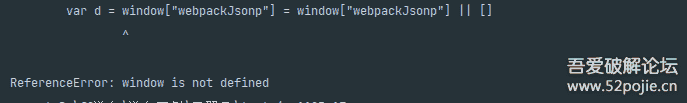

`202203300922977.png` (13.36 KB, 下载次数: 274) [附件下载](https://www.52pojie.cn/forum.php?mod=attachment&aid=MjUwOTM0MXxkYWEzMWYyNXwxNzkzNTc1ODY3fDE2ODA4NnwxNjEzNDY2&nothumb=yes) 2022-3-30 12:36 上传

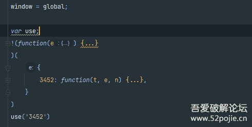

`202203300922977.png` (20.16 KB, 下载次数: 283) [附件下载](https://www.52pojie.cn/forum.php?mod=attachment&aid=MjUwOTM0MnwxMTkzZGQ1N3wxNzkzNTc1ODY3fDE2ODA4NnwxNjEzNDY2&nothumb=yes) 2022-3-30 12:37 上传

再次运行发现 `TypeError: Cannot read property 'call' of undefined` 这个错误，这个错误就是少函数模块，然后发现 `3452` 里面加载了其他函数模块。

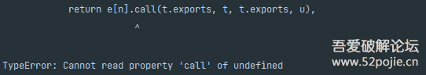

`202203300922977.png` (13.02 KB, 下载次数: 295) [附件下载](https://www.52pojie.cn/forum.php?mod=attachment&aid=MjUwOTM0M3w1YTdkMGYyM3wxNzkzNTc1ODY3fDE2ODA4NnwxNjEzNDY2&nothumb=yes) 2022-3-30 12:37 上传

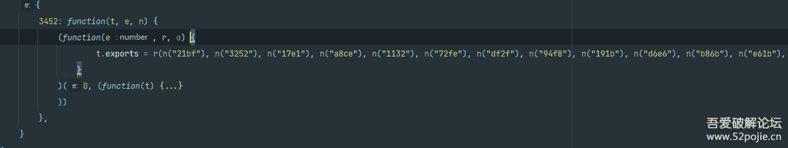

`202203300922977.png` (25.02 KB, 下载次数: 269) [附件下载](https://www.52pojie.cn/forum.php?mod=attachment&aid=MjUwOTM0NHwyMDAxNjA1ZHwxNzkzNTc1ODY3fDE2ODA4NnwxNjEzNDY2&nothumb=yes) 2022-3-30 12:37 上传

将其他函数模块粘过来，粘完之后运行就不报错了。

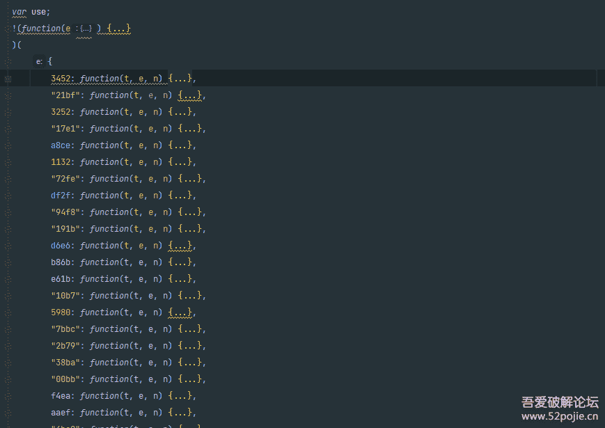

`202203300922977.png` (80.53 KB, 下载次数: 280) [附件下载](https://www.52pojie.cn/forum.php?mod=attachment&aid=MjUwOTM0NXw4ODM4YzBlMXwxNzkzNTc1ODY3fDE2ODA4NnwxNjEzNDY2&nothumb=yes) 2022-3-30 12:38 上传

# 构造 password 生成代码

将 `H()` 函数扣下来，生成 `p`。

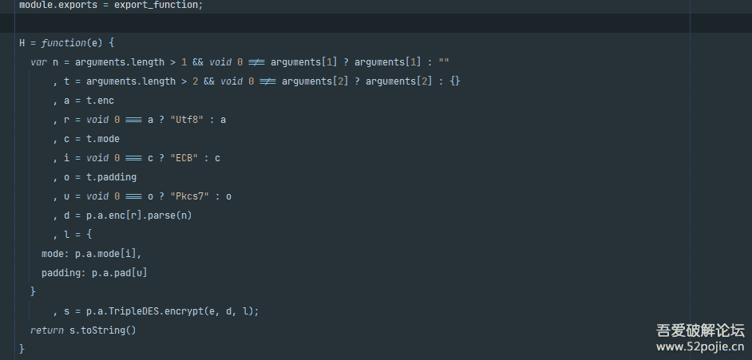

`202203300922977.png` (43.42 KB, 下载次数: 270) [附件下载](https://www.52pojie.cn/forum.php?mod=attachment&aid=MjUwOTM0Nnw5ZmFmNjc2N3wxNzkzNTc1ODY3fDE2ODA4NnwxNjEzNDY2&nothumb=yes) 2022-3-30 12:38 上传

这里用漁佬的生成加载器赋给了 `module.exports`，所以用 `module.exports` 加载 `3452`。

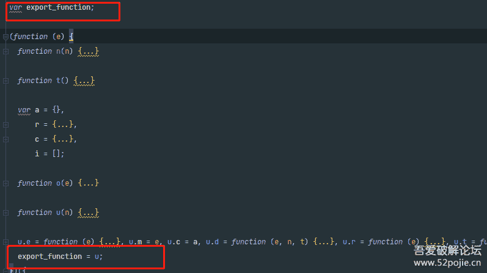

`202203300922977.png` (33.27 KB, 下载次数: 274) [附件下载](https://www.52pojie.cn/forum.php?mod=attachment&aid=MjUwOTM0OXwxMTJhNjAxNHwxNzkzNTc1ODY3fDE2ODA4NnwxNjEzNDY2&nothumb=yes) 2022-3-30 12:38 上传

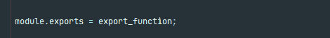

`202203300922977.png` (2.82 KB, 下载次数: 278) [附件下载](https://www.52pojie.cn/forum.php?mod=attachment&aid=MjUwOTM1MHw5NDlkOTQ0Y3wxNzkzNTc1ODY3fDE2ODA4NnwxNjEzNDY2&nothumb=yes) 2022-3-30 12:39 上传

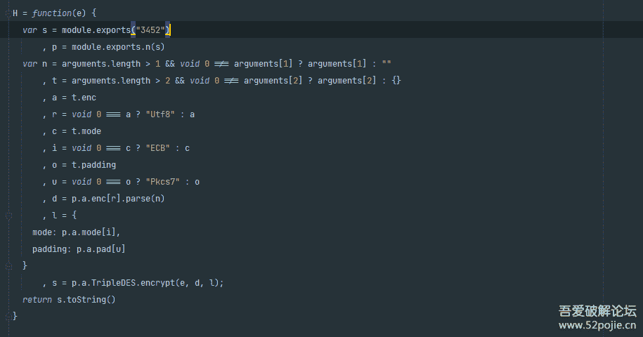

`202203300922977.png` (46.8 KB, 下载次数: 268) [附件下载](https://www.52pojie.cn/forum.php?mod=attachment&aid=MjUwOTM1MnxmNTgyMTAxY3wxNzkzNTc1ODY3fDE2ODA4NnwxNjEzNDY2&nothumb=yes) 2022-3-30 12:39 上传

调用 `H` 函数（这里我将 `u` 赋值给了 `use`，所以用 `use` 加载 `3452` 函数）发现不报错了。

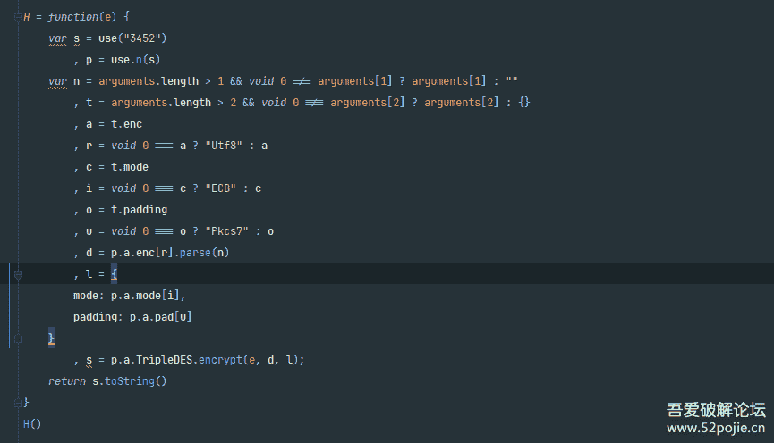

`202203300922977.png` (48.3 KB, 下载次数: 273) [附件下载](https://www.52pojie.cn/forum.php?mod=attachment&aid=MjUwOTM1M3wyNTY1ZWE0ZXwxNzkzNTc1ODY3fDE2ODA4NnwxNjEzNDY2&nothumb=yes) 2022-3-30 12:39 上传

之前美化的调用 `h` 方法的代码就变成了


## 第一步美化

```
l["c"](a.value, l["f"](l["g"](s.value)))
```

## 第二步美化

```
H(a.value, l["f"](l["g"](s.value)))
```

这里 `a.value` 和 `s.value` 之前分析过，`a.value` 是密码明文，`s.value` 是邮箱。

看一下 `l["f"](l["g"](s.value))` 干了什么，这里看到就是给邮箱加了 12 个 0。

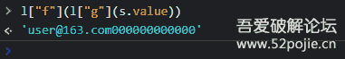

`202203300922977.png`（10.25 KB，下载次数：284）

[href="forum.php?mod=attachment&aid=MjUwOTM1NHw1N2FjNzMzMHwxNzkzNTc1ODY3fDE2ODA4NnwxNjEzNDY2&nothumb=yes" target="_blank"](https://www.52pojie.cn/forum.php?mod=attachment&aid=MjUwOTM1NHw1N2FjNzMzMHwxNzkzNTc1ODY3fDE2ODA4NnwxNjEzNDY2&nothumb=yes)

2022-3-30 12:40 上传

## 封装加密函数

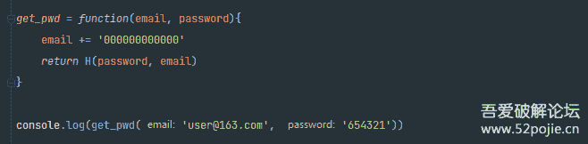

`202203300922977.png`（22.75 KB，下载次数：278）

[href="forum.php?mod=attachment&aid=MjUwOTM1N3w1OGY1YjNiYXwxNzkzNTc1ODY3fDE2ODA4NnwxNjEzNDY2&nothumb=yes" target="_blank"](https://www.52pojie.cn/forum.php?mod=attachment&aid=MjUwOTM1N3w1OGY1YjNiYXwxNzkzNTc1ODY3fDE2ODA4NnwxNjEzNDY2&nothumb=yes)

2022-3-30 12:40 上传

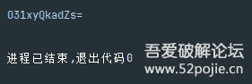

`202203300922977.png`（10.07 KB，下载次数：265）

[href="forum.php?mod=attachment&aid=MjUwOTM1OHxkNmNmMGJjNXwxNzkzNTc1ODY3fDE2ODA4NnwxNjEzNDY2&nothumb=yes" target="_blank"](https://www.52pojie.cn/forum.php?mod=attachment&aid=MjUwOTM1OHxkNmNmMGJjNXwxNzkzNTc1ODY3fDE2ODA4NnwxNjEzNDY2&nothumb=yes)

2022-3-30 12:40 上传

可以看到结果跟页面结果一样，至此加密完成！

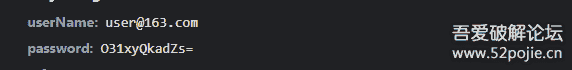

`202203300922977.png`（10.67 KB，下载次数：276）

[href="forum.php?mod=attachment&aid=MjUwOTM1OXwyZTE3NjEyMXwxNzkzNTc1ODY3fDE2ODA4NnwxNjEzNDY2&nothumb=yes" target="_blank"](https://www.52pojie.cn/forum.php?mod=attachment&aid=MjUwOTM1OXwyZTE3NjEyMXwxNzkzNTc1ODY3fDE2ODA4NnwxNjEzNDY2&nothumb=yes)

2022-3-30 12:41 上传
