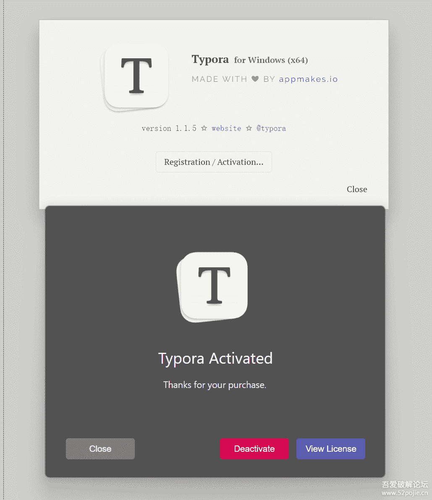

# [原创] 某收费 Markdown 编辑器的破解分析

- 原帖: https://www.52pojie.cn/forum.php?mod=viewthread&tid=1614569
- 抓取时间: 2026-11-01T23:30:59

去年，某个 markdown 编辑器停止免费试用，开始收费了。我一直使用着免费版本，但是，突然有一天，免费版也不能用了，，，，，

其实，不激活也能使用，不过每次启动都有一个激活弹窗，就暂时用了几天，发现丢了一些笔记，也不明白什么情况，但是，，新手上路，啥都想研究一下。

## 先上研究成果

`Screenshot 2022-04-01 001049.png` (100.5 KB, 下载次数: 0)

[href="`forum.php?mod=attachment&aid=MjUxMDAzMHwzM2NkZmRkYXwxNzkzNTc1ODU3fDE2ODA4NnwxNjE0NTY5&nothumb=yes`" target="_blank"](https://www.52pojie.cn/forum.php?mod=attachment&aid=MjUxMDAzMHwzM2NkZmRkYXwxNzkzNTc1ODU3fDE2ODA4NnwxNjE0NTY5&nothumb=yes)

2022-4-1 00:11 上传

代码经过混淆，又没有经验，分析了好几天，，，，

详情看置顶帖
