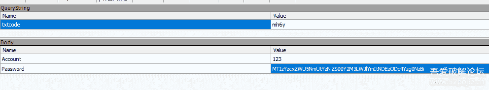
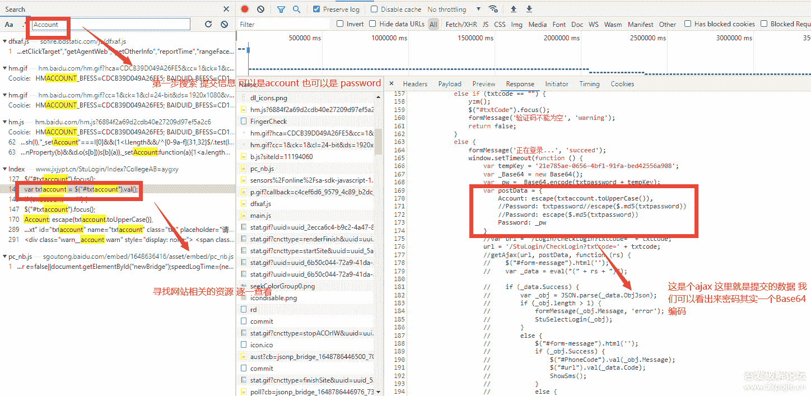
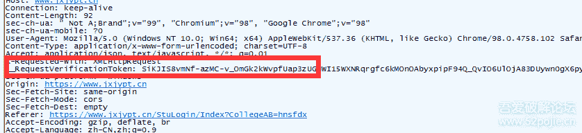
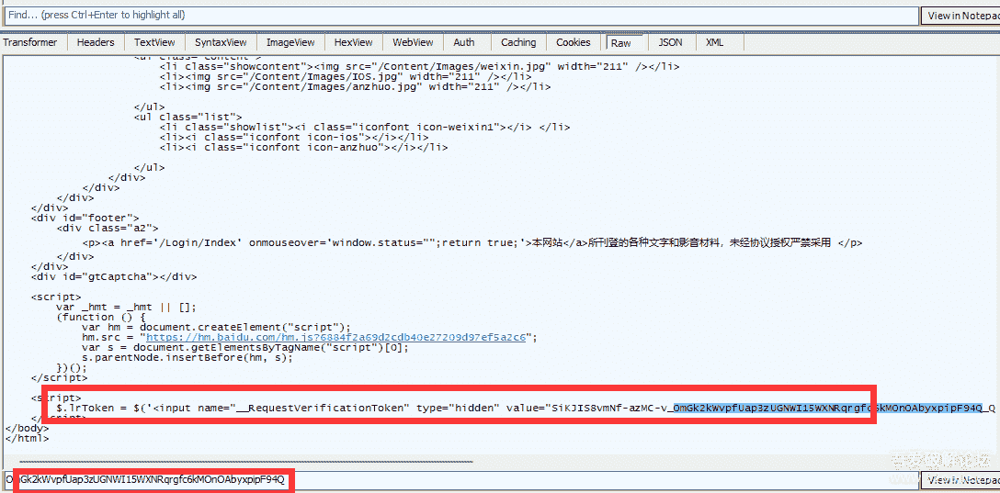
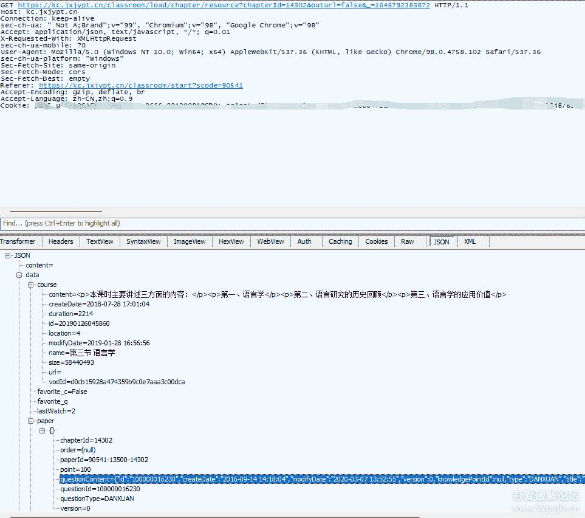

# [Web逆向] 某大学堂逆向笔记，实现查看作业答案思路

- 原帖：https://www.52pojie.cn/forum.php?mod=viewthread&tid=1614850
- 抓取时间：2026-11-01T23:30:53

又到了一年一度的网课季，没办法发工作实在太忙没什么时间看这玩意，顺手记录一下过程，希望能帮到你。

## 声明：非刷课 非刷课 非刷课

## 第一步 登录



`image.png` (16.08 KB, 下载次数: 2)  
[附件下载](https://www.52pojie.cn/forum.php?mod=attachment&aid=MjUxMDEzN3w0M2U3YzJkZnwxNzkzNTc1ODUwfDE2ODA4NnwxNjE0ODUw&nothumb=yes)

登录 2022-4-1 12:24 上传

这里我们能看出来 `txtcode` 为验证码，`Account` 为明文账号，`Password` 为密码，是加密过后的，具体什么加密我们继续往下看。



`解密过程.png` (211.07 KB, 下载次数: 1)  
[附件下载](https://www.52pojie.cn/forum.php?mod=attachment&aid=MjUxMDE1M3w1M2U3M2RlZnwxNzkzNTc1ODUwfDE2ODA4NnwxNjE0ODUw&nothumb=yes)

2022-4-1 13:36 上传

接下来我们看看协议头：



`协议头.png` (34.7 KB, 下载次数: 2)  
[附件下载](https://www.52pojie.cn/forum.php?mod=attachment&aid=MjUxMDE2M3w1OWY0NWZmMHwxNzkzNTc1ODUwfDE2ODA4NnwxNjE0ODUw&nothumb=yes)

2022-4-1 13:47 上传

很明显又加了东西，我们继续搜。

很明显他在第一次进入页面的时候就加载这个 `token`。

所以我们直接通过 `xpath` 获取就可以。



`FD搜索.png` (61.35 KB, 下载次数: 0)  
[附件下载](https://www.52pojie.cn/forum.php?mod=attachment&aid=MjUxMDE2NXw5ZTQwN2FjNXwxNzkzNTc1ODUwfDE2ODA4NnwxNjE0ODUw&nothumb=yes)

2022-4-1 13:50 上传

## 第二步 做题

我发现他这个不是硬性要求必须吧视频看完，只需要把课后题做了即可。

继续看获取每个 `item` 的请求。

这里能看到需要提供一个 `chapterId`，这个顾名思义就是章节的 ID，这个可以根据进入课程后的课程信息的请求里拿到，这里就不多解释了；后面跟了个时间戳也不再多说。

我们主要看响应信息。



`获取item信息.png` (67.77 KB, 下载次数: 1)  
[附件下载](https://www.52pojie.cn/forum.php?mod=attachment&aid=MjUxMDE3M3w3NGJhMmRmNHwxNzkzNTc1ODUwfDE2ODA4NnwxNjE0ODUw&nothumb=yes)

2022-4-1 14:10 上传

`paper` 节点下 `questionContent`：

```json
{
  "id": "100000016230",
  "createDate": "2016-09-14 14:18:04",
  "modifyDate": "2020-03-07 13:52:55",
  "version": 0,
  "knowledgePointId": null,
  "type": "DANXUAN",
  "title": "下列选项中，不属于语言学不分类角度的是",
  "option0": "语言的符号特种",
  "option1": "研究对象的时间范围",
  "option2": "研究对象",
  "option3": "功能角度",
  "option4": null,
  "rightAnswer": null,
  "rightOption": "A"
}
```

这个就是题目的详情信息，不得不说 `rightOption` 一眼就能看出来是正确答案。目测后端直接把这个库里的东西直接返回过来了，完全未封装 `dto`。

OKK，具体提交的话自己抓吧，这里只提供自己的一些思路，感谢观看！
