# [原创] CrackMe160学习记录3 AfKayAs.2

- 原帖：https://www.52pojie.cn/forum.php?mod=viewthread&tid=1617093
- 抓取时间：2026-11-01T23:30:40

## 1. 前期信息探查

### 1.1 EXEinfo

32 位，无壳，VB 编写的程序

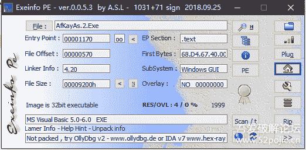

### 1.2 运行一下

双击程序会发现弹出一个 Neg 窗口，过了很久才弹出主窗口：


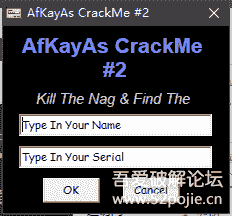

随便输入一点东西：


主要关注一下出错后弹出的信息。

## 2. 前置知识

tips：这里列一下分析这个程序会用到的一些知识点，但有些知识点不会在这里写得太详细，可以移步到百度或者我博客里关于一些知识点的整理。

### 2.1 `Timer`

在 Windows 应用程序中常常要用到时间控制的功能，如在程序界面上显示当前时间，或者每隔多长时间触发一个事件，等等。而 Visual Basic 中的 `Timer`（时间）控制器就是专门解决这方面问题的控件。`Timer` 控件可以使用 `Name` 属性与 `Enabled` 属性，但最重要的是 `Interval` 即时间间隔属性。`Interval` 属性决定了时钟事件之间的间隔，以毫秒为单位，取值范围为 `0` ～ `65535`，因此其最大时间间隔不能超过 65 秒，即一分钟多一点的时间。如果把 `Interval` 属性设置为 `1000`，则表示每秒钟触发一个 `Timer` 事件。其语法格式：`Timer.Interval = X`，其中，`X` 代表具体的时间间隔。

一个 `TImer` 对象需指定定义回叫方法的 `TimerCallback` 委托、传递到该回叫的可选状态对象、首次调用该回叫前的延迟时间以及两次回叫调用之间的时间间隔。

```
timer = new Timer(
        callback: new TimerCallback(TimerTask),
        state: timerState,
        dueTime: 1000,
        period: 2000);
```

### 2.2 Virtual Basic 程序运行简介

https://www.52pojie.cn/thread-1610514-1-1.html

### 2.3 汇编中关于浮点寄存器的知识点

https://magnificent-syrup-61f.notion.site/e117ace2c3d949ec9c0d5f1671eee87e

## 3. 去除 Neg 弹窗

运行程序可以看到会停留在一个 Neg 弹窗很长时间，我们先把他给干掉。

tips：对于一个应用接口需要限制运行速度，需要在循环中加个延时函数，这个延时不需要多么精确，要求有个几秒延时就可以的话，一般使用 `Timer` 函数。这里首先尝试第一个方法。

### 3.1 方法一：直接搜索 `Timer`

首先可以直接在数据框中搜索字符串“`Timer`”：

`OD` 打开程序，在右击数据窗口选择查找→二进制字串→输入 `Timer`：

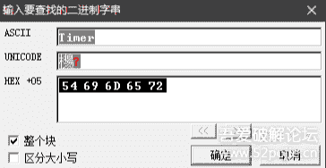

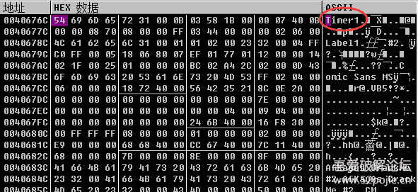

找到 `Timer` 后可以看到后面有一串数值“`0x1B58`”（注意小端存储），这个数值就是调用 `Timer` 后的延迟时间，转换成 10 进制为 `7000`，而 `Timer` 的单位为毫秒，也就是说这个 Neg 窗口的停留时间为 7 秒，既然它存在了数据区里面，那我们可以直接修改停留时间（修改为 1 毫秒）：

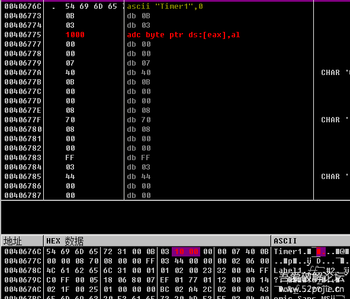

同样还是要注意一个小端存储的问题，这里要输的值为“`10 00`”，这里再补充一个知识点就是当我们修改好一个程序后，如何保存为新的程序：

在指令窗口右击→选择复制到可执行文件→点击所有修改


然后会弹出一个选项卡：


选择复制，之后弹出一个文件窗格：

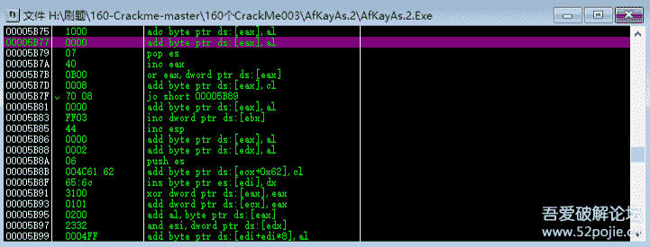

在窗口内右击然后选择保存文件就会弹出文件另存为窗口了。

保存为新的程序后双击运行就会发现 Neg 窗口一闪而过后就直接跳转到序列号窗口。

其实这里我有尝试过把时间改为 0 秒，但是运行后发现程序会一直停留在 Neg 窗口，我对 `Timer` 不是很熟悉，只能是猜测可能当数值为 `0` 时，就等于一直停留吧。

### 3.2 方法二：`4C` 法

这个方法首先要明白的一个点就是啥是 `4C` 法，这里的 `4C` 指的其实就是对于 `VBHeader` 结构体中偏移为 `4C` 位置处的成员 `GUITable`，这个成员也是一个指针其作用是指向 `Form GuI` 描述表。通俗的来说这个指针指向的就是窗体参数数据块，在这里面我们看到的窗口其出现的顺序，并且可以利用这个特征来根据按照我们的个人意愿来调整各窗口出现的顺序。

我们可以分析一下 `GUITable` 结构体的主要成员的定义：

```
Signature DWORD //00H.必须是50000000
FomID TGUID //04，可能是以GUID方式命名的formID
Index BYTE //24H 窗体的序号
Flag1 BYTE //28H 第一个窗体的启动标志，可能是90 也可能是10
AGUIDescriptionTable DWORD //48H指针指向以“FFCC…“开始的FormGUI表
Flag3 Dword //4CH.意义不明
```

具体操作如下：

把程序丢入 `IDA` 分析，根据之前笔记的分析得知，`EP` 的第一条指令 `push` 的是一个指针，指向的是 `VBHeader` 结构体。跟随到数据窗口：

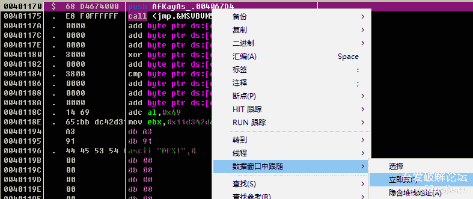

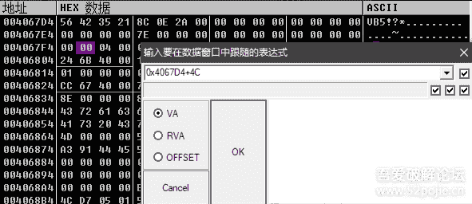

找到 `GUITable` 成员：

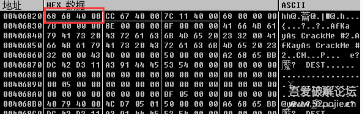

继续跳到 `0x406868` 处：

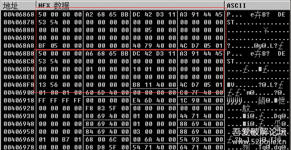

可以看到这里根据窗口分为了两个块，每个块的大小就是一个 `GUITable` 的结构体的大小（`0x50`）：

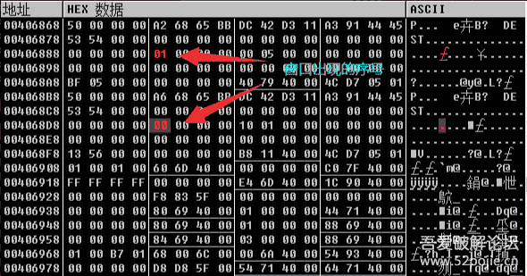


COGQSH06`L}__HQ6@LYOQ8C.png (33.17 KB, 下载次数: 1)

[href="forum.php?mod=attachment&aid=MjUxMTQzN3wzOTFjMzg1NHwxNzkzNTc1ODM4fDE2ODA4NnwxNjE3NTc1ODM4fDE2ODA4NnwxNjE3MDkz&nothumb=yes" target="_blank"](https://www.52pojie.cn/forum.php?mod=attachment&aid=MjUxMTQzN3wzOTFjMzg1NHwxNzkzNTc1ODM4fDE2ODA4NnwxNjE3MDkz&nothumb=yes)

2022-4-6 02:08 上传

箭头所指的地方就是窗口出现的顺序，这里我修改了两个窗口的出场顺序，将序列号窗口放到了前面，而当执行完序列号窗口后就会直接退出程序，也就是Neg消息窗口根本就不会出现了。

将修改后的程序进行保存，我将修改后的程序命名为`AfKayAs.banNeg`，运行一下会发现已经不会弹出Neg窗口了。

## 动调分析算法

### 定位关键跳转

还是跟之前一样的老套路，采取的方式就是查找参考字符串：

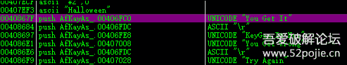

KB%A_S6EXSCVC()GSA4PS55.png (11.52 KB, 下载次数: 1)

[href="forum.php?mod=attachment&aid=MjUxMTQzOHxjYjE2NTM5OHwxNzkzNTc1ODM4fDE2ODA4NnwxNjE3MDkz&nothumb=yes" target="_blank"](https://www.52pojie.cn/forum.php?mod=attachment&aid=MjUxMTQzOHxjYjE2NTM5OHwxNzkzNTc1ODM4fDE2ODA4NnwxNjE3MDkz&nothumb=yes)

2022-4-6 02:08 上传

双击跟踪字符串“You Get Wrong”根据跳转到错误字符串箭头定位到关键判断代码(当然也可以直接跟踪正确字符串，都可以)

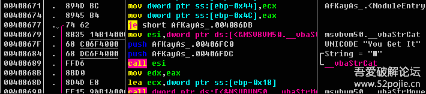

%LK@8`H8L@EW`)QU`J9{W.png (19.95 KB, 下载次数: 1)

[href="forum.php?mod=attachment&aid=MjUxMTQzOXw4OTY0ODVmYXwxNzkzNTc1ODM4fDE2ODA4NnwxNjE3MDkz&nothumb=yes" target="_blank"](https://www.52pojie.cn/forum.php?mod=attachment&aid=MjUxMTQzOXw4OTY0ODVmYXwxNzkzNTc1ODM4fDE2ODA4NnwxNjE3MDkz&nothumb=yes)

2022-4-6 02:09 上传

### 分析校验算法

在确认关键的判断点后下个断点，然后直接翻到构建栈帧的地方下断点，`F9`直接运行，用户名输入“hahaha”和序列号为“123456”。这些操作就不一一截图了，这些东西包括如何定位一些关于序列号生成算法的主要指令在之前的crack分析中都已经详细的走过了(主要是本人懒，可以看一下之前crackme的第二题学习笔记，那里面有讲)。这里直接贴关于序列号生成算法的主要流程：

首先是获取用户名长度


KZHE%E(_O}%`H0~]H7U]Z`1.png (13.62 KB, 下载次数: 1)

[href="forum.php?mod=attachment&aid=MjUxMTQ0MHw5MWNhMzY4MXwxNzkzNTc1ODM4fDE2ODA4NnwxNjE3MDkz&nothumb=yes" target="_blank"](https://www.52pojie.cn/forum.php?mod=attachment&aid=MjUxMTQ0MHw5MWNhMzY4MXwxNzkzNTc1ODM4fDE2ODA4NnwxNjE3MDkz&nothumb=yes)

2022-4-6 02:10 上传

后面三条指令一个是将`name`长度放入`edi`，然后是将`name`存入`ecx`，第三条是将`name`的长度乘上`0x15B38`在存入`edi`

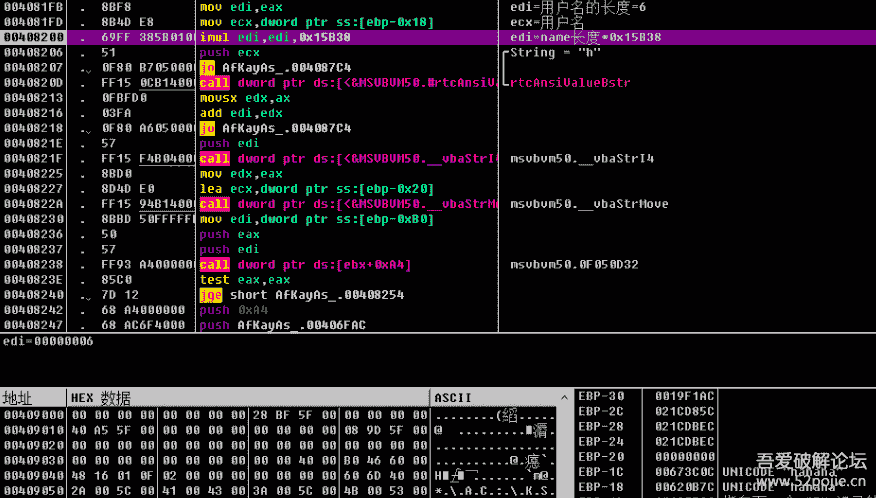

$VL)]Z]4%6NU505%YFBO3Z7.png (215.02 KB, 下载次数: 1)

[href="forum.php?mod=attachment&aid=MjUxMTQ0MXxjYTVjM2FjN3wxNzkzNTc1ODM4fDE2ODA4NnwxNjE3MDkz&nothumb=yes" target="_blank"](https://www.52pojie.cn/forum.php?mod=attachment&aid=MjUxMTQ0MXxjYTVjM2FjN3wxNzkzNTc1ODM4fDE2ODA4NnwxNjE3MDkz&nothumb=yes)

2022-4-6 02:11 上传

大概就是`edi` = `name`的长度*`0x15B38` + 第一个字符的ASCII码

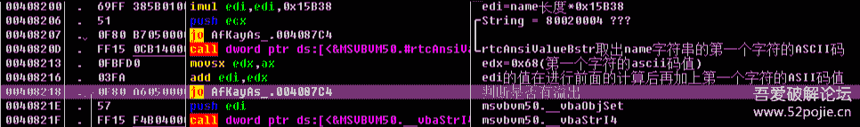

_J]H]MAG]15EGW7X7~@DF3V.png (25.7 KB, 下载次数: 1)

[href="forum.php?mod=attachment&aid=MjUxMTQ0Mnw3MThiZDU3M3wxNzkzNTc1ODM4fDE2ODA4NnwxNjE3MDkz&nothumb=yes" target="_blank"](https://www.52pojie.cn/forum.php?mod=attachment&aid=MjUxMTQ0Mnw3MThiZDU3M3wxNzkzNTc1ODM4fDE2ODA4NnwxNjE3MDkz&nothumb=yes)

2022-4-6 02:12 上传

然后将算出来的值转换成十进制，我算出来的值为533432：


$)9@P[0JNHZSTD9(DYOO)KO.png (15.66 KB, 下载次数: 1)

[href="forum.php?mod=attachment&aid=MjUxMTQ0M3w5MGY2ZTQ1MHwxNzkzNTc1ODM4fDE2ODA4NnwxNjE3MDkz&nothumb=yes" target="_blank"](https://www.52pojie.cn/forum.php?mod=attachment&aid=MjUxMTQ0M3w5MGY2ZTQ1MHwxNzkzNTc1ODM4fDE2ODA4NnwxNjE3MDkz&nothumb=yes)

2022-4-6 02:12 上传

将算出来的值转换成浮点型之后加上2.0然后以浮点的形式表示：

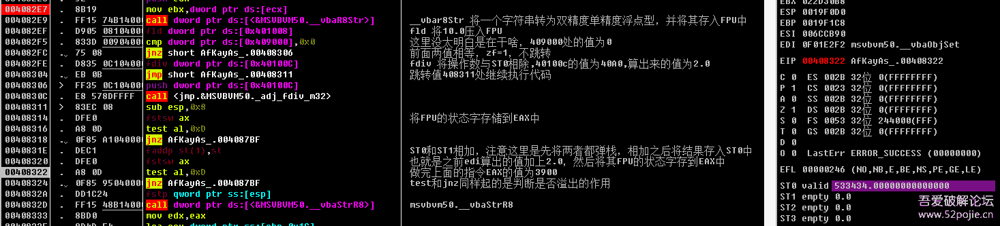

22.png (37.12 KB, 下载次数: 1)

[href="forum.php?mod=attachment&aid=MjUxMTQ0NHxiZDg4YmJlOHwxNzkzNTc1ODM4fDE2ODA4NnwxNjE3MDkz&nothumb=yes" target="_blank"](https://www.52pojie.cn/forum.php?mod=attachment&aid=MjUxMTQ0NHxiZDg4YmJlOHwxNzkzNTc1ODM4fDE2ODA4NnwxNjE3MDkz&nothumb=yes)

2022-4-6 02:13 上传

之后还是将之前那个数放入`ST0`并乘上3，再减去2，等于1600300

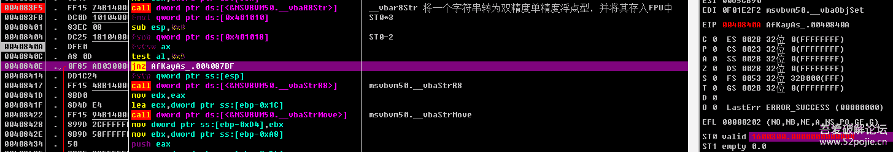

33.png (27.43 KB, 下载次数: 1)

[href="forum.php?mod=attachment&aid=MjUxMTQ0NXwzZmY0OTFkMXwxNzkzNTc1ODM4fDE2ODA4NnwxNjE3MDkz&nothumb=yes" target="_blank"](https://www.52pojie.cn/forum.php?mod=attachment&aid=MjUxMTQ0NXwzZmY0OTFkMXwxNzkzNTc1ODM4fDE2ODA4NnwxNjE3MDkz&nothumb=yes)

2022-4-6 02:15 上传

最后将1600300减去负的15得出最后的序列号“”：

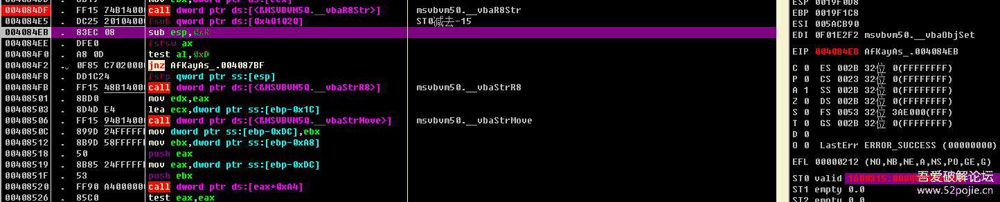

44.png (28.42 KB, 下载次数: 1)

[href="forum.php?mod=attachment&aid=MjUxMTQ0Nnw5ZTEwOTY5NHwxNzkzNTc1ODM4fDE2ODA4NnwxNjE3MDkz&nothumb=yes" target="_blank"](https://www.52pojie.cn/forum.php?mod=attachment&aid=MjUxMTQ0Nnw5ZTEwOTY5NHwxNzkzNTc1ODM4fDE2ODA4NnwxNjE3MDkz&nothumb=yes)

2022-4-6 02:15 上传

验证一下：

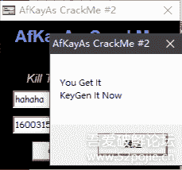

B5CMSN~5{%P7CDPM75PV%2R.png (17.64 KB, 下载次数: 1)

[href="forum.php?mod=attachment&aid=MjUxMTQ0N3w3NmZmMzFhYnwxNzkzNTc1ODM4fDE2ODA4NnwxNjE3MDkz&nothumb=yes" target="_blank"](https://www.52pojie.cn/forum.php?mod=attachment&aid=MjUxMTQ0N3w3NmZmMzFhYnwxNzkzNTc1ODM4fDE2ODA4NnwxNjE3MDkz&nothumb=yes)

2022-4-6 02:16 上传

## 注册机编写

### 确认整个算法逻辑

这个算法的验证过程虽然有用到浮点数但作用仅在于影响我们分析，基本的逻辑和上一个crack差不都，都是取`name`的第一个字符，验证过程如下：

- 取出`name`的长度将其乘上一个固定的值（`0x15B38`）
- 再加上`name`的第一个字符的ASCII码值，再加上2
- 之后再乘3减2
- 最后再加上15，得出来的值为序列号

### 注册机

```
#include"stdio.h"
#include"stdlib.h"
#include"string.h"
int main()
{
        char str1[10] = "";
        int len,seriali;

        puts("Please Input Your Name:");
        scanf("%s", str1);
        len = strlen(str1);
        len = 0x15B38 * len;
        seriali = (len + str1[0] + 2) * 3 - 2 + 15;

        printf("%d",seriali);

        return 0;
}
```

编译成程序搞一搞：

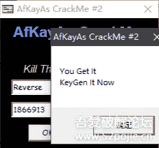

S}@ZYFM7}IMSJNU95IVPHOS.png (18 KB, 下载次数: 1)

[href="forum.php?mod=attachment&aid=MjUxMTQ0OHwxZGJiMWI1ZnwxNzkzNTc1ODM4fDE2ODA4NnwxNjE3MDkz&nothumb=yes" target="_blank"](https://www.52pojie.cn/forum.php?mod=attachment&aid=MjUxMTQ0OHwxZGJiMWI1ZnwxNzkzNTc1ODM4fDE2ODA4NnwxNjE3MDkz&nothumb=yes)

2022-4-6 02:16 上传
