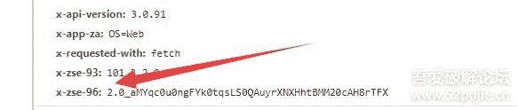
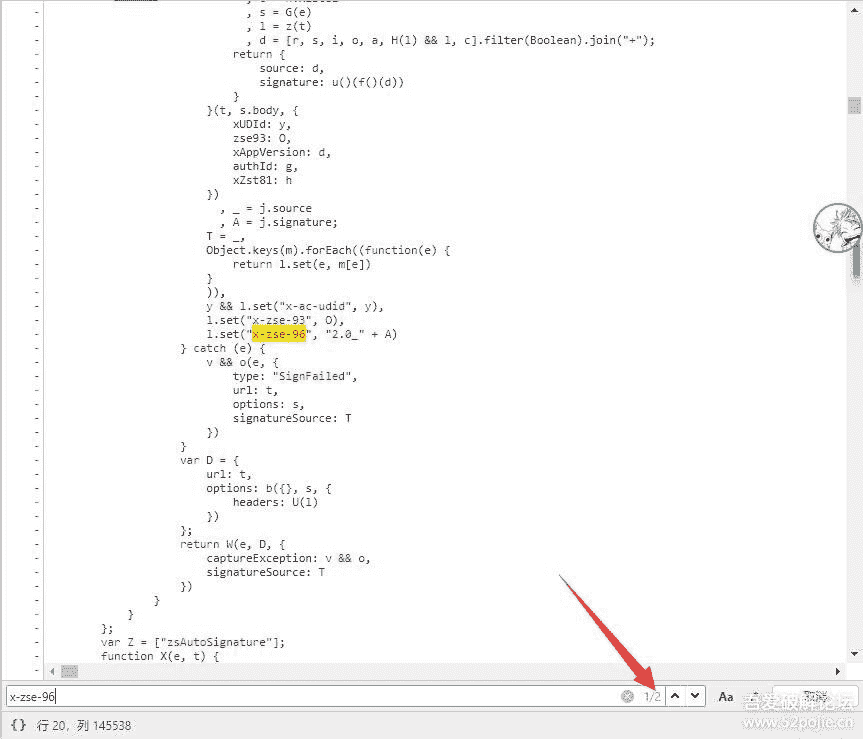
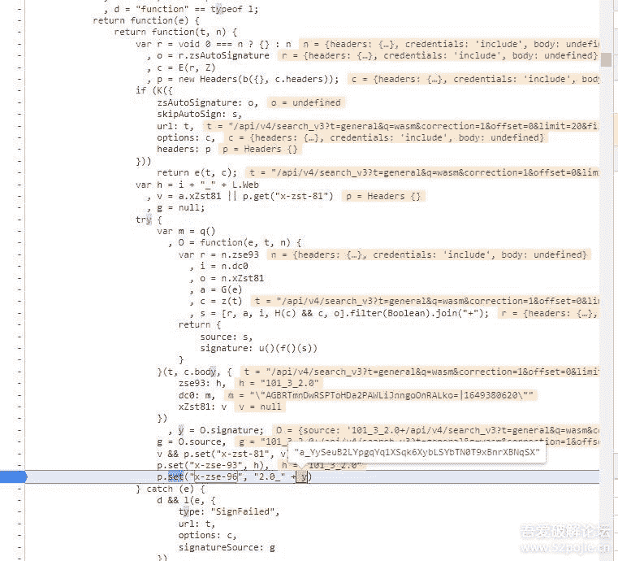
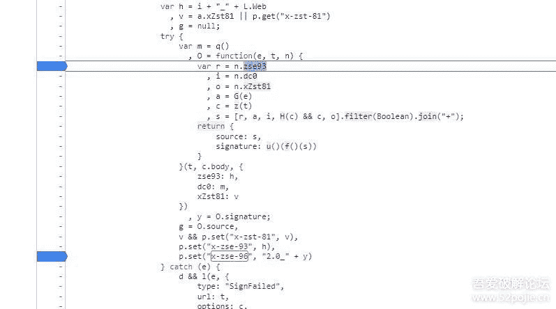
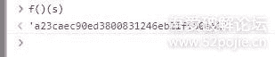
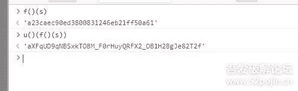
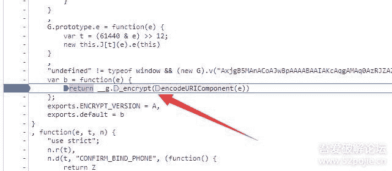
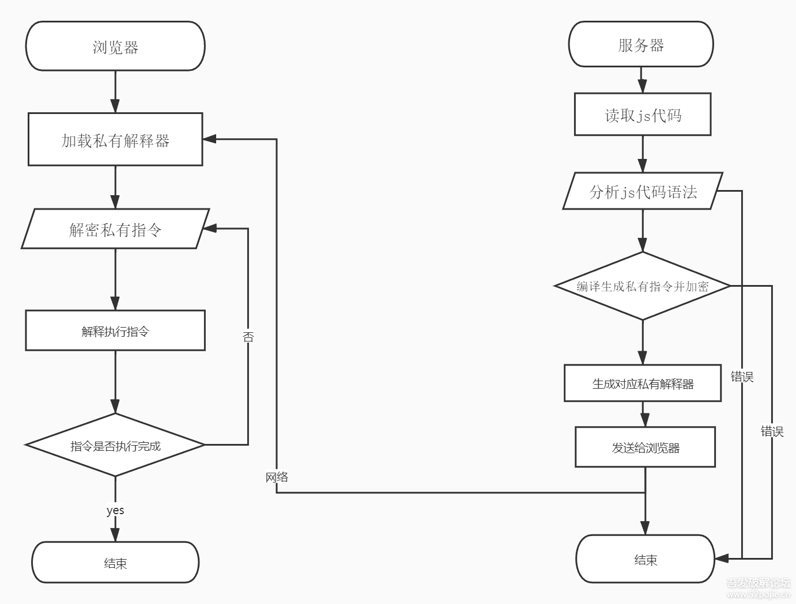
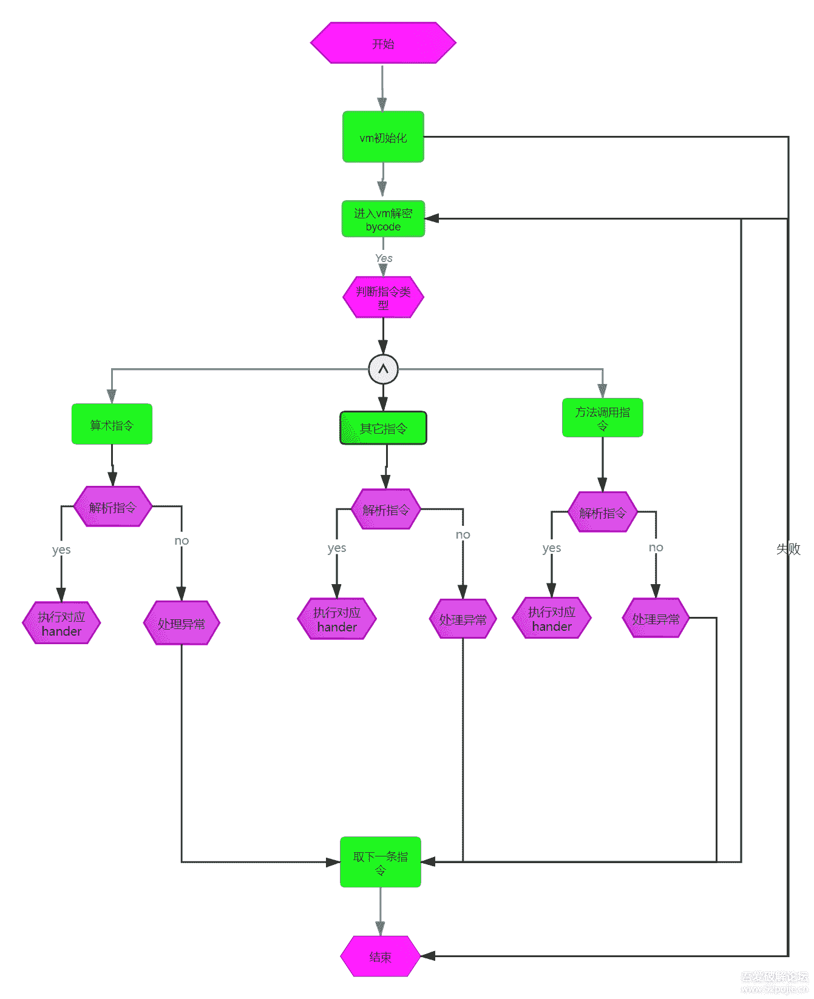
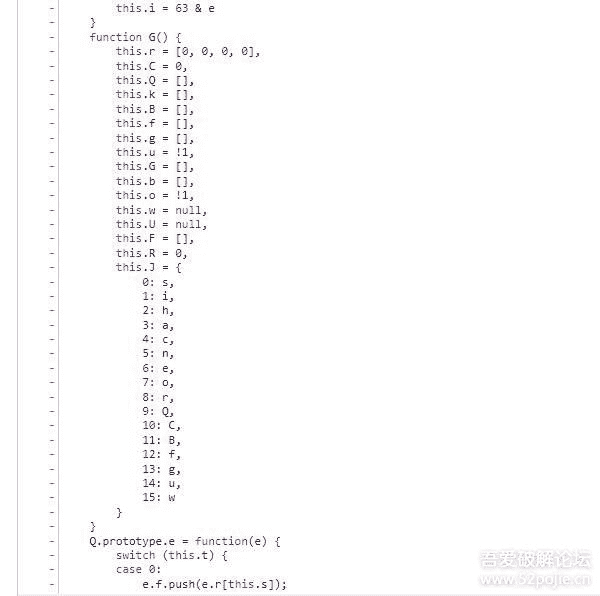

# [Web逆向] 【JS逆向系列】某乎x96参数与jsvmp初体验

- 原帖: https://www.52pojie.cn/forum.php?mod=viewthread&tid=1619464
- 抓取时间: 2026-11-01T23:30:24

@[rel="nofollow noopener" href="【JS逆向系列】某乎x96参数与jsvmp初体验" target="_blank" rel="noopener noreferrer nofollow"](https://www.52pojie.cn/【JS逆向系列】某乎x96参数与jsvmp初体验)

样品网址：aHR0cHM6Ly93d3cuemhpaHUuY29tLw==

## js分析

在搜索的时候，请求头中会存在一个`x-zse-96`的参数，这个参数是加密的，本篇文章主要分析这个参数是如何生成的

1.png (12.04 KB, 下载次数: 258)

[href="forum.php?mod=attachment&aid=MjcyNjExMnw3ZjFmMGNjMHwxNzkzNTc1ODIyfDE2ODA4NnwxNjE5NDY0&nothumb=yes" target="_blank"](https://www.52pojie.cn/forum.php?mod=attachment&aid=MjcyNjExMnw3ZjFmMGNjMHwxNzkzNTc1ODIyfDE2ODA4NnwxNjE5NDY0&nothumb=yes)

2024-9-30 12:23 上传

直接在全局中搜索

2.png (56.56 KB, 下载次数: 263)

[href="forum.php?mod=attachment&aid=MjcyNjExM3xkMWE0YWY2YXwxNzkzNTc1ODIyfDE2ODA4NnwxNjE5NDY0&nothumb=yes" target="_blank"](https://www.52pojie.cn/forum.php?mod=attachment&aid=MjcyNjExM3xkMWE0YWY2YXwxNzkzNTc1ODIyfDE2ODA4NnwxNjE5NDY0&nothumb=yes)

2024-9-30 12:23 上传

发现只有两处地方引用到，那么直接打上断点刷新

3.png (95.44 KB, 下载次数: 265)

[href="forum.php?mod=attachment&aid=MjcyNjExNHxkZjI3YWQ3YXwxNzkzNTc1ODIyfDE2ODA4NnwxNjE5NDY0&nothumb=yes" target="_blank"](https://www.52pojie.cn/forum.php?mod=attachment&aid=MjcyNjExNHxkZjI3YWQ3YXwxNzkzNTc1ODIyfDE2ODA4NnwxNjE5NDY0&nothumb=yes)

2024-9-30 12:23 上传

此时发现参数已经生成，前面的`2.0_`是固定值，后面的`y`是前面的`O.signature`

继续往前看`O`，这是由一个自执行函数生成的，在里面也下一个断点

4.png (35.58 KB, 下载次数: 259)

[href="forum.php?mod=attachment&aid=MjcyNjExNXxhZWZlZjRjNnwxNzkzNTc1ODIyfDE2ODA4NnwxNjE5NDY0&nothumb=yes" target="_blank"](https://www.52pojie.cn/forum.php?mod=attachment&aid=MjcyNjExNXxhZWZlZjRjNnwxNzkzNTc1ODIyfDE2ODA4NnwxNjE5NDY0&nothumb=yes)

2024-9-30 12:23 上传

这里有三个参数，第一个`e`是请求的地址，第二个`t`是请求体，第三个`n`是一个对象，里面又有三个值，其中`zse93`是另一个请求头的值，是一个定值，`dc0`是cookie中的`d_c0`的值，还有一个`xZst81`是空的，可以不用管

接着的参数`s`就是过滤掉布尔值为false的值然后进行拼接，所以实际`s`就是`{x_zse_93}+{path}+{d_c0}`

然后我们需要的参数`signature`就是`s`经过两个函数生成的，那么首先来看看`f`函数

5.png (4.19 KB, 下载次数: 269)

[href="forum.php?mod=attachment&aid=MjcyNjExNnxiYmMwYTBmZHwxNzkzNTc1ODIyfDE2ODA4NnwxNjE5NDY0&nothumb=yes" target="_blank"](https://www.52pojie.cn/forum.php?mod=attachment&aid=MjcyNjExNnxiYmMwYTBmZHwxNzkzNTc1ODIyfDE2ODA4NnwxNjE5NDY0&nothumb=yes)

2024-9-30 12:23 上传

看到返回值是一个长度32的字符串，猜测这个函数很有可能是一个`md5`的计算，从在线网站计算一下对比，发现这个就是一个标准的`md5`算法

接着就是`u`函数

6.png (10.07 KB, 下载次数: 261)

[href="forum.php?mod=attachment&aid=MjcyNjExN3w4ZmZjZWZhNXwxNzkzNTc1ODIyfDE2ODA4NnwxNjE5NDY0&nothumb=yes" target="_blank"](https://www.52pojie.cn/forum.php?mod=attachment&aid=MjcyNjExN3w4ZmZjZWZhNXwxNzkzNTc1ODIyfDE2ODA4NnwxNjE5NDY0&nothumb=yes)

2024-9-30 12:23 上传

这个就是我们需要的结果，跟进去看看

7.png (28.31 KB, 下载次数: 266)

[href="forum.php?mod=attachment&aid=MjcyNjExOHwyY2E5MzI3M3wxNzkzNTc1ODIyfDE2ODA4NnwxNjE5NDY0&nothumb=yes" target="_blank"](https://www.52pojie.cn/forum.php?mod=attachment&aid=MjcyNjExOHwyY2E5MzI3M3wxNzkzNTc1ODIyfDE2ODA4NnwxNjE5NDY0&nothumb=yes)

2024-9-30 12:23 上传

接着在单步调试的时候，发现会在各个函数之间反复横跳。看到这个前面有一个很长的字符串`AxjgB5MAnACoAJwBpAAAABAAIAKcAqgAM*****`，这种很有可能就是`jsvmp`。

## jsvmp分析

`jsvmp`就是将`js`源代码首先编译为字节码，得到的这种字节码就变成只有操作码（`opcode`）和操作数（`Operands`），这是其中一个前端代码的保护技术。

整体架构流程是服务器端通过对`JavaScript`代码词法分析 -> 语法分析 -> 语法树->生成`AST`->生成私有指令->生成对应私有解释器，将私有指令加密与私有解释器发送给浏览器，就开始一边解释，一边执行。

8.png (98.65 KB, 下载次数: 269)

[href="forum.php?mod=attachment&aid=MjcyNjExOXwxM2UzZGQ1Y3wxNzkzNTc1ODIyfDE2ODA4NnwxNjE5NDY0&nothumb=yes" target="_blank"](https://www.52pojie.cn/forum.php?mod=attachment&aid=MjcyNjExOXwxM2UzZGQ1Y3wxNzkzNTc1ODIyfDE2ODA4NnwxNjE5NDY0&nothumb=yes)

2024-9-30 12:23 上传

在客户端中，通过特定的解释器，不断执行一条一条的指令

9.png (129.23 KB, 下载次数: 261)

[href="forum.php?mod=attachment&aid=MjcyNjEyMHxkYzliMjVkMXwxNzkzNTc1ODIyfDE2ODA4NnwxNjE5NDY0&nothumb=yes" target="_blank"](https://www.52pojie.cn/forum.php?mod=attachment&aid=MjcyNjEyMHxkYzliMjVkMXwxNzkzNTc1ODIyfDE2ODA4NnwxNjE5NDY0&nothumb=yes)

2024-9-30 12:23 上传

既然是`jsvmp`，那么肯定会有`vmp`的一些特征

10.png (30.44 KB, 下载次数: 275)

[href="forum.php?mod=attachment&aid=MjcyNjEyMXw0NGIwODUyY3wxNzkzNTc1ODIyfDE2ODA4NnwxNjE5NDY0&nothumb=yes" target="_blank"](https://www.52pojie.cn/forum.php?mod=attachment&aid=MjcyNjEyMXw0NGIwODUyY3wxNzkzNTc1ODIyfDE2ODA4NnwxNjE5NDY0&nothumb=yes)

2024-9-30 12:23 上传

这里的`G`就是`vm`初始化，这里有几个参数需要特别注意

参数 | 映射意义 | `this.r`
