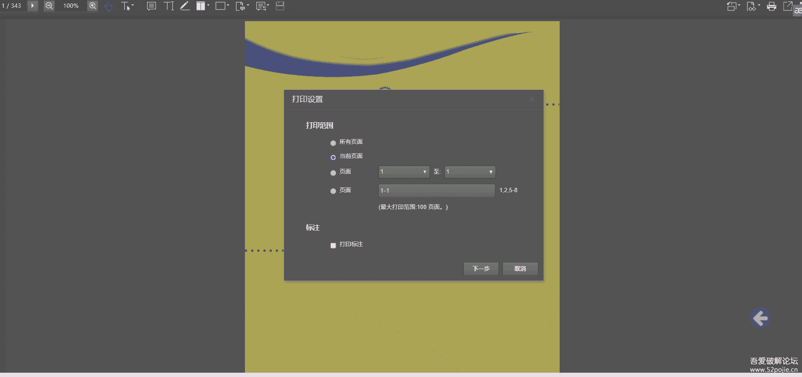
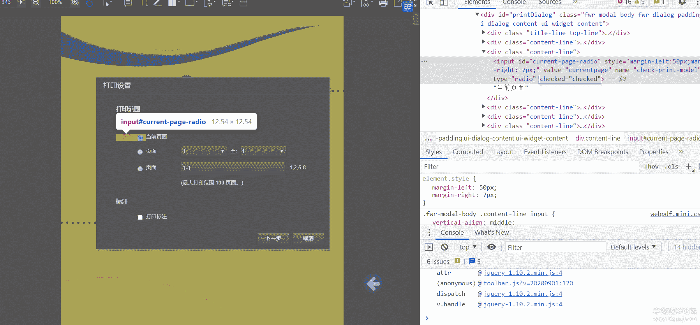
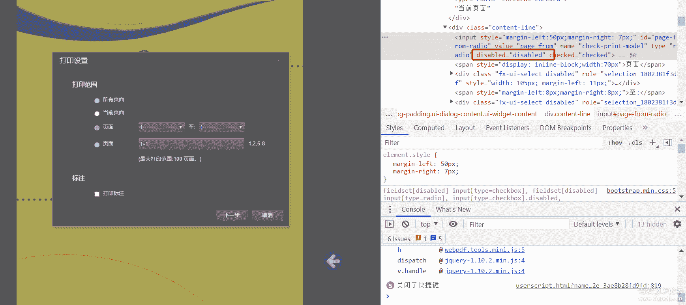

# [Web逆向] 【失效】科学文库网页多页与全文打印

- 原帖: https://www.52pojie.cn/forum.php?mod=viewthread&tid=1621475
- 抓取时间: 2026-11-01T23:29:00

2022.6.30 已更新全文pdf下载方法，发布于个人博客liublogs.tk与github ZhiliAn中

## 背景
查找研究生教材的电子书，学校图书馆转到了科学文库。但是下载的pdf文件只能有CAJ查看，并且不能打印输出。在线的查看只能单页输出。

## 正文
科学文库查找教材
数值分析


`image.png` (133.25 KB, 下载次数: 0)

2022-4-13 23:16 上传

点击阅读 因为那个下载是caj才可以看。


`image.png` (143.26 KB, 下载次数: 0)

2022-4-13 23:17 上传

鼠标移到当前页面 右击鼠标 选中检查


`image.png` (215.7 KB, 下载次数: 0)

2022-4-13 23:19 上传

对 HTML 纯文本查看 复制代码

```
checked="checked"
```


`image.png` (202.23 KB, 下载次数: 0)

2022-4-13 23:21 上传

对 HTML 纯文本查看 复制代码

```
disabled="disabled"
```

需要进行删除！！！
这里每次进行打印操作后，会自动添加`disabled="disabled"` 需要再次删除。

完成

感谢有说以前有类似文章，当时我搜索的科学文库，所以没有搜到这方法。下面是以前文章的地址
https://www.52pojie.cn/thread-1562617-1-1.html

我也将方法进行了视频录制，感谢各位大佬提供的全文方法
https://www.bilibili.com/video/BV1YY4y1h7Fy/

有大佬已经找到了原文pdf下载的方法，本人还未找到破解方法。
