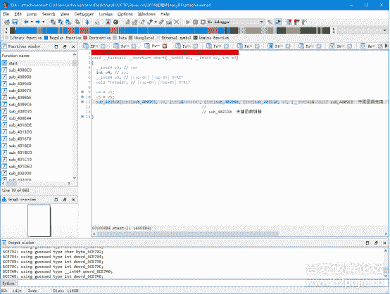
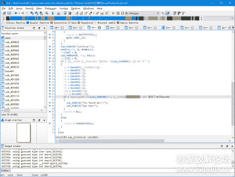
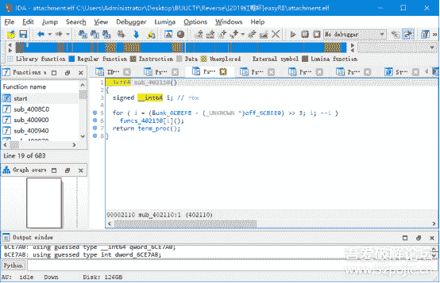
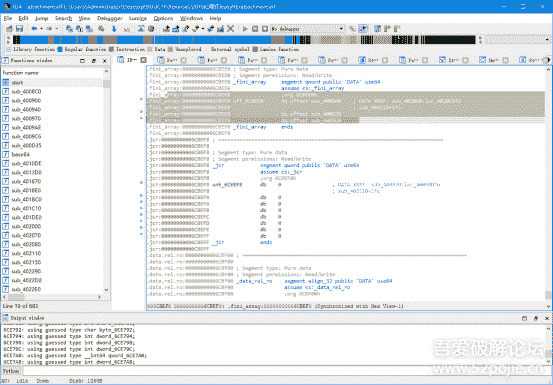
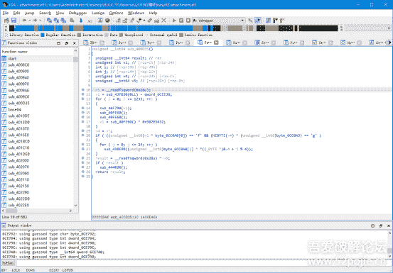

# [CTF] 【2019红帽杯】easyRE

- 原帖: https://www.52pojie.cn/forum.php?mod=viewthread&tid=1622346
- 抓取时间: 2026-11-01T23:28:59

## 【2019红帽杯】easyRE



image.png (84 KB, 下载次数: 2)

[href="forum.php?mod=attachment&aid=MjUxMzk3NnxlNTczNzNlOHwxNzkzNTc1NzM2fDE2ODA4NnwxNjIyMzQ2&nothumb=yes" target="_blank"](https://www.52pojie.cn/forum.php?mod=attachment&aid=MjUxMzk3NnxlNTczNzNlOHwxNzkzNTc1NzM2fDE2ODA4NnwxNjIyMzQ2&nothumb=yes)

1

2022-4-15 14:13 上传

`sub_4009C6` 干扰函数 看雪论坛的一个链接进行了10次`base64` 无用



image.png (81.5 KB, 下载次数: 3)

[href="forum.php?mod=attachment&aid=MjUxMzk3OHxiNTM5MjIzMnwxNzkzNTc1NzM2fDE2ODA4NnwxNjIyMzQ2&nothumb=yes" target="_blank"](https://www.52pojie.cn/forum.php?mod=attachment&aid=MjUxMzk3OHxiNTM5MjIzMnwxNzkzNTc1NzM2fDE2ODA4NnwxNjIyMzQ2&nothumb=yes)

2

2022-4-15 14:15 上传

`sub_402110`



image.png (79.95 KB, 下载次数: 2)

[href="forum.php?mod=attachment&aid=MjUxMzk3OXxhOTNmMzlkOHwxNzkzNTc1NzM2fDE2ODA4NnwxNjIyMzQ2&nothumb=yes" target="_blank"](https://www.52pojie.cn/forum.php?mod=attachment&aid=MjUxMzk3OXxhOTNmMzlkOHwxNzkzNTc1NzM2fDE2ODA4NnwxNjIyMzQ2&nothumb=yes)

3

2022-4-15 14:15 上传

依次运行三个函数



image.png (118.35 KB, 下载次数: 3)

[href="forum.php?mod=attachment&aid=MjUxMzk4MHw0MmY4YTcyMHwxNzkzNTc1NzM2fDE2ODA4NnwxNjIyMzQ2&nothumb=yes" target="_blank"](https://www.52pojie.cn/forum.php?mod=attachment&aid=MjUxMzk4MHw0MmY4YTcyMHwxNzkzNTc1NzM2fDE2ODA4NnwxNjIyMzQ2&nothumb=yes)

4

2022-4-15 14:16 上传

关键函数



image.png (90.52 KB, 下载次数: 2)

[href="forum.php?mod=attachment&aid=MjUxMzk4MXxiNTY3OWJiZHwxNzkzNTc1NzM2fDE2ODA4NnwxNjIyMzQ2&nothumb=yes" target="_blank"](https://www.52pojie.cn/forum.php?mod=attachment&aid=MjUxMzk4MXxiNTY3OWJiZHwxNzkzNTc1NzM2fDE2ODA4NnwxNjIyMzQ2&nothumb=yes)

5

2022-4-15 14:16 上传

### exp：

[Python] 纯文本查看 复制代码

```
str1 = 'flag'
str2 = [ 0x40, 0x35, 0x20, 0x56, 0x5D, 0x18, 0x22, 0x45, 0x17, 0x2F,0x24, 0x6E, 0x62, 0x3C, 0x27, 0x54, 0x48, 0x6C, 0x24, 0x6E, 0x72, 0x3C, 0x32, 0x45, 0x5B]
flag = ''
key = ''
for x in range(4):
    key += chr(ord(str1[x]) ^ str2[x])
for i in range(len(str2)):
    flag += chr(str2[i] ^ ord(key[i%4]))
    
print(flag)

#flag{Act1ve_Defen5e_Test}

flag{Act1ve_Defen5e_Test}
```
