# [原创] 关于小生我怕怕第六课的一个CrackMe的破解

- 原帖: https://www.52pojie.cn/forum.php?mod=viewthread&tid=1622840
- 抓取时间: 2026-11-01T23:28:56

大家好 我是wasdzjh 好久没做教程了，前几天也是看到了论坛一个帖子，有一个朋友寻求这个CrackMe的一个破解过程，抽点时间做一个教程。分享一下，大家一起交流进步。

破解工具：论坛的 `od` `peid0.95`（查壳工具）

目标软件：`CRACKME.exe`

达到目的：形成自己破解的一种思维或者方法（直接点注册就可以成功）

## 教程开始

### 第一步：获取软件的关键信息

点击软件的注册，登录 看软件提示什么错误消息，打开记事本记录下来。

错误消息：注册失败要继续努力哦 如图：

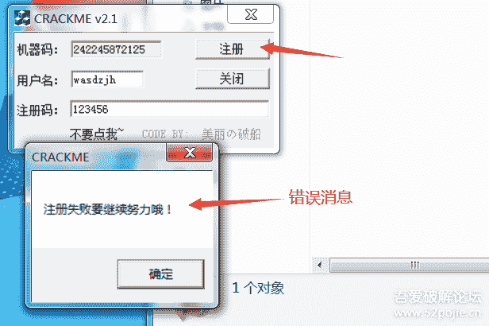

错误消息.png (86.21 KB, 下载次数: 1)

消息

2022-4-16 11:31 上传

### 第二步：开始查壳

将软件拖入 `peid0.95` 即可看到什么壳子 经过查看是没有壳子的，如果有大家还得去学习。如图：

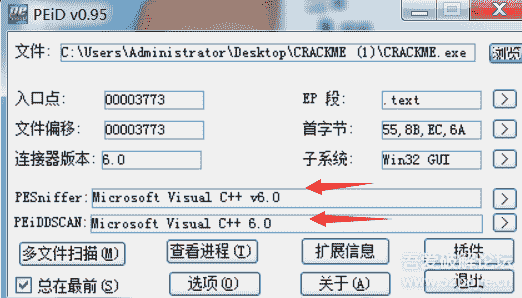

查壳.png (69.82 KB, 下载次数: 2)

查壳

2022-4-16 11:38 上传

### 第三步：开始分析

将软件拖入 `od` 开始查找 `ASCII`码 搜索字符串（前面提到了错误信息 直接搜索 看可以找到吗 如果作者隐藏了字符串那就搜索不到了）

选取第一行 右键--中文搜索引擎--搜索 `ASCII`--查找（`cttl+f` ）--输入（注册失败要继续加油哦！）查找不到 因为作者隐藏了 如图：

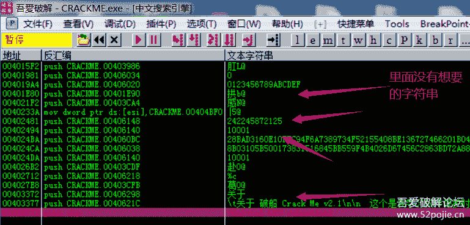

搜索字符串.png (133.03 KB, 下载次数: 0)

字符串

2022-4-16 11:50 上传

### 第四步：下断点消息框

下断点 `MessageBoxA` 如图：

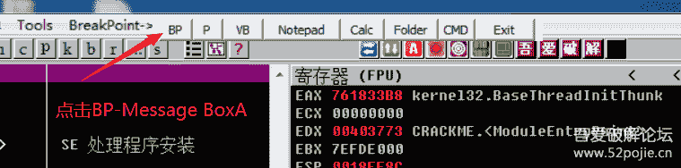

断点.png (57.37 KB, 下载次数: 1)

断点

2022-4-16 11:56 上传

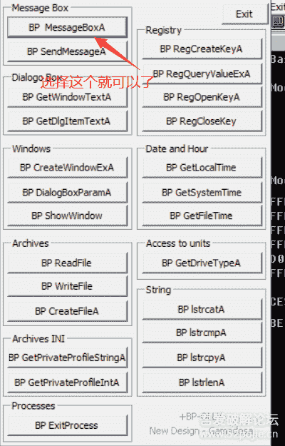

断点1.png (118.36 KB, 下载次数: 0)

断点1

2022-4-16 11:57 上传

### 第五步：开始分析代码走向

点击运行（`F9` ）运行程序 输入 用户名 注册码 点击注册 看程序在哪里停止 段下来 如图：

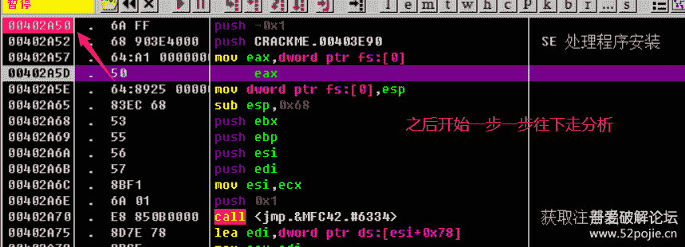

断点位置.png (86.75 KB, 下载次数: 1)

断点位置

2022-4-16 13:17 上传

我们之后一步一步往下走开始分析 关键代码可以 `f7` 进入，`f8` 步过分析

一直 `F8` 步过会出现如下图：看图片里面的文字描述，之后还会看到注册失败如图：

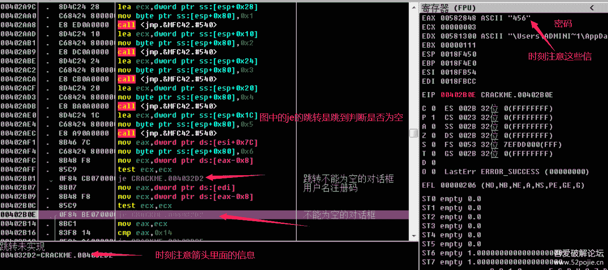

信息跳转.png (260.36 KB, 下载次数: 0)

信息跳转

2022-4-16 13:39 上传

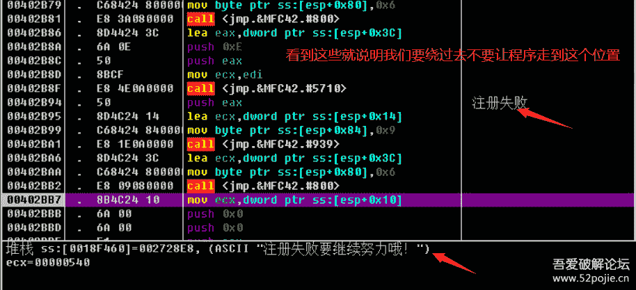

绕过去.png (116.46 KB, 下载次数: 1)

绕过去

2022-4-16 13:47 上传

我们要绕过去不要让程序走到这些位置，想到之前的三个 `je` 跳转，有两个跳转一样是跳到判断为空的位置，剩下一个就可以改改跳转将 `je` 改为无条件跳转的 `jmp` 看看会有什么效果

将 `00402B19` 的 `je` 改为 `jmp` 操作：选中 `00402B19` 这行 按空格键 将 `je` 改为 `jmp` 点击汇编即可，如图：

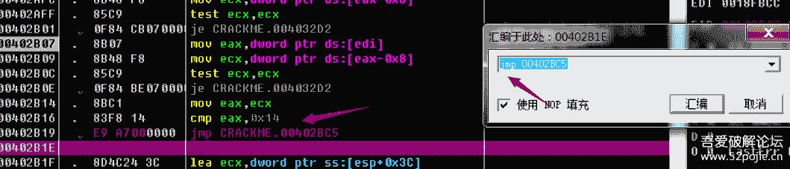

修改 `je`.png (93.08 KB, 下载次数: 1)

`je` 修改

2022-4-16 13:56 上传

后面如果看到 `jnz`（不为0则跳转）我们将其改为 `jmp` 无条件跳转 我们反着来就可以。如图：

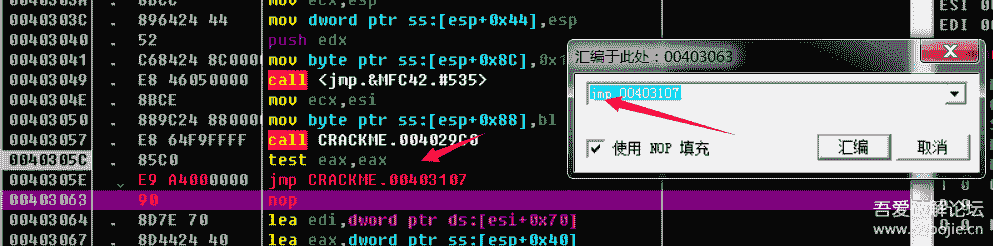

修改 `jnz`.png (100.12 KB, 下载次数: 2)

`jnz`

2022-4-16 14:13 上传

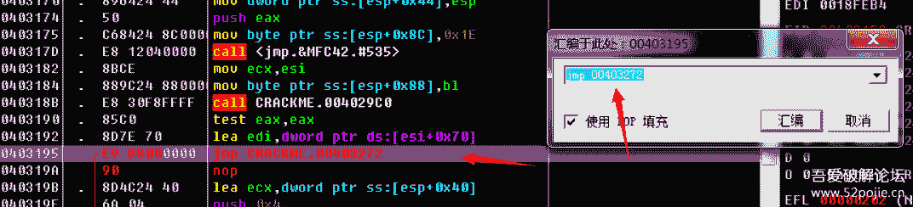

修改 `jnz1`.png (106.36 KB, 下载次数: 1)

`jnz1`

2022-4-16 14:26 上传

只要将 `00402F3A` `0040305E` `00403195` 三个位置的 `jnz` 改成 `jmp` 就可以完成破解 如图：

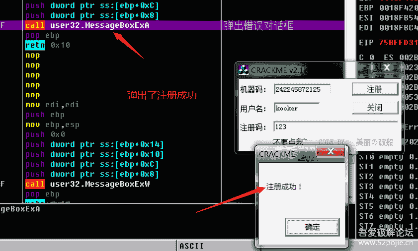

注册成功了.png (128.38 KB, 下载次数: 1)

成功

2022-4-16 14:39 上传

随后我们将修改后的软件保存操作:选取区域--右键--复制到可执行文件--所有修改--全部复制 如图：

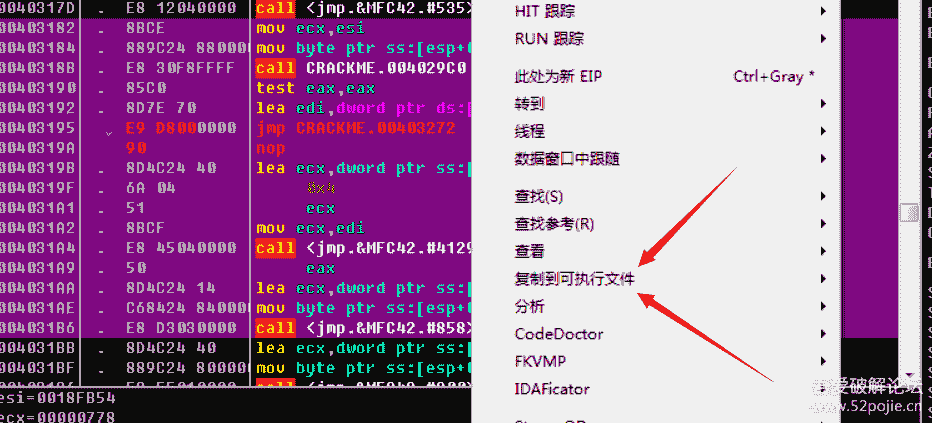

保存文件.png (149.46 KB, 下载次数: 3)

保存

2022-4-16 14:43 上传

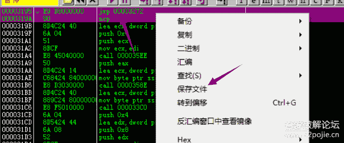

保存.png (82.65 KB, 下载次数: 3)

保存文件

2022-4-16 14:45 上传

已经成功保存文件了 现在打开看下效果如何：

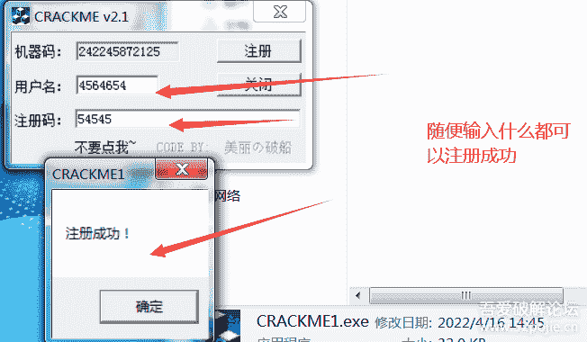

完结.png (86.49 KB, 下载次数: 1)

完结

2022-4-16 14:48 上传

这个就是一个简单的破解，算法什么的我技术有限，分析不出来。希望大家可以通过我的小破文学习一些有用的知识，给点热心值的都可以。不给也行。大家一起进步。没有看懂的操作也可以留言，我会一一回复。希望大家在论坛里都可以学到东西。感谢大家。软件我也会上传大家去研究。
