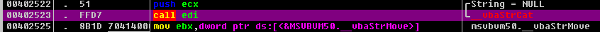
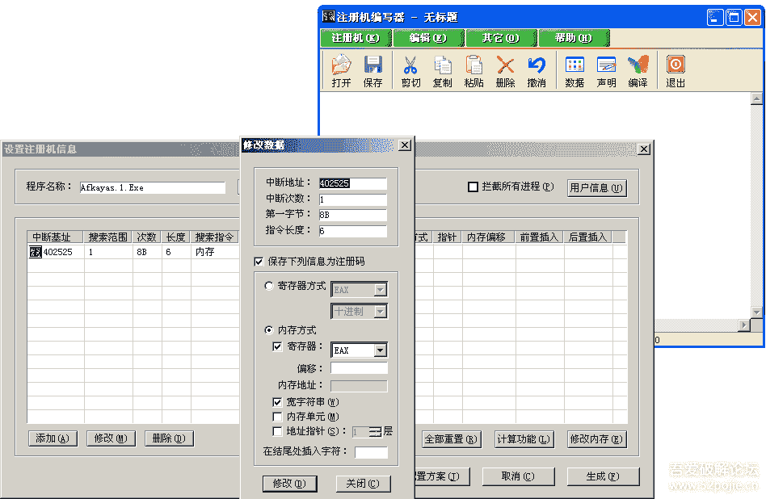
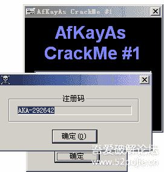

# [原创] 练习笔记之160Crackme-002

- 原帖：<https://www.52pojie.cn/forum.php?mod=viewthread&tid=1623288>
- 抓取时间：2026-11-01T23:28:50

在论坛上前后逛了3年了，还是菜鸟一个，最近开始用160Crackme来练练，尝试将过程都记录一下。

001因为好久以前做过，所以直接从002开始了。

这道题比较简单，大致解题过程如下：

1. 查找字符串，可以很容易找到关键跳转位置；
2. 使用 VB 事件特征码 `816C24`，可以断到按钮事件位置，跟踪运行，可以追到注册码。
3. 注册码和输入的用户名有关，跟踪程序可以发现是根据用户名计算得到字符串后，前面加上“`AKA-`”。

爆破和追码都比较简单，过程就不详细叙述了，第一次尝试制作内存注册机，将制作过程记录一下。（内存注册机软件使用的是论坛[内存注册机2.0](https://www.52pojie.cn/thread-661779-1-1.html)里面自带的）

内存注册机：对于会在程序运行中出现明码的，可以制作内存注册机，如本例，在`402523`运行完成后，`EAX`指向的内存地址就是注册码。

`01.png`（4.26 KB，下载次数：0；[附件](https://www.52pojie.cn/forum.php?mod=attachment&aid=MjUxNDUwNHxiOWMxODg2OHwxNzkzNTc1NzI4fDE2ODA4NnwxNjIzMjg4&nothumb=yes)；2022-4-17 15:54 上传）

因此可以按以下方式制作注册码，由于注册码是宽字符类型，因此须选择宽字符串。

`02.png`（63.3 KB，下载次数：0；[附件](https://www.52pojie.cn/forum.php?mod=attachment&aid=MjUxNDUwNXw5ZDU2Y2M1YXwxNzkzNTc1NzI4fDE2ODA4NnwxNjIzMjg4&nothumb=yes)；2022-4-17 15:54 上传）

运行后效果如下：

`03.png`（22.22 KB，下载次数：0；[附件](https://www.52pojie.cn/forum.php?mod=attachment&aid=MjUxNDUwNnwyYjQxZTJjM3wxNzkzNTc1NzI4fDE2ODA4NnwxNjIzMjg4&nothumb=yes)；2022-4-17 15:54 上传）
