# [CTF] CTF2022部分RE_WP

- 原帖: <https://www.52pojie.cn/forum.php?mod=viewthread&tid=1623713>
- 抓取时间: 2026-11-01T23:28:43

## 2022* CTF部分RE题目WP

### Simple File System

IDA打开程序进行分析

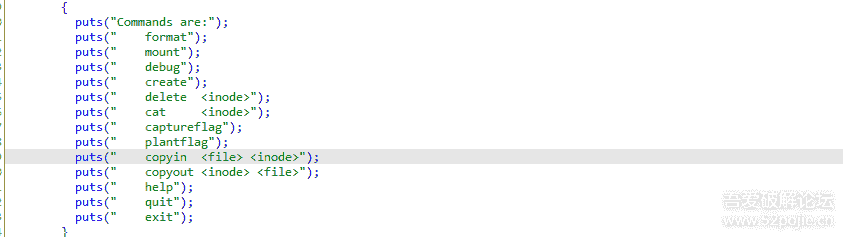

image-20220417163232398.png (22.77 KB, 下载次数: 0)

[附件](https://www.52pojie.cn/forum.php?mod=attachment&aid=MjUxNDcwMnxhNmIxMDVjNnwxNzkzNTc1NzIxfDE2ODA4NnwxNjIzNzEz&nothumb=yes)

2022-4-18 13:39 上传

打开`instruction.txt`，观察运行的指令

```
# instructions

I implemented a very simple file system and buried my flag in it.

The image file are initiated as follows: 
./simplefs image.flag 500
 simplefs> format
 simplefs> mount
 simplefs> plantflag
 simplefs> exit

And you cold run "help" to explore other commands.
```

程序逻辑是创建一个磁盘，格式化并挂载，然后将`flag`文件的内容加密后存储进去，只需要找到对应的加密函数写解密脚本即可

IDA找到`plantflag`处的代码

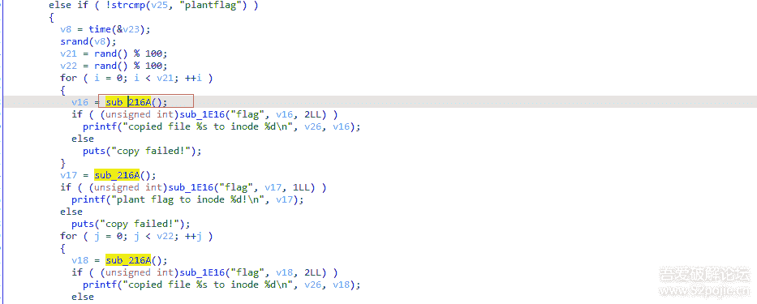

image-20220417163339564.png (35.76 KB, 下载次数: 0)

[附件](https://www.52pojie.cn/forum.php?mod=attachment&aid=MjUxNDcwM3xkMWZlN2U5ZnwxNzkzNTc1NzIxfDE2ODA4NnwxNjIzNzEz&nothumb=yes)

2022-4-18 13:39 上传

这里的`sub_216A`函数的功能其实就是`create_inode`，`v21`，`v22`是2个随机数，而`sub_1e16`的第二个参数是不同的，进去分析

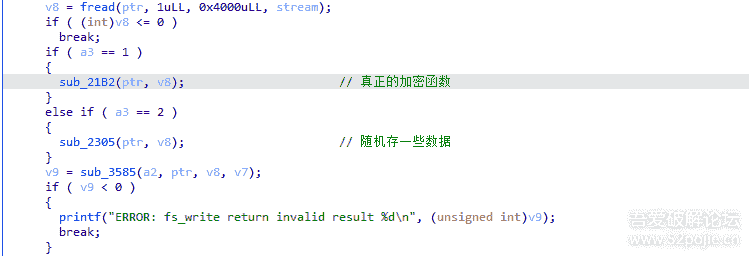

image-20220417163631438.png (21.88 KB, 下载次数: 0)

[附件](https://www.52pojie.cn/forum.php?mod=attachment&aid=MjUxNDcwNHwxOWI5OTlmM3wxNzkzNTc1NzIxfDE2ODA4NnwxNjIzNzEz&nothumb=yes)

2022-4-18 13:39 上传

发现`sub_21B2`才是真正的加密函数，在此函数下断点，把程序运行参数设置为`imagetest.flag 500`，IDA远程动态调试，运行并执行命令

```
 simplefs> format

 simplefs> mount

 simplefs> plantflag
```

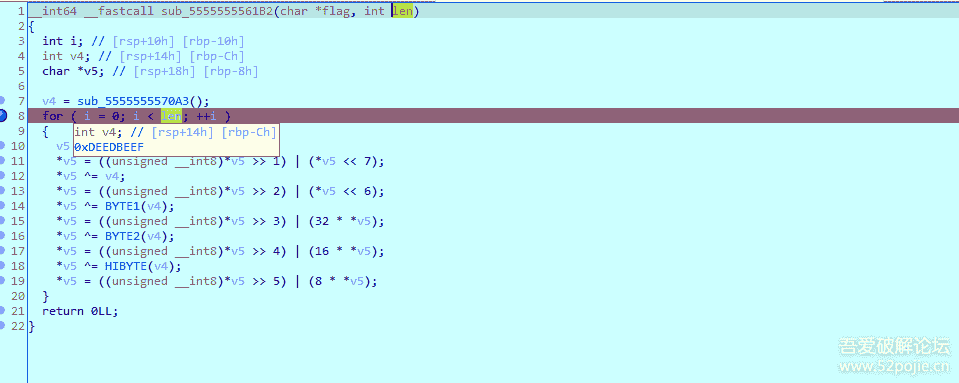

image-20220417164027740.png (38.71 KB, 下载次数: 0)

[附件](https://www.52pojie.cn/forum.php?mod=attachment&aid=MjUxNDcwNXw0YjliYWVmZXwxNzkzNTc1NzIxfDE2ODA4NnwxNjIzNzEz&nothumb=yes)

2022-4-18 13:39 上传

调试发现`V4`的值一定是`0xDEEDBEEF`，观察`imagetest.flag`文件，发现从偏移`0X33000`开始存储，每隔`0x1000`存1个`enc_flag`，不过这些`enc_flag`只有1个是真正的通过`sub_21b2`函数进行加密的，其他的都是`sub_2305`中生成的随机数，所以不管它，直接把所有`enc_flag`执行一下解密函数就可以了。

`exp`为

```
def ROR(_num, _n):
    return (((_num >> _n) & 0XFF) | ((_num 
```

### NaCl

IDA打开分析，测试是最终这2段数据进行对比，如果相同的话，`flag`就是`*CTF{input}`

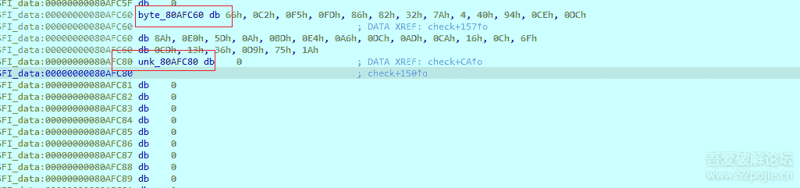

image-20220417200540628.png (37.27 KB, 下载次数: 0)

[附件](https://www.52pojie.cn/forum.php?mod=attachment&aid=MjUxNDcwNnxjM2UxNWViY3wxNzkzNTc1NzIxfDE2ODA4NnwxNjIzNzEz&nothumb=yes)

2022-4-18 13:39 上传

调试起来，发现了`xtea`算法

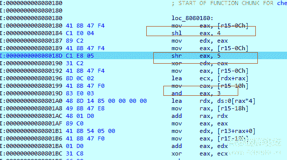

image-20220417200600659.png (39.9 KB, 下载次数: 0)

[附件](https://www.52pojie.cn/forum.php?mod=attachment&aid=MjUxNDcwN3wxMGYyNTU3MXwxNzkzNTc1NzIxfDE2ODA4NnwxNjIzNzEz&nothumb=yes)

2022-4-18 13:39 上传

最终经过无尽的调试，还原了题目算法

```
#include 

#include 

#define LeftRotate(word, bits) ( (word) > (32 - (bits)) )

unsigned int dword_80AFB60[44] = {
        0x04050607, 0x00010203, 0x0C0D0E0F, 0x08090A0B, 0xCD3FE81B, 0xD7C45477, 0x9F3E9236, 0x0107F187,
        0xF993CB81, 0xBF74166C, 0xDA198427, 0x1A05ABFF, 0x9307E5E4, 0xCB8B0E45, 0x306DF7F5, 0xAD300197,
        0xAA86B056, 0x449263BA, 0x3FA4401B, 0x1E41F917, 0xC6CB1E7D, 0x18EB0D7A, 0xD4EC4800, 0xB486F92B,
        0x8737F9F3, 0x765E3D25, 0xDB3D3537, 0xEE44552B, 0x11D0C94C, 0x9B605BCB, 0x903B98B3, 0x24C2EEA3,
        0x896E10A2, 0x2247F0C0, 0xB84E5CAA, 0x8D2C04F0, 0x3BC7842C, 0x1A50D606, 0x49A1917C, 0x7E1CB50C,
        0xFC27B826, 0x5FDDDFBC, 0xDE0FC404, 0xB2B30907
};

DWORD xtea_key[4] = { 0x03020100, 0x07060504, 0x0B0A0908, 0x0F0E0D0C };

//xtea算法

void encipher(unsigned int num_rounds, DWORD v[2], DWORD  key[4]) {
        unsigned int i;
        DWORD v0 = v[0], v1 = v[1], sum = 0, delta = 0x10325476;
        for (i = 0; i > 5)) + v1) ^ (sum + key[sum & 3]);
                sum += delta;
                v1 += (((v0 > 5)) + v0) ^ (sum + key[(sum >> 11) & 3]);
        }
        v[0] = v0; v[1] = v1;
}

void enc11(DWORD* v)
{
        for (int i = 0; i 
```

接下来的任务就简单了，比着写解密脚本即可

`exp`为:

```
#include 
#include 

#define LeftRotate(word, bits) ( (word) > (32 - (bits)) )

unsigned int dword_80AFB60[44] = {
        0x04050607, 0x00010203, 0x0C0D0E0F, 0x08090A0B, 0xCD3FE81B, 0xD7C45477, 0x9F3E9236, 0x0107F187,
        0xF993CB81, 0xBF74166C, 0xDA198427, 0x1A05ABFF, 0x9307E5E4, 0xCB8B0E45, 0x306DF7F5, 0xAD300197,
        0xAA86B056, 0x449263BA, 0x3FA4401B, 0x1E41F917, 0xC6CB1E7D, 0x18EB0D7A, 0xD4EC4800, 0xB486F92B,
        0x8737F9F3, 0x765E3D25, 0xDB3D3537, 0xEE44552B, 0x11D0C94C, 0x9B605BCB, 0x903B98B3, 0x24C2EEA3,
        0x896E10A2, 0x2247F0C0, 0xB84E5CAA, 0x8D2C04F0, 0x3BC7842C, 0x1A50D606, 0x49A1917C, 0x7E1CB50C,
        0xFC27B826, 0x5FDDDFBC, 0xDE0FC404, 0xB2B30907
};

DWORD xtea_key[4] = { 0x03020100, 0x07060504, 0x0B0A0908, 0x0F0E0D0C };

void decipher(unsigned int num_rounds, DWORD v[2], DWORD key[4]) {
        unsigned int i;
        DWORD v0 = v[0], v1 = v[1], delta = 0x10325476, sum = delta * num_rounds;
        for (i = 0; i > 5)) + v0) ^ (sum + key[(sum >> 11) & 3]);
                sum -= delta;
                v0 -= (((v1 > 5)) + v1) ^ (sum + key[sum & 3]);
        }
        v[0] = v0; v[1] = v1;
}

void enc11(DWORD* v)
{
        for (int i = 0; i 
```

### Jump

IDA打开，发现符号都被去除了，用`Finger`恢复一下符号 [Finger](https://github.com/aliyunav/Finger)，我只能说这个工具太牛逼了

`Finger`分析前

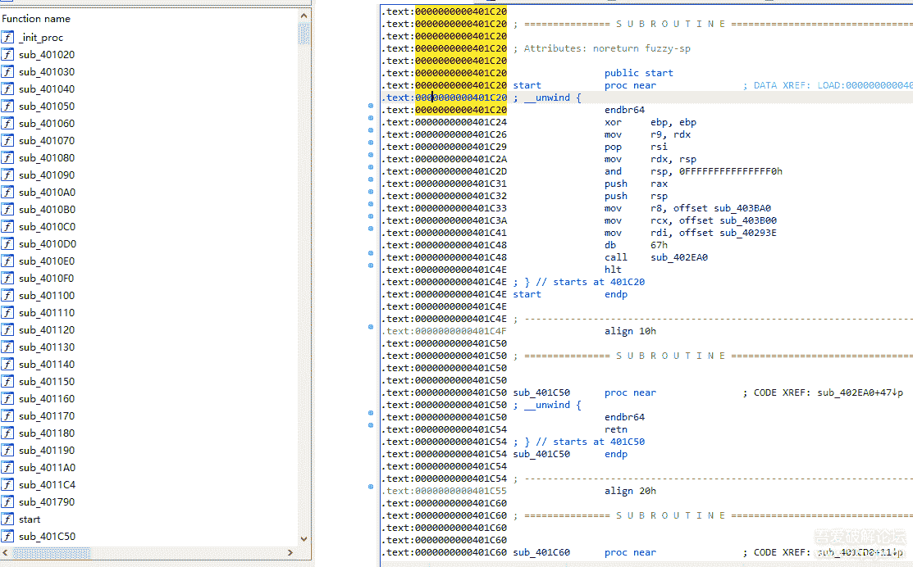

image-20220417213946452.png (100.86 KB, 下载次数: 0)

[附件](https://www.52pojie.cn/forum.php?mod=attachment&aid=MjUxNDcxMXxjNTNlOTg0OXwxNzkzNTc1NzIxfDE2ODA4NnwxNjIzNzEz&nothumb=yes)

2022-4-18 13:40 上传

`Finger`分析后

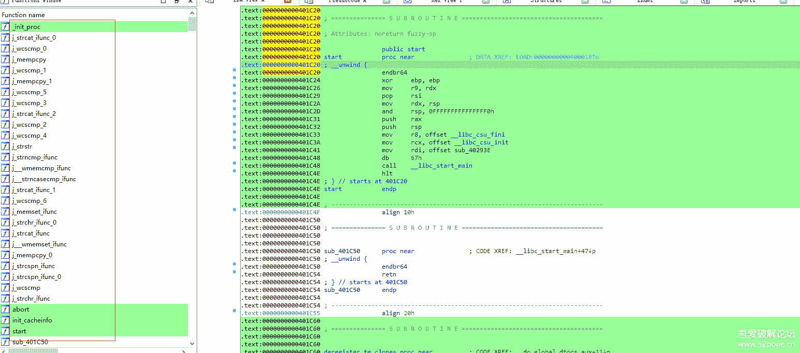

image-20220417214325367.png (112.7 KB, 下载次数: 0)

[附件](https://www.52pojie.cn/forum.php?mod=attachment&aid=MjUxNDcxMnxjM2RlMzI3YXwxNzkzNTc1NzIxfDE2ODA4NnwxNjIzNzEz&nothumb=yes)

2022-4-18 13:40 上传

爽歪歪~~~ 开始分析

程序起名叫`Jump`，而在调试的过程中，发现确实是`Jump`，程序从一个地方调到了另一个地方，于是谷歌搜索，找到一篇文章 [文章](https://blog.csdn.net/dog250/article/details/89742140) 感觉跟题目好像，就是保存线程上下文，然后恢复这个线程上下文来实现跳转

经过分析，找到了`save_ctx`和`restore_ctx`函数

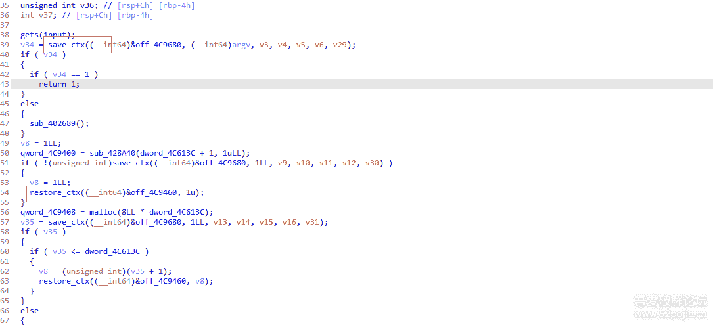

image-20220417201238954.png (43.37 KB, 下载次数: 0)

[附件](https://www.52pojie.cn/forum.php?mod=attachment&aid=MjUxNDcwOHwxYzgyZTQ2MHwxNzkzNTc1NzIxfDE2ODA4NnwxNjIzNzEz&nothumb=yes)

2022-4-18 13:39 上传

后面的第一个参数其实就是`context`，逆向了下这个`save_ctx`，发现`context`结构大致如下

```
00000000 ctx struc ; (sizeof=0x60, mappedto_18)
00000000 _rbx dq ?
00000008 _enc_rbp dq ?
00000010 _r12 dq ?
00000018 _r13 dq ?
00000020 _r14 dq ?
00000028 _r15 dq ?
00000030 _enc_rsp_8 dq ?                         ; [rsp+8] enc
00000038 _enc_rsp_0 dq ?                         ; [rsp] --> rip
```


# 逆向分析笔记

## 数据结构
```
00000040 _rsi dq ? ; 当rsi为0的时候，这个位置存rsi寄存器的值
00000048 field_48 dq ?
00000050 field_50 dq ?
00000058 _rax dq ?
00000060 ctx ends
```

## 调试定位
调试找到最终比较的位置

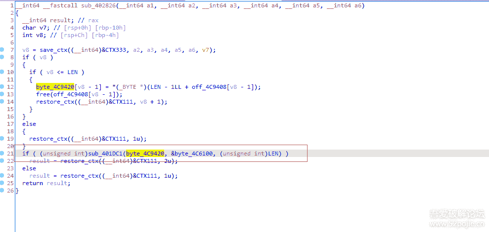

image-20220417201451026.png (40.74 KB, 下载次数: 0)

[href="forum.php?mod=attachment&aid=MjUxNDcwOXxmZWFjMmY2NHwxNzkzNTc1NzIxfDE2ODA4NnwxNjIzNzEz&nothumb=yes" target="_blank"](https://www.52pojie.cn/forum.php?mod=attachment&aid=MjUxNDcwOXxmZWFjMmY2NHwxNzkzNTc1NzIxfDE2ODA4NnwxNjIzNzEz&nothumb=yes)

2022-4-18 13:40 上传

密文是[0x03, 0x6A, 0x6D, 0x47, 0x6E, 0x5F, 0x3D, 0x75, 0x61, 0x53, 0x5A, 0x4C, 0x76, 0x4E, 0x34, 0x77, 0x46, 0x78, 0x45, 0x36, 0x52, 0x2B, 0x70, 0x02, 0x44, 0x32, 0x71, 0x56, 0x31, 0x43, 0x42, 0x54, 0x63, 0x6B]

`sub_401F62` 是关键加密函数，他把这个矩阵每一行，按第一个字符大小进行排序，然后排完序的这个矩阵的最后一列就是密文，现在知道这个矩阵的第一列和最后一列，来求`flag`

举个例子，假如我们输入的是`985236147adgjlqwesxzcvbnmfuiopvx`，程序先将其前加上`\x02`尾部加上`\x03`

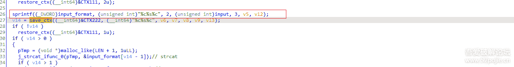

image-20220417201957613.png (25.79 KB, 下载次数: 0)

[href="forum.php?mod=attachment&aid=MjUxNDcxMHw1MmE4MWMxOHwxNzkzNTc1NzIxfDE2ODA4NnwxNjIzNzEz&nothumb=yes" target="_blank"](https://www.52pojie.cn/forum.php?mod=attachment&aid=MjUxNDcxMHw1MmE4MWMxOHwxNzkzNTc1NzIxfDE2ODA4NnwxNjIzNzEz&nothumb=yes)

2022-4-18 13:40 上传

## 循环左移与打印
然后一层层循环左移1个字符，循环33次，将循环后的二维数组保存在`0000004C9408`处，通过下面的`IDApython`打印出来

```python
addr =[0x00000000004CC0D0, 0x00000000004CC100, 0x00000000004CC130, 0x00000000004CC160, 0x00000000004CC190, 0x00000000004CC1C0, 0x00000000004CC1F0, 0x00000000004CC220, 0x00000000004CC250, 0x00000000004CC280, 0x00000000004CC2B0, 0x00000000004CC2E0, 0x00000000004CC310, 0x00000000004CC340, 0x00000000004CC370, 0x00000000004CC3A0, 0x00000000004CC3D0, 0x00000000004CC400, 0x00000000004CC430, 0x00000000004CC460, 0x00000000004CC490, 0x00000000004CC4C0, 0x00000000004CC4F0, 0x00000000004CC520, 0x00000000004CC550, 0x00000000004CC580, 0x00000000004CC5B0, 0x00000000004CC5E0, 0x00000000004CC610, 0x00000000004CC640, 0x00000000004CC670, 0x00000000004CC6A0, 0x00000000004CC6D0, 0x00000000004CC700] # 0000004C9408处存的34个指针
for i in range(34):
    tmp = b""
    for j in range(34):
        tmp += get_bytes(addr[i]+j, 1)
    print(tmp)
```

b'\x02985236147adgjlqwesxzcvbnmfuiopvx\x03'
b'985236147adgjlqwesxzcvbnmfuiopvx\x03\x02'
b'85236147adgjlqwesxzcvbnmfuiopvx\x03\x029'
b'5236147adgjlqwesxzcvbnmfuiopvx\x03\x0298'
b'236147adgjlqwesxzcvbnmfuiopvx\x03\x02985'
b'36147adgjlqwesxzcvbnmfuiopvx\x03\x029852'
b'6147adgjlqwesxzcvbnmfuiopvx\x03\x0298523'
b'147adgjlqwesxzcvbnmfuiopvx\x03\x02985236'
b'47adgjlqwesxzcvbnmfuiopvx\x03\x029852361'
b'7adgjlqwesxzcvbnmfuiopvx\x03\x0298523614'
b'adgjlqwesxzcvbnmfuiopvx\x03\x02985236147'
b'dgjlqwesxzcvbnmfuiopvx\x03\x02985236147a'
b'gjlqwesxzcvbnmfuiopvx\x03\x02985236147ad'
b'jlqwesxzcvbnmfuiopvx\x03\x02985236147adg'
b'lqwesxzcvbnmfuiopvx\x03\x02985236147adgj'
b'qwesxzcvbnmfuiopvx\x03\x02985236147adgjl'
b'wesxzcvbnmfuiopvx\x03\x02985236147adgjlq'
b'esxzcvbnmfuiopvx\x03\x02985236147adgjlqw'
b'sxzcvbnmfuiopvx\x03\x02985236147adgjlqwe'
b'xzcvbnmfuiopvx\x03\x02985236147adgjlqwes'
b'zcvbnmfuiopvx\x03\x02985236147adgjlqwesx'
b'cvbnmfuiopvx\x03\x02985236147adgjlqwesxz'
b'vbnmfuiopvx\x03\x02985236147adgjlqwesxzc'
b'bnmfuiopvx\x03\x02985236147adgjlqwesxzcv'
b'nmfuiopvx\x03\x02985236147adgjlqwesxzcvb'
b'mfuiopvx\x03\x02985236147adgjlqwesxzcvbn'
b'fuiopvx\x03\x02985236147adgjlqwesxzcvbnm'
b'uiopvx\x03\x02985236147adgjlqwesxzcvbnmf'
b'iopvx\x03\x02985236147adgjlqwesxzcvbnmfu'
b'opvx\x03\x02985236147adgjlqwesxzcvbnmfui'
b'pvx\x03\x02985236147adgjlqwesxzcvbnmfuio'
b'vx\x03\x02985236147adgjlqwesxzcvbnmfuiop'
b'x\x03\x02985236147adgjlqwesxzcvbnmfuiopv'
b'\x03\x02985236147adgjlqwesxzcvbnmfuiopvx'

## 排序后打印
然后经过`sub_401F62`函数，再重新查看`0000004C9408`处的指针，发现顺序与之前不一样，重新整理`IDApython`脚本，再打印下

b'\x02985236147adgjlqwesxzcvbnmfuiopvx\x03'
b'\x03\x02985236147adgjlqwesxzcvbnmfuiopvx'
b'147adgjlqwesxzcvbnmfuiopvx\x03\x02985236'
b'236147adgjlqwesxzcvbnmfuiopvx\x03\x02985'
b'36147adgjlqwesxzcvbnmfuiopvx\x03\x029852'
b'47adgjlqwesxzcvbnmfuiopvx\x03\x029852361'
b'5236147adgjlqwesxzcvbnmfuiopvx\x03\x0298'
b'6147adgjlqwesxzcvbnmfuiopvx\x03\x0298523'
b'7adgjlqwesxzcvbnmfuiopvx\x03\x0298523614'
b'85236147adgjlqwesxzcvbnmfuiopvx\x03\x029'
b'985236147adgjlqwesxzcvbnmfuiopvx\x03\x02'
b'adgjlqwesxzcvbnmfuiopvx\x03\x02985236147'
b'bnmfuiopvx\x03\x02985236147adgjlqwesxzcv'
b'cvbnmfuiopvx\x03\x02985236147adgjlqwesxz'
b'dgjlqwesxzcvbnmfuiopvx\x03\x02985236147a'
b'esxzcvbnmfuiopvx\x03\x02985236147adgjlqw'
b'fuiopvx\x03\x02985236147adgjlqwesxzcvbnm'
b'gjlqwesxzcvbnmfuiopvx\x03\x02985236147ad'
b'iopvx\x03\x02985236147adgjlqwesxzcvbnmfu'
b'jlqwesxzcvbnmfuiopvx\x03\x02985236147adg'
b'lqwesxzcvbnmfuiopvx\x03\x02985236147adgj'
b'mfuiopvx\x03\x02985236147adgjlqwesxzcvbn'
b'nmfuiopvx\x03\x02985236147adgjlqwesxzcvb'
b'opvx\x03\x02985236147adgjlqwesxzcvbnmfui'
b'pvx\x03\x02985236147adgjlqwesxzcvbnmfuio'
b'qwesxzcvbnmfuiopvx\x03\x02985236147adgjl'
b'sxzcvbnmfuiopvx\x03\x02985236147adgjlqwe'
b'uiopvx\x03\x02985236147adgjlqwesxzcvbnmf'
b'vbnmfuiopvx\x03\x02985236147adgjlqwesxzc'
b'vx\x03\x02985236147adgjlqwesxzcvbnmfuiop'
b'wesxzcvbnmfuiopvx\x03\x02985236147adgjlq'
b'x\x03\x02985236147adgjlqwesxzcvbnmfuiopv'
b'xzcvbnmfuiopvx\x03\x02985236147adgjlqwes'
b'zcvbnmfuiopvx\x03\x02985236147adgjlqwesx'

每一行是按照第一个字符从小到大排序，而拍完序的最后一列，正好是`000004C9420`存储的加密后的`flag`

## Flag 求解
现在已知密文是`\x03jmGn_=uaSZLvN4wFxE6R+p\x02D2qV1CBTck`，将其排序后为`\x02\x03+1246=BCDEFGLNRSTVZ_acjkmnpquvwx`

知道这个二维数组的第一列的每个字符和最后一列的每个字符，因为每一行的第一个字符和最后一个字符在原始字符串中肯定是挨着了，这样就可以慢慢推出原始字符串来了，写脚本解一下即可

```python
lie1 = list(b'\x02\x03+1246=BCDEFGLNRSTVZ_acjkmnpquvwx')
lie34 = list(b'\x03jmGn_=uaSZLvN4wFxE6R+p\x02D2qV1CBTck')
flag = [2] + [0] * 33
map_ = [[lie1[i], lie34[i]] for i in range(34)]
for i in range(33):
    tmp = lie34.index(flag[i])
    flag[i+1] = lie1[tmp]
print(flag)
print(bytes(flag))
```

`\x02cwNG1paBu=6Vn2kxSCqm+_4LETvFRZDj\x03`
