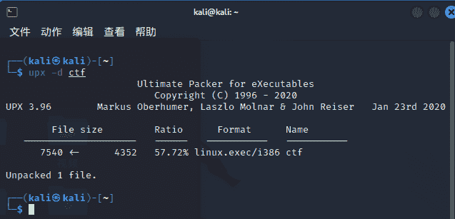
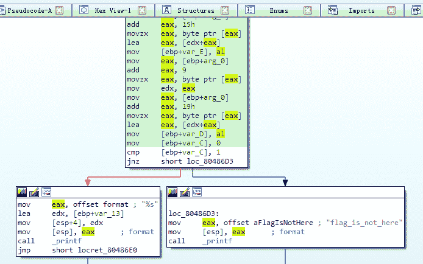

# [CTF] 学破解第194天，《攻防世界reverse练习区easyre-153》学习

- 原帖: https://www.52pojie.cn/forum.php?mod=viewthread&tid=1624497
- 抓取时间: 2026-11-01T23:28:32

前言：

坛友们，年轻就是资本，和我一起逆天改命吧，我的学习过程全部记录及学习资源：[//www.52pojie.cn/thread-1582287-1-1.html](https://www.52pojie.cn/thread-1582287-1-1.html)

立帖为证！--------记录学习的点点滴滴

## 0x1 收集信息

1. 首先，还是查壳，然后看一看文件格式，可以看到是32位，带UPX壳，这OD工具也只能windows平台用，咋脱壳呢?


2. 还是和昨天一样将文件复制到kali中，然后将`ida`目录下的`linux_server`也复制过来，防止一会远程调试，先备用。


3. 运行一下程序，没反应？？？

4. 熟悉一下kali，似乎没有类似的脱壳工具？


5. 除了明面上的目录工具，还有很多命令行工具藏在`bin`目录下，例如`java`、`python`、C/C++ 编译器`gcc`和`g++`。


6. 有了工具先输入`upx -d ctf`进行脱壳，如下图提示，脱壳完成，UPX是压缩壳，所以脱完壳，程序体积会变大。



7. 现在运行程序，可以看到输出了，看这提示，似乎让我找到正确的ID，输入123456然后程序就退出了。

```
┌──(kali㉿kali)-[~]
└─$ ./ctf

OMG!!!! I forgot kid's id
Ready to exit     
123456

┌──(kali㉿kali)-[~]
└─$ 
```

## 0x2 静态分析

1. 收集完信息，就开始分析了，将脱壳后的程序复制回win7电脑，将程序拖进ida，找到`main()`函数，`F5`可以看到伪代码：

```c
int __cdecl main(int argc, const char **argv, const char **envp)
{
  int pipedes[2]; // [esp+18h] [ebp-38h] BYREF
  __pid_t v5; // [esp+20h] [ebp-30h]
  int v6; // [esp+24h] [ebp-2Ch] BYREF
  char buf[30]; // [esp+2Eh] [ebp-22h] BYREF
  unsigned int v8; // [esp+4Ch] [ebp-4h]

  v8 = __readgsdword(0x14u);
  pipe(pipedes);
  v5 = fork();
  if ( !v5 )
  {
    puts("\nOMG!!!! I forgot kid's id");
    write(pipedes[1], "69800876143568214356928753", 0x1Du);
    puts("Ready to exit     ");
    exit(0);
  }
  read(pipedes[0], buf, 0x1Du);
  __isoc99_scanf("%d", &v6);
  if ( v6 == v5 )
  {
    if ( (unsigned __int8)*(_DWORD *)((char *)lol + 3) == 204 )
    {
      puts(":D");
      exit(1);
    }
    printf("\nYou got the key\n ");
    lol(buf);
  }
  wait(0);
  return 0;
}
```

2. 有了昨天的经验，这个就好理解了，fock子进程，防止动态调试，`"69800876143568214356928753"`字符串写到文件，然后退出，接着读文件，然后根据提示可以锁定关键代码在这里。

```c
if ( v6 == v5 )
{
  if ( (unsigned __int8)*(_DWORD *)((char *)lol + 3) == 204 )
  {
    puts(":D");
    exit(1);
  }
  printf("\nYou got the key\n ");
  lol(buf);
}
```

3. `(unsigned __int8)(_DWORD )((char *)lol + 3) == 204`，这段代码到底干什么的？`lol`是一个函数地址，打印的一段字符串？这显然是不可能的，难道自己比自己，而且这里有些此地无银三百两的感觉。

```c
int lol()
{
  return printf("flag_is_not_here");
}
```

4. 看一看这个函数的执行流程图，明显很多反汇编代码，还有分支语句，为什么`F5`识别不出来呢？



5. 看看这三行代码，赋值为0再和1比较，这不是`jmp`吗？然后就被IDA `F5`给优化掉了，不会走另外一个流程。

```asm
mov     [ebp+var_C], 0
cmp     [ebp+var_C], 1
jnz     short loc_80486D3
```

6. `edit->patch program->assemble`，也可以选第一个或者第二个硬编码修改，这里注意，因为这里指令占6个大小，所以我得`nop` 6次才可以，再来`F5`反编译看看：

```c
int __cdecl lol(_BYTE *a1)
{
  int result; // eax
  char v2[7]; // [esp+15h] [ebp-13h] BYREF
  int v3; // [esp+1Ch] [ebp-Ch]

  v2[0] = 2 * a1[1];
  v2[1] = a1[4] + a1[5];
  v2[2] = a1[8] + a1[9];
  v2[3] = 2 * a1[12];
  v2[4] = a1[18] + a1[17];
  v2[5] = a1[10] + a1[21];
  v2[6] = a1[9] + a1[25];
  if ( v3 == 1 )
    result = printf("%s", v2);
  else
    result = printf("flag_is_not_here");
  return result;
}
```

7. 现在逻辑清楚了，我输入的字符串存到`v6`，然后判断`v6`是不是和`v5`的`pid`相等，`v5`就是fock函数的返回值，如果相等就执行上面刚刚反编译出来的函数，不知道是不是这么理解，直接把这段代码拷贝过来，因为kali自带编辑器，百度一下用法：

```
touch main.c  新建一个文件

单击左上角自带的text editor工具，打开刚刚创建的文件

开始编写代码，最后保存

gcc main.c -o main  编译程序

./main  运行程序
```

8. kali工具是真的齐全，成功得到flag：`rhelheg`。


## 0x3 总结

1. 看不懂就百度，顺便学一学新工具，新环境的用法。
