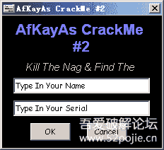
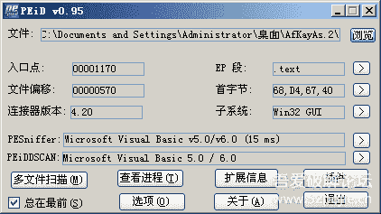
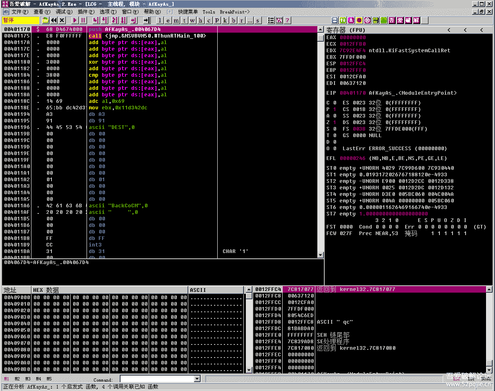
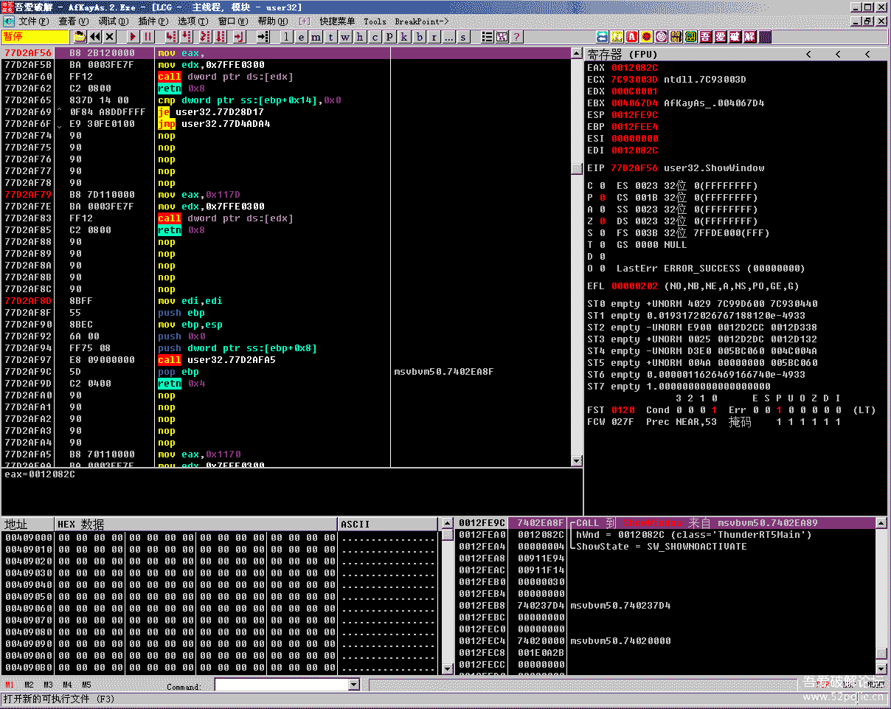
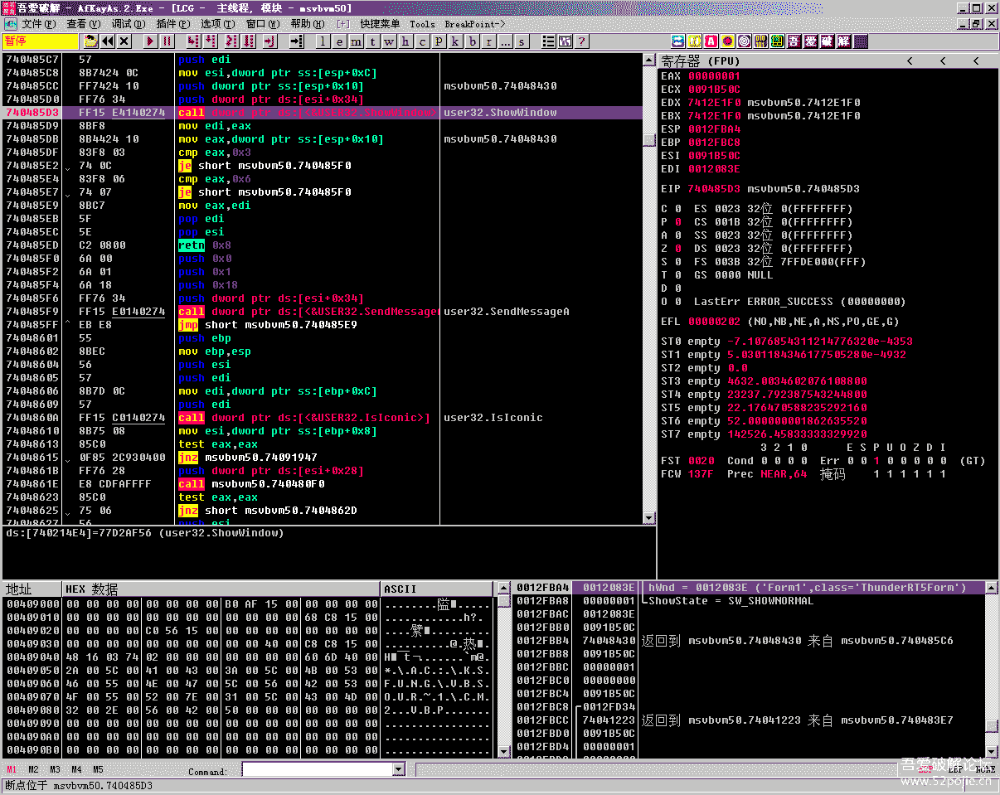
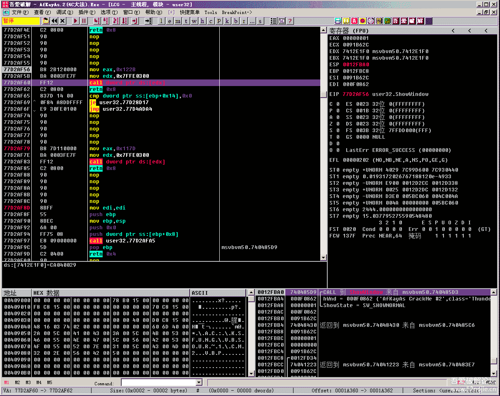

# [原创] 摸爬滚打着学习破解之路--第三章 CRACKME160之三

- 原帖: https://www.52pojie.cn/forum.php?mod=viewthread&tid=1624602
- 抓取时间: 2026-11-01T23:28:30

## 摸爬滚打着学习破解之路--第三章 CRACKME160之三

### 前言

上一章说去学习视频，真的去学习了。知道了个`TLS`这么个东西，但是你问我会不会用，哈哈，我现在只是知道就不错了，要用的时候再回去翻视频吧。现在脑子里记得还有个`VEH`，但是依旧完全想不起来是干啥的了。不动手是真的容易忘，所以练手之路继续。(可能我太高产了，前面三篇文章，本来已经审过了一篇的，18号编辑了一下，重新审。现在18号新写的一篇，19号写的一篇都还没过审，20号写的一篇都已经上传了。为自己的学习精神点赞。哈哈)

### 正题

今天依然继续冲着`3\160`的目标前进。冲啊！

### CRACKME 编号 3 破解之路

- 破解第一步：运行程序，确定破解目标
- 运行程序。哎呀，今天这个程序有点恶心人啊，运行以后出来个框框，然后不让动了，非要等一会才能出程序主界面。把弹窗和程序主界面都放下面：

1.这是什么意思.png (102.01 KB, 下载次数: 1)
[href="forum.php?mod=attachment&aid=MjUxNTE2NnxhZDE2MTAxY3wxNzkzNTc1NzA3fDE2ODA4NnwxNjI0NjAy&nothumb=yes" target="_blank"](https://www.52pojie.cn/forum.php?mod=attachment&aid=MjUxNTE2NnxhZDE2MTAxY3wxNzkzNTc1NzA3fDE2ODA4NnwxNjI0NjAy&nothumb=yes)
2022-4-20 00:49 上传

2.进入主界面.png (12.13 KB, 下载次数: 1)
[href="forum.php?mod=attachment&aid=MjUxNTE2N3xlZTg3NmZjNHwxNzkzNTc1NzA3fDE2ODA4NnwxNjI0NjAy&nothumb=yes" target="_blank"](https://www.52pojie.cn/forum.php?mod=attachment&aid=MjUxNTE2N3xlZTg3NmZjNHwxNzkzNTc1NzA3fDE2ODA4NnwxNjI0NjAy&nothumb=yes)
2022-4-20 00:49 上传

- 嗯嗯，今天的程序主界面很明确告诉你，让你干掉这个欢迎窗口，然后再找到用户名和密码。（如果我没理解错的话，找到用户名密码的意思是都内置好了？）
- 不管了，先搞掉恶心人的欢迎界面吧。
- 破解第二步：明确破解目标，确定破解思路
- 现在的目标是干掉恶心人的欢迎界面。
- 先按传统思维逻辑来，我一般喜欢在程序正好发生的地方，去跳过它。
- 按照这个逻辑，我应该找到窗口生成的位置，然后要么跳过，要么`NOP`掉。
- 好，开干！
- 破解第三步：找到关键破解点，暴力开干
- 新程序来了。我们得按照大大门总结的经验来，看看有没有壳。

3.查壳.png (20.45 KB, 下载次数: 1)
[href="forum.php?mod=attachment&aid=MjUxNTE2OHxkMGYwNGFkZXwxNzkzNTc1NzA3fDE2ODA4NnwxNjI0NjAy&nothumb=yes" target="_blank"](https://www.52pojie.cn/forum.php?mod=attachment&aid=MjUxNTE2OHxkMGYwNGFkZXwxNzkzNTc1NzA3fDE2ODA4NnwxNjI0NjAy&nothumb=yes)
2022-4-20 00:49 上传

- OK！漂亮，依然没壳，依然是`VB`写的。
- 程序拖进`OD`。今天程序进`OD`终于来了新变化了，出来个弹窗提示，如下图：

4.压缩代码提示.png (15.29 KB, 下载次数: 1)
[href="forum.php?mod=attachment&aid=MjUxNTE2OXxkMmFkNDk3ZnwxNzkzNTc1NzA3fDE2ODA4NnwxNjI0NjAy&nothumb=yes" target="_blank"](https://www.52pojie.cn/forum.php?mod=attachment&aid=MjUxNTE2OXxkMmFkNDk3ZnwxNzkzNTc1NzA3fDE2ODA4NnwxNjI0NjAy&nothumb=yes)
2022-4-20 00:49 上传

- 说实话，我不知道这是什么意思，本来我看画眉老师的视频是说，有这个提示可能有壳，这不是查了没壳了么。所以不管了，点确定。

5.程序进入点.png (74.6 KB, 下载次数: 1)
[href="forum.php?mod=attachment&aid=MjUxNTE3MHxiMzlkOWZlZnwxNzkzNTc1NzA3fDE2ODA4NnwxNjI0NjAy&nothumb=yes" target="_blank"](https://www.www.52pojie.cn/forum.php?mod=attachment&aid=MjUxNTE3MHxiMzlkOWZlZnwxNzkzNTc1NzA3fDE2ODA4NnwxNjI0NjAy&nothumb=yes)
2022-4-20 00:50 上传

- 好了，程序停在了进入点。这次的进入点有点意思，啥事不干，马上给你来个`CALL`。看不懂就不鸟它先。直接下断点,下的断点如下图：

6.下的断点.png (397 Bytes, 下载次数: 1)
[href="forum.php?mod=attachment&aid=MjUxNTE3MXxiZTU2Mzk1ZHwxNzkzNTc1NzA3fDE2ODA4NnwxNjI0NjAy&nothumb=yes" target="_blank"](https://www.52pojie.cn/forum.php?mod=attachment&aid=MjUxNTE3MXxiZTU2Mzk1ZHwxNzkzNTc1NzA3fDE2ODA4NnwxNjI0NjAy&nothumb=yes)
2022-4-20 00:50 上传

- 让程序运行起来，然后断下来。

7.程序断下的第一个位置.png (73.68 KB, 下载次数: 1)
[href="forum.php?mod=attachment&aid=MjUxNTE3MnwwMjllMzQzY3wxNzkzNTc1NzA3fDE2ODA4NnwxNjI0NjAy&nothumb=yes" target="_blank"](https://www.52pojie.cn/forum.php?mod=attachment&aid=MjUxNTE3MnwwMjllMzQzY3wxNzkzNTc1NzA3fDE2ODA4NnwxNjI0NjAy&nothumb=yes)
2022-4-20 00:50 上传

- 好吧。从这里开始，离上次断下来界面的时间已经过去了2个小时了。问题太多了，如果把截图都放上来。估计各位看客们要看上个把小时。所以我简单的介绍下我中间都干了些什么蠢事吧。
- 第一个小时，我还是按照上面的思路找到了调用欢迎窗口的位置。位置在`740485D3`。这个位置我把截图发出来吧。

8.欢迎窗口的位置.png (82.07 KB, 下载次数: 1)
[href="forum.php?mod=attachment&aid=MjUxNTE3M3wwNTk5MWNkMHwxNzkzNTc1NzA3fDE2ODA4NnwxNjI0NjAy&nothumb=yes" target="_blank"](https://www.52pojie.cn/forum.php?mod=attachment&aid=MjUxNTE3M3wwNTk5MWNkMHwxNzkzNTc1NzA3fDE2ODA4NnwxNjI0NjAy&nothumb=yes)
2022-4-20 00:51 上传

- 大家看堆栈的位置，显示`Form1`。应该是欢迎窗口没错咯。所以我按照我原来的思路，干掉它做了什么尝试了，首先当然最简单的，直接`NOP`掉了。
- 然后程序，叮，报错。
- 好吧，不能`NOP`，我就想着要怎么跳过呢？跟进去然后直接返回吗？我现在知道我很傻，居然有了这样的想法，大家千万别去尝试，因为那个位置被无数地方调用，改了，也是直接程序崩溃。
- 好吧，现实告诉我这么简单是搞不定的了。我就想为什么我`NOP`掉不行呢。就又调试了好几次，好几次，好几次，因为一直没有新的思路，所以再各种死磕。突然我发现`CALL`那句执行了以后，到后面一句的时候，有4个寄存器有了变化，`EAX`，`ECX`，`EDX`，`ESP`，所以我就又突发奇想，是不是改了代码，然后想办法把所有寄存器改变的地方都搞定，也能解决这个问题呢。
- 然后我就进行了尝试，这个尝试首先又花了半个多小时，因为尝试了很多方法。一直没有成功，不知道有没有汇编大牛告诉我，这里到底能不能这么改来实现。
- 再然后我实在解不开了，开始搜索资料想学习下别人的资料，看到了`VB`的`4C`大法，妈呀，真的简单。过程我就不复述了，论坛里多的是。
- 正常情况我该放弃了。但是我又觉得不甘心，然后我干了什么。我又按照自己的思路去瞎搞，从`740485D3`这个位置跟了进去，然后看到里面还有一个`CALL`，如下图：

9.最终调出窗口的`CALL`位置.png (79.33 KB, 下载次数: 1)
[href="forum.php?mod=attachment&aid=MjUxNTE3NHxhOWVkYzhmY3wxNzkzNTc1NzA3fDE2ODA4NnwxNjI0NjAy&nothumb=yes" target="_blank"](https://www.52pojie.cn/forum.php?mod=attachment&aid=MjUxNTE3NHxhOWVkYzhmY3wxNzkzNTc1NzA3fDE2ODA4NnwxNjI0NjAy&nothumb=yes)
2022-4-20 00:52 上传

- 我又开始不了不安分的想法，我就在想能不能在停在这个`CALL`的时候，我把`EIP`修改了，然后直接不执行`CALL`，走下一步去呢。
- 这里我想问下各位大牛，为啥`OD`里面不能像改其他寄存器位置一样，直接修改`EIP`的位置。我很是惆怅，还好昨天说补画眉老师的视频，真的去补了，刚好看到`OD`的脚本编写，我就很白痴的写了个给`EIP`赋值的脚本，然后，欢迎界面就这么消失了。但是，也只是这一次消失了。后面每次都得`OD`打开，先断再我需要的位置，然后运行脚本。这样肯定不是解决了问题。
- 到了这里，其实今天的破解是非常失败的，因为除了`4C`大法，能把程序破解了再重新保存成可执行文件。脚本的方式我还不知道怎么加判断，让它准确的在我需要修改的时候修改`EIP`。然后能在程序里面执行。请各位大大给点解决的学习途径。

#### 今天是尝到了苦涩的一天，虽然`4C`大法可行，但是自己的思路不行的时候，还是满满的遗憾。这里就留个难题，等再学习学习，看看能不能找到自己思路的解决办法把。

### 今天到此为止，剩下的验证部分，等下一章再继续了。现在脑子一团浆糊。
