# [原创] 继上次的第一个cm ''Acid burnl''算法逆向

- 原帖: https://www.52pojie.cn/forum.php?mod=viewthread&tid=1625534
- 抓取时间: 2026-11-01T23:28:18

## 第一关：Name Serial的算法逆向

我输入的账户是：123456
直接找到关键字符然后在段首下断挨着跟就行
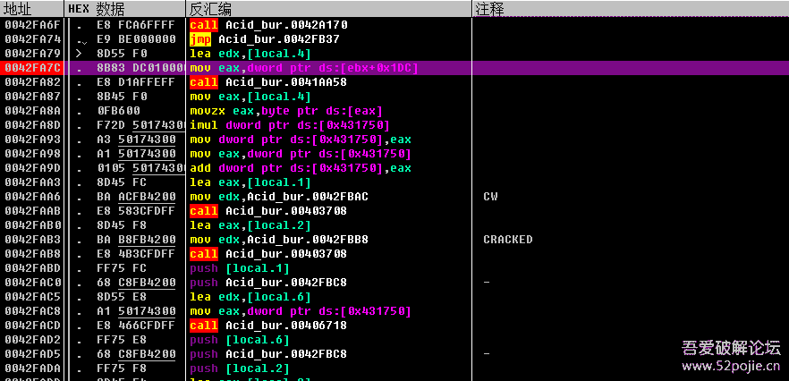
Snipaste_2022-04-21_15-25-09.png (25.09 KB, 下载次数: 1)
[href="forum.php?mod=attachment&aid=MjUxNTc2MXxlMzBkMWIxZXwxNzkzNTc1Njk2fDE2ODA4NnwxNjI1NTM0&nothumb=yes" target="_blank"](https://www.52pojie.cn/forum.php?mod=attachment&aid=MjUxNTc2MXxlMzBkMWIxZXwxNzkzNTc1Njk2fDE2ODA4NnwxNjI1NTM0&nothumb=yes)
2022-4-21 15:24 上传
从这里开始就是Name Serial的序列号生成开始了（其实在更前面有个给数据段赋值为`0x29`的 解释了为什么要乘以`0x29`）
开始运行输入账户和序列号点“Check it Baby！”
程序断下 我们单步向下跟
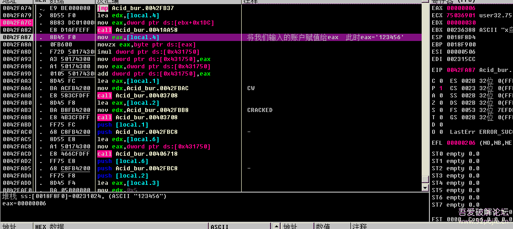
Snipaste_2022-04-21_15-35-15.png (37.9 KB, 下载次数: 2)
[href="forum.php?mod=attachment&aid=MjUxNTc2M3w5ZDE2YTdjZHwxNzkzNTc1Njk2fDE2ODA4NnwxNjI1NTM0&nothumb=yes" target="_blank"](https://www.52pojie.cn/forum.php?mod=attachment&aid=MjUxNTc2M3w5ZDE2YTdjZHwxNzkzNTc1Njk2fDE2ODA4NnwxNjI1NTM0&nothumb=yes)
2022-4-21 15:35 上传
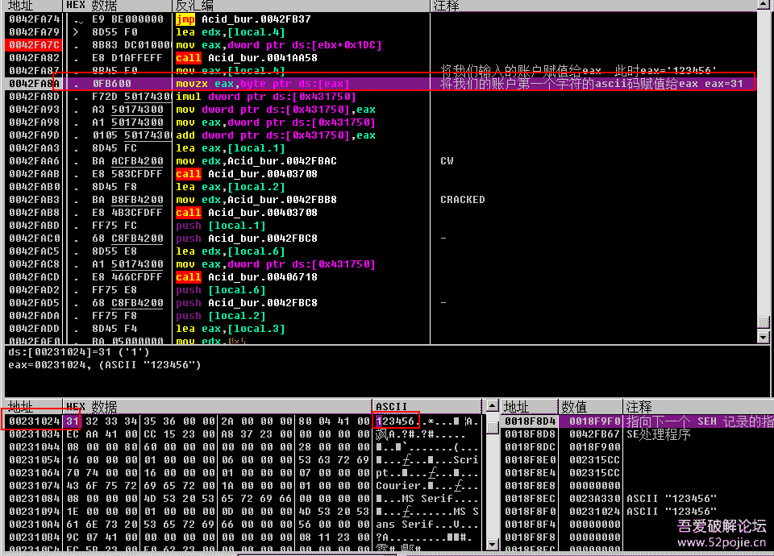
Snipaste_2022-04-21_15-37-32.png (43.22 KB, 下载次数: 2)
[href="forum.php?mod=attachment&aid=MjUxNTc2NHwzYzEzMGRkOXwxNzkzNTc1Njk2fDE2ODA4NnwxNjI1NTM0&nothumb=yes" target="_blank"](https://www.52pojie.cn/forum.php?mod=attachment&aid=MjUxNTc2NHwzYzEzMGRkOXwxNzkzNTc1Njk2fDE2ODA4NnwxNjI1NTM0&nothumb=yes)
2022-4-21 15:37 上传
可能想问为什么是31，我又没看到他有计算ascii码的函数 为什么都说是ascii码（可能只有我想问）
可以看到他已经在反汇编窗口下面那个小窗口（忘叫什么了！丢死人了！）说了`ds:[00231024]=31('1')`
那我们知道`ds`是数据段 去数据窗口跟随一下这个地址就会发现，奥 从这取的啊 那这个疑问就解决了
继续向下`F8`
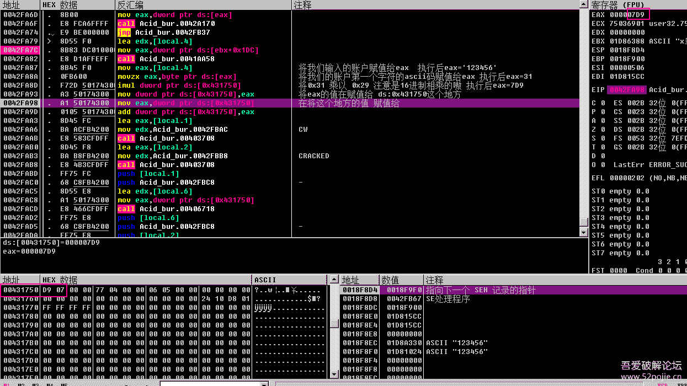
Snipaste_2022-04-21_15-48-03.png (52.36 KB, 下载次数: 1)
[href="forum.php?mod=attachment&aid=MjUxNTc2Nnw2NzhkYWZhMHwxNzkzNTc1Njk2fDE2ODA4NnwxNjI1NTM0&nothumb=yes" target="_blank"](https://www.52pojie.cn/forum.php?mod=attachment&aid=MjUxNTc2Nnw2NzhkYWZhMHwxNzkzNTc1Njk2fDE2ODA4NnwxNjI1NTM0&nothumb=yes)
2022-4-21 15:47 上传
上图，为什么还要将结果赋值给`eax`啊`eax`本来不就是结果了吗 为什么还要赋值？？我不是很理解
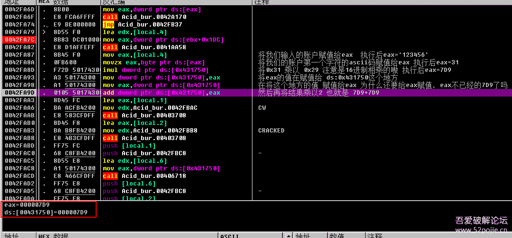
Snipaste_2022-04-21_15-50-39.png (34.69 KB, 下载次数: 1)
[href="forum.php?mod=attachment&aid=MjUxNTc2N3xkMTI1NjY5MHwxNzkzNTc1Njk2fDE2ODA4NnwxNjI1NTM0&nothumb=yes" target="_blank"](https://www.52pojie.cn/forum.php?mod=attachment&aid=MjUxNTc2N3xkMTI1NjY5MHwxNzkzNTc1Njk2fDE2ODA4NnwxNjI1NTM0&nothumb=yes)
2022-4-21 15:50 上传
将结果乘以2后有431750这个数据段里存放了结果 FB2 见下图
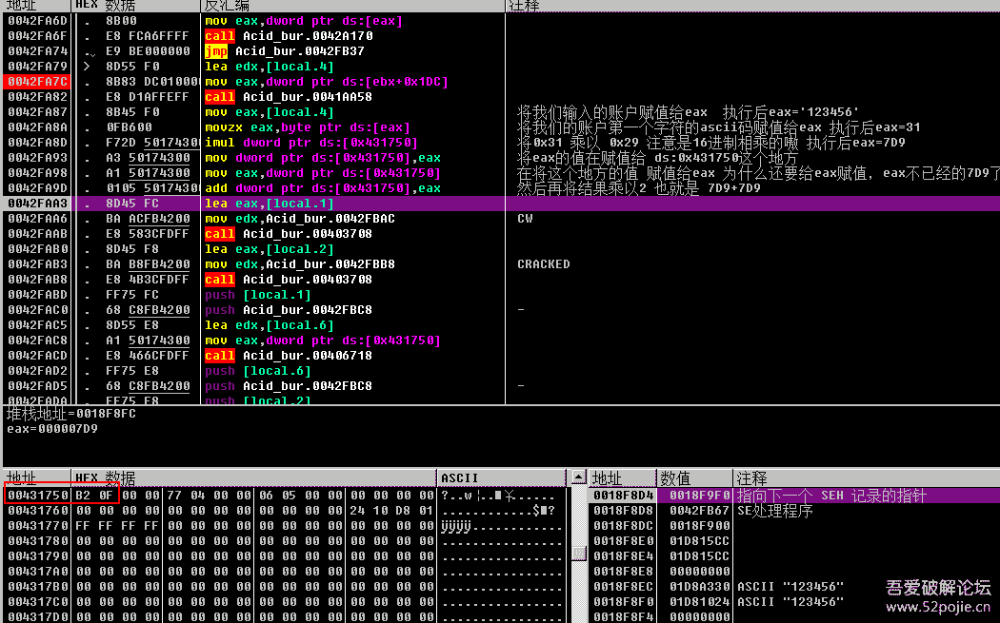
Snipaste_2022-04-21_15-52-39.png (43.14 KB, 下载次数: 1)
[href="forum.php?mod=attachment&aid=MjUxNTc2OHw0ZWY4MWU3YXwxNzkzNTc1Njk2fDE2ODA4NnwxNjI1NTM0&nothumb=yes" target="_blank"](https://www.52pojie.cn/forum.php?mod=attachment&aid=MjUxNTc2OHw0ZWY4MWU3YXwxNzkzNTc1Njk2fDE2ODA4NnwxNjI1NTM0&nothumb=yes)
2022-4-21 15:53 上传
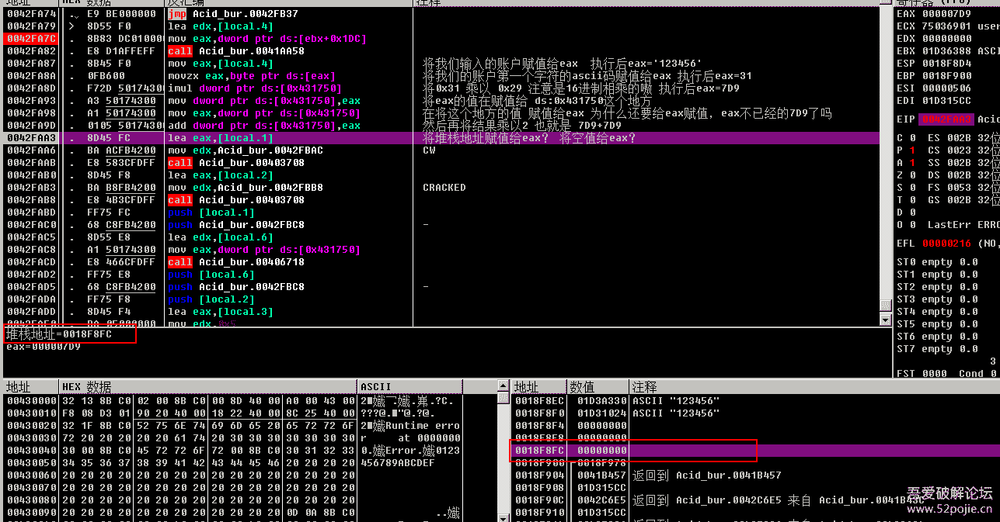
Snipaste_2022-04-21_16-02-31.png (55.54 KB, 下载次数: 2)
[href="forum.php?mod=attachment&aid=MjUxNTc2OXxjMTM2YjJiYXwxNzkzNTc1Njk2fDE2ODA4NnwxNjI1NTM0&nothumb=yes" target="_blank"](https://www.52pojie.cn/forum.php?mod=attachment&aid=MjUxNTc2OXxjMTM2YjJiYXwxNzkzNTc1Njk2fDE2ODA4NnwxNjI1NTM0&nothumb=yes)
2022-4-21 16:02 上传
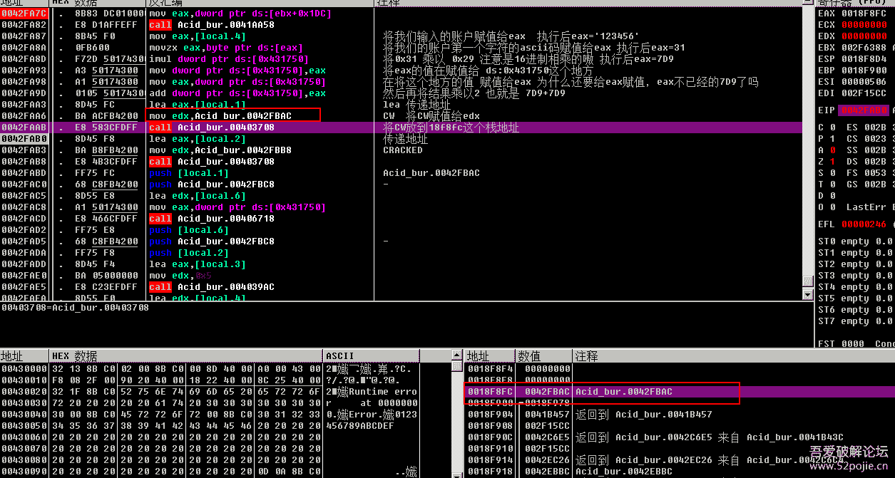
Snipaste_2022-04-21_16-07-23.png (55.56 KB, 下载次数: 1)
[href="forum.php?mod=attachment&aid=MjUxNTc3MXwxZWU1ZGI1NHwxNzkzNTc1Njk2fDE2ODA4NnwxNjI1NTM0&nothumb=yes" target="_blank"](https://www.52pojie.cn/forum.php?mod=attachment&aid=MjUxNTc3MXwxZWU1ZGI1NHwxNzkzNTc1Njk2fDE2ODA4NnwxNjI1NTM0&nothumb=yes)
2022-4-21 16:07 上传
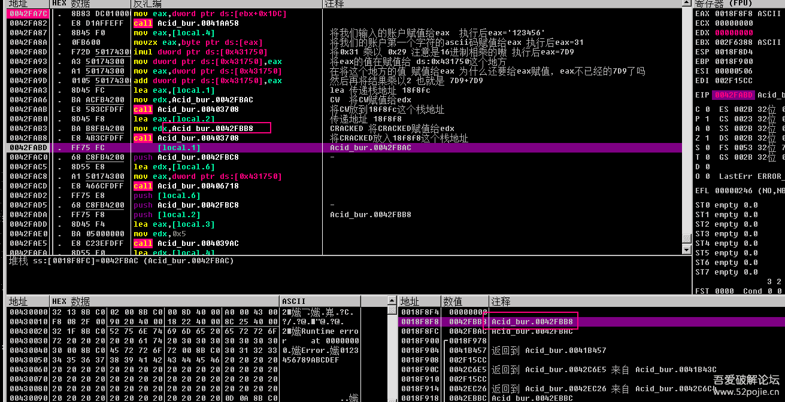
Snipaste_2022-04-21_16-10-49.png (69.01 KB, 下载次数: 2)
[href="forum.php?mod=attachment&aid=MjUxNTc3N3xiYjM1NzM0NnwxNzkzNTc1Njk2fDE2ODA4NnwxNjI1NTM0&nothumb=yes" target="_blank"](https://www.52pojie.cn/forum.php?mod=attachment&aid=MjUxNTc3N3xiYjM1NzM0NnwxNzkzNTc1Njk2fDE2ODA4NnwxNjI1NTM0&nothumb=yes)
2022-4-21 16:10 上传
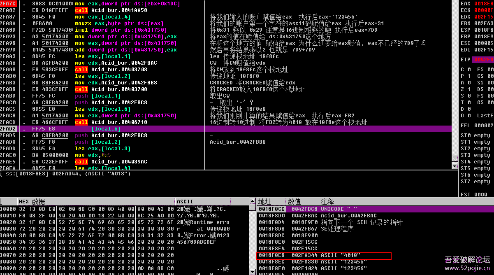
Snipaste_2022-04-21_16-16-05.png (55.98 KB, 下载次数: 1)
[href="forum.php?mod=attachment&aid=MjUxNTc3OHw0ZTU3OWE0OXwxNzkzNTc1Njk2fDE2ODA4NnwxNjI1NTM0&nothumb=yes" target="_blank"](https://www.52pojie.cn/forum.php?mod=attachment&aid=MjUxNTc3OHw0ZTU3OWE0OXwxNzkzNTc1Njk2fDE2ODA4NnwxNjI1NTM0&nothumb=yes)
2022-4-21 16:15 上传
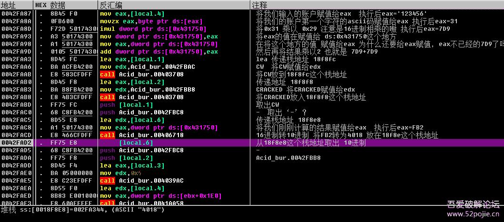
Snipaste_2022-04-21_16-17-13.png (39.57 KB, 下载次数: 2)
[href="forum.php?mod=attachment&aid=MjUxNTc3OXwxOTgxMDU4M3wxNzkzNTc1Njk2fDE2ODA4NnwxNjI1NTM0&nothumb=yes" target="_blank"](https://www.52pojie.cn/forum.php?mod=attachment&aid=MjUxNTc3OXwxOTgxMDU4M3wxNzkzNTc1Njk2fDE2ODA4NnwxNjI1NTM0&nothumb=yes)
2022-4-21 16:16 上传
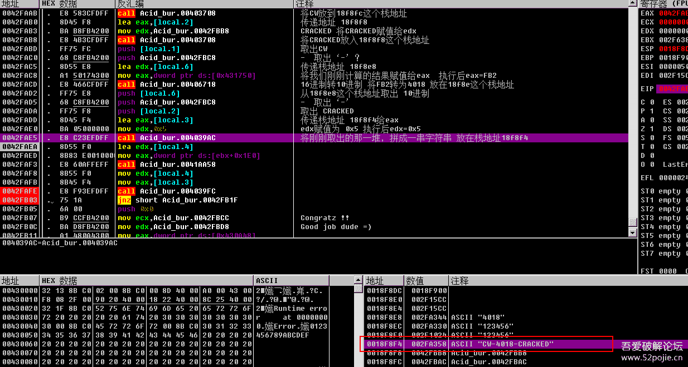
Snipaste_2022-04-21_16-21-06.png (54.67 KB, 下载次数: 2)
[href="forum.php?mod=attachment&aid=MjUxNTc4MHxkNzNiZTU5MHwxNzkzNTc1Njk2fDE2ODA4NnwxNjI1NTM0&nothumb=yes" target="_blank"](https://www.52pojie.cn/forum.php?mod=attachment&aid=MjUxNTc4MHxkNzNiZTU5MHwxNzkzNTc1Njk2fDE2ODA4NnwxNjI1NTM0&nothumb=yes)
2022-4-21 16:20 上传
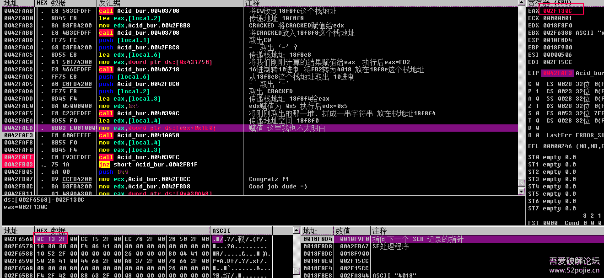
Snipaste_2022-04-21_16-23-04.png (53.67 KB, 下载次数: 1)
[href="forum.php?mod=attachment&aid=MjUxNTc4MXw5N2MzZTcxZnwxNzkzNTc1Njk2fDE2ODA4NnwxNjI1NTM0&nothumb=yes" target="_blank"](https://www.52pojie.cn/forum.php?mod=attachment&aid=MjUxNTc4MXw5N2MzZTcxZnwxNzkzNTc1Njk2fDE2ODA4NnwxNjI1NTM0&nothumb=yes)
2022-4-21 16:22 上传
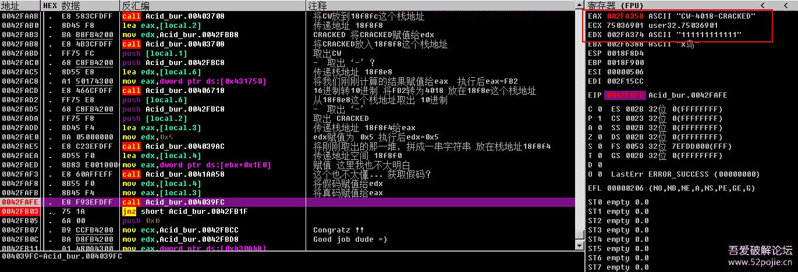
Snipaste_2022-04-21_16-25-46.png (46.85 KB, 下载次数: 2)
[href="forum.php?mod=attachment&aid=MjUxNTc4Mnw4NDBiM2FiY3wxNzkzNTc1Njk2fDE2ODA4NnwxNjI1NTM0&nothumb=yes" target="_blank"](https://www.52pojie.cn/forum.php?mod=attachment&aid=MjUxNTc4Mnw4NDBiM2FiY3wxNzkzNTc1Njk2fDE2ODA4NnwxNjI1NTM0&nothumb=yes)
2022-4-21 16:25 上传
接下来终于到了关键`call`了
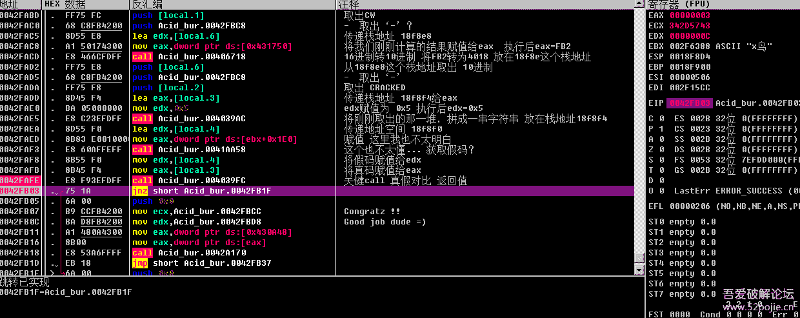
Snipaste_2022-04-21_16-26-55.png (44.68 KB, 下载次数: 2)
[href="forum.php?mod=attachment&aid=MjUxNTc4M3w3NTlhY2YwOHwxNzkzNTc1Njk2fDE2ODA4NnwxNjI1NTM0&nothumb=yes" target="_blank"](https://www.52pojie.cn/forum.php?mod=attachment&aid=MjUxNTc4M3w3NTlhY2YwOHwxNzkzNTc1Njk2fDE2ODA4NnwxNjI1NTM0&nothumb=yes)
2022-4-21 16:26 上传
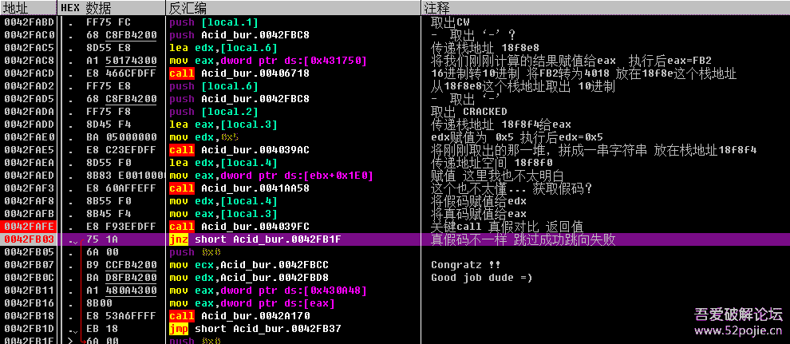
Snipaste_2022-04-21_16-27-55.png (34.66 KB, 下载次数: 2)
[href="forum.php?mod=attachment&aid=MjUxNTc4NHw1YWU5ZDMzOHwxNzkzNTc1Njk2fDE2ODA4NnwxNjI1NTM0&nothumb=yes" target="_blank"](https://www.52pojie.cn/forum.php?mod=attachment&aid=MjUxNTc4NHw1YWU5ZDMzOHwxNzkzNTc1Njk2fDE2ODA4NnwxNjI1NTM0&nothumb=yes)
2022-4-21 16:27 上传
至此，我们终于分析完了他的算法（哇写这个真的用了我好长好长时间.....可能是我太菜了）

## 补充

### 为什么要乘以`0x29`？

答：
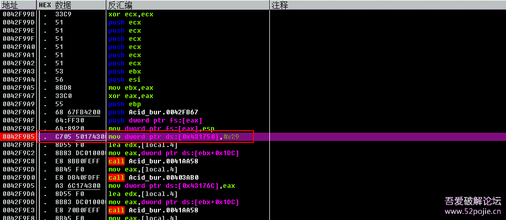
Snipaste_2022-04-21_16-29-34.png (22.29 KB, 下载次数: 1)
[href="forum.php?mod=attachment&aid=MjUxNTc4NXwwODg0ZjNiMXwxNzkzNTc1Njk2fDE2ODA4NnwxNjI1NTM0&nothumb=yes" target="_blank"](https://www.52pojie.cn/forum.php?mod=attachment&aid=MjUxNTc4NXwwODg0ZjNiMXwxNzkzNTc1Njk2fDE2ODA4NnwxNjI1NTM0&nothumb=yes)
2022-4-21 16:29 上传
因为前面已经向这个段地址赋值了，而赋的这个值就是`0x29`

### 为什么是从哪个地方才开始进行序列号生成？

答：
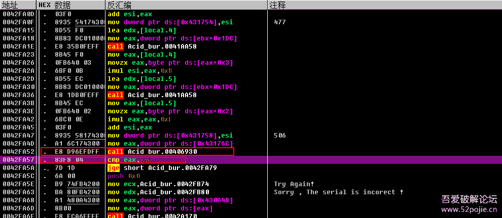
Snipaste_2022-04-21_16-31-34.png (25.93 KB, 下载次数: 1)
[href="forum.php?mod=attachment&aid=MjUxNTc4N3wwMDVmZDQyMXwxNzkzNTc1Njk2fDE2ODA4NnwxNjI1NTM0&nothumb=yes" target="_blank"](https://www.52pojie.cn/forum.php?mod=attachment&aid=MjUxNTc4N3wwMDVmZDQyMXwxNzkzNTc1Njk2fDE2ODA4NnwxNjI1NTM0&nothumb=yes)
2022-4-21 16:31 上传
前面好像是判断我们输入的账户是否大于4 如果小于4就直接跳失败（当然这个失败是小于4的失败，和序列号不正确的失败不一样）
如果有大佬分析过求告诉我前面那一堆到底是什么，我也没具体分析

## 总结

1、判断是否大于4 如果大于继续执行 如果小于等于直接报错
2、获取输入账户的第一个字符的`ascii`码值 然后乘以`29` 再将结果相加一遍 然后在拼起来
我们可以写注册机了


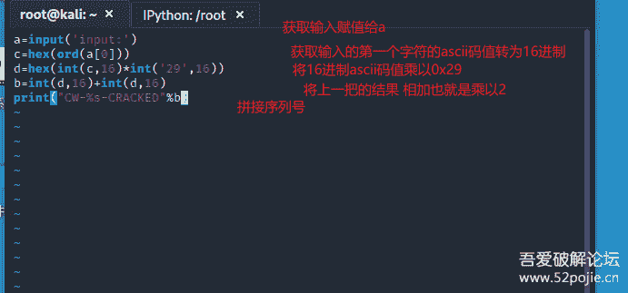

python代码.png (63.81 KB, 下载次数: 2)

[href="forum.php?mod=attachment&aid=MjUxNTc4OXw4YjYyZGU3NXwxNzkzNTc1Njk2fDE2ODA4NnwxNjI1NTM0&nothumb=yes" target="_blank"](https://www.52pojie.cn/forum.php?mod=attachment&aid=MjUxNTc4OXw4YjYyZGU3NXwxNzkzNTc1Njk2fDE2ODA4NnwxNjI1NTM0&nothumb=yes)

2022-4-21 16:39 上传

[Python] 纯文本查看 复制代码

```
a=input('input:')
c=hex(ord(a[0]))
d=hex(int(c,16)*int('29',16))
b=int(d,16)+int(d,16)
print("CW-%s-CRACKED"%b)
```

我们生成一个 52pojie的注册码试试

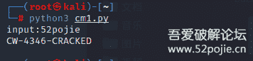

结果.png (18.3 KB, 下载次数: 2)

[href="forum.php?mod=attachment&aid=MjUxNTc5MHxiMTQ4ODVhNnwxNzkzNTc1Njk2fDE2ODA4NnwxNjI1NTM0&nothumb=yes" target="_blank"](https://www.52pojie.cn/forum.php?mod=attachment&aid=MjUxNTc5MHxiMTQ4ODVhNnwxNzkzNTc1Njk2fDE2ODA4NnwxNjI1NTM0&nothumb=yes)

2022-4-21 16:41 上传

成了


Snipaste_2022-04-21_16-43-01.png (76.2 KB, 下载次数: 2)

[href="forum.php?mod=attachment&aid=MjUxNTc5MXxiZmE5NjdjOXwxNzkzNTc1Njk2fDE2ODA4NnwxNjI1NTM0&nothumb=yes" target="_blank"](https://www.52pojie.cn/forum.php?mod=attachment&aid=MjUxNTc5MXxiZmE5NjdjOXwxNzkzNTc1Njk2fDE2ODA4NnwxNjI1NTM0&nothumb=yes)

2022-4-21 16:42 上传

下面那个等等在搞吧 让我休息一下。。。

推荐个小程序是yyhd大佬写的

玩玩[//www.52pojie.cn" target="_blank" class="relatedlink"](https://www.52pojie.cn:href="https)番外篇1—快速分析汇编代码

[//www.52pojie.cn/thread-1623016-1-1.html" target="_blank"](https://www.52pojie.cn/thread-1623016-1-1.html:href="https)

(出处: [//www.52pojie.cn" target="_blank" class="relatedlink"](https://www.52pojie.cn:href="https)论坛)

这里面有个附件 汇编自动翻译小助手，很不错，遇到不懂的可以直接粘贴进去让他翻译

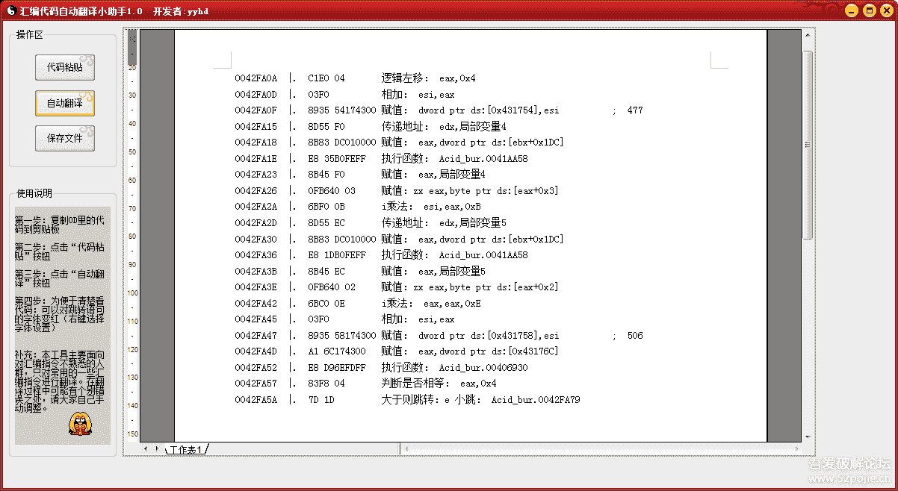

Snipaste_2022-04-21_16-49-03.png (53.54 KB, 下载次数: 2)

[href="forum.php?mod=attachment&aid=MjUxNTc5Mnw1Y2IyZWE0OHwxNzkzNTc1Njk2fDE2ODA4NnwxNjI1NTM0&nothumb=yes" target="_blank"](https://www.52pojie.cn/forum.php?mod=attachment&aid=MjUxNTc5Mnw1Y2IyZWE0OHwxNzkzNTc1Njk2fDE2ODA4NnwxNjI1NTM0&nothumb=yes)

2022-4-21 16:48 上传
